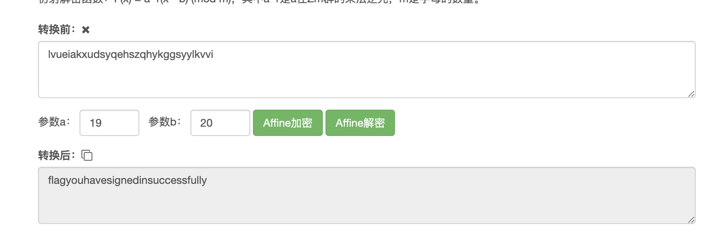
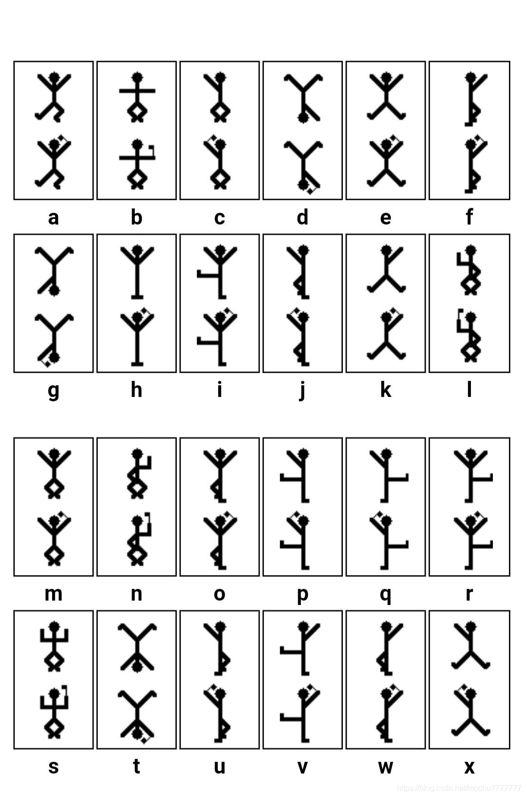
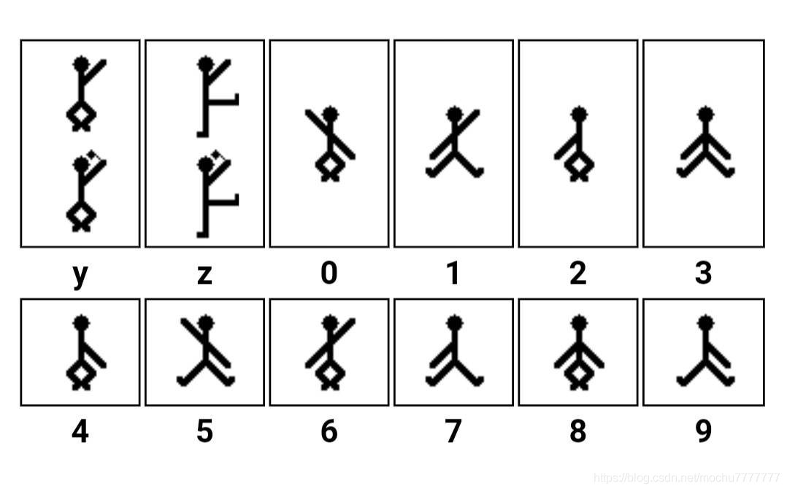
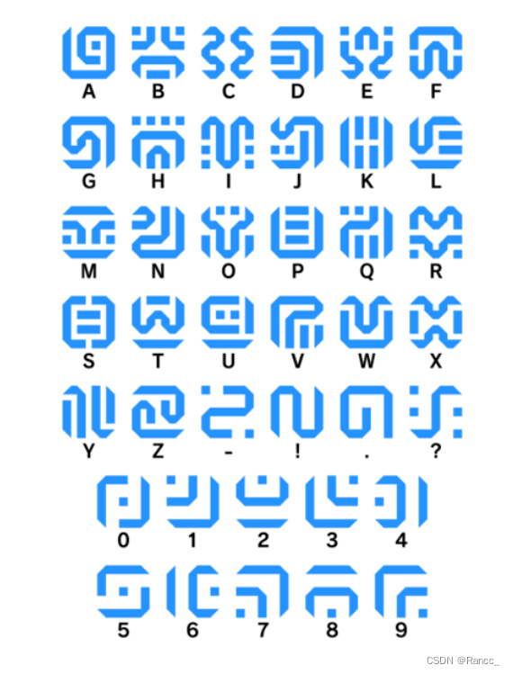

# Crypto

## 密文解码

- 如果看起来像 base，可能是多层嵌套 base，用其他软件解可能都会报错，这时选择 [basetrack](####basetrack) 自动接码 (有的非标准格式的 base 编码应该用 basetrack 来解)
- 如果遇到不认识的密码，长得像 base64 又不是 base 系列，可以考虑 [Rabbit](#Rabbit) 。除此之外，如果这段密文很长，还可能是[图片的 base64](####base64 转图片) (TomatoTools 识别不了)
- 关于10进制和16进制
  - 如果遇到一串10进制编码，一般可以先转为16进制，再看看16进制是不是图片 (复制到 hex 中保存)。此外，十进制还可能表示 ascci 码，使用[脚本](####特殊情况：16进制/10进制/2进制 偏移后的字符串转 flag)还原 flag
  - 看到 16 进制（如 `d43963e92b012aab` 可以联想到反查 md5 [通过在线网站查询]，题目出的 md5 一般不难，还可以[碰撞](#####通用碰撞模版)）
  - 如果上面两种方法得到的16进制都不能转换，可以考虑题目是否对 ascci 码做了偏移，使用[脚本](####特殊情况：16进制/10进制/2进制 偏移后的字符串转 flag)还原 flag（**注意**：只要确认这个字符串不是图片或 md5，直接使用该脚本即可，该脚本已经完善为 10进制、16进制转 unicode 字符串的**通用脚本**）
  - 如果是这种有空格的10进制 `33 43 43 13 44 21 54 34 45 21 24 33 14 21 31 11 22 12 54 44 11 35 13 34 14 15`，应该想到 [Tap Code](####Tap Code)
- 不要相信 TomatoTools 中文本框里复制出的内容，所见不一定是所得。建议复制到备忘录后，再复制一次
- 看到 flag 顺序是乱的（如 `fa{hsi_refa}lgti_stu_lg`），不止要想到凯撒密码，还要想到栅栏密码
- 如果题目中提示有两个密钥，如 `19_20`，要联想到是[仿射密码](####仿射密码)

### ciphey
> 先尝试 ciphey -t "Encrypted input"

另外，如果能看出密钥，这种可能使用 AES 算法

### 进制转换

#### 10进制转其他

如需转回十进制，用 int(text)

##### 10进制转16进制

- 注意这种转换和 assci 码转换的区别，编码方式不同导致结果不同

```python
hex(3207357)
```

Python 中16进制以 `0x` 开头，如需去掉，请执行

```python
hex(3207357)[2:]
```

##### 10进制转2进制

```python
bin(3207357)
```

##### 10进制转8进制

```python
oct(3207357)
```

#### 特殊情况：16进制/10进制/2进制 偏移后的字符串转 flag

- 我已经将该脚本完善为一个**通用脚本**，支持 2进制/10进制/16进制 **直接转换**为 unicode 字符串，同时支持按 **最后一个字符和  '}' 的偏移**来转换

- 这种情况直接将 16进制/10进制 转为 unicode 字符串会导致不可读，CTF-Tools 也识别不了，所以使用下面的脚本实现

有的题目得到的16进制或10进制，是经过 ascci 码偏移后的值，这里会计算 最后一个元素的 asscii 与 '}' 的 ascci 的差值，达到自动还原 flag 的目的。（因为 flag 字符串的最后一个元素往往是 '}'）

```python
# 此处不但支持16进制，还支持10进制和2进制，程序会自动判断
text = 'c8e9aca0c3f4e6e5f2a1a0d4e8e5a0e6ece1e7a0e9f3baa0e6ece1e7fbf7e5e6e5efe9e4eae7efe5e4f3e6e9eff2f0e5e6e4e6e7e7e6e4f3e5fd'

def format_hex(hex_str: str):
    '''
        将16进制转为8位一个整体，中间加空格
    '''
    result = ''
    for i in range(0, len(hex_str), 2):
        result += hex_str[i:i+2] + ' '
    result = result.rstrip(' ')
    return result


def hex_to_str(hex_str: str):
    hex_list = hex_str.split(' ')
    reslut = ''
    for one in hex_list:
        reslut += chr(int(one, 16))
    return reslut


def hex_to_str_flag(hex_str: str):
    '''
        16进制转 ascii 码，并寻找移位的 flag
        （这里假设该字符串最后一位一定是 '}' ）
    '''
    hex_list = hex_str.split(' ')
    # 转为10进制
    int_list = []
    for one in hex_list:
        int_list.append(int(one, 16))
    
    # 分析 最后一个字符 和 '}' 的差值
    diff = ord('}') - int_list[-1]
    # 得到 flag
    flag = ''
    for one in int_list:
        flag += chr(one + diff)
    
    return flag


def hex_conversion(hex_str):
    # 先分离为8位一组
    hex_str = format_hex(hex_str)
    
    # 获取未偏移的 ascci 码
    result = hex_to_str(hex_str)
    print(f'直接转换:{result}')
    # 获取偏移值
    try:
        flag = hex_to_str_flag(hex_str)
        print(f'偏移后转换:{flag}')
    except:
        print('无法偏移转换')


def main():
    global text
    # 将16进制或10进制中间的空格去掉
    text = text.replace(' ', '')
    
    hex_10_str = None
    hex_2_str = None
    
    # 如果是10进制，先转为16进制
    if text.isdigit():
        i = 0
        hex_10_str = ''
        while(i<len(text)):
            if int(text[i:i+2])>=32:
                hex_10_str=hex_10_str+hex(int(text[i:i+2]))[2:]
                i+=2
            else:
                hex_10_str=hex_10_str+hex(int(text[i:i+3]))[2:]
                i+=3
        print(f'10进制转16进制:{hex_10_str}')
        
    # 如果是2进制，先转为16进制
    if all(c in '01' for c in text):
        decimal = int(text, 2)
        hex_2_str = hex(decimal)[2:]
        print(f'2进制转16进制:{hex_2_str}')
    
    if hex_10_str:
        print('\n当字符串是10进制时:')
        print('请注意，该方法只尝试了将10进制按ascci编码转为16进制。\
              如果未得到flag，还应该尝试10进制直接转16进制，并观察是否是图片')
        hex_conversion(hex_10_str)
    if hex_2_str:
        print('\n当字符串是2进制时:')
        hex_conversion(hex_2_str)
    if not hex_10_str and not hex_2_str:
        print('当字符串是16进制时:')
        hex_str = text
        hex_conversion(hex_str)
    

if __name__ == '__main__':
    main()
```

### base 格式

- 看到很长一串，可能是图片的 base64

- 有一些多层嵌套的 base 编码，TomatoTools 识别不了，但是可以用 basetrack 识别 (用 magic 模式)

#### basetrack

**普通解码**
```bash
python3 basecrack.py -b 编码文本
```

**自动解码**

```bash
python basecrack.py --magic -b 编码文本
```

#### base64 转图片

https://tool.jisuapi.com/base642pic.html

本地转换方法:

```python
import base64
from PIL import Image
from io import BytesIO

def base64_to_image(base64_str, image_path):
    # 如果 base64 字符串不是 4 的倍数，添加等号
    padding = len(base64_str) % 4
    if padding:
        base64_str += "=" * (4 - padding)

    # 将 base64 字符串解码为二进制数据
    base64_data = base64.b64decode(base64_str)

    # 使用 PIL 库将二进制数据转换为图像
    image = Image.open(BytesIO(base64_data))

    # 保存图像
    image.save(image_path)

# 这里替换为你的 base64 字符串 (由于长度限制，此处不能通过终端输入，只能写在 py 文件里或读文件)
base64_str = '...'
image_path = 'output.png'  # 输出的图片路径
base64_to_image(base64_str, image_path)
```

### Hash

- MD5算法生成的哈希值通常以16进制的形式表示。这是因为MD5算法生成的原始结果是一个128位的二进制数，这个数包含的信息量非常大，如果直接以二进制或者十进制的形式表示，将会非常长。因此，通常会将这个二进制数转换为16进制来表示，这样可以大大减少表示的长度。一个128位的二进制数可以转换为一个32位的16进制数，这就是我们通常看到的MD5哈希值的形式。
- 有一些 hash 碰撞题目给的条件很多，实际并不难。按题目给的条件编写碰撞代码，简单地遍历数字即可得到结果

#### Hash 类 (md5) 密文在线解密

https://www.cmd5.com/

上面的地址有时候要收费，下面这个是免费的

https://www.somd5.com/

#### MD5 碰撞

##### 通用碰撞模版

```python
import hashlib


def main():
    for i in range(100000):
        token = hashlib.md5(str(i).encode()).hexdigest()
        # 筛选符合碰撞规则的 md5 值
        if token[-6:] == '8b184b':
            print(i)
            print(token)
            break


if __name__ == '__main__':
    main()
```

##### 普通碰撞套路示例

（这只是一个示例提示，这段代码不重要，以上一个模版为准）

有一些 hash 碰撞题目给的条件很多，实际并不难。按题目给的条件编写碰撞代码，简单地遍历数字即可得到结果，例如：

```python
import hashlib


# if 语句的内容是例题给出的特殊条件
def main():
    for i in range(100000):
        token = hashlib.md5(str(i).encode()).hexdigest()
        if token[1] == token[14] and token[14] == token[17]:
            if (int(token[1], 16) + int(token[14], 16) + int(token[17], 16)) / int(token[1], 16) == int(token[31], 16):
                print(i)
                break


if __name__ == '__main__':
    main()
```

##### 带前缀的 MD5 碰撞

运行以下脚本，解得后缀

```python
import hashlib # 建立爆破的字典data 


def main():
    prefix = 'ctfshow' # 自定义前缀
    
    data='abcdefghijklmnopqrstuvwxyzABCDEFGHIJKLMNOPQRSTUVWXYZ1234567890+-*/' # 从一个字符开始尝试，逐渐往下加 
    for i in data: 
        for j in data : 
            for k in data: 
                s = hashlib.md5((prefix+i+j+k).encode()).hexdigest() 
                if s == 'a6f57ae38a22448c2f07f3f95f49c84e':#判断值是否符合条件 
                    print(i + j + k) # 输出字符c的值 脚本输出36d 构造payload: ?c=36d 


if __name__ == '__main__':
    main()
```

##### MD5 强碰撞（Python 和 PHP ===）

###### Python

```python
import hashlib


def main():
    # 第一个字符串
    str1 = "d131dd02c5e6eec4693d9a0698aff95c2fcab58712467eab4004583eb8fb7f8955ad340609f4b30283e488832571415a085125e8f7cdc99fd91dbdf280373c5bd8823e3156348f5bae6dacd436c919c6dd53e2b487da03fd02396306d248cda0e99f33420f577ee8ce54b67080a80d1ec69821bcb6a8839396f9652b6ff72a70"

    # 第二个字符串
    str2 = "d131dd02c5e6eec4693d9a0698aff95c2fcab50712467eab4004583eb8fb7f8955ad340609f4b30283e4888325f1415a085125e8f7cdc99fd91dbd7280373c5bd8823e3156348f5bae6dacd436c919c6dd53e23487da03fd02396306d248cda0e99f33420f577ee8ce54b67080280d1ec69821bcb6a8839396f965ab6ff72a70"

    # 计算第一个字符串的MD5哈希值
    hash1 = hashlib.md5(bytes.fromhex(str1)).hexdigest()

    # 计算第二个字符串的MD5哈希值
    hash2 = hashlib.md5(bytes.fromhex(str2)).hexdigest()

    print(hash1 == hash2)
    

if __name__ == '__main__':
    main()
```

###### PHP

原版

```php
<?php

// 第一个字符串
$str1 = "d131dd02c5e6eec4693d9a0698aff95c2fcab58712467eab4004583eb8fb7f8955ad340609f4b30283e488832571415a085125e8f7cdc99fd91dbdf280373c5bd8823e3156348f5bae6dacd436c919c6dd53e2b487da03fd02396306d248cda0e99f33420f577ee8ce54b67080a80d1ec69821bcb6a8839396f9652b6ff72a70";

// 第二个字符串
$str2 = "d131dd02c5e6eec4693d9a0698aff95c2fcab50712467eab4004583eb8fb7f8955ad340609f4b30283e4888325f1415a085125e8f7cdc99fd91dbd7280373c5bd8823e3156348f5bae6dacd436c919c6dd53e23487da03fd02396306d248cda0e99f33420f577ee8ce54b67080280d1ec69821bcb6a8839396f965ab6ff72a70";

// 计算第一个字符串的MD5哈希值
$hash1 = md5(hex2bin($str1));

// 计算第二个字符串的MD5哈希值
$hash2 = md5(hex2bin($str2));

echo $hash1 === $hash2;

?>
```

Web 优化版

这里利用了 url 编码，以便传至网页

```php
<?php

// 第一个字符串
$str1 = "%D11%DD%02%C5%E6%EE%C4i%3D%9A%06%98%AF%F9%5C%2F%CA%B5%87%12F%7E%AB%40%04X%3E%B8%FB%7F%89U%AD4%06%09%F4%B3%02%83%E4%88%83%25qAZ%08Q%25%E8%F7%CD%C9%9F%D9%1D%BD%F2%807%3C%5B%D8%82%3E1V4%8F%5B%AEm%AC%D46%C9%19%C6%DDS%E2%B4%87%DA%03%FD%029c%06%D2H%CD%A0%E9%9F3B%0FW%7E%E8%CET%B6p%80%A8%0D%1E%C6%98%21%BC%B6%A8%83%93%96%F9e%2Bo%F7%2Ap";

// 第二个字符串
$str2 = "%D11%DD%02%C5%E6%EE%C4i%3D%9A%06%98%AF%F9%5C%2F%CA%B5%07%12F%7E%AB%40%04X%3E%B8%FB%7F%89U%AD4%06%09%F4%B3%02%83%E4%88%83%25%F1AZ%08Q%25%E8%F7%CD%C9%9F%D9%1D%BDr%807%3C%5B%D8%82%3E1V4%8F%5B%AEm%AC%D46%C9%19%C6%DDS%E24%87%DA%03%FD%029c%06%D2H%CD%A0%E9%9F3B%0FW%7E%E8%CET%B6p%80%28%0D%1E%C6%98%21%BC%B6%A8%83%93%96%F9e%ABo%F7%2Ap";

$str1 = urldecode($str1);
$str2 = urldecode($str2);

echo md5($str1) === md5($str2);

?>
```


### RSA

#### 原理

##### 公钥与私钥的产生

1. **密钥生成**：首先，选择两个大质数 p 和 q，然后计算它们的乘积 n。n 就是公钥和私钥的一部分。然后计算 φ(n)（也就是 n 的欧拉函数，等于 (p-1)(q-1)）。接着，选择一个整数 e，使得 e 和 φ(n) 是互质的（即 e 和 φ(n) 的最大公约数是 1），并且 1 < e < φ(n)。**公钥**就是 (n, e)。然后，计算一个数 d，使得 (d * e) % φ(n) = 1。**私钥**就是 (n, d)。
2. **加密**：假设有一个消息 m，我们要用公钥 (n, e) 进行加密。计算 c = m^e % n。这里的 c 就是加密后的消息。
3. **解密**：使用私钥 (n, d) 来解密消息。计算 m = c^d % n。这里的 m 就是解密后的原始消息。

RSA 的安全性基于一个事实：虽然 n、e 和 c 都是公开的，但是如果没有 d，很难从 c 计算出 m。而要计算出 d，就需要将 n 分解成 p 和 q，这是一个已知的困难问题，特别是当 p 和 q 都非常大的时候。因此，只要保护好私钥，RSA 加密就是安全的。

总的来说，RSA 算法的公钥和私钥原理基于大数因子分解的困难性，以及模运算和欧拉函数的性质。

#### 题型

##### 已知 p,q,e 求 d

p=447685307 q=2037 e=17

提交flag{d}即可

```python
import gmpy2


def main():
    p = 447685307
    q = 2037
    n = (p - 1)*(q - 1)
    e = 17
    
    print(gmpy2.invert(e, n))
    
    
if __name__ == '__main__':
    main()
```

- `gmpy2.invert(e, n)` 是一个函数，用于计算模逆元。在数学中，对于模 n 的运算，整数 a 的逆元是一个整数 b，使得 (d * e) % n = 1。也就是说，e 是 d 在模 n 下的乘法逆元。

  在你的代码中，`gmpy2.invert(e, n)` 计算的是 e 在模 n 下的乘法逆元。在 RSA 加密算法中，这个逆元对应的就是私钥中的 d。这样，对于公钥 (n, e) 和私钥 (n, d)，我们有 (d * e) % n = 1，这是 RSA 算法的一个关键性质。


##### 已知 e,p,q,c 求 明文 m

```python
import gmpy2
import binascii


def main():
    e = 65537
    p = 104046835712664064779194734974271185635538927889880611929931939711001301561682270177931622974642789920918902563361293345434055764293612446888383912807143394009019803471816448923969637980671221111117965227402429634935481868701166522350570364727873283332371986860194245739423508566783663380619142431820861051179
    q = 140171048074107988605773731671018901813928130582422889797732071529733091703843710859282267763783461738242958098610949120354497987945911021170842457552182880133642711307227072133812253341129830416158450499258216967879857581565380890788395068130033931180395926482431150295880926480086317733457392573931410220501
    c = 4772758911204771028049020670778336799568778930072841084057809867608022732611295305096052430641881550781141776498904005589873830973301898523644744951545345404578466176725030290421649344936952480254902939417215148205735730754808467351639943474816280980230447097444682489223054499524197909719857300597157406075069204315022703894466226179507627070835428226086509767746759353822302809385047763292891543697277097068406512924796409393289982738071019047393972959228919115821862868057003145401072581115989680686073663259771587445250687060240991265143919857962047718344017741878925867800431556311785625469001771370852474292194

    n = (p-1)*(q-1)
    d = gmpy2.invert(e, n)
    # 使用私钥 d 对密文 c 进行解密
    m = gmpy2.powmod(c, d, p*q)

    print(binascii.unhexlify(hex(m)[2:]).decode())
    

if __name__ == '__main__':
    main()
```

- 这段代码的主要步骤如下：

  1. 定义 RSA 的公钥部分 `e`（公开指数）和私钥部分 `p` 和 `q`（两个大质数的乘积）。这里 `e` 是常用的值 65537。
  2. 计算 `n`，它是 `p` 和 `q` 减去 1 的乘积。在 RSA 算法中，`n` 通常是 `p` 和 `q` 的乘积，但在这里，我们需要计算 `(p-1)*(q-1)` 来作为模逆运算的参数。
  3. 计算私钥 `d`，它是 `e` 相对于 `n` 的模逆。模逆是一个数学运算，它找到一个数，使得该数和另一个数的乘积对一个模数取模后等于 1。在这里，`d` 是满足 `e * d ≡ 1 (mod n)` 的数。
  4. 使用私钥 `d` 对密文 `c` 进行解密。这是通过模幂运算完成的，这是一个数学运算，它计算一个数的幂次对一个模数取模的结果。在这里，`m = c^d mod (p*q)` 是解密的明文。
  5. 最后，将解密后的明文 `m` 从十六进制转换为 ASCII 字符串，并打印出来。这假设原始的明文是一个 ASCII 字符串。

  总的来说，这段代码就是实现了 RSA 解密的过程，将密文解密回原始的明文。

### TomatoTools 来识别编码

备用工具: CTF-Tools

#### 问题
- 软件的 base58、base91 有问题。[base91](https://www.dcode.fr/base-91-encoding)
- Brainfuck 有问题

### CTF-Tools 识别编码

可以批量尝试不同的解密方式

### 肉眼识别密文类型

#### 摩斯电码

形如

```
-- --- .-. ... . ..--.- .. ... ..--.- -.-. --- --- .-.. ..--.- -... ..- - ..--.- -... .- -.-. --- -. ..--.- .. ... ..--.- -.-. --- --- .-.. . .-. ..--.- -- -- -.. -.. -- -.. -- -.. -- -- -- -.. -.. -.. /-- -.. -- -.. -.. --/ -- -- -- -- -- /-- -.. -.. -- -.. -- /-- -.. -.. -- 
```

如果工具解不开，直接用 ciphey 解就行了（自动去斜杠）

#### 栅栏密码

形如

```
(不是标准格式) fg2ivyo}l{2s3_o@aw__rcl@

再来一个 KYdf0a3ebd5c4dc160-E{fb63ee0298b8f4d8}
```


#### 培根密码

解密地址 http://www.metools.info/code/bacon193.html

形如 

```
AABBBABBA
```


如果遇到类似培根密码的形式，如 MMDDMDMDMMMDDDMDMDDMMMMMMMDDMDMMDDM ，需要转为 AB 形式，快捷脚本:

```python
data = {
    'M': 'A',
    'D': 'B'
}

text = ''
for i in 'MMDDMDMDMMMDDDMDMDDMMMMMMMDDMDMMDDM':
    text+= data[i]
    
print(text)
```


#### 社会主义核心价值观加密/解密
形如 

```
公正公正公正诚信文明公正民主公正法治法治友善平等和谐敬业和谐富强和谐富强和谐文明和谐平等公正公正和谐法治公正公正公正文明和谐民主和谐敬业和谐平等和谐敬业和谐敬业和谐和谐和谐公正法治友善法治
```


#### "奇特"（esoteric）编程语言

Brainfuck 和 Ook! 都是所谓的"奇特"（esoteric）编程语言，这种编程语言通常是为了探索编程语言设计的边界，或者仅仅是为了娱乐。这两种语言都是图灵完备的，这意味着它们可以被用来实现任何可计算的问题（只要给予足够的时间和存储空间）。

Brainfuck 是由 Urban Müller 在 1993 年创造的，它只有 8 个简单的命令和一个字节的数组。这使得 Brainfuck 语言非常简洁，但同时也非常难以阅读和编写。

Ook! 是由 David Morgan-Mar 创造的，它是 Brainfuck 的一个变体，设计的目标是为 orangutans（猩猩）设计一种编程语言。Ook! 的语法和 Brainfuck 完全相同，只是将 Brainfuck 的八个命令分别替换为了 "Ook."、"Ook?" 和 "Ook!" 的三个词组的八种不同组合。因此，任何在 Brainfuck 中编写的程序都可以直接转换为 Ook!，反之亦然。

总的来说，Brainfuck 和 Ook! 的关系在于，Ook! 是 Brainfuck 的一个直接变体，它们在语法上完全相同，只是命令的表示方式不同。

自动识别并解密 Brainfuck 和 Ook! 的脚本:

```python
# 只需要修改此值，自动识别 Brainfuck 和 ook
text = '''Ook. Ook. Ook. Ook. Ook. Ook. Ook. Ook. Ook. Ook. Ook. Ook. Ook. Ook. Ook.
Ook. Ook. Ook. Ook. Ook. Ook! Ook? Ook! Ook! Ook. Ook? Ook. Ook. Ook. Ook.
Ook. Ook. Ook. Ook. Ook. Ook. Ook. Ook. Ook. Ook. Ook. Ook. Ook. Ook. Ook.
Ook. Ook? Ook. Ook? Ook! Ook. Ook? Ook. Ook. Ook. Ook. Ook! Ook. Ook. Ook.
Ook. Ook. Ook. Ook. Ook. Ook. Ook. Ook. Ook. Ook. Ook! Ook. Ook? Ook. Ook.
Ook. Ook. Ook. Ook. Ook. Ook! Ook? Ook! Ook! Ook. Ook? Ook! Ook! Ook! Ook!
Ook! Ook! Ook? Ook. Ook? Ook! Ook. Ook? Ook! Ook! Ook! Ook! Ook! Ook. Ook.
Ook. Ook. Ook. Ook. Ook. Ook. Ook. Ook. Ook. Ook. Ook. Ook! Ook. Ook? Ook.
Ook. Ook. Ook. Ook. Ook. Ook. Ook. Ook. Ook! Ook? Ook! Ook! Ook. Ook? Ook.
Ook. Ook. Ook. Ook. Ook. Ook. Ook. Ook? Ook. Ook? Ook! Ook. Ook? Ook. Ook.
Ook. Ook. Ook. Ook. Ook. Ook. Ook! Ook. Ook? Ook. Ook. Ook. Ook. Ook. Ook.
Ook. Ook! Ook? Ook! Ook! Ook. Ook? Ook! Ook! Ook! Ook! Ook! Ook! Ook? Ook.
Ook? Ook! Ook. Ook? Ook! Ook! Ook! Ook! Ook! Ook! Ook! Ook. Ook! Ook. Ook!
Ook! Ook! Ook! Ook! Ook! Ook! Ook! Ook! Ook. Ook? Ook. Ook. Ook. Ook. Ook.
Ook. Ook. Ook. Ook. Ook! Ook? Ook! Ook! Ook. Ook? Ook. Ook. Ook. Ook. Ook.
Ook. Ook. Ook. Ook? Ook. Ook? Ook! Ook. Ook? Ook. Ook. Ook. Ook. Ook! Ook.
Ook? Ook. '''


def decode(code, translation):
    return ''.join(translation[code[i:i+9]] for i in range(0, len(code), 9))

def run_brainfuck(code):
    code = [c for c in code if c in ['<', '>', '+', '-', '.', ',', '[', ']']]
    memory = [0] * 30000
    pc = 0  # Program counter
    ptr = 0  # Data pointer
    stack = []
    output = []
    while pc < len(code):
        cmd = code[pc]
        if cmd == '>':
            ptr += 1
        elif cmd == '<':
            ptr -= 1
        elif cmd == '+':
            memory[ptr] = (memory[ptr] + 1) % 256
        elif cmd == '-':
            memory[ptr] = (memory[ptr] - 1) % 256
        elif cmd == '.':
            output.append(chr(memory[ptr]))
        elif cmd == ',':
            memory[ptr] = ord(input())
        elif cmd == '[':
            if memory[ptr] == 0:
                bracket_count = 1
                while bracket_count != 0:
                    pc += 1
                    if code[pc] == '[':
                        bracket_count += 1
                    elif code[pc] == ']':
                        bracket_count -= 1
            else:
                stack.append(pc)
        elif cmd == ']':
            if memory[ptr] == 0:
                stack.pop()
            else:
                pc = stack[-1] - 1
        pc += 1
    return ''.join(output)

def run_ook(code):
    OOK_COMMANDS = {
        'Ook. Ook?': '>',
        'Ook? Ook.': '<',
        'Ook. Ook.': '+',
        'Ook! Ook!': '-',
        'Ook! Ook.': '.',
        'Ook. Ook!': ',',
        'Ook! Ook?': '[',
        'Ook? Ook!': ']',
    }
    bf_code = ''
    ook_commands = code.split()
    for i in range(0, len(ook_commands), 2):
        bf_code += OOK_COMMANDS[ook_commands[i] + ' ' + ook_commands[i+1]]
    return run_brainfuck(bf_code)


def main():
    # 测试 Brainfuck 代码
    try:
        brainfuck_text = run_brainfuck(text)
        print(f'Brainfuck 解密结果:{brainfuck_text}')
    except:
        print('Brainfuck 解密失败')
    # 测试 ook 代码
    try:
        ook_text = run_ook(text)
        print(f'ook 解密结果:{ook_text}')
    except:
        print('ook 解密失败')

if __name__ == '__main__':
    main()
```
##### ook

遇到类似的，可能把 Ook 替换为了其他字母，要能反应过来是 ook 密码

形如

```
Ook. Ook. Ook. Ook. Ook. Ook. Ook. Ook. Ook. Ook. Ook.
```

解密地址 https://www.splitbrain.org/services/ook (选择 Ook! to Text)

##### Brainfuck

形如

```
+++++ +++++ [->++ +++++ +++<] >++.+ +++++ .<+++ [->-- -<]>- -.+++ +++.<
++++[ ->+++ +<]>+ +++.< +++++ +++[- >---- ----< ]>--. .--.- -.-.- --.-.
+++++ +..-- -..<+ +++++ +[->+ +++++ +<]>+ +.<++ ++++[ ->--- ---<] >----
----- .---- -.<++ ++++[ ->+++ +++<] >++++ +++++ +++.< +++++ ++[-> -----
--<]> .++.- ----. <++++ +++[- >++++ +++<] >+++. --.<+ +++++ [->-- ----<
]>--- ----- ---.+ .<+++ +++[- >++++ ++<]> +++++ +++++ ++.<+ +++++ [->--
----< ]>--- ----- ---.- .++++ .<+++ +++[- >++++ ++<]> +++++ +++.< +++++
+[->- ----- <]>-- ----- ---.- ----- .++++ +++++ .---- ----. <++++ ++[->
+++++ +<]>+ +++++ +++++ +.<++ +++[- >++++ +<]>+ ++.<
```

解密地址 https://www.splitbrain.org/services/ook (选择 Brainfuck to Text)

#### 猪圈密码

形如下图


解密地址 http://www.metools.info/code/c90.html

#### Baudot Code

形如

```
11001 00011 00111 01001 11011  10110 11111  10000 01110 11011  10110 11111  01001 00001
```

解密地址 https://www.boxentriq.com/code-breaking/baudot-code

#### html 的编码样子
形如

```
&#x66;&#x6c;&#x61;
```

#### jsfuck

形如

```
[][(![]+[])[+[]]+([![]]+[][[]])[+!+[]+[+[]]]+(![]+[])[!+[]+!+[]]+(![]+[])[!+[]+!+[]]][([][(![]+[])[+[]]+([![]]+[][[]])[+!+[]+[+[]]]+(![]+[])[!+[]+!+[]]+(![]+[])[!+[]+!+[]]]+[])[!+[]+!+[]+!+[]]+(!![]+[][(![]+[])[+[]]+([![]]+[][[]])[+!+[]+[+[]]]+(![]+[])[!+[]+!+[]]+(![]+[])[!+[]+!+[]]])[+!+[]+[+[]]]+([][[]]+[])[+!+[]]+(![]+[])[!+[]+!+[]+!+[]]+(!![]+[])[+[]]+(!![]+[])[+!+[]]+([][[]]+[])[+[]]+([][(![]+[])[+[]]+([![]]+[][[]])[+!+[]+[+[]]]+(![]+[])[!+[]+!+[]]+(![]+[])[!+[]+!+[]]]+[])[!+[]+!+[]+!+[]]+(!![]+[])[+[]]+(!![]+[][(![]+[])[+[]]+([![]]+[][[]])[+!+)])
```

```
ﾟωﾟﾉ= /｀ｍ´）ﾉ ~┻━┻   //*´∇｀*/ ['_']; o=(ﾟｰﾟ)  =_=3; c=(ﾟΘﾟ) =(ﾟｰﾟ)-(ﾟｰﾟ); (ﾟДﾟ) =(ﾟΘﾟ)= (o^_^o)/ (o^_^o);(ﾟДﾟ)={ﾟΘﾟ: '_' ,ﾟωﾟﾉ : ((ﾟωﾟﾉ==3) +'_') [ﾟΘﾟ] ,ﾟｰﾟﾉ :(ﾟωﾟﾉ+ '_')[o^_^o -(ﾟΘﾟ)] ,ﾟДﾟﾉ:((ﾟｰﾟ==3) +'_')[ﾟｰﾟ] }; (ﾟДﾟ) [ﾟΘﾟ] =((ﾟωﾟﾉ==3) +'_') [c^_^o];(ﾟДﾟ) ['c'] = ((ﾟДﾟ)+'_') [ (ﾟｰﾟ)+(ﾟｰﾟ)-(ﾟΘﾟ) ];(ﾟДﾟ) ['o'] = ((ﾟДﾟ)+'_') [ﾟΘﾟ];(ﾟoﾟ)=(ﾟДﾟ) ['c']+(ﾟДﾟ) ['o']+(ﾟｰﾟ)+ ((o^_^o) +(o^_^o))+ (ﾟДﾟ)[ﾟεﾟ]+(ﾟΘﾟ)+ (ﾟｰﾟ)+ (ﾟΘﾟ)+ (ﾟДﾟ)[ﾟεﾟ]+(ﾟΘﾟ)+ (o^_^o)+ ((ﾟｰﾟ) + (o^_^o))+ (ﾟДﾟ)[ﾟεﾟ]+(ﾟΘﾟ)+ ((ﾟｰﾟ) + (ﾟΘﾟ))+ (c^_^o)+ (ﾟДﾟ)[ﾟεﾟ]+(ﾟΘﾟ)+ (ﾟｰﾟ)+ (ﾟΘﾟ)+ (ﾟДﾟ)[ﾟεﾟ]+(ﾟΘﾟ)+ ((ﾟｰﾟ) + (ﾟΘﾟ))+ ((ﾟｰﾟ) + (o^_^o))+ (ﾟДﾟ)[ﾟεﾟ]+(ﾟΘﾟ)+ ((ﾟｰﾟ) + (o^_^o))+ ((ﾟｰﾟ) + (ﾟΘﾟ))+ (ﾟДﾟ)[ﾟεﾟ]+(ﾟｰﾟ)+ ((o^_^o) - (ﾟΘﾟ))+ (ﾟДﾟ)[ﾟεﾟ]+((ﾟｰﾟ) + (ﾟΘﾟ))+ (ﾟΘﾟ)+ (ﾟДﾟ)[ﾟεﾟ]+((ﾟｰﾟ) + (o^_^o))+ (o^_^o)+ (ﾟДﾟ)[ﾟoﾟ]) (ﾟΘﾟ)) ('_');
```

复制到 F12 ，在控制台执行即可得到明文

#### **Rabbit**

形如 

```
U2FsdGVkX19mGsGlfI3nciNVpWZZRqZO2PYjJ1ZQuRqoiknyHSWeQv8ol0uRZP94
MqeD2xz+
```

```
U2FsdGVkX1/eK2855m8HM4cTq8Fquqtm6QDbcUu4F1yQpA==
```

需要一个密钥，在线解密地址: https://www.sojson.com/encrypt_rabbit.html

#### RC4

形如

```
U2FsdGVkX19uI2lzmxYrQ9mc16y7la7qc7VTS8gLaUKa49gzXPclxRXVsRJxWz/p
```

需要一个密钥，在线解密地址: https://www.sojson.com/encrypt_rc4.html

#### 音乐符号密文

形如

```
♭‖♭‖‖♯♭♭♬‖♩♫‖♬∮♭♭¶♭‖♯‖¶♭♭‖∮‖‖♭‖§♭‖♬♪♭♯§‖‖♯‖‖♬‖‖♪‖‖♪‖¶§‖‖♬♭♯‖♭♯♪‖‖∮‖♬§♭‖‖‖♩♪‖‖♬♭♭♬‖♩♪‖♩¶‖♩♪‖♩♬‖¶§‖‖♩‖¶♫♭♭♩‖♬♯‖♬§♭‖♭‖♩¶‖‖∮♭♭♬‖‖♭‖♫§‖¶♫‖♩∮♭♭§‖♭§‖♭§§=
```

在线解密地址: https://www.qqxiuzi.cn/bianma/wenbenjiami.php?s=yinyue

#### 数独密码

如下图


在线解密地址: https://shudu.gwalker.cn/

解得结果后，所有数字连接起来就是密码

#### emoji-aes

形如（需要密钥）

```
🙃💵🌿🎤🚪🌏🐎🥋🚫😆😍🥋🐘🍴🚰😍☀🌿😇😍😡🏎👉🛩🤣🖐💧☺🌉🏎😇😆🎈💧⏩☺🔄🌪⌨🐅🎅🙃🍌🙃🔪☂🏹🕹☃🌿🌉💵🐎🐍😇🍵😍🐅🎈🥋🚰✅🎈🎈
```

在线解密地址: https://aghorler.github.io/emoji-aes/

#### Tap Code

- Tap Code 只能是两位数为一组
- 遇到一道题，它在 Tap Code 中间插入了单独的1位数字 (如 `55 32 21 7 11 23 33 35 53 3 25 31 55 32 21 9 12 22 14 0 11 51 9 55 14 23 51 21 12 22 13`)，这时只需要解码 Tap Code，手动将1位数字插入进原来的位置即可

形如

```
33 43 43 13 44 21 54 34 45 21 24 33 14 21 31 11 22 12 54 44 11 35 13 34 14 15
```

在线工具: https://www.boxentriq.com/code-breaking/tap-code (如果是像例子中的数字，需要选择 `Numbers`) [如果不行，解码出来的字母可以全部转为大写再试试]

#### 仿射密码

- 如果题目中提示有两个密钥，如 `19_20`，要联想到是仿射密码



在线解密：http://www.metools.info/code/affinecipher183.html

#### Quoted-printable

形如

```
=E7=94=A8=E4=BD=A0=E9=82=A3=E7=81=AB=E7=83=AD=E7=9A=84=E5=98=B4=E5=94=87=E8=AE=A9=E6=88=91=E5=9C=A8=E5=8D=88=E5=A4=9C=E9=87=8C=E6=97=A0=E5=B0=BD=E7=9A=84=E9=94=80=E9=AD=82
```

解密脚本

```python
# Quoted-printable 编码的字符串
text = "=E7=94=A8=E4=BD=A0=E9=82=A3=E7=81=AB=E7=83=AD=E7=9A=84=E5=98=B4=E5=94=87=E8=AE=A9=E6=88=91=E5=9C=A8=E5=8D=88=E5=A4=9C=E9=87=8C=E6=97=A0=E5=B0=BD=E7=9A=84=E9=94=80=E9=AD=82"


import quopri

def decode_quopri(text):
    return quopri.decodestring(text).decode()

decoded_text = decode_quopri(text)
print(decoded_text)
```

#### 兽音密码

形如

```
~呜嗷嗷嗷嗷呜啊嗷啊呜呜嗷呜呜~嗷嗷~啊嗷啊呜嗷嗷~嗷~嗷~呜呜嗷呜啊嗷嗷嗷呜啊呜~啊呜嗷呜呜~嗷~~啊嗷啊呜嗷嗷~嗷~嗷~呜呜嗷呜~嗷嗷嗷呜啊嗷呜嗷呜嗷呜呜~嗷~~啊嗷啊呜嗷嗷~嗷~嗷~呜呜呜~嗷啊
```

在线解密: https://roar.iiilab.com/

#### EBCDIC

如果一个文件用 010 editor 打开有乱码内容，形如

```
摂m墷m卪倕ⅲm仈Z
```

解码方法：打开 010 editor，选择 tools，选择 convert，选择 convert to EBCDIC (使用后记得还原)

#### serpent

- 需要密钥，选择默认模式解密

Serpent是由Ross Anderson, Eli Biham, 和 Lars Knudsen在1998年为美国国家标准与技术研究院(NIST)的高级加密标准(AES)竞赛设计的。尽管Serpent没有赢得AES竞赛（Rijndael算法赢得了竞赛并被选为AES），但它在安全性上被广泛认为至少与AES同样强大。

在 `.dat` 文件中，遇到的一道题，用 010 打开 `.dat` 文件为

```
¦…~v†Üi3¤ÇmKª+Ó¶È:"
m»èr^Ð?{¸&îú 43Úäé y
```

在线解密: http://serpent.online-domain-tools.com/ (不要通过文本解密 (经测试无效)。需要在该网站上传 `.dat` 文件，然后输入密钥解密)

#### 福尔摩斯小人密码





#### 西卡语



## 密码学及文本处理工具

### 编码任何类型的数据
> 任何类型的文件都可能被编码，可尝试用 stegpy 解编码

#### stegpy
普通提取
```bash
stegpy _image.png
```
带密码提取
```bash
stegpy _image.png -p 密码
```

### 密码字典生成

#### crunch
> 生成该数字开头的所有手机号
```bash
crunch 11 11 -t 1391040%%%% -o 1.txt
```

#### 大小写转换
https://www.iamwawa.cn/daxiaoxie.html
