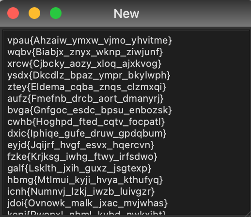

# Crypto

# 密文解码

- 如果看起来像 base，可能是多层嵌套 base，用其他软件解可能都会报错，这时选择 [basetrack](####basetrack) 自动接码 (有的非标准格式的 base 编码应该用 basetrack 来解)
  - 如果遇到不认识的密码，长得像 base64 又不是 base 系列，可以考虑 [Rabbit](#Rabbit) 。除此之外，如果这段密文很长，还可能是[图片的 base64](####base64 转图片) (TomatoTools 识别不了)
  - 如果坚持认为密文是 base64 的变体，可以尝试通过 [base64 表偏移获取 flag](####base64 表偏移获取 flag)
  - Python 的 `b64encode` 必须编码二进制内容(`b'xxx...'`)，即便对应字符串内容不可打印，也可以编码为 base64
- 关于10进制和16进制
  - 如果遇到一串10进制编码，一般可以先转为16进制，再看看16进制是不是图片 (复制到 hex 中保存)。此外，十进制还可能表示 ascci 码，使用[脚本](####特殊情况：16进制/10进制/2进制 偏移后的字符串转 flag)还原 flag
  - 看到 16 进制（如 `d43963e92b012aab` 可以联想到反查 md5 [通过在线网站查询]，题目出的 md5 一般不难，还可以[碰撞](#####通用碰撞模版)）
  - 如果上面两种方法得到的16进制都不能转换，可以考虑题目是否对 ascci 码做了偏移，使用[脚本](####特殊情况：16进制/10进制/2进制 偏移后的字符串转 flag)还原 flag（**注意**：只要确认这个字符串不是图片或 md5，直接使用该脚本即可，该脚本已经完善为 10进制、16进制转 unicode 字符串的**通用脚本**）
  - 如果是这种有空格的10进制 `33 43 43 13 44 21 54 34 45 21 24 33 14 21 31 11 22 12 54 44 11 35 13 34 14 15`，应该想到 [Tap Code](####Tap Code)
- 看到 `\x` 开头的编码，不一定是 16 进制，还可能是 Python Bytes，如 `b'\x1a%&\'()*456789:'` (解决方法就是在前面加一个 `b`，很可能可以转图片)
- md5 碰撞，如果是密码的 md5 值，尝试使用 `psd_big.txt` 中的密码来碰撞。(文件位置: `/Users/Cyberbolt/Library/CloudStorage/OneDrive-个人/编程/CTF/工具/密码学/常用密码/psd_big.txt`)
- 不要相信 TomatoTools 中文本框里复制出的内容，所见不一定是所得。建议复制到备忘录后，再复制一次
- 看到 flag 顺序是乱的（如 `fa{hsi_refa}lgti_stu_lg`），不止要想到凯撒密码，还要想到栅栏密码。此外，还要想到 Atbash Cipher
- 如果题目中提示有两个密钥，如 `19_20`，要联想到是[仿射密码](####仿射密码)

## ciphey
> 先尝试 ciphey -t "Encrypted input"

另外，如果能看出密钥，这种可能使用 AES 算法

## 进制转换

### 10进制转其他

如需转回十进制，用 `int(text)`、`int(text, 2)`、`int(text, 16)`

#### 10进制转16进制

- 注意这种转换和 assci 码转换的区别，编码方式不同导致结果不同

```python
hex(3207357)
```

Python 中16进制以 `0x` 开头，如需去掉，请执行

```python
hex(3207357)[2:]
```

16进制转回10进制 (hex_number 是字符串，无论前面是否有 `0x` 都可)

```python
int(hex_number, 16)
```

#### 10进制转2进制

```python
bin(3207357)
```

#### 10进制转8进制

```python
oct(3207357)
```

### 特殊情况：16进制/10进制/2进制 偏移后的字符串转 flag

- 我已经将该脚本完善为一个**通用脚本**，支持 2进制/10进制/16进制 **直接转换**为 unicode 字符串，同时支持按 **最后一个字符和  '}' 的偏移**来转换

- 这种情况直接将 16进制/10进制 转为 unicode 字符串会导致不可读，CTF-Tools 也识别不了，所以使用下面的脚本实现

有的题目得到的16进制或10进制，是经过 ascci 码偏移后的值，这里会计算 最后一个元素的 asscii 与 '}' 的 ascci 的差值，达到自动还原 flag 的目的。（因为 flag 字符串的最后一个元素往往是 '}'）

```python
# 此处不但支持16进制，还支持10进制和2进制，程序会自动判断
text = 'c8e9aca0c3f4e6e5f2a1a0d4e8e5a0e6ece1e7a0e9f3baa0e6ece1e7fbf7e5e6e5efe9e4eae7efe5e4f3e6e9eff2f0e5e6e4e6e7e7e6e4f3e5fd'

def format_hex(hex_str: str):
    '''
        将16进制转为8位一个整体，中间加空格
    '''
    result = ''
    for i in range(0, len(hex_str), 2):
        result += hex_str[i:i+2] + ' '
    result = result.rstrip(' ')
    return result


def hex_to_str(hex_str: str):
    hex_list = hex_str.split(' ')
    reslut = ''
    for one in hex_list:
        reslut += chr(int(one, 16))
    return reslut


def hex_to_str_flag(hex_str: str):
    '''
        16进制转 ascii 码，并寻找移位的 flag
        （这里假设该字符串最后一位一定是 '}' ）
    '''
    hex_list = hex_str.split(' ')
    # 转为10进制
    int_list = []
    for one in hex_list:
        int_list.append(int(one, 16))
    
    # 分析 最后一个字符 和 '}' 的差值
    diff = ord('}') - int_list[-1]
    # 得到 flag
    flag = ''
    for one in int_list:
        flag += chr(one + diff)
    
    return flag


def hex_conversion(hex_str):
    # 先分离为8位一组
    hex_str = format_hex(hex_str)
    
    # 获取未偏移的 ascci 码
    result = hex_to_str(hex_str)
    print(f'直接转换:{result}')
    # 获取偏移值
    try:
        flag = hex_to_str_flag(hex_str)
        print(f'偏移后转换:{flag}')
    except:
        print('无法偏移转换')


def main():
    global text
    # 将16进制或10进制中间的空格去掉
    text = text.replace(' ', '')
    
    hex_10_str = None
    hex_2_str = None
    
    # 如果是10进制，先转为16进制
    if text.isdigit():
        i = 0
        hex_10_str = ''
        while(i<len(text)):
            if int(text[i:i+2])>=32:
                hex_10_str=hex_10_str+hex(int(text[i:i+2]))[2:]
                i+=2
            else:
                hex_10_str=hex_10_str+hex(int(text[i:i+3]))[2:]
                i+=3
        print(f'10进制转16进制:{hex_10_str}')
        
    # 如果是2进制，先转为16进制
    if all(c in '01' for c in text):
        decimal = int(text, 2)
        hex_2_str = hex(decimal)[2:]
        print(f'2进制转16进制:{hex_2_str}')
    
    if hex_10_str:
        print('\n当字符串是10进制时:')
        print('请注意，该方法只尝试了将10进制按ascci编码转为16进制。\
              如果未得到flag，还应该尝试10进制直接转16进制，并观察是否是图片')
        hex_conversion(hex_10_str)
    if hex_2_str:
        print('\n当字符串是2进制时:')
        hex_conversion(hex_2_str)
    if not hex_10_str and not hex_2_str:
        print('当字符串是16进制时:')
        hex_str = text
        hex_conversion(hex_str)
    

if __name__ == '__main__':
    main()
```

## base 格式

- 看到很长一串，可能是图片的 base64

- 有一些多层嵌套的 base 编码，TomatoTools 识别不了，但是可以用 basetrack 识别 (用 magic 模式)

### basecrack

**普通解码**
```bash
python3 basecrack.py -b 编码文本
```

**自动解码**

```bash
python basecrack.py --magic -b 编码文本
```

参数:

- 读文件: `-f file.txt`

### 破解 Base 家族 (超大参数量)

如果参数量大到 basecrack 无法运行，可以使用此方法破解 base 家族加密

```python
import string
import base64
with open('/programme/CTF/测试用/base家族/base.txt') as f:
    text = f.read()
while(1):
    try:
        text = base64.b64decode(text).decode()
    except Exception as e:
        try:
            text = base64.b32decode(text).decode()
        except Exception as e:
            try:
                text = base64.b16decode(text).decode()
            except Exception as e:
                break
print(text)
```

### base64 转图片

https://tool.jisuapi.com/base642pic.html

本地转换方法:

```python
import base64
from PIL import Image
from io import BytesIO

def base64_to_image(base64_str, image_path):
    # 如果 base64 字符串不是 4 的倍数，添加等号
    padding = len(base64_str) % 4
    if padding:
        base64_str += "=" * (4 - padding)

    # 将 base64 字符串解码为二进制数据
    base64_data = base64.b64decode(base64_str)

    # 使用 PIL 库将二进制数据转换为图像
    image = Image.open(BytesIO(base64_data))

    # 保存图像
    image.save(image_path)

# 这里替换为你的 base64 字符串 (由于长度限制，此处不能通过终端输入，只能写在 py 文件里或读文件)
base64_str = '...'
image_path = 'output.png'  # 输出的图片路径
base64_to_image(base64_str, image_path)
```

### base64 表偏移获取 flag

由于 flag{xxxx...} 开头的字符串的 base64 编码一定是 Zmxh 开头，可以根据求 flag 的偏移量还原 base64 格式的密文。（同理，也可将 `flag` 替换为其他前缀）

```python
# 修改此处的 s
s = '3EP/3VNFFmNEAnlHD5dCMmVHD5ad9uG'
flag_exp = 'Zmxh' # flag{xxxx...} 开头的字符串的 base64 编码一定是 Zmxh 开头 (也可将 flag 替换为其他前缀)


import base64

base64_table = "ABCDEFGHIJKLMNOPQRSTUVWXYZabcdefghijklmnopqrstuvwxyz0123456789+/"
def base64_offset(text):
    '''
        计算 base64 表的偏移量
    '''
    global base64_table
    return base64_table.index(text)


def main():
    global base64_table
    
    # 计算偏移量
    diff = base64_offset(flag_exp[0]) - base64_offset(s[0])
    index = []
    for one in s:
        index.append(base64_offset(one) + diff)
    
    text = ''
    for i in index:
        text += base64_table[i]
    if len(text)%4!=0:
        text = text + "=" * (4-(len(text)%4))
    print(f'base64 解码结果:{text}')
    print(f'明文:{base64.b64decode(text).decode()}')
    

if __name__ == '__main__':
    main()
```

## Hash

- MD5算法生成的哈希值通常以16进制的形式表示。这是因为MD5算法生成的原始结果是一个128位的二进制数，这个数包含的信息量非常大，如果直接以二进制或者十进制的形式表示，将会非常长。因此，通常会将这个二进制数转换为16进制来表示，这样可以大大减少表示的长度。一个128位的二进制数可以转换为一个32位的16进制数，这就是我们通常看到的MD5哈希值的形式。
- 有一些 hash 碰撞题目给的条件很多，实际并不难。按题目给的条件编写碰撞代码，简单地遍历数字即可得到结果

### Hash 类 (md5) 密文在线解密

https://www.cmd5.com/

上面的地址有时候要收费，下面这个是免费的

https://www.somd5.com/

### MD5 碰撞

#### 通用碰撞模版

```python
import hashlib


def main():
    for i in range(100000):
        token = hashlib.md5(str(i).encode()).hexdigest()
        # 筛选符合碰撞规则的 md5 值
        if token[-6:] == '8b184b':
            print(i)
            print(token)
            break


if __name__ == '__main__':
    main()
```

#### 普通碰撞套路示例

（这只是一个示例提示，这段代码不重要，以上一个模版为准）

有一些 hash 碰撞题目给的条件很多，实际并不难。按题目给的条件编写碰撞代码，简单地遍历数字即可得到结果，例如：

```python
import hashlib


# if 语句的内容是例题给出的特殊条件
def main():
    for i in range(100000):
        token = hashlib.md5(str(i).encode()).hexdigest()
        if token[1] == token[14] and token[14] == token[17]:
            if (int(token[1], 16) + int(token[14], 16) + int(token[17], 16)) / int(token[1], 16) == int(token[31], 16):
                print(i)
                break


if __name__ == '__main__':
    main()
```

#### 带前缀的 MD5 碰撞

运行以下脚本，解得后缀

```python
import hashlib # 建立爆破的字典data 


def main():
    prefix = 'ctfshow' # 自定义前缀
    
    data='abcdefghijklmnopqrstuvwxyzABCDEFGHIJKLMNOPQRSTUVWXYZ1234567890+-*/' # 从一个字符开始尝试，逐渐往下加 
    for i in data: 
        for j in data : 
            for k in data: 
                s = hashlib.md5((prefix+i+j+k).encode()).hexdigest() 
                if s == 'a6f57ae38a22448c2f07f3f95f49c84e':#判断值是否符合条件 
                    print(i + j + k) # 输出字符c的值 脚本输出36d 构造payload: ?c=36d 


if __name__ == '__main__':
    main()
```

#### MD5 强碰撞（Python 和 PHP ===）

##### Python

```python
import hashlib


def main():
    # 第一个字符串
    str1 = "d131dd02c5e6eec4693d9a0698aff95c2fcab58712467eab4004583eb8fb7f8955ad340609f4b30283e488832571415a085125e8f7cdc99fd91dbdf280373c5bd8823e3156348f5bae6dacd436c919c6dd53e2b487da03fd02396306d248cda0e99f33420f577ee8ce54b67080a80d1ec69821bcb6a8839396f9652b6ff72a70"

    # 第二个字符串
    str2 = "d131dd02c5e6eec4693d9a0698aff95c2fcab50712467eab4004583eb8fb7f8955ad340609f4b30283e4888325f1415a085125e8f7cdc99fd91dbd7280373c5bd8823e3156348f5bae6dacd436c919c6dd53e23487da03fd02396306d248cda0e99f33420f577ee8ce54b67080280d1ec69821bcb6a8839396f965ab6ff72a70"

    # 计算第一个字符串的MD5哈希值
    hash1 = hashlib.md5(bytes.fromhex(str1)).hexdigest()

    # 计算第二个字符串的MD5哈希值
    hash2 = hashlib.md5(bytes.fromhex(str2)).hexdigest()

    print(hash1 == hash2)
    

if __name__ == '__main__':
    main()
```

##### PHP

原版

```php
<?php

// 第一个字符串
$str1 = "d131dd02c5e6eec4693d9a0698aff95c2fcab58712467eab4004583eb8fb7f8955ad340609f4b30283e488832571415a085125e8f7cdc99fd91dbdf280373c5bd8823e3156348f5bae6dacd436c919c6dd53e2b487da03fd02396306d248cda0e99f33420f577ee8ce54b67080a80d1ec69821bcb6a8839396f9652b6ff72a70";

// 第二个字符串
$str2 = "d131dd02c5e6eec4693d9a0698aff95c2fcab50712467eab4004583eb8fb7f8955ad340609f4b30283e4888325f1415a085125e8f7cdc99fd91dbd7280373c5bd8823e3156348f5bae6dacd436c919c6dd53e23487da03fd02396306d248cda0e99f33420f577ee8ce54b67080280d1ec69821bcb6a8839396f965ab6ff72a70";

// 计算第一个字符串的MD5哈希值
$hash1 = md5(hex2bin($str1));

// 计算第二个字符串的MD5哈希值
$hash2 = md5(hex2bin($str2));

echo $hash1 === $hash2;

?>
```

Web 优化版

这里利用了 url 编码，以便传至网页

```php
<?php

// 第一个字符串
$str1 = "%D11%DD%02%C5%E6%EE%C4i%3D%9A%06%98%AF%F9%5C%2F%CA%B5%87%12F%7E%AB%40%04X%3E%B8%FB%7F%89U%AD4%06%09%F4%B3%02%83%E4%88%83%25qAZ%08Q%25%E8%F7%CD%C9%9F%D9%1D%BD%F2%807%3C%5B%D8%82%3E1V4%8F%5B%AEm%AC%D46%C9%19%C6%DDS%E2%B4%87%DA%03%FD%029c%06%D2H%CD%A0%E9%9F3B%0FW%7E%E8%CET%B6p%80%A8%0D%1E%C6%98%21%BC%B6%A8%83%93%96%F9e%2Bo%F7%2Ap";

// 第二个字符串
$str2 = "%D11%DD%02%C5%E6%EE%C4i%3D%9A%06%98%AF%F9%5C%2F%CA%B5%07%12F%7E%AB%40%04X%3E%B8%FB%7F%89U%AD4%06%09%F4%B3%02%83%E4%88%83%25%F1AZ%08Q%25%E8%F7%CD%C9%9F%D9%1D%BDr%807%3C%5B%D8%82%3E1V4%8F%5B%AEm%AC%D46%C9%19%C6%DDS%E24%87%DA%03%FD%029c%06%D2H%CD%A0%E9%9F3B%0FW%7E%E8%CET%B6p%80%28%0D%1E%C6%98%21%BC%B6%A8%83%93%96%F9e%ABo%F7%2Ap";

$str1 = urldecode($str1);
$str2 = urldecode($str2);

echo md5($str1) === md5($str2);

?>
```


## RSA

- `P = pow(p,2,n)` 此时如果 `P < n`，P 的平方根就是 p
- 当无法分离出 p、q 时，通过观察方程式求 gcd 是一个思路(例题:[[SWPU 2020]happy](https://www.ctfer.vip/problem/149))
- 在暴力枚举 e 来爆破时，当e和φn的最大公因数不为1时，模逆元就不存在，这时应该加上 `try except` 来跳过当前的 e 。例题 [[BJDCTF 2020]rsa](https://www.ctfer.vip/problem/688)
- 如果需要求明文 m，又只知道 e, n, c，可以通过[在线工具](#####将 n 分解为 p,q)通过 n 反查 p, q
- 如果 p 被移位，且末尾有很多0，要想到 [SageMath 还原](####SageMath 还原)

### 原理

#### 公钥与私钥的产生

1. **密钥生成**：首先，选择两个大质数 p 和 q，然后计算它们的乘积 n。n 就是公钥和私钥的一部分。然后计算 φ(n)（也就是 n 的欧拉函数，等于 (p-1)(q-1)）。接着，选择一个整数 e，使得 e 和 φ(n) 是互质的（即 e 和 φ(n) 的最大公约数是 1），并且 1 < e < φ(n)。**公钥**就是 (n, e)。然后，计算一个数 d，使得 (d * e) % φ(n) = 1。**私钥**就是 (n, d)。
2. **加密**：假设有一个消息 m，我们要用公钥 (n, e) 进行加密。计算 c = m^e % n。这里的 c 就是加密后的消息。
3. **解密**：使用私钥 (n, d) 来解密消息。计算 m = c^d % n。这里的 m 就是解密后的原始消息。

RSA 的安全性基于一个事实：虽然 n、e 和 c 都是公开的，但是如果没有 d，很难从 c 计算出 m。而要计算出 d，就需要将 n 分解成 p 和 q，这是一个已知的困难问题，特别是当 p 和 q 都非常大的时候。因此，只要保护好私钥，RSA 加密就是安全的。

总的来说，RSA 算法的公钥和私钥原理基于大数因子分解的困难性，以及模运算和欧拉函数的性质。

#### 条件

在RSA加密算法中，以下是一些必须满足互素条件的值：

1. 公钥的指数e和φ(n)必须互素。如前所述，这是为了确保可以找到一个私钥的指数d，使得e * d ≡ 1 (mod φ(n))。这里的φ(n)是欧拉函数，对于n=p*q（p和q都是大素数），φ(n)=(p-1)*(q-1)。

2. 模数n的构成因子p和q必须互素。这是因为p和q都需要是大素数，素数的定义就是只有1和自身能整除的数，所以p和q必须互素。

3. 在一些扩展的RSA应用中，可能会有多个公钥指数e，这些公钥指数之间也需要互素。

注意，虽然在理论上p、q、e等都需要是大素数，但在实际应用中，为了方便，e经常被选为65537，这是一个相对较小的素数，但可以提供足够的安全性，并且在计算上相对高效。

### 工具

#### 求解最大公因数

Greatest Common Divisor

示例如

```python
import math


a = 1285367317452089980789441829580397855321901891350429414413655782431779727560841427444135440068248152908241981758331600586
b = 1109691832903289208389283296592510864729403914873734836011311325874120780079555500202475594
r = math.gcd(a, b)
print(r)
```

#### 开平方

```python
import gmpy2

r = gmpy2.isqrt(64)
print(r)
```

#### 将 n 分解为 p,q

- 不是很大的 n 都可以试试该方法

原理类似 md5 的彩虹表，提前将结果存储在数据库中

在线工具: http://factordb.com/

#### 在线 sagemath

https://sagecell.sagemath.org/?q=iyqcsn

#### 求两个数是否互素

```python
print(gmpy2.gcd(e, φn))
```

如果输出的结果不是1 (最大公因数)，那么就说明e和φn不是互素

### 题型

- `e` 有可能藏在公式中，如 `c = pow(m,3,n)`, `e` 为 3

#### 已知 p,q,e 求 d

p=447685307 q=2037 e=17

提交flag{d}即可

```python
import gmpy2


def main():
    p = 447685307
    q = 2037
    φn = (p - 1)*(q - 1)
    e = 17
    
    print(gmpy2.invert(e, φn))
    
    
if __name__ == '__main__':
    main()
```

`gmpy2.invert(e, n)` 是一个函数，用于计算模逆元。在数学中，对于模 n 的运算，整数 a 的逆元是一个整数 b，使得 (d * e) % n = 1。也就是说，e 是 d 在模 n 下的乘法逆元。

在你的代码中，`gmpy2.invert(e, n)` 计算的是 e 在模 n 下的乘法逆元。在 RSA 加密算法中，这个逆元对应的就是私钥中的 d。这样，对于公钥 (n, e) 和私钥 (n, d)，我们有 (d * e) % n = 1，这是 RSA 算法的一个关键性质。


#### 已知 e,p,q,c 求 明文 m

- (另一种情况) 遇到有一道题，题目给了两组 e,p,q,c，但是两组的 e 和 φn 都不互素，这时应该考虑模不互素的[情况二](######情况二)

```python
import gmpy2
import binascii


def main():
    e = 65537
    p = 104046835712664064779194734974271185635538927889880611929931939711001301561682270177931622974642789920918902563361293345434055764293612446888383912807143394009019803471816448923969637980671221111117965227402429634935481868701166522350570364727873283332371986860194245739423508566783663380619142431820861051179
    q = 140171048074107988605773731671018901813928130582422889797732071529733091703843710859282267763783461738242958098610949120354497987945911021170842457552182880133642711307227072133812253341129830416158450499258216967879857581565380890788395068130033931180395926482431150295880926480086317733457392573931410220501
    c = 4772758911204771028049020670778336799568778930072841084057809867608022732611295305096052430641881550781141776498904005589873830973301898523644744951545345404578466176725030290421649344936952480254902939417215148205735730754808467351639943474816280980230447097444682489223054499524197909719857300597157406075069204315022703894466226179507627070835428226086509767746759353822302809385047763292891543697277097068406512924796409393289982738071019047393972959228919115821862868057003145401072581115989680686073663259771587445250687060240991265143919857962047718344017741878925867800431556311785625469001771370852474292194

    φn = (p-1)*(q-1)
    n = p * q
    
    d = gmpy2.invert(e, φn)
    # 使用私钥 d 对密文 c 进行解密
    m = gmpy2.powmod(c, d, n)
		# 转为字符串
    print(binascii.unhexlify(hex(m)[2:]).decode())
    

if __name__ == '__main__':
    main()
```

- 这段代码的主要步骤如下：

  1. 定义 RSA 的公钥部分 `e`（公开指数）和私钥部分 `p` 和 `q`（两个大质数的乘积）。这里 `e` 是常用的值 65537。
  2. 计算 `n`，它是 `p` 和 `q` 减去 1 的乘积。在 RSA 算法中，`n` 通常是 `p` 和 `q` 的乘积，但在这里，我们需要计算 `(p-1)*(q-1)` 来作为模逆运算的参数。
  3. 计算私钥 `d`，它是 `e` 相对于 `n` 的模逆。模逆是一个数学运算，它找到一个数，使得该数和另一个数的乘积对一个模数取模后等于 1。在这里，`d` 是满足 `e * d ≡ 1 (mod n)` 的数。
  4. 使用私钥 `d` 对密文 `c` 进行解密。这是通过模幂运算完成的，这是一个数学运算，它计算一个数的幂次对一个模数取模的结果。在这里，`m = c^d mod (p*q)` 是解密的明文。
  5. 最后，将解密后的明文 `m` 从十六进制转换为 ASCII 字符串，并打印出来。这假设原始的明文是一个 ASCII 字符串。

  总的来说，这段代码就是实现了 RSA 解密的过程，将密文解密回原始的明文。

#### 已知 n1、n2、e、c 求明文 m

```python
import binascii
from Crypto.Util.number import *
from gmpy2 import gcd, invert

n1 = 103835296409081751860770535514746586815395898427260334325680313648369132661057840680823295512236948953370895568419721331170834557812541468309298819497267746892814583806423027167382825479157951365823085639078738847647634406841331307035593810712914545347201619004253602692127370265833092082543067153606828049061
n2 = 115383198584677147487556014336448310721853841168758012445634182814180314480501828927160071015197089456042472185850893847370481817325868824076245290735749717384769661698895000176441497242371873981353689607711146852891551491168528799814311992471449640014501858763495472267168224015665906627382490565507927272073
e = 65537
c = 60406168302768860804211220055708551816238816061772464557956985699400782163597251861675967909246187833328847989530950308053492202064477410641014045601986036822451416365957817685047102703301347664879870026582087365822433436251615243854347490600004857861059245403674349457345319269266645006969222744554974358264

p = gcd(n1,n2)

q1 = n1 // p
q2 = n2 // p

phi1 = (p-1)*(q1-1)
phi2 = (p-1)*(q2-1)

d1 = invert(e,phi1)
d2 = invert(e,phi2)

c = pow(c,d2,n2)
m = pow(c,d1,n1)

print(binascii.unhexlify(hex(m)[2:]).decode())
```

#### 模不互素

- 只要两个或多个模（如 n1, n2）不互素，则可以通过求最大公因数的方式求得 p 或 q 的其中一个（如 p），然后使用 n // p 求得另一个

##### 情况一

有两组值，没有 p, q, 但是 e 相同

```python
import gmpy2
import binascii
 
e = 65537
n1 = 23686563925537577753047229040754282953352221724154495390687358877775380147605152455537988563490716943872517593212858326146811511103311865753018329109314623702207073882884251372553225986112006827111351501044972239272200616871716325265416115038890805114829315111950319183189591283821793237999044427887934536835813526748759612963103377803089900662509399569819785571492828112437312659229879806168758843603248823629821851053775458651933952183988482163950039248487270453888288427540305542824179951734412044985364866532124803746008139763081886781361488304666575456680411806505094963425401175510416864929601220556158569443747
c1 = 1627484142237897613944607828268981193911417408064824540711945192035649088104133038147400224070588410335190662682231189997580084680424209495303078061205122848904648319219646588720994019249279863462981015329483724747823991513714172478886306703290044871781158393304147301058706003793357846922086994952763485999282741595204008663847963539422096343391464527068599046946279309037212859931303335507455146001390326550668531665493245293839009832468668390820282664984066399051403227990068032226382222173478078505888238749583237980643698405005689247922901342204142833875409505180847943212126302482358445768662608278731750064815
 
e = 65537
n2 = 22257605320525584078180889073523223973924192984353847137164605186956629675938929585386392327672065524338176402496414014083816446508860530887742583338880317478862512306633061601510404960095143941320847160562050524072860211772522478494742213643890027443992183362678970426046765630946644339093149139143388752794932806956589884503569175226850419271095336798456238899009883100793515744579945854481430194879360765346236418019384644095257242811629393164402498261066077339304875212250897918420427814000142751282805980632089867108525335488018940091698609890995252413007073725850396076272027183422297684667565712022199054289711
c2 = 2742600695441836559469553702831098375948641915409106976157840377978123912007398753623461112659796209918866985480471911393362797753624479537646802510420415039461832118018849030580675249817576926858363541683135777239322002741820145944286109172066259843766755795255913189902403644721138554935991439893850589677849639263080528599197595705927535430942463184891689410078059090474682694886420022230657661157993875931600932763824618773420077273617106297660195179922018875399174346863404710420166497017196424586116535915712965147141775026549870636328195690774259990189286665844641289108474834973710730426105047318959307995062
 
p = gmpy2.gcd(n1, n2)
q = n2 // p  # 这里用n1，n2都可以，但是要与后面保持一致
phi = (p - 1)*(q - 1)
 
d = gmpy2.invert(e, phi)
m = gmpy2.powmod(c2, d, n2)
 
print(binascii.unhexlify(hex(m)[2:]).decode())
```

- n1，n2不同，考虑模不互素的情况，由于n1，n2不互素，那么必然有一个公因数，由于n是由两个[质数](https://so.csdn.net/so/search?q=质数&spm=1001.2101.3001.7020)相乘得到的，所以只有两个因数，那他们的公因数设为p，则q1=n1//p, q2=n2//p，求解m就好了。

##### 情况二

有两组值，且两组值的 e 和 φn 都不互素。在正常解密文时报错: 

```bash
    d = gmpy2.invert(e, φn)
ZeroDivisionError: invert() no inverse exists
```

```python
from Cryptodome.Util.number import *
import gmpy2
from libnum import *

e1 = 14606334023791426
p1 = 121009772735460235364940622989433807619211926015494087453674747614331295040063679722422298286549493698150690694965106103822315378461970129912436074962111424616439032849788953648286506433464358834178903821069564798378666159882090757625817745990230736982709059859613843100974349380542982235135982530318438330859
q1 = 130968576816900149996914427770826228884925960001279609559095138835900329492765336419489982304805369724685145941218640504262821549441728192761733409684831633194346504685627189375724517070780334885673563409259345291959439026700006694655545512308390416859315892447092639503318475587220630455745460309886030186593
c1 = 11402389955595766056824801105373550411371729054679429421548608725777586555536302409478824585455648944737304660137306241012321255955693234304201530700362069004620531537922710568821152217381257446478619320278993539785699090234418603086426252498046106436360959622415398647198014716351359752734123844386459925553497427680448633869522591650121047156082228109421246662020164222925272078687550896012363926358633323439494967417041681357707006545728719651494384317497942177993032739778398001952201667284323691607312819796036779374423837576479275454953999865750584684592993292347483309178232523897058253412878901324740104919248
n1 = p1 * q1

e2 = 13813369129257838
p2 = 121009772735460235364940622989433807619211926015494087453674747614331295040063679722422298286549493698150690694965106103822315378461970129912436074962111424616439032849788953648286506433464358834178903821069564798378666159882090757625817745990230736982709059859613843100974349380542982235135982530318438330859
q2 = 94582257784130735233174402362819395926641026753071039760251190444144495369829487705195913337502962816079184062352678128843179586054535283861793827497892600954650126991213176547276006780610945133603745974181504975165082485845571788686928859549252522952174376071500707863379238688200493621993937563296490615649
c2 = 7984888899827615209197324489527982755561403577403539988687419233579203660429542197972867526015619223510964699107198708420785278262082902359114040327940253582108364104049849773108799812000586446829979564395322118616382603675257162995702363051699403525169767736410365076696890117813211614468971386159587698853722658492385717150691206731593509168262529568464496911821756352254486299361607604338523750318977620039669792468240086472218586697386948479265417452517073901655900118259488507311321060895347770921790483894095085039802955700146474474606794444308825840221205073230671387989412399673375520605000270180367035526919
n2 = p2 * q2

p = p1
phi1 = (p - 1) * (q1 - 1)
phi2 = (p - 1) * (q2 - 1)
b = gmpy2.gcd(e1, phi1)
a1 = e1 // b
a2 = e2 // b
bd1 = gmpy2.invert(a1, phi1)
bd2 = gmpy2.invert(a2, phi2)

mb1 = pow(c1, bd1, n1)
mb2 = pow(c2, bd2, n2)
c3 = mb1 * mb2 % p
c2 = mb2 % q2
c1 = mb1 % q1

res = solve_crt([c1, c2, c3], [q1, q2, p])   #crt中国同余定理,求出特解作为

n = q1 * q2
f = (q1 - 1) * (q2 - 1)
m = res % n
d2 = gmpy2.invert(7, f)
m = pow(m, d2, n)
msg = gmpy2.iroot(m, 2)[0]
print(long_to_bytes(msg).decode())
```

#### 共模攻击

- 有两组值，n 相同而 e, c 不同

```python
import gmpy2
import libnum
 
e1 = 797
n = 15944475431088053285580229796309956066521520107276817969079550919586650535459242543036143360865780730044733026945488511390818947440767542658956272380389388112372084760689777141392370253850735307578445988289714647332867935525010482197724228457592150184979819463711753058569520651205113690397003146105972408452854948512223702957303406577348717348753106868356995616116867724764276234391678899662774272419841876652126127684683752880568407605083606688884120054963974930757275913447908185712204577194274834368323239143008887554264746068337709465319106886618643849961551092377843184067217615903229068010117272834602469293571
c1 = 11157593264920825445770016357141996124368529899750745256684450189070288181107423044846165593218013465053839661401595417236657920874113839974471883493099846397002721270590059414981101686668721548330630468951353910564696445509556956955232059386625725883038103399028010566732074011325543650672982884236951904410141077728929261477083689095161596979213961494716637502980358298944316636829309169794324394742285175377601826473276006795072518510850734941703194417926566446980262512429590253643561098275852970461913026108090608491507300365391639081555316166526932233787566053827355349022396563769697278239577184503627244170930
 
e2 = 521
n = 15944475431088053285580229796309956066521520107276817969079550919586650535459242543036143360865780730044733026945488511390818947440767542658956272380389388112372084760689777141392370253850735307578445988289714647332867935525010482197724228457592150184979819463711753058569520651205113690397003146105972408452854948512223702957303406577348717348753106868356995616116867724764276234391678899662774272419841876652126127684683752880568407605083606688884120054963974930757275913447908185712204577194274834368323239143008887554264746068337709465319106886618643849961551092377843184067217615903229068010117272834602469293571
c2 = 6699274351853330023117840396450375948797682409595670560999898826038378040157859939888021861338431350172193961054314487476965030228381372659733197551597730394275360811462401853988404006922710039053586471244376282019487691307865741621991977539073601368892834227191286663809236586729196876277005838495318639365575638989137572792843310915220039476722684554553337116930323671829220528562573169295901496437858327730504992799753724465760161805820723578087668737581704682158991028502143744445435775458296907671407184921683317371216729214056381292474141668027801600327187443375858394577015394108813273774641427184411887546849
def func(e1,e2,c1,c2,n):
	s = gmpy2.gcdext(e1, e2)
	s1 = s[1]
	s2 = s[2]
	if s1 < 0:
		s1 = - s1
		c1 = gmpy2.invert(c1, n)
	elif s2 < 0:
		s2 = - s2
		c2 = gmpy2.invert(c2, n)
	m = (pow(c1,s1,n) * pow(c2 ,s2 ,n)) % n
	return int(m)
 
m = func(e1,e2,c1,c2,n)
print(libnum.n2s(int(m)).decode())
```

RSA共模攻击（Common Modulus Attack）是一种针对RSA加密算法的攻击方式，它的基本原理是在两个不同的公钥使用了同样的模数时进行的。具体来说，如果两个公钥(e1, n)和(e2, n)使用了同一个模数n，那么就可以利用这个特性来攻击RSA系统。

RSA共模攻击的基本原理依赖于一个数学定理，叫做Bézout's Identity或者叫做扩展欧几里得算法。这个定理告诉我们，对于任何一对整数a和b，总存在一对整数x和y，使得以下等式成立：

ax + by = gcd(a, b)

在RSA共模攻击的场景中，我们有两个公钥，它们的公钥指数是e1和e2，我们可以找到一对整数x和y，使得以下等式成立：

e1*x + e2*y = gcd(e1, e2)

在RSA的公钥中，公钥指数通常是选择一个较小的素数，例如65537，所以gcd(e1, e2)通常就是1。这就意味着我们可以找到一对整数x和y，使得以下等式成立：

e1*x + e2*y = 1

现在，假设我们有两个密文，它们是同一明文m的加密，但是使用了两个不同的公钥，那么我们就有：

C1 = m^e1 mod n
C2 = m^e2 mod n

根据RSA的加密原理，我们可以得到：

C1^x * C2^y = (m^e1)^x * (m^e2)^y = m^(e1*x + e2*y) = m mod n

所以，只要我们能找到这样的x和y，就可以从C1和C2中恢复出明文m。这就是RSA共模攻击的基本原理。

需要注意的是，这种攻击方式的前提是两个公钥使用了同一个模数n，这在实际操作中是应该避免的。因此，一个好的RSA系统应该确保每个公钥都使用一个独特的模数。

#### 低加密指数攻击

- 已知 e, n, c，且 e 过小或 e 过大

##### e 过小

原题中，e为3，**对n，c来说非常小**

当m^3<n,可以推出m^3=c

当m^3>n,可以推出(m^3+i·n)mod n=c(i为系数，只要找到i，然后c+i n能开三次方就可以得到m)

```python
import gmpy2
import binascii


def main():
    e = 3
    n = 18970053728616609366458286067731288749022264959158403758357985915393383117963693827568809925770679353765624810804904382278845526498981422346319417938434861558291366738542079165169736232558687821709937346503480756281489775859439254614472425017554051177725143068122185961552670646275229009531528678548251873421076691650827507829859299300272683223959267661288601619845954466365134077547699819734465321345758416957265682175864227273506250707311775797983409090702086309946790711995796789417222274776215167450093735639202974148778183667502150202265175471213833685988445568819612085268917780718945472573765365588163945754761
    c = 150409620528139732054476072280993764527079006992643377862720337847060335153837950368208902491767027770946661
    
    i = 0
    while True:
        if gmpy2.iroot((c+i*n),e)[1] == 1:
            m = gmpy2.iroot((c+i*n),e)[0]
            break
        i += 1
    
    print(binascii.unhexlify(hex(m)[2:]).decode())
    

if __name__ == '__main__':
    main()
```

##### e 过大

```python
import gmpy2
import binascii

# Sage
def rational_to_contfrac(x, y):
    # Converts a rational x/y fraction into a list of partial quotients [a0, ..., an]
    a = x // y
    pquotients = [a]
    while a * y != x:
        x, y = y, x - a * y
        a = x // y
        pquotients.append(a)
    return pquotients


def convergents_from_contfrac(frac):
    # computes the list of convergents using the list of partial quotients
    convs = [];
    for i in range(len(frac)): convs.append(contfrac_to_rational(frac[0: i]))
    return convs


def contfrac_to_rational(frac):
    # Converts a finite continued fraction [a0, ..., an] to an x/y rational.
    if len(frac) == 0: return (0, 1)
    num = frac[-1]
    denom = 1
    for _ in range(-2, -len(frac) - 1, -1): num, denom = frac[_] * num + denom, num
    return (num, denom)


def egcd(a, b):
    if a == 0: return (b, 0, 1)
    g, x, y = egcd(b % a, a)
    return (g, y - (b // a) * x, x)


def mod_inv(a, m):
    g, x, _ = egcd(a, m)
    return (x + m) % m


def isqrt(n):
    x = n
    y = (x + 1) // 2
    while y < x:
        x = y
        y = (x + n // x) // 2
    return x


def crack_rsa(e, n):
    frac = rational_to_contfrac(e, n)
    convergents = convergents_from_contfrac(frac)

    for (k, d) in convergents:
        if k != 0 and (e * d - 1) % k == 0:
            phi = (e * d - 1) // k
            s = n - phi + 1
            # check if x*x - s*x + n = 0 has integer roots
            D = s * s - 4 * n
            if D >= 0:
                sq = isqrt(D)
                if sq * sq == D and (s + sq) % 2 == 0: return d


def main():
    n = 468459887279781789188886188573017406548524570309663876064881031936564733341508945283407498306248145591559137207097347130203582813352382018491852922849186827279111555223982032271701972642438224730082216672110316142528108239708171781850491578433309964093293907697072741538649347894863899103340030347858867705231
    e = 284100478693161642327695712452505468891794410301906465434604643365855064101922252698327584524956955373553355814138784402605517536436009073372339264422522610010012877243630454889127160056358637599704871937659443985644871453345576728414422489075791739731547285138648307770775155312545928721094602949588237119345
    c = 350429162418561525458539070186062788413426454598897326594935655762503536409897624028778814302849485850451243934994919418665502401195173255808119461832488053305530748068788500746791135053620550583421369214031040191188956888321397450005528879987036183922578645840167009612661903399312419253694928377398939392827

    d = crack_rsa(e, n)
    m = hex(pow(c, d, n))[2:]
    print(bytes.fromhex(m).decode())
    

if __name__ == '__main__':
    main()
```

##### e 小指数攻击（暴力枚举 e）

###### 已知 m, n 暴力枚举 e

```python
from gmpy2 import iroot
import sympy
import binascii

m = 25166751653530941364839663846806543387720865339263370907985655775152187319464715737116599171477207047430065345882626259880756839094179627032623895330242655333
n = 134109481482703713214838023035418052567000870587160796935708584694132507394211363652420160931185332280406437290210512090663977634730864032370977407179731940068634536079284528020739988665713200815021342700369922518406968356455736393738946128013973643235228327971170711979683931964854563904980669850660628561419


def small_m_atk(c, n):
    e = 2
    while e < 2 ** 10:
        i = 0
        while i < 10:
            res = iroot(c + i * n, e)
            if res[1]:
                print("破解成功！", e, i, res)
                return res[0]
            print(e, i, res)
            i += 1
        e = sympy.nextprime(e)


print("m:", binascii.unhexlify(hex(small_m_atk(m, n))[2:]))
```

原理：这个攻击方法是一种低加密指数攻击，更具体地说，它是对RSA加密的低公开指数e的攻击。这种攻击方法特别适用于当公开指数e较小且明文m的大小也较小的情况。

在RSA加密中，公开指数e通常是一个较小的素数，如3或65537。这是因为较小的e可以使加密过程更快。然而，如果明文m也较小，那么m的e次方可能会小于模数n，这意味着加密过程可能不会进行模n的运算。在这种情况下，密文c就等于m的e次方，而不是m的e次方模n。

这就使得攻击者可以通过计算c的e次根来恢复明文m。这就是你的代码所做的事情：它尝试计算c的e次根，如果成功（即，结果是整数），它就认为已经找到了明文m。

然而，这种攻击方法有一个限制，那就是它需要明文m的大小较小。如果m的大小接近n，那么m的e次方将会大于n，加密过程将会进行模n的运算，这就使得这种攻击方法无法成功。因此，这种攻击方法只在明文m的大小较小的情况下有效。

###### 已知 c1,c2,n 暴力枚举 e

```python
from gmpy2 import *
from Crypto.Util.number import long_to_bytes
from gmpy2 import iroot, gcdext

c1 = 463634070971821449698012827631572665302589213868521491855038966879005784397309389922926838028598122795187584361359142761652619958273094398420314927073008031088375892957173280915904309949716842152249806486027920136603248454946737961650252641668562626310035983343018705370077783879047584582817271215517599531278507300104564011142229942160380563527291388260832749808727470291331902902518196932928128107067117198707209620169906575791373793854773799564060536121390593687449884988936522369331738199522700261116496965863870682295858957952661531894477603953742494526632841396338388879198270913523572980574440793543571757278020533565628285714358815083303489096524318164071888139412436112963845619981511061231001617406815056986634680975142352197476024575809514978857034477688443230263761729039797859697947454810551009108031457294164840611157524719173343259485881089252938664456637673337362424443150013961181619441267926981848009107466576314685961478748352388452114042115892243272514245081604607798243817586737546663059737344687130881861357423084448027959893402445303299089606081931041217035955143939567456782107203447898345284731038150377722447329202078375870541529539840051415759436083384408203659613313535094343772238691393447475364806171594
c2 = 130959534275704453216282334815034647265875632781798750901627773826812657339274362406246297925411291822193191483409847323315110393729020700526946712786793380991675008128561863631081095222226285788412970362518398757423705216112313533155390315204875516645459370629706277876211656753247984282379731850770447978537855070379324935282789327428625259945250066774049650951465043700088958965762054418615838049340724639373351248933494355591934236360506778496741051064156771092798005112534162050165095430065000827916096893408569751085550379620558282942254606978819033885539221416335848319082054806148859427713144286777516251724474319613960327799643723278205969253636514684757409059003348229151341200451785288395596484563480261212963114071064979559812327582474674812225260616757099890896900340007990585501470484762752362734968297532533654846190900571017635959385883945858334995884341767905619567505341752047589731815868489295690574109758825021386698440670611361127170896689015108432408490763723594673299472336065575301681055583084547847733168801030191262122130369687497236959760366874106043801542493392227424890925595734150487586757484304609945827925762382889592743709682485229267604771944535469557860120878491329984792448597107256325783346904408

n = 609305637099654478882754880905638123124918364116173050874864700996165096776233155524277418132679727857702738043786588380577485490575591029930152718828075976000078971987922107645530323356525126496562423491563365836491753476840795804040219013880969539154444387313029522565456897962200817021423704204077133003361140660038327458057898764857872645377236870759691588009666047187685654297678987435769051762120388537868493789773766688347724903911796741124237476823452505450704989455260077833828660552130714794889208291939055406292476845194489525212129635173284301782141617878483740788532998492403101324795726865866661786740345862631916793208037250277376942046905892342213663197755010315060990871143919384283302925469309777769989798197913048813940747488087191697903624669415774198027063997058701217124640082074789591591494106726857376728759663074734040755438623372683762856958888826373151815914621262862750497078245369680378038995425628467728412953392359090775734440671874387905724083226246587924716226512631671786591611586774947156657178654343092123117255372954798131265566301316033414311712092913492774989048057650627801991277862963173961355088082419091848569675686058581383542877982979697235829206442087786927939745804017455244315305118437

for e1 in range(1,3087):
    if 3087 % e1 == 0 :
        e2 = 3087 // e1
        s0, s1, s2 = gcdext(e1,e2)
        m_s0 = pow(c1,s1,n) * pow(c2,s2,n) % n
        m = long_to_bytes(iroot(m_s0,s0)[0])
        if m[-1:] == b'}':
            print(m)
            break
```

##### 广播攻击

已知 e 和多组 (n, c) 对 (e 很小？)

```python
from sympy.ntheory.modular import crt
from gmpy2 import iroot
from Crypto.Util.number import *

e = 9
N = [71189786319102608575263218254922479901008514616376166401353025325668690465852130559783959409002115897148828732231478529655075366072137059589917001875303598680931962384468363842379833044123189276199264340224973914079447846845897807085694711541719515881377391200011269924562049643835131619086349617062034608799, 92503831027754984321994282254005318198418454777812045042619263533423066848097985191386666241913483806726751133691867010696758828674382946375162423033994046273252417389169779506788545647848951018539441971140081528915876529645525880324658212147388232683347292192795975558548712504744297104487514691170935149949, 100993952830138414466948640139083231443558390127247779484027818354177479632421980458019929149817002579508423291678953554090956334137167905685261724759487245658147039684536216616744746196651390112540237050493468689520465897258378216693418610879245129435268327315158194612110422630337395790254881602124839071919, 59138293747457431012165762343997972673625934330232909935732464725128776212729547237438509546925172847581735769773563840639187946741161318153031173864953372796950422229629824699580131369991913883136821374596762214064774480548532035315344368010507644630655604478651898097886873485265848973185431559958627423847, 66827868958054485359731420968595906328820823695638132426084478524423658597714990545142120448668257273436546456116147999073797943388584861050133103137697812149742551913704341990467090049650721713913812069904136198912314243175309387952328961054617877059134151915723594900209641163321839502908705301293546584147, 120940513339890268554625391482989102665030083707530690312336379356969219966820079510946652021721814016286307318930536030308296265425674637215009052078834615196224917417698019787514831973471113022781129000531459800329018133248426080717653298100515701379374786486337920294380753805825328119757649844054966712377, 72186594495190221129349814154999705524005203343018940547856004977368023856950836974465616291478257156860734574686154136925776069045232149725101769594505766718123155028300703627531567850035682448632166309129911061492630709698934310123778699316856399909549674138453085885820110724923723830686564968967391721281, 69105037583161467265649176715175579387938714721653281201847973223975467813529036844308693237404592381480367515044829190066606146105800243199497182114398931410844901178842049915914390117503986044951461783780327749665912369177733246873697481544777183820939967036346862056795919812693669387731294595126647751951, 76194219445824867986050004226602973283400885106636660263597964027139613163638212828932901192009131346530898961165310615466747046710743013409318156266326090650584190382130795884514074647833949281109675170830565650006906028402714868781834693473191228256626654011772428115359653448111208831188721505467497494581]
C =  [62580922178008480377006528793506649089253164524883696044759651305970802215270721223149734532870729533611357047595181907404222690394917605617029675103788705320032707977225447998111744887898039756375876685711148857676502670812333076878964148863713993853526715855758799502735753454247721711366497722251078739585, 46186240819076690248235492196228128599822002268014359444368898414937734806009161030424589993541799877081745454934484263188270879142125136786221625234555265815513136730416539407710862948861531339065039071959576035606192732936477944770308784472646015244527805057990939765708793705044236665364664490419874206900, 85756449024868529058704599481168414715291172247059370174556127800630896693021701121075838517372920466708826412897794900729896389468152213884232173410022054605870785910461728567377769960823103334874807744107855490558726013068890632637193410610478514663078901021307258078678427928255699031215654693270240640198, 14388767329946097216670270960679686032536707277732968784379505904021622612991917314721678940833050736745004078559116326396233622519356703639737886289595860359630019239654690312132039876082685046329079266785042428947147658321799501605837784127004536996628492065409017175037161261039765340032473048737319069656, 1143736792108232890306863524988028098730927600066491485326214420279375304665896453544100447027809433141790331191324806205845009336228331138326163746853197990596700523328423791764843694671580875538251166864957646807184041817863314204516355683663859246677105132100377322669627893863885482167305919925159944839, 2978800921927631161807562509445310353414810029862911925227583943849942080514132963605492727604495513988707849133045851539412276254555228149742924149242124724864770049898278052042163392380895275970574317984638058768854065506927848951716677514095183559625442889028813635385408810698294574175092159389388091981, 16200944263352278316040095503540249310705602580329203494665614035841657418101517016718103326928336623132935178377208651067093136976383774189554806135146237406248538919915426183225265103769259990252162411307338473817114996409705345401251435268136647166395894099897737607312110866874944619080871831772376466376, 31551601425575677138046998360378916515711528548963089502535903329268089950335615563205720969393649713416910860593823506545030969355111753902391336139384464585775439245735448030993755229554555004154084649002801255396359097917380427525820249562148313977941413268787799534165652742114031759562268691233834820996, 25288164985739570635307839193110091356864302148147148153228604718807817833935053919412276187989509493755136905193728864674684139319708358686431424793278248263545370628718355096523088238513079652226028236137381367215156975121794485995030822902933639803569133458328681148758392333073624280222354763268512333515]

resultant, mod = crt(N,C)
value, is_perfect = iroot(resultant,e)
print(long_to_bytes(value))
```

#### 已知 e, n, dp, c

发现常规rsa不存在的dp。查找资料知道 dp ≡ d mod (p - 1)。意识到dp是解题关键，可能dp和n存在某种关系可以解出p或者去，跟之前有一题有点类似，求p和q之间存在的线性关系那题

```python
from Cryptodome.Util.number import *
import gmpy2

e = 65537
n = 13851998696110232034312408768370264747862778787235362033287301947690834384177869107768578977872169953363148442670412868565346964490724532894099772144625540138618913694240688555684873934424471837897053658485573395777349902581306875149677867098014969597240339327588421766510008083189109825385296069501377605893298996953970043168244444585264894721914216744153344106498382558756181912535774309211692338879110643793628550244212618635476290699881188640645260075209594318725693972840846967120418641315829098807385382509029722923894508557890331485536938749583463709142484622852210528766911899504093351926912519458381934550361
dp = 100611735902103791101540576986246738909129436434351921338402204616138072968334504710528544150282236463859239501881283845616704984276951309172293190252510177093383836388627040387414351112878231476909883325883401542820439430154583554163420769232994455628864269732485342860663552714235811175102557578574454173473
c = 6181444980714386809771037400474840421684417066099228619603249443862056564342775884427843519992558503521271217237572084931179577274213056759651748072521423406391343404390036640425926587772914253834826777952428924120724879097154106281898045222573790203042535146780386650453819006195025203611969467741808115336980555931965932953399428393416196507391201647015490298928857521725626891994892890499900822051002774649242597456942480104711177604984775375394980504583557491508969320498603227402590571065045541654263605281038512927133012338467311855856106905424708532806690350246294477230699496179884682385040569548652234893413

a = e * dp
for i in range(1, e):
    p = (a + i - 1) // i
    if a == (p - 1) * i + 1:
        q = n // p
        phi = (p - 1) * (q - 1)
        d = gmpy2.invert(e, phi)
        m = pow(c, d, n)
        print(long_to_bytes(m))
```


#### n 等于3个大素数相乘

RSA加密通常使用两个大素数，但是它可以被扩展到使用多个素数，这就是多素数RSA

例题:

```python
from Crypto.Util.number import getPrime
import libnum
from secret import flag

e = 0x10001
p = getPrime(80)
q = getPrime(80)
r = getPrime(80)
n = p * q * r
m = libnum.s2n(flag)
c = pow(m,e,n)
print("n =", n)
print("c =", c)
# n = 897607935780955837078784515115186203180822213482989041398073067996023639
# c = 490571531583321382715358426750276448536961994273309958885670149895389968
```

使用在线网站将 n 分为了3个数 p、q、r，然后正常解明文即可（两个数的乘法都变成三个）

答案:

```python
import gmpy2
import libnum


def main():
    e = 0x10001
    p = 876391552113414716726089
    q = 932470255754103340237147
    r = 1098382268985762240184333
    c = 490571531583321382715358426750276448536961994273309958885670149895389968

    φn = (p-1)*(q-1)*(r-1)
    n = p * q * r
    
    d = gmpy2.invert(e, φn)
    # 使用私钥 d 对密文 c 进行解密
    m = gmpy2.powmod(c, d, n)
    # 将 mpz 转为 int
    m = int(m)
	# 转为字符串
    print(libnum.n2s(m).decode())
    

if __name__ == '__main__':
    main()
```

#### 文件题 (public.key 和 flag.enc)

public.key 是 公钥加密文件，可以解析出 n 和 e

flag.enc 大概率是私钥加密密文，此处把他当成 RSA 加密文件解即可

##### 1.解析 public.key 为 n 和 e

- 已有文件 public.key

```python
from cryptography.hazmat.backends import default_backend
from cryptography.hazmat.primitives import serialization

with open("easyrsa8/public.key", "rb") as key_file:
    public_key = serialization.load_pem_public_key(
        key_file.read(),
        backend=default_backend()
    )

public_numbers = public_key.public_numbers()

n = public_numbers.n
e = public_numbers.e

print("n:", n)
print("e:", e)
```

再使用在线网站将 n 分为两个大质数 p 和 q 即可

##### 2.使用 RSA 解密 flag.enc

```python
import libnum
from Crypto.PublicKey import RSA
from Crypto.Cipher import PKCS1_OAEP


def main():
    n = 10306247299477991196335954707897189353577589618180446614762218980226685668311143526740800444344046158260556585833057716406703213966249956775927205061731821632025483608182881492214855240841820024816859031176291364212054293818204399157346955465232586109199762630150640804366966946066155685218609638749171632685073
    e = 65537
    p = 97
    q = 106249972159566919549855203174197828387397831115262336234662051342543151219702510584956705611794290291345944183845955839244363030579896461607496959399297130227066841321473005074379950936513608503266587950271044991876848389878395867601515004796212227929894460104645781488319246866661398816686697306692491058609

    phi=(p-1)*(q-1)
    d = libnum.invmod(e,phi)
    privatekey = RSA.construct((n,e,d,p,q))
    rsa = PKCS1_OAEP.new(privatekey)
    m = rsa.decrypt(open('easyrsa8/flag.enc', 'rb').read()).decode()
    print(m)


if __name__ == '__main__':
    main()
```

### SageMath 还原

- 求到 `m` 后，无论题目是什么，马上想到 `libnum.n2s(m).decode()`，然后打印，很可能就是 flag

执行链接: https://sagecell.sagemath.org/?q=iyqcsn

#### Coppersmith 攻击

条件: `p>>128>>128` 被移位，且 p 末尾是**很多0**，所以我们猜想这是Coppersmith攻击。已知 e, p (被移位，代码中为 p4), n

```python
from sage.all import *
n = 0x79e0bf9b916e59286163a1006f8cefd4c1b080387a6ddb98a3f3984569a4ebb48b22ac36dff7c98e4ebb90ffdd9c07f53a20946f57634fb01f4489fcfc8e402865e152820f3e2989d4f0b5ef1fb366f212e238881ea1da017f754d7840fc38236edba144674464b661d36cdaf52d1e5e7c3c21770c5461a7c1bc2db712a61d992ebc407738fc095cd8b6b64e7e532187b11bf78a8d3ddf52da6f6a67c7e88bef5563cac1e5ce115f3282d5ff9db02278859f63049d1b934d918f46353fea1651d96b2ddd874ec8f1e4b9d487d8849896d1c21fb64029f0d6f47e560555b009b96bfd558228929a6cdf3fb6d47a956829fb1e638fcc1bdfad4ec2c3590dea1ed3
#p4为p去除末尾0的剩余位
p4 = 0xd1c520d9798f811e87f4ff406941958bab8fc24b19a32c3ad89b0b73258ed3541e9ca696fd98ce15255264c39ae8c6e8db5ee89993fa44459410d30a0a8af700ae3aee8a9a1d6094f8c757d3b79a8d1147e85be34fb260a970a52826c0a92b46cefb5dfaf2b5a31edf867f8d34d22229
e = 0x10001
pbits = 1024
kbits = pbits - p4.nbits()
print(p4.nbits())
p4 = p4 << kbits
PR.<x> = PolynomialRing(Zmod(n))
f = x + p4
roots = f.small_roots(X=2^kbits, beta=0.4)
if roots:        
    p = p4+int(roots[0]) 
    print("n= "+str(n))
    print("p= "+str(p))
    print("q= "+str(n//p))
```

#### (m>>315)<<315

已知 n、c、e 和 m 被移位后的结果((m>>315)<<315)

在线求解

```python
n = 14113948189208713011909396304970377626324044633561155020366406284451614054260708934598840781397326960921718892801653205159753091559901114082556464576477585198060530094478860626532455065960136263963965819002575418616768412539016154873800614138683106056209070597212668250136909436974469812231498651367459717175769611385545792201291192023843434476550550829737236225181770896867698281325858412643953550465132756142888893550007041167700300621499970661661288422834479368072744930285128061160879720771910458653611076539210357701565156322144818787619821653007453741709031635862923191561438148729294430924288173571196757351837
m_fake = 1520800285708753284739523608878585974609134243280728660335545667177630830064371336150456537012842986526527904043383436211487979254140749228004148347597566264500276581990635110200009305900689510908049771218073767918907869112593870878204145615928290375086195098919355531430003571366638390993296583488184959318678321571278510231561645872308920917404996519309473979203661442792048291421574603018835698487725981963573816645574675640357569465990665689618997534740389987351864738104038598104713275375385003471306823348792559733332094774873827383320058176803218213042061965933143968710199376164960850951030741280074168795136
c = 6635663565033382363211849843446648120305449056573116171933923595209656581213410699649926913276685818674688954045817246263487415328838542489103709103428412175252447323358040041217431171817865818374522191881448865227314554997131690963910348820833080760482835650538394814181656599175839964284713498394589419605748581347163389157651739759144560719049281761889094518791244702056048080280278984031050608249265997808217512349309696532160108250480622956599732443714546043439089844571655280770141647694859907985919056009576606333143546094941635324929407538860140272562570973340199814409134962729885962133342668270226853146819
e = 3
k_bits = 315
PR.<x> = PolynomialRing(Zmod(n))
f = (x + m_fake)^e-c
x0 = f.small_roots(X=2^k_bits)[0]
m = int(x0) + m_fake
print(m)
# m = 1520800285708753284739523608878585974609134243280728660335545667177630830064371336150456537012842986526527904043383436211487979254140749228004148347597566264500276581990635110200009305900689510908049771218073767918907869112593870878204145615928290375086195098919355531430003571366638390993296583488184959318678321571278510231561645872308920917404996519309473979203661442792048291421574603018835698487725981963573816645574675640357569465990665689618997534740389987351864738104038598104713275375385003471306823348792559733393609593321367463114703873343853590413300366406780333184299791982772652326424221774382732443261
```

### 相关函数及解法

#### libnum.s2n

- 该函数的功能和 `Crypto.Util.number.bytes_to_long` 基本相同

`libnum.s2n` 专门用于处理数字和字符串之间的转换。`s2n` 函数将一个字符串转换为一个数字，具体来说，它把每个字符的 ASCII 值按照一定的规则组合成一个大的整数。

如果你已知 `m`（即 `s2n(flag)` 的结果），并且想要求 `flag`，你需要执行相反的过程，即将 `m` 从大整数转换回原始的字符串。这可以通过 `libnum` 库中的 `n2s` 函数来实现，它将一个大的整数转换回原始的字符串。这个函数的工作原理是，首先将整数拆分为一系列 ASCII 值，然后将每个 ASCII 值转换回其对应的字符。

例，

```python
m = libnum.s2n(flag)
```

已知 m ，求 flag

```python
flag = libnum.n2s(m).decode()
```

上面这段代码是将10进制转为字符串，如需将16进制转为字符串，使用 `binascii.unhexlify(hex(m)[2:]).decode()`

如果 `libnum.n2s(m)` 和 `binascii.unhexlify(hex(m)[2:]).decode()` 都解不了，则使用

```python
from Crypto.Util.number import long_to_bytes

long_to_bytes(m)
```

使用 `long_to_bytes` 的原因如下：

`m`是解密后得到的明文，它是一个长整数。我们需要将这个长整数转换回原始的字节字符串。

`long_to_bytes(m)`，`libnum.n2s(m)`和`binascii.unhexlify(hex(m)[2:]).decode()`都是用来做这个转换的，但是它们在处理特定情况时的行为是不同的。

- `long_to_bytes(m)`来自于Python的cryptography库中的Crypto.Util.number模块，它可以正确地将任何长整数转换为字节字符串。
- `libnum.n2s(m)`来自于libnum库，它也可以将长整数转换为字节字符串，但是如果m的值不是完全符合ASCII编码范围内的字符，可能会导致错误。
- `binascii.unhexlify(hex(m)[2:]).decode()`首先将长整数m转换为十六进制字符串，然后尝试将这个字符串解码为字节字符串。但是，如果m的十六进制表示形式的长度是奇数，或者包含了不是有效ASCII字符的字节，这个方法也会导致错误。

所以，如果`libnum.n2s(m)`和`binascii.unhexlify(hex(m)[2:]).decode()`都报错，那么很可能是因为m的值包含了一些这两个方法无法正确处理的字节。而`long_to_bytes(m)`能够正确地处理这些情况，所以它可以成功地将m转换为字节字符串。

####  pow(FLAG, e, N) 和 

- `P = pow(p,2,n)` 此时如果 `P < n`，P 的平方根就是 p

在 RSA 公钥加密中，`pow(FLAG, e, N)` 是用来加密信息的。这里的 `FLAG` 是要加密的信息（通常是一个数字），`e` 是公钥的一部分，而 `N` 是公钥的另一部分（`N = p * q`，其中 `p` 和 `q` 是两个大质数）。`pow(FLAG, e, N)` 计算的是 `FLAG` 的 `e` 次方对 `N` 取模的结果，这就是加密后的密文。

#### gmpy2.invert(e, φn)

- `Crypto.Util.number.inverse(e,φn)` 也是计算 d，和该函数的功能基本相同

在 RSA 私钥解密中，`gmpy2.invert(e, φn)` 是用来计算解密密钥 `d` 的。这里的 `e` 是公钥的一部分，`φn` 是 `(p - 1) * (q - 1)`，其中 `p` 和 `q` 是两个大质数。`gmpy2.invert(e, φn)` 计算的是 `e` 关于 `φn` 的模逆元，这就是解密密钥 `d`。

#### gmpy2.powmod(c, d, n)

`gmpy2.powmod(c, d, n)` 是一个用于计算模幂的函数，它计算的是 `c` 的 `d` 次方对 `n` 取模的结果。具体来说，它返回的是 `(c^d) mod n` 的结果。这个函数特别适用于处理大数的模幂运算，因为直接计算 `c` 的 `d` 次方可能会导致数字过大而无法处理。

在 RSA 加密算法中，这个函数通常被用于解密过程。假设你已经有了一个 RSA 加密的密文 `c`，私钥 `(n, d)`，那么你可以使用 `gmpy2.powmod(c, d, n)` 来计算出原始的明文。

这是因为在 RSA 加密过程中，明文 `m` 被加密为密文 `c` 通过计算 `c = pow(m, e, n)`，其中 `(n, e)` 是公钥。因此，要恢复原始的明文 `m`，我们需要计算 `m = pow(c, d, n)`，其中 `(n, d)` 是私钥。由于 `d` 是 `e` 关于 `φ(n)` 的模逆元，这个计算能够正确地恢复出原始的明文 `m`。因此，`gmpy2.powmod(c, d, n)` 是 RSA 解密过程的关键部分。`gmpy2.powmod(c, d, n)` 的结果用 `binascii.unhexlify(hex(m)[2:]).decode()` 转为字符串可得到明文

## TomatoTools 来识别编码

备用工具: CTF-Tools

### 问题
- 软件的 base58、base91 有问题。[base91](https://www.dcode.fr/base-91-encoding)
- Brainfuck 有问题

## CTF-Tools 识别编码

可以批量尝试不同的解密方式

## 肉眼识别密文类型

### 摩斯电码

形如

```
-- --- .-. ... . ..--.- .. ... ..--.- -.-. --- --- .-.. ..--.- -... ..- - ..--.- -... .- -.-. --- -. ..--.- .. ... ..--.- -.-. --- --- .-.. . .-. ..--.- -- -- -.. -.. -- -.. -- -.. -- -- -- -.. -.. -.. /-- -.. -- -.. -.. --/ -- -- -- -- -- /-- -.. -.. -- -.. -- /-- -.. -.. -- 
```

如果工具解不开，直接用 ciphey 解就行了（自动去斜杠）

### 栅栏密码

形如

```
(不是标准格式) fg2ivyo}l{2s3_o@aw__rcl@

再来一个 KYdf0a3ebd5c4dc160-E{fb63ee0298b8f4d8}
```


### 培根密码

解密地址 http://www.metools.info/code/bacon193.html

形如 

```
AABBBABBA
```


如果遇到类似培根密码的形式，如 MMDDMDMDMMMDDDMDMDDMMMMMMMDDMDMMDDM ，需要转为 AB 形式，快捷脚本:

```python
data = {
    'M': 'A',
    'D': 'B'
}

text = ''
for i in 'MMDDMDMDMMMDDDMDMDDMMMMMMMDDMDMMDDM':
    text+= data[i]
    
print(text)
```


### 社会主义核心价值观加密/解密
形如 

```
公正公正公正诚信文明公正民主公正法治法治友善平等和谐敬业和谐富强和谐富强和谐文明和谐平等公正公正和谐法治公正公正公正文明和谐民主和谐敬业和谐平等和谐敬业和谐敬业和谐和谐和谐公正法治友善法治
```


### "奇特"（esoteric）编程语言

Brainfuck 和 Ook! 都是所谓的"奇特"（esoteric）编程语言，这种编程语言通常是为了探索编程语言设计的边界，或者仅仅是为了娱乐。这两种语言都是图灵完备的，这意味着它们可以被用来实现任何可计算的问题（只要给予足够的时间和存储空间）。

Brainfuck 是由 Urban Müller 在 1993 年创造的，它只有 8 个简单的命令和一个字节的数组。这使得 Brainfuck 语言非常简洁，但同时也非常难以阅读和编写。

Ook! 是由 David Morgan-Mar 创造的，它是 Brainfuck 的一个变体，设计的目标是为 orangutans（猩猩）设计一种编程语言。Ook! 的语法和 Brainfuck 完全相同，只是将 Brainfuck 的八个命令分别替换为了 "Ook."、"Ook?" 和 "Ook!" 的三个词组的八种不同组合。因此，任何在 Brainfuck 中编写的程序都可以直接转换为 Ook!，反之亦然。

总的来说，Brainfuck 和 Ook! 的关系在于，Ook! 是 Brainfuck 的一个直接变体，它们在语法上完全相同，只是命令的表示方式不同。

自动识别并解密 Brainfuck 和 Ook! 的脚本:

```python
# 只需要修改此值，自动识别 Brainfuck 和 ook
text = '''Ook. Ook. Ook. Ook. Ook. Ook. Ook. Ook. Ook. Ook. Ook. Ook. Ook. Ook. Ook.
Ook. Ook. Ook. Ook. Ook. Ook! Ook? Ook! Ook! Ook. Ook? Ook. Ook. Ook. Ook.
Ook. Ook. Ook. Ook. Ook. Ook. Ook. Ook. Ook. Ook. Ook. Ook. Ook. Ook. Ook.
Ook. Ook? Ook. Ook? Ook! Ook. Ook? Ook. Ook. Ook. Ook. Ook! Ook. Ook. Ook.
Ook. Ook. Ook. Ook. Ook. Ook. Ook. Ook. Ook. Ook. Ook! Ook. Ook? Ook. Ook.
Ook. Ook. Ook. Ook. Ook. Ook! Ook? Ook! Ook! Ook. Ook? Ook! Ook! Ook! Ook!
Ook! Ook! Ook? Ook. Ook? Ook! Ook. Ook? Ook! Ook! Ook! Ook! Ook! Ook. Ook.
Ook. Ook. Ook. Ook. Ook. Ook. Ook. Ook. Ook. Ook. Ook. Ook! Ook. Ook? Ook.
Ook. Ook. Ook. Ook. Ook. Ook. Ook. Ook. Ook! Ook? Ook! Ook! Ook. Ook? Ook.
Ook. Ook. Ook. Ook. Ook. Ook. Ook. Ook? Ook. Ook? Ook! Ook. Ook? Ook. Ook.
Ook. Ook. Ook. Ook. Ook. Ook. Ook! Ook. Ook? Ook. Ook. Ook. Ook. Ook. Ook.
Ook. Ook! Ook? Ook! Ook! Ook. Ook? Ook! Ook! Ook! Ook! Ook! Ook! Ook? Ook.
Ook? Ook! Ook. Ook? Ook! Ook! Ook! Ook! Ook! Ook! Ook! Ook. Ook! Ook. Ook!
Ook! Ook! Ook! Ook! Ook! Ook! Ook! Ook! Ook. Ook? Ook. Ook. Ook. Ook. Ook.
Ook. Ook. Ook. Ook. Ook! Ook? Ook! Ook! Ook. Ook? Ook. Ook. Ook. Ook. Ook.
Ook. Ook. Ook. Ook? Ook. Ook? Ook! Ook. Ook? Ook. Ook. Ook. Ook. Ook! Ook.
Ook? Ook. '''


def decode(code, translation):
    return ''.join(translation[code[i:i+9]] for i in range(0, len(code), 9))

def run_brainfuck(code):
    code = [c for c in code if c in ['<', '>', '+', '-', '.', ',', '[', ']']]
    memory = [0] * 30000
    pc = 0  # Program counter
    ptr = 0  # Data pointer
    stack = []
    output = []
    while pc < len(code):
        cmd = code[pc]
        if cmd == '>':
            ptr += 1
        elif cmd == '<':
            ptr -= 1
        elif cmd == '+':
            memory[ptr] = (memory[ptr] + 1) % 256
        elif cmd == '-':
            memory[ptr] = (memory[ptr] - 1) % 256
        elif cmd == '.':
            output.append(chr(memory[ptr]))
        elif cmd == ',':
            memory[ptr] = ord(input())
        elif cmd == '[':
            if memory[ptr] == 0:
                bracket_count = 1
                while bracket_count != 0:
                    pc += 1
                    if code[pc] == '[':
                        bracket_count += 1
                    elif code[pc] == ']':
                        bracket_count -= 1
            else:
                stack.append(pc)
        elif cmd == ']':
            if memory[ptr] == 0:
                stack.pop()
            else:
                pc = stack[-1] - 1
        pc += 1
    return ''.join(output)

def run_ook(code):
    OOK_COMMANDS = {
        'Ook. Ook?': '>',
        'Ook? Ook.': '<',
        'Ook. Ook.': '+',
        'Ook! Ook!': '-',
        'Ook! Ook.': '.',
        'Ook. Ook!': ',',
        'Ook! Ook?': '[',
        'Ook? Ook!': ']',
    }
    bf_code = ''
    ook_commands = code.split()
    for i in range(0, len(ook_commands), 2):
        bf_code += OOK_COMMANDS[ook_commands[i] + ' ' + ook_commands[i+1]]
    return run_brainfuck(bf_code)


def main():
    # 测试 Brainfuck 代码
    try:
        brainfuck_text = run_brainfuck(text)
        print(f'Brainfuck 解密结果:{brainfuck_text}')
    except:
        print('Brainfuck 解密失败')
    # 测试 ook 代码
    try:
        ook_text = run_ook(text)
        print(f'ook 解密结果:{ook_text}')
    except:
        print('ook 解密失败')

if __name__ == '__main__':
    main()
```
#### ook

遇到类似的，可能把 Ook 替换为了其他字母，要能反应过来是 ook 密码

形如

```
Ook. Ook. Ook. Ook. Ook. Ook. Ook. Ook. Ook. Ook. Ook.
```

解密地址 https://www.splitbrain.org/services/ook (选择 Ook! to Text)

#### Brainfuck

形如

```
+++++ +++++ [->++ +++++ +++<] >++.+ +++++ .<+++ [->-- -<]>- -.+++ +++.<
++++[ ->+++ +<]>+ +++.< +++++ +++[- >---- ----< ]>--. .--.- -.-.- --.-.
+++++ +..-- -..<+ +++++ +[->+ +++++ +<]>+ +.<++ ++++[ ->--- ---<] >----
----- .---- -.<++ ++++[ ->+++ +++<] >++++ +++++ +++.< +++++ ++[-> -----
--<]> .++.- ----. <++++ +++[- >++++ +++<] >+++. --.<+ +++++ [->-- ----<
]>--- ----- ---.+ .<+++ +++[- >++++ ++<]> +++++ +++++ ++.<+ +++++ [->--
----< ]>--- ----- ---.- .++++ .<+++ +++[- >++++ ++<]> +++++ +++.< +++++
+[->- ----- <]>-- ----- ---.- ----- .++++ +++++ .---- ----. <++++ ++[->
+++++ +<]>+ +++++ +++++ +.<++ +++[- >++++ +<]>+ ++.<
```

解密地址 https://www.splitbrain.org/services/ook (选择 Brainfuck to Text)

### 猪圈密码

形如下图


解密地址 http://www.metools.info/code/c90.html

### Baudot Code

形如

```
11001 00011 00111 01001 11011  10110 11111  10000 01110 11011  10110 11111  01001 00001
```

解密地址 https://www.boxentriq.com/code-breaking/baudot-code

### html 的编码样子
形如

```
&#x66;&#x6c;&#x61;
```

### jsfuck

形如

```
[][(![]+[])[+[]]+([![]]+[][[]])[+!+[]+[+[]]]+(![]+[])[!+[]+!+[]]+(![]+[])[!+[]+!+[]]][([][(![]+[])[+[]]+([![]]+[][[]])[+!+[]+[+[]]]+(![]+[])[!+[]+!+[]]+(![]+[])[!+[]+!+[]]]+[])[!+[]+!+[]+!+[]]+(!![]+[][(![]+[])[+[]]+([![]]+[][[]])[+!+[]+[+[]]]+(![]+[])[!+[]+!+[]]+(![]+[])[!+[]+!+[]]])[+!+[]+[+[]]]+([][[]]+[])[+!+[]]+(![]+[])[!+[]+!+[]+!+[]]+(!![]+[])[+[]]+(!![]+[])[+!+[]]+([][[]]+[])[+[]]+([][(![]+[])[+[]]+([![]]+[][[]])[+!+[]+[+[]]]+(![]+[])[!+[]+!+[]]+(![]+[])[!+[]+!+[]]]+[])[!+[]+!+[]+!+[]]+(!![]+[])[+[]]+(!![]+[][(![]+[])[+[]]+([![]]+[][[]])[+!+)])
```

```
ﾟωﾟﾉ= /｀ｍ´）ﾉ ~┻━┻   //*´∇｀*/ ['_']; o=(ﾟｰﾟ)  =_=3; c=(ﾟΘﾟ) =(ﾟｰﾟ)-(ﾟｰﾟ); (ﾟДﾟ) =(ﾟΘﾟ)= (o^_^o)/ (o^_^o);(ﾟДﾟ)={ﾟΘﾟ: '_' ,ﾟωﾟﾉ : ((ﾟωﾟﾉ==3) +'_') [ﾟΘﾟ] ,ﾟｰﾟﾉ :(ﾟωﾟﾉ+ '_')[o^_^o -(ﾟΘﾟ)] ,ﾟДﾟﾉ:((ﾟｰﾟ==3) +'_')[ﾟｰﾟ] }; (ﾟДﾟ) [ﾟΘﾟ] =((ﾟωﾟﾉ==3) +'_') [c^_^o];(ﾟДﾟ) ['c'] = ((ﾟДﾟ)+'_') [ (ﾟｰﾟ)+(ﾟｰﾟ)-(ﾟΘﾟ) ];(ﾟДﾟ) ['o'] = ((ﾟДﾟ)+'_') [ﾟΘﾟ];(ﾟoﾟ)=(ﾟДﾟ) ['c']+(ﾟДﾟ) ['o']+(ﾟｰﾟ)+ ((o^_^o) +(o^_^o))+ (ﾟДﾟ)[ﾟεﾟ]+(ﾟΘﾟ)+ (ﾟｰﾟ)+ (ﾟΘﾟ)+ (ﾟДﾟ)[ﾟεﾟ]+(ﾟΘﾟ)+ (o^_^o)+ ((ﾟｰﾟ) + (o^_^o))+ (ﾟДﾟ)[ﾟεﾟ]+(ﾟΘﾟ)+ ((ﾟｰﾟ) + (ﾟΘﾟ))+ (c^_^o)+ (ﾟДﾟ)[ﾟεﾟ]+(ﾟΘﾟ)+ (ﾟｰﾟ)+ (ﾟΘﾟ)+ (ﾟДﾟ)[ﾟεﾟ]+(ﾟΘﾟ)+ ((ﾟｰﾟ) + (ﾟΘﾟ))+ ((ﾟｰﾟ) + (o^_^o))+ (ﾟДﾟ)[ﾟεﾟ]+(ﾟΘﾟ)+ ((ﾟｰﾟ) + (o^_^o))+ ((ﾟｰﾟ) + (ﾟΘﾟ))+ (ﾟДﾟ)[ﾟεﾟ]+(ﾟｰﾟ)+ ((o^_^o) - (ﾟΘﾟ))+ (ﾟДﾟ)[ﾟεﾟ]+((ﾟｰﾟ) + (ﾟΘﾟ))+ (ﾟΘﾟ)+ (ﾟДﾟ)[ﾟεﾟ]+((ﾟｰﾟ) + (o^_^o))+ (o^_^o)+ (ﾟДﾟ)[ﾟoﾟ]) (ﾟΘﾟ)) ('_');
```

复制到 F12 ，在控制台执行即可得到明文

### **Rabbit**

形如 

```
U2FsdGVkX19mGsGlfI3nciNVpWZZRqZO2PYjJ1ZQuRqoiknyHSWeQv8ol0uRZP94
MqeD2xz+
```

```
U2FsdGVkX1/eK2855m8HM4cTq8Fquqtm6QDbcUu4F1yQpA==
```

需要一个密钥，在线解密地址: https://www.sojson.com/encrypt_rabbit.html

### RC4

形如

```
U2FsdGVkX19uI2lzmxYrQ9mc16y7la7qc7VTS8gLaUKa49gzXPclxRXVsRJxWz/p
```

需要一个密钥，在线解密地址: https://www.sojson.com/encrypt_rc4.html

### 音乐符号密文

形如

```
♭‖♭‖‖♯♭♭♬‖♩♫‖♬∮♭♭¶♭‖♯‖¶♭♭‖∮‖‖♭‖§♭‖♬♪♭♯§‖‖♯‖‖♬‖‖♪‖‖♪‖¶§‖‖♬♭♯‖♭♯♪‖‖∮‖♬§♭‖‖‖♩♪‖‖♬♭♭♬‖♩♪‖♩¶‖♩♪‖♩♬‖¶§‖‖♩‖¶♫♭♭♩‖♬♯‖♬§♭‖♭‖♩¶‖‖∮♭♭♬‖‖♭‖♫§‖¶♫‖♩∮♭♭§‖♭§‖♭§§=
```

在线解密地址: https://www.qqxiuzi.cn/bianma/wenbenjiami.php?s=yinyue

### 数独密码

如下图


在线解密地址: https://shudu.gwalker.cn/

解得结果后，所有数字连接起来就是密码

### emoji-aes

形如（需要密钥）

```
🙃💵🌿🎤🚪🌏🐎🥋🚫😆😍🥋🐘🍴🚰😍☀🌿😇😍😡🏎👉🛩🤣🖐💧☺🌉🏎😇😆🎈💧⏩☺🔄🌪⌨🐅🎅🙃🍌🙃🔪☂🏹🕹☃🌿🌉💵🐎🐍😇🍵😍🐅🎈🥋🚰✅🎈🎈
```

在线解密地址: https://aghorler.github.io/emoji-aes/

### Tap Code

- Tap Code 只能是两位数为一组
- 遇到一道题，它在 Tap Code 中间插入了单独的1位数字 (如 `55 32 21 7 11 23 33 35 53 3 25 31 55 32 21 9 12 22 14 0 11 51 9 55 14 23 51 21 12 22 13`)，这时只需要解码 Tap Code，手动将1位数字插入进原来的位置即可

形如

```
33 43 43 13 44 21 54 34 45 21 24 33 14 21 31 11 22 12 54 44 11 35 13 34 14 15
```

在线工具: https://www.boxentriq.com/code-breaking/tap-code (如果是像例子中的数字，需要选择 `Numbers`) [如果不行，解码出来的字母可以全部转为大写再试试]

### 仿射密码

- 如果题目中提示有两个密钥，如 `19_20`，要联想到是仿射密码


在线解密：http://www.metools.info/code/affinecipher183.html

### Atbash Cipher (埃特巴什码 )

埃特巴什码（Atbash Cipher）其实可以视为下面要介绍的简单替换密码的特例，其原理为：它使用字母表中的最后一个字母代表第一个字母，倒数第二个字母代表第二个字母。在罗马字母表中，它是这样出现的： 明文：A B C D E F G H I J K L M N O P Q R S T U V W X Y Z 密文：Z Y X W V U T S R Q P O N M L K J I H G F E D C B A 

形如:

```
uozt{Zgyzhv_xlwv_uiln_xguhsld}
```

这串字符用凯撒密码和栅栏密码解都得不到结果，但是解凯撒密码时能看到比较规律的 24 个字母，如图:



```python
ciphertext = "uozt{Zgyzhv_xlwv_uiln_xguhsld}"


def atbash_decrypt(ciphertext):
    decrypted_text = ""
    for char in ciphertext:
        if char.isalpha():
            if char.isupper():
                decrypted_text += chr(90 - (ord(char) - 65))  # 65 和 90 是 'A' 和 'Z' 的 ASCII 值
            else:
                decrypted_text += chr(122 - (ord(char) - 97))  # 97 和 122 是 'a' 和 'z' 的 ASCII 值
        else:
            decrypted_text += char
    return decrypted_text


def main():
    print(atbash_decrypt(ciphertext))
    
    
if __name__ == '__main__':
    main()
```

### Quoted-printable

形如

```
=E7=94=A8=E4=BD=A0=E9=82=A3=E7=81=AB=E7=83=AD=E7=9A=84=E5=98=B4=E5=94=87=E8=AE=A9=E6=88=91=E5=9C=A8=E5=8D=88=E5=A4=9C=E9=87=8C=E6=97=A0=E5=B0=BD=E7=9A=84=E9=94=80=E9=AD=82
```

解密脚本

```python
# Quoted-printable 编码的字符串
text = "=E7=94=A8=E4=BD=A0=E9=82=A3=E7=81=AB=E7=83=AD=E7=9A=84=E5=98=B4=E5=94=87=E8=AE=A9=E6=88=91=E5=9C=A8=E5=8D=88=E5=A4=9C=E9=87=8C=E6=97=A0=E5=B0=BD=E7=9A=84=E9=94=80=E9=AD=82"


import quopri

def decode_quopri(text):
    return quopri.decodestring(text).decode()

decoded_text = decode_quopri(text)
print(decoded_text)
```

### 当铺密码

形如:

```
由田中 由田井 羊夫 由田人 由中人 羊羊 由由王 由田中 由由大 由田工 由由由 由由羊 由中大
```

当前汉字有多少笔画出头，就是转化成数字几，一般转为数字后再转为对应的ascii码

```python
# 当前汉字有多少笔画出头，就是转化成数字几,一般转为数字后再转为对应的ascii码
# 对照表，可以适当修改
dh = '田口由中人工大土士王夫井羊壮'
ds = '00123455567899'
 
#一个示例
#miwen = '由田中 由田井 羊夫 由田人 由中人 羊羊 由由王 由田中 由由大 由田工 由由由 由由羊 由中大'
miwen = input('请输入要解密的密文：')
s = ''
for i in miwen:
	if i in dh:
		s += ds[dh.index(i)]
	else:
		s += ' '
print('密文转为数字的结果为(默认十进制):')
print(s)
 
 
ll = s.split(" ")   #按空格分割
mingwen = ''
for i in range(0, len(ll)):
	mingwen += chr(int(ll[i]))
print('----------明文为----------')
print(mingwen)
print('----------明文的小写为----------')
print(mingwen.lower())
print('----------明文的大写为----------')
print(mingwen.upper())
```

### 兽音密码

形如

```
~呜嗷嗷嗷嗷呜啊嗷啊呜呜嗷呜呜~嗷嗷~啊嗷啊呜嗷嗷~嗷~嗷~呜呜嗷呜啊嗷嗷嗷呜啊呜~啊呜嗷呜呜~嗷~~啊嗷啊呜嗷嗷~嗷~嗷~呜呜嗷呜~嗷嗷嗷呜啊嗷呜嗷呜嗷呜呜~嗷~~啊嗷啊呜嗷嗷~嗷~嗷~呜呜呜~嗷啊
```

在线解密: https://roar.iiilab.com/

### EBCDIC

如果一个文件用 010 editor 打开有乱码内容，形如

```
摂m墷m卪倕ⅲm仈Z
```

解码方法：打开 010 editor，选择 tools，选择 convert，选择 convert to EBCDIC (使用后记得还原)

### serpent

- 需要密钥，选择默认模式解密

Serpent是由Ross Anderson, Eli Biham, 和 Lars Knudsen在1998年为美国国家标准与技术研究院(NIST)的高级加密标准(AES)竞赛设计的。尽管Serpent没有赢得AES竞赛（Rijndael算法赢得了竞赛并被选为AES），但它在安全性上被广泛认为至少与AES同样强大。

在 `.dat` 文件中，遇到的一道题，用 010 打开 `.dat` 文件为

```
¦…~v†Üi3¤ÇmKª+Ó¶È:"
m»èr^Ð?{¸&îú 43Úäé y
```

在线解密: http://serpent.online-domain-tools.com/ (不要通过文本解密 (经测试无效)。需要在该网站上传 `.dat` 文件，然后输入密钥解密)

### 福尔摩斯小人密码


### 西卡语


# 密码学及文本处理工具

## 编码任何类型的数据
> 任何类型的文件都可能被编码，可尝试用 stegpy 解编码

### stegpy
普通提取
```bash
stegpy _image.png
```
带密码提取
```bash
stegpy _image.png -p 密码
```

## 密码字典生成

### crunch
> 生成该数字开头的所有手机号
```bash
crunch 11 11 -t 1391040%%%% -o 1.txt
```

### 大小写转换
https://www.iamwawa.cn/daxiaoxie.html


# 数学基础

## 因式分解

`1+p^3 = (1+p)(p^2-p+1)`
