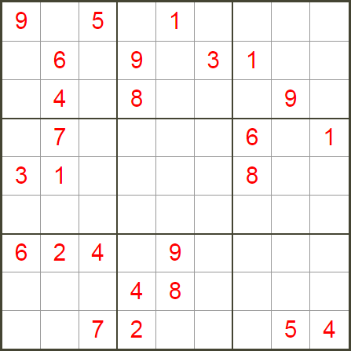

# Crypto

## 密文解码

- 如果看起来像 base，可能是多层嵌套 base，用其他软件解可能都会报错，这时选择 basetrack 自动接码。
- 如果遇到一串十进制编码，一般可以先转为十六进制，再十六进制可以转为字符串还是图片
- 如果遇到不认识的密码，长得像 base64 又不是 base 系列，可以考虑 [Rabbit](#Rabbit)

### ciphey
> 先尝试 ciphey -t "Encrypted input"

另外，如果能看出密钥，这种可能使用 AES 算法

### 进制转换

#### 十进制转其他

如需转回十进制，用 int(text)

##### 十进制转十六进制

```python
hex(3207357)
```

##### 十进制转二进制

```python
bin(3207357)
```

##### 十进制转八进制

```python
oct(3207357)
```

### base 格式

> 看到很长一串，可能是图片的 base64
>
> 有一些多层嵌套的 base 编码，TomatoTools 识别不了，但是可以用 basetrack 识别

**basetrack**

**普通解码**
```bash
python3 basecrack.py -b 编码文本
```

**自动解码**

```bash
python basecrack.py --magic -b 编码文本
```

**base64 转图片**

```bash
https://tool.jisuapi.com/base642pic.html
```

### Hash 碰撞

- MD5算法生成的哈希值通常以16进制的形式表示。这是因为MD5算法生成的原始结果是一个128位的二进制数，这个数包含的信息量非常大，如果直接以二进制或者十进制的形式表示，将会非常长。因此，通常会将这个二进制数转换为16进制来表示，这样可以大大减少表示的长度。一个128位的二进制数可以转换为一个32位的16进制数，这就是我们通常看到的MD5哈希值的形式。
- 有一些 hash 碰撞题目给的条件很多，实际并不难。按题目给的条件编写碰撞代码，简单地遍历数字即可得到结果

#### 通用碰撞模版

```python
import hashlib


def main():
    for i in range(100000):
        token = hashlib.md5(str(i).encode()).hexdigest()
        # 筛选符合碰撞规则的 md5 值
        if token[-6:] == '8b184b':
            print(i)
            print(token)
            break


if __name__ == '__main__':
    main()
```

#### 普通碰撞套路示例

有一些 hash 碰撞题目给的条件很多，实际并不难。按题目给的条件编写碰撞代码，简单地遍历数字即可得到结果，例如：

```python
import hashlib


# if 语句的内容是例题给出的特殊条件
def main():
    for i in range(100000):
        token = hashlib.md5(str(i).encode()).hexdigest()
        if token[1] == token[14] and token[14] == token[17]:
            if (int(token[1], 16) + int(token[14], 16) + int(token[17], 16)) / int(token[1], 16) == int(token[31], 16):
                print(i)
                break


if __name__ == '__main__':
    main()
```


#### 带前缀的 MD5 碰撞

运行以下脚本，解得后缀

```python
import hashlib # 建立爆破的字典data 


def main():
    prefix = 'ctfshow' # 自定义前缀
    
    data='abcdefghijklmnopqrstuvwxyzABCDEFGHIJKLMNOPQRSTUVWXYZ1234567890+-*/' # 从一个字符开始尝试，逐渐往下加 
    for i in data: 
        for j in data : 
            for k in data: 
                s = hashlib.md5((prefix+i+j+k).encode()).hexdigest() 
                if s == 'a6f57ae38a22448c2f07f3f95f49c84e':#判断值是否符合条件 
                    print(i + j + k) # 输出字符c的值 脚本输出36d 构造payload: ?c=36d 


if __name__ == '__main__':
    main()
```

### RSA

p=447685307 q=2037 e=17

提交flag{d}即可

```python
import libnum
p = 447685307
q = 2037
e = 17
 
print(libnum.invmod(e,(p - 1)*(q - 1)))
```

p=447685307 q=2037 e=17 c=704796792

提交flag{m}

```python
import libnum


p = 447685307
q = 2037
e = 17
c = 704796792
m = (libnum.invmod(e,(p - 1)*(q - 1)))
result = pow(c,m,p*q)
print(result)
```


### TomatoTools 来识别编码

备用工具: CTF-Tools

#### 问题
- 软件的 base58、base91 有问题。[base91](https://www.dcode.fr/base-91-encoding)
- Brainfuck 有问题

### CTF-Tools 识别编码

可以批量尝试不同的解密方式

### 肉眼识别密文类型

#### 摩斯电码

形如

```
-- --- .-. ... . ..--.- .. ... ..--.- -.-. --- --- .-.. ..--.- -... ..- - ..--.- -... .- -.-. --- -. ..--.- .. ... ..--.- -.-. --- --- .-.. . .-. ..--.- -- -- -.. -.. -- -.. -- -.. -- -- -- -.. -.. -.. /-- -.. -- -.. -.. --/ -- -- -- -- -- /-- -.. -.. -- -.. -- /-- -.. -.. -- 
```

如果工具解不开，直接用 ciphey 解就行了（自动去斜杠）

#### 栅栏密码

形如

```
(不是标准格式) fg2ivyo}l{2s3_o@aw__rcl@

再来一个 KYdf0a3ebd5c4dc160-E{fb63ee0298b8f4d8}
```


#### 培根密码

解密地址 http://www.metools.info/code/bacon193.html

形如 

```
AABBBABBA
```


如果遇到类似培根密码的形式，如 MMDDMDMDMMMDDDMDMDDMMMMMMMDDMDMMDDM ，需要转为 AB 形式，快捷脚本:

```python
data = {
    'M': 'A',
    'D': 'B'
}

text = ''
for i in 'MMDDMDMDMMMDDDMDMDDMMMMMMMDDMDMMDDM':
    text+= data[i]
    
print(text)
```


#### 社会主义核心价值观加密/解密
形如 

```
公正公正公正诚信文明公正民主公正法治法治友善平等和谐敬业和谐富强和谐富强和谐文明和谐平等公正公正和谐法治公正公正公正文明和谐民主和谐敬业和谐平等和谐敬业和谐敬业和谐和谐和谐公正法治友善法治
```


#### ook

遇到类似的，可能把 Ook 替换为了其他字母，要能反应过来是 ook 密码

形如

```
Ook. Ook. Ook. Ook. Ook. Ook. Ook. Ook. Ook. Ook. Ook.
```

解密地址 https://www.splitbrain.org/services/ook

#### 猪圈密码

形如下图


解密地址 http://www.metools.info/code/c90.html

#### Baudot Code

形如

```
11001 00011 00111 01001 11011  10110 11111  10000 01110 11011  10110 11111  01001 00001
```

解密地址 https://www.boxentriq.com/code-breaking/baudot-code

#### html 的编码样子
形如

```
&#x66;&#x6c;&#x61;
```

#### jsfuck

形如

```
[][(![]+[])[+[]]+([![]]+[][[]])[+!+[]+[+[]]]+(![]+[])[!+[]+!+[]]+(![]+[])[!+[]+!+[]]][([][(![]+[])[+[]]+([![]]+[][[]])[+!+[]+[+[]]]+(![]+[])[!+[]+!+[]]+(![]+[])[!+[]+!+[]]]+[])[!+[]+!+[]+!+[]]+(!![]+[][(![]+[])[+[]]+([![]]+[][[]])[+!+[]+[+[]]]+(![]+[])[!+[]+!+[]]+(![]+[])[!+[]+!+[]]])[+!+[]+[+[]]]+([][[]]+[])[+!+[]]+(![]+[])[!+[]+!+[]+!+[]]+(!![]+[])[+[]]+(!![]+[])[+!+[]]+([][[]]+[])[+[]]+([][(![]+[])[+[]]+([![]]+[][[]])[+!+[]+[+[]]]+(![]+[])[!+[]+!+[]]+(![]+[])[!+[]+!+[]]]+[])[!+[]+!+[]+!+[]]+(!![]+[])[+[]]+(!![]+[][(![]+[])[+[]]+([![]]+[][[]])[+!+)])
```

```
ﾟωﾟﾉ= /｀ｍ´）ﾉ ~┻━┻   //*´∇｀*/ ['_']; o=(ﾟｰﾟ)  =_=3; c=(ﾟΘﾟ) =(ﾟｰﾟ)-(ﾟｰﾟ); (ﾟДﾟ) =(ﾟΘﾟ)= (o^_^o)/ (o^_^o);(ﾟДﾟ)={ﾟΘﾟ: '_' ,ﾟωﾟﾉ : ((ﾟωﾟﾉ==3) +'_') [ﾟΘﾟ] ,ﾟｰﾟﾉ :(ﾟωﾟﾉ+ '_')[o^_^o -(ﾟΘﾟ)] ,ﾟДﾟﾉ:((ﾟｰﾟ==3) +'_')[ﾟｰﾟ] }; (ﾟДﾟ) [ﾟΘﾟ] =((ﾟωﾟﾉ==3) +'_') [c^_^o];(ﾟДﾟ) ['c'] = ((ﾟДﾟ)+'_') [ (ﾟｰﾟ)+(ﾟｰﾟ)-(ﾟΘﾟ) ];(ﾟДﾟ) ['o'] = ((ﾟДﾟ)+'_') [ﾟΘﾟ];(ﾟoﾟ)=(ﾟДﾟ) ['c']+(ﾟДﾟ) ['o']+(ﾟｰﾟ)+ ((o^_^o) +(o^_^o))+ (ﾟДﾟ)[ﾟεﾟ]+(ﾟΘﾟ)+ (ﾟｰﾟ)+ (ﾟΘﾟ)+ (ﾟДﾟ)[ﾟεﾟ]+(ﾟΘﾟ)+ (o^_^o)+ ((ﾟｰﾟ) + (o^_^o))+ (ﾟДﾟ)[ﾟεﾟ]+(ﾟΘﾟ)+ ((ﾟｰﾟ) + (ﾟΘﾟ))+ (c^_^o)+ (ﾟДﾟ)[ﾟεﾟ]+(ﾟΘﾟ)+ (ﾟｰﾟ)+ (ﾟΘﾟ)+ (ﾟДﾟ)[ﾟεﾟ]+(ﾟΘﾟ)+ ((ﾟｰﾟ) + (ﾟΘﾟ))+ ((ﾟｰﾟ) + (o^_^o))+ (ﾟДﾟ)[ﾟεﾟ]+(ﾟΘﾟ)+ ((ﾟｰﾟ) + (o^_^o))+ ((ﾟｰﾟ) + (ﾟΘﾟ))+ (ﾟДﾟ)[ﾟεﾟ]+(ﾟｰﾟ)+ ((o^_^o) - (ﾟΘﾟ))+ (ﾟДﾟ)[ﾟεﾟ]+((ﾟｰﾟ) + (ﾟΘﾟ))+ (ﾟΘﾟ)+ (ﾟДﾟ)[ﾟεﾟ]+((ﾟｰﾟ) + (o^_^o))+ (o^_^o)+ (ﾟДﾟ)[ﾟoﾟ]) (ﾟΘﾟ)) ('_');
```

复制到 F12 ，在控制台执行即可得到明文

#### **Rabbit**

形如 

```
U2FsdGVkX19mGsGlfI3nciNVpWZZRqZO2PYjJ1ZQuRqoiknyHSWeQv8ol0uRZP94
MqeD2xz+
```

```
U2FsdGVkX1/eK2855m8HM4cTq8Fquqtm6QDbcUu4F1yQpA==
```

需要一个密钥，在线解密地址: https://www.sojson.com/encrypt_rabbit.html

#### 音乐符号密文

形如

```
♭‖♭‖‖♯♭♭♬‖♩♫‖♬∮♭♭¶♭‖♯‖¶♭♭‖∮‖‖♭‖§♭‖♬♪♭♯§‖‖♯‖‖♬‖‖♪‖‖♪‖¶§‖‖♬♭♯‖♭♯♪‖‖∮‖♬§♭‖‖‖♩♪‖‖♬♭♭♬‖♩♪‖♩¶‖♩♪‖♩♬‖¶§‖‖♩‖¶♫♭♭♩‖♬♯‖♬§♭‖♭‖♩¶‖‖∮♭♭♬‖‖♭‖♫§‖¶♫‖♩∮♭♭§‖♭§‖♭§§=
```

在线解密地址: https://www.qqxiuzi.cn/bianma/wenbenjiami.php?s=yinyue

#### 数独密码

如下图



在线解密地址: https://shudu.gwalker.cn/

解得结果后，所有数字连接起来就是密码

## 密码学及文本处理工具

### 编码任何类型的数据
> 任何类型的文件都可能被编码，可尝试用 stegpy 解编码

#### stegpy
普通提取
```bash
stegpy _image.png
```
带密码提取
```bash
stegpy _image.png -p 密码
```

### Hash 类密文在线解密
https://www.cmd5.com/

上面的地址有时候要收费，下面这个是免费的

https://www.somd5.com/

### 密码字典生成

#### crunch
> 生成该数字开头的所有手机号
```bash
crunch 11 11 -t 1391040%%%% -o 1.txt
```

#### 大小写转换
https://www.iamwawa.cn/daxiaoxie.html
