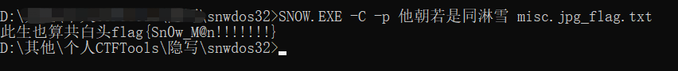
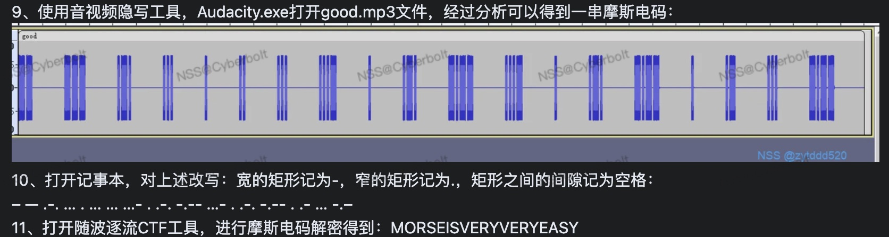

# Misc

- 脑洞：

- - 不排除 Misc 的 flag 是中文的情况，比如图片中隐藏了几个模糊的汉字。（有时候缩小了看得更清楚？）

  - 解到离 flag 最近的一步，{} 中是大写数字，把大写数字转为正规数字即可得到 flag

  - 有一道题，得到一串很乱的文本，按字频统计排序后即可得到 flag

  - 遇到过一道找两张图片不同的题，结果就是找 hex 的 text 部分，把两串明显像 flag 的特殊字符连起来解密处理

  - 看到两张图片，联想到图片盲水印提取

  - 遇到过一种打不开的 png，观察发现，图片中的 16 进制的每个字节 (16 进制的2位) 和 标准 png 的每个字节相加为一个定值 (题目中是 0x100)，所以通过下面的代码很容易求得原图片

  - ```python
    f1 = open("./1.png","rb")
    f2 = open("./2.png","wb")
    all_data = f1.read()
    lt = []
    for i in all_data:
        if i == 0:
            lt.append(i)
        else:
            lt.append(0x100 - i)
    f2.write(bytes(lt))
    f1.close()
    f2.close()
    ```

- macOS 的坑：

- - 遇到过一次解压输入密码后解压不了，这时换一个解压软件即可
  - 使用 hex friend 复制出来的文本格式有时候有问题（Mac 上肉眼看不见，用剪切板或粘贴在终端即可发现），这时 OCR 一次。

## 图片类型

- 除了通过工具和方法分析图片外，也要具备最基本的观察能力，说不定信息就在图中
- 看到图片（无论是图片文件还是 **PDF** 中的图片），要联想到图片中可能隐藏了不可见的文字，按住 command + a 或鼠标选中即可复制（word 文件中也可能有隐藏文字）
- bitmap 格式的文件后缀是 bmp，TIFF 格式的后缀是 tif (这些类图片格式可以考虑直接改成 jpg 打开)
- png 图片可以先用 `pngcheck 1.png` 检查一下图片有没问题，打不开的图片也可能是宽高被修改了。png 还可以考虑 lsb 一键工具
- PS 中可以点击上方菜单栏的 窗口—信息 查看每个像素点的坐标
- 图片不一定只是图片，完全可以当成文件来做，例如用 strings 输出该文件的信息，可能有隐藏提示
- 题目得到两张很像的图片，可以考虑盲水印

### 二维码、条码识别
https://online-barcode-reader.inliteresearch.com/

有时候扫了二维码不一定能拿到 flag，遇到一道题，将 flag 藏在了 URL 的路径处，解开 base64 即可拿到 flag

### 查看 hex 中有无线索
html 的编码样子

类似 &#x66;&#x6c;&#x61;

使用 hex friend 复制出来的文本格式有时候有问题（Mac 上肉眼看不见，用剪切板或粘贴在终端即可发现），OCR 一次。

### 图片属性里有可能藏有东西

> macOS 像 Windows 一样查看图片的备注
```bash
exiftool -verbose 1.jpg
# 其中输出内容的 XPComment 就是图片备注
```

### 破解正确宽高

- 这个脚本是 png 的做法。jpg 直接用 010 editor 改高就行了，bmp 同理（bmp 的高度不能拉得太高，因为这个格式没有算法压缩来自动处理）
- 010 如果显示 CRC 报错，多半都是这个问题，破解宽高即可

有时候因为图片宽高被修改了导致显示不全

```python
import binascii
import struct
import sys

file = input("图片的地址")
fr = open(file,'rb').read()
data = bytearray(fr[0x0c:0x1d])
crc32key = eval('0x'+str(binascii.b2a_hex(fr[0x1d:0x21]))[2:-1])
#原来的代码: crc32key = eval(str(fr[29:33]).replace('\\x','').replace("b'",'0x').replace("'",''))
n = 4095
for w in range(n):
    width = bytearray(struct.pack('>i', w))
    for h in range(n):
        height = bytearray(struct.pack('>i', h))
        for x in range(4):
            data[x+4] = width[x]
            data[x+8] = height[x]
        crc32result = binascii.crc32(data) & 0xffffffff
        if crc32result == crc32key:
            print(width,height)
            newpic = bytearray(fr)
            for x in range(4):
                newpic[x+16] = width[x]
                newpic[x+20] = height[x]
            fw = open(file+'.png','wb')
            fw.write(newpic)
            fw.close
            sys.exit()
```

### 图片取征 Stegsolve

#### LSB
##### 方法一

在 Stegsolve-Analyse-Data Extract 勾上右下角3个0 (有时候需要切换右边的 Row 和 column 选项，也有可能要改其他选项，不要太死板)，点 preview

##### 另一种图片隐写解法 zsteg (png, bpm)

- 主要用来检测 png 和 bpm
- 该方法是 LSB 解密最简单的一种解法

```bash
zsteg -a file
```

##### 加密 LSB 隐写解密

- 需要知道密钥

工具：https://github.com/livz/cloacked-pixel

cloacked-pixel 项目的使用:

```bash
python2 lsb.py hide ori.png flag.txt 123456
```

```bash
python2 lsb.py extract ori.png-stego.png aaa.txt 123456
```

#### 可能是图片宽高被修改了
- 1.可以在 Stegsolve-Analyse-File format 最上面查看图片的原始宽高
- 2.使用自动破解宽高的程序恢复(Python 脚本)

#### 合并多张图
如果有多张图，可以用 Stegsolve 合并(Image Combiner)

### 图片盲水印提取

在 ctf 容器中，进入 /programme/CTF/工具/Misc/BlindWaterMark ，运行

```bash
python3.6 bwmforpy3.py decode 1.png 2.png 3.png
```

1.png 是原图，2.png 是加了水印的图片 (如果不知道 1.png 和 2.png 的顺序，可以尝试互换顺序)，得到 3.png 是去除水印的图片

### jphs

有的图片(如部分 jpg)需要用 Jphswin 打开并输出为 txt 文件。Mac 使用的 win 11 虚拟机，文件在 `/Users/Cyberbolt/Library/CloudStorage/OneDrive-个人/编程/CTF/工具/Misc/Windows工具/Jphswin.exe`

使用方法，选择图片，点 Seek，然后空密码，输出为 txt (其实不一定是 txt，根据具体情况，把后缀改了)

### gif

#### 横向拼接
> 如果有很多图(gif)，可能是横向拼接起来的

图片拼接地址 http://www.atoolbox.net/Tool.php?Id=978

注意：有可能是按修改日期排序后拼接


#### 逐帧解析
注意: macOS 自带的逐帧解析可能有问题

- 1、使用stegsolve打开图片 
- 2、analyse-》frame browser，一帧一帧看
  
#### 逐帧查看（分割 gif）
```bash
convert cake.gif cake.png
```

#### 自动提取 gif 中藏的二维码

```python
import imageio
from PIL import Image
from pyzbar.pyzbar import decode


def main():
    # 读取 GIF 图像
    path = input('请输入 gif 的路径:')
    gif = imageio.mimread(path, memtest="512MB")

    # 遍历 GIF 中的每一帧
    for i, frame in enumerate(gif):
        # 将帧转换为 PIL 图像
        pil_image = Image.fromarray(frame)
        
        # 尝试解码二维码
        decoded_objects = decode(pil_image)
        
        # 如果在帧中找到二维码，打印其内容并停止
        for obj in decoded_objects:
            print(f"在帧 {i} 中找到二维码，内容为：{obj.data.decode('utf-8')}")


if __name__ == '__main__':
    main()
```

#### 合并 gif

```bash
convert -delay 3 *.png output.gif 
# 上述命令可以将当前目录下的所有 *.png 文件合成并生成 output.gif 文件。其中在 output.gif 文件中，每帧的间隔时间可以通过 -delay 参数来设置。
```

#### 百度识图人物或其他

百度识图就算人物脸部不全，也可以识别试试

## 文件
- 不要相信任何后缀类型。遇到一道题，虽然后缀是 zip，但实际是 word，应该改为 docx 格式，所以 zip 后缀也不能相信。
- 任何奇怪的文件都可以尝试用 binwalk 分离一下

- efi 是 Unix 的可执行文件

- evt 是 Windows 的日志文件（好像需要 win 7 ?）

- 文件名可能是一个隐藏提示。（如 91 可能是 base91）
- 如果一个目录下有繁多文件（尤其是项目源码），可以直接用 D 盾扫后门（macOS 用 wine 打开 D 盾）

### 查看文件类型
用 file 命令识别下是什么文件 (不能完全相信 file)
```bash
file 文件名
```

有时候图片的 hex 被修改了，file 命令显示不准确，需要手动改文件头部的 hex 为正确 hex。格式如下

| 格式类型 | 文件头标识                            | 文件尾标识                          |
| -------- | ------------------------------------- | ----------------------------------- |
| jpeg/jpg | FFD8                                  | FFD9                                |
| gif      | 47 49 46 38 39(37) 61(G I F 8 9(7) a) |                                     |
| png      | 89 50 4E 47 0D 0A 1A 0A               | 00 00 00 00 49 45 4E 44 AE 42 60 82 |
| bmp      | 42 4D (B M)                           |                                     |
| tiff     | 4D 4D 00 2A / 49 49 2A 00             |                                     |

| **文件类型**  | **文件标识**         |
| ------------- | -------------------- |
| zip/docx/xlsx | 50 4B 03 04          |
| RAR           | 52 61 72 21          |
| doc/xls       | D0 CF 11 E0          |
| pdf           | 25 50 44 46 2D 31 2E |

### Hex

- 右键查看 Hex，优先使用 010 Editor（直观性更强，能更快发现 flag）
- 有时 flag 不一定在显眼的位置（但位置一定不偏僻，如最前面一段或最后面一段），看仔细一点【更简单的方法是直接用 [strings](###用 strings 匹配) 匹配】
- 可以用 [strings](###用 strings 匹配) 匹配一定程度替代人工查看 hex

遇到过一道题，flag 藏在 Hex 中，构成图形，如下:


### txt

txt 文件有可能可以下滑，信息藏在最下面

### word
如果是 word 文件可能有隐藏文字。按 command + a 选中查看（图片或 PDF 中的图片也可能有隐藏文字）

### 一个文件夹下一堆文件
用 VS Code 全局搜索关键词

### 用 strings 匹配
匹配二进制文件的 flag
```bash
strings webshell.pcapng | grep -E '.{1,10}\{.{1,50}\}.*'
# webshell.pcapng 为二进制文件
```

### 文件内部映像提取

#### binwalk
- 如果 binwalk 查到了内部映象却分离不了，应该尝试 foremost
- 如果 binwalk 可以分离内部映象，但是分离出的文件有问题，也可以尝试 foremost

**查照内部映像**
```bash
binwalk firmware.bin
```
注意:图片中有可能隐藏另一张图片

**文件自动提取**

```bash
binwalk -e firmware.bin
```

#### foremost

> 有时候用 binwalk 提取不了时，​可以用 foremost 提取。

**文件递归提取**
```bash
foremost -T ccc.pcap
```

### pcapng 格式

- Wireshark 过滤器筛选后，如果又想返回查询全部流量，需要删除搜索内容后点击重新搜索 (Wireshark 并不会自动显示全部流量)

#### http 类型
- 可以全局搜索文件后缀，右键追踪 http 流。搜索 http 流后，可以按 command + f 搜索全文关键词
- `http contains "关键词"` 这个命令可以筛选关键词。单独的数据包中无法筛选关键词，只能复制出来筛选
- 筛选方法
  - ip.addr == 192.168.1.1
  - http.request.method == "post"
  - http && ip.dst == 192.168.1.1 (按照 http 协议且 ip 目的地址为 192.168.1.1 进行组合过滤显示)

- 可以直接解码 JWT 查看用户名等信息，JWT 解码工具: https://www.box3.cn/tools/jwt.html
- webshell (PHP) 的执行路径通常是 `/var/www/html/` 的相对路径
- 看到 `FFD8` 开头应该联想到 jpg 图片

##### 注入类

可以通过观察 HTTP 包的长度判断哪些是注入成功的，拼接收到的 ascii 码即可

操作方法: 先筛选出 http (搜索 http 即可)，再按 http 导出，导出界面选择按 size 排序可能会看到连续的 flag

**SQL 盲注简单原理**

例如（下面的流量按时间顺序排序）

```python
LIMIT 0, 1),1,1) )>64 AND

LIMIT 0, 1),1,1))>96 AND

LIMIT 0, 1),1, 1) )>112 AND

LIMIT 0,1),1,1) )>104 AND

LIMIT 0, 1),1, 1) )>100 AND

LIMIT 0, 1),1,1))>102 AND

LIMIT 0, 1),1,1))>101 AND

LIMIT 0,1),2,1))>96 AND

LIMIT 0,1),2,1))>112 AND

LIMIT 0,1),2,1))>104 AND

LIMIT 0,1),2,1))>108 AND

LIMIT 0,1),2,1) )>106 AND

LIMIT 0, 1),2,1))>107 AND

LIMIT 0, 1),3,1))>96 AND

LIMIT 0, 1),3,1))>112 AND

LIMIT 0,1),3,1))>104 AND

LIMIt 0,1),3,1))>100 AND

LIMIt 0,1),3,1))>98 AND

LIMIT 0, 1),3, 1))>97 AND
```

数字的第3列代表猜的字段位数，`>`后面的数字是 Ascii 码。数字的第3列相同时，取最后一个 Ascii 码(如果后面有状态码，需要保证这一行的状态码是200而不是404)。将取得的 Ascci 码拼接好即是完整的字段。（可以用字典来拼接。一般依次猜数据库名、表名、列名等）

#### Wireshark 常用命令

Wireshark 是一款非常强大的网络协议分析工具，可以用来捕获和分析网络流量。它能够解析各种类型的网络协议，包括 HTTP。在分析 HTTP 流量时，你可以使用以下的一些过滤器和功能：

1. **HTTP 过滤器**：在过滤器栏中输入 "http"，然后按 Enter 键，Wireshark 将只显示 HTTP 流量。

2. **特定主机的 HTTP 过滤器**：如果你只想看到来自特定主机的 HTTP 流量，你可以使用过滤器 "http.host == yourhostname.com"，其中 "yourhostname.com" 是你想要过滤的主机名。

3. **特定方法的 HTTP 过滤器**：如果你只想看到特定 HTTP 方法（例如 GET 或 POST）的流量，你可以使用过滤器 "http.request.method == METHOD"，其中 "METHOD" 是你想要过滤的方法，例如 "GET" 或 "POST"。

4. **特定状态码的 HTTP 过滤器**：如果你只想看到特定 HTTP 状态码的流量，你可以使用过滤器 "http.response.code == CODE"，其中 "CODE" 是你想要过滤的状态码，例如 "200" 或 "404"。

5. **追踪 TCP 会话**：在 HTTP 请求上右键点击，然后选择 "Follow" > "TCP Stream"，Wireshark 将显示整个 TCP 会话的内容，这可以帮助你更好地理解 HTTP 请求和响应。

6. **查看 HTTP 详细信息**：在 HTTP 请求或响应上双击，Wireshark 将打开一个新窗口，显示该请求或响应的详细信息，包括头部、载荷等。

以上是一些基本的 Wireshark 命令和功能。请注意，Wireshark 是一个非常强大的工具，可以进行更复杂的分析和过滤。

### 键盘输入(USB)

**KBE**

```bash
python KBE.py
```

### cap 格式

可以根据此类型的文件破解 wifi 密码

使用 aircrack-ng，已经下载到了 Docker ctf 中

### aircrack-ng

根据 1.txt 密码表破解 wifi 密码，如
```bash
aircrack-ng -w 1.txt wifi.cap
```

补充：生成密码表，该数字开头的所有手机号
```bash
crunch 11 11 -t 1391040%%%% -o 1.txt
```

### 压缩文件

- 有的压缩文件只有内部的一个文件加密，可以手动试下其他文件能不能直接解压。
- 优先使用 unzip 命令解压，unzip 会自动解压上面提到的未加密文件。(但是遇到过编码不支持 unzip 的情况，所以不能只局限于 unzip)
- 如果 macOS 打不开压缩文件，尝试使用 Windows 虚拟机
- 优先使用 `360 压缩` 来解压 rar 文件（因为不同的压缩软件解压出的结果可能不同）
- 直接用 binwalk 可以分离一个压缩包里未加密的文件
- 有时候一个文件解压出来有多个文件，不要眼花，切勿忽略每个文件

#### zip爆破

##### 破解伪加密
```bash
java -jar ZipCenOp.jar r  压缩包名
# (macOS jdk 17 上报错不用管，运行后用 unzip 解压即可，macOS 的解压软件有坑【最新测试全能解压不错】)
```

##### 暴力破解 

###### zipCrack

- 建议用 fcrackzip 替代

优先使用下一个工具 fcrackzip

```bash
git clone https://github.com/luckman666/zipCrack.git
cd zipCrack
python zipcrack.py -f  file.zip -d password.txt
# 注意:已经在 M1 Mac 的 /Users/Cyberbolt/Library/CloudStorage/OneDrive-个人/编程/CTF/工具/Misc/压缩包破解/zipCrack 处做了备份
```

###### fcrackzip

- 如果密码正确但破解过程失败了，可能是因为压缩包在之前的使用中损坏了

```bash
fcrackzip  -b -c 'aA1' -l 1-10 -u 文件名
```
```
-b 使用暴力算法
-D 使用字典破解
-B 查看当前机器破解速度
-v 显示更多信息
-p 使用字符串作为初始密码
-l 设置密码长度（1-10）
-u 不打印错误密码

-c指定字符集，字符集格式只能为 -c 'aA1!:' 
a 表示小写字母[a-z]
A 表示大写字母[A-Z]
1 表示阿拉伯数字[0-9]
! 感叹号表示任意特殊字符[!:$%&/()=?{[]}+*~#]
: 表示包含冒号之后的字符（不能为二进制的空字符），例如  a1:$%  表示 字符集包含小写字母、数字、$字符和%百分号

192837465  --->         [1]
a123  --->              [a1]
A123  --->              [A1]
Q123we  --->            [aA1]
Q123we!?  --->          [aA1:!?]
Qwe!?123  --->          [aA1:!?]
Qwe$%^&*(123  --->      [aA1!]
```
破解3位纯数字
```bash
fcrackzip -b -c 1 -l 3 -v file.zip
```

还可以指定密码字典来破解

1.先生成密码字典

- (1) 生成某个数值范围的密码字典

  ```python
  def main():
      text = ''
      for i in range(19900000, 20000000):
          text += str(i) + '\n'
          
      with open('passwords.txt', 'w') as f:
          f.write(text)
  
  
  if __name__ == '__main__':
      main()
  ```

  

- (2) 指定密码位数生成字典

  ```python
  def main():
      num = 9 # 一共多少位数
      prefix = '372' # 前缀(前缀后面的部分则覆盖 num 位数的所有数值)
      
      text = ''
      for i in range(0, 10 ** (num - (len(prefix)) + 1) ):
          i = str(i)
          left = '0' * (num - (len(prefix)) - len(i))
          text += prefix + left + i + '\n'
      
      with open('passwords.txt', 'w') as f:
          f.write(text)
  
  
  if __name__ == '__main__':
      main()
  ```

  

2.指定用这个字典破解

```
fcrackzip -v -D -p passwords.txt -u flag.zip
```

### SNOW 隐写

有一个 SNOW 隐写工具，貌似只能在 Windows 上用 https://darkside.com.au/snow/

用法：

 

图中 -p 这里这段中文是密钥，接着那个文件是需要解密的文件

### .dat 文件

开源的微信 Dat 文件(.dat)解码器 http://github.com/PiaoZhenJia/WeChatDatFileDecoder

### GPS 数据流

先将 txt 转为 kml 格式 https://www.gpsvisualizer.com/map_input

再用 VS Code 打开 kml 文件，使用 Geo Data Viewer 插件可以绘制地图轨迹

### 音频文件

- 可以用 Audacity 打开分析
- 将 Audacity 的音轨放大后，可能会混杂摩斯密码

例题（仔细看转码规则！）



```
点（·）：表示一个短脉冲信号，持续时间较短。	# 对应短波
划（-）：表示一个长脉冲信号，持续时间较长。	# 对应长波
间隔：用于分隔各个字母和单词之间的信号。		 # 对应空白一条横篮线
```

`-…/…-/…–/----./-…/…–/./----./…—/-…/-----/.----/…—/.-/.-/-…` 这种编码（另一种编码）就是将 `空格` 变为了 `/`

## 文本

### 大小写隐写

遇到过一道题，一串文本里基本是小写字母，此时提取大写字母组合起来就是 flag 。示例代码

```python
def main():
    text = 'i was always Fond of visiting new scenes'
    flag = ''
    for i in text:
        if i.isupper():
            # 小写字母是 i.islower()
            flag += i
    print(flag)
    

if __name__ == '__main__':
    main()
```

### Zero-Width 隐写 (0宽隐写)

示例内容如：

```
dd师父父鸭❤️，想找一个男师父来宠我辽 ٩(๑‌‌‌‌‍‬‌•ㅂ•)۶。要求如下鸭🌸，国赛三等奖及以上吖（重点，画圈圈），给窝包flag和jio‌‌‌‌‍‍‌本辣种（开心❤️(≧▽≦‌‌‌‌‍‬‍‬)。
不要有战队的那种师父父o╰(‌‌‌‌‍‌*´︶`*)╯，因为有战队的话窝怕你队友会生我的气鸭💦（点点头qaq‌‌‌‌‍‬‬‌）
如果实在不行有战队的师父父窝也不介意的辣QVQ🌸！你就把你队友当成玩玩的就行叭✨，你每天陪窝更多就行啦‌‌‌‌‍‬~ ‌‌‌‌‍‍（害羞羞地扯了扯你的衣服袖子 (*๓´╰╯`๓)
另外另外🎉！窝占有欲非常强o💦（叉腰并且理直气壮！）所以希望你只有我一个可耐耐的徒徒辣（开心地看着你 (*‌‌‌‌‍‬≧▽≦) 所以你不能有别的徒徒鸭⭐‌‌‌‌‍‌，要不然我会炒鸡炒鸡桑心的o‌‌‌‌‍‍‌‌呜呜呜（突然委屈巴巴地看着你）
当然辽（突然开心地笑✨），你也不能散养窝鸭(๑•ູ॒॒̀‌‌‌‌‍‍•̀‌‌‌‌‍‬‬‍ູ॒॒•ູ॒॒̀•ູ॒॒̀•́๑)，所以窝希望你最好每天都替窝做题~窝一直在旁边打游戏辣种叭❤️ (/^▽^)/
⭕对辽‌‌‌‌‍‌，还有鸭！（开心地举手手٩(ˊᗜˋ*)و，窝炒鸡喜欢高强度帅哥❤️，所以嘛你必须是最牛的呀🌈，永远不会变菜菜的辣种（对你点点头⸜₍๑•‌‌‌‌‍‍⌔•๑₎
当然啦!希望师父父三次元阔以是一个190+的寸头大帅锅啦‌‌‌‌‍‬‍‬✨! 最好还有富有磁性声线温软温润如玉温和冷冷的清冷的嗓音❤️ (一双圆溜溜的大眼睛调皮地眨了两下小鼻子不自觉地皱了皱卷曲的海藻般的长发披散着将娇小的身躯衬得更加柔弱甜甜的小奶音吐出小粉拳也不自觉地捏紧了睡裙的蕾丝花边开心地看着你)
希望师父父和窝不涉三次元以及谈恋爱o‌‌‌‌‍‬💦（羞涩地看着你），因为窝俩的关系只是师父父和徒徒嘛💖。但是可以...鸭（脸红害羞）‌‌‌‌‍‌‬
‌‌‌‌‍‍人家...人家还会骂师父父是大坏蛋的o🌈‌‌‌‌‍‌（脸红哭泣），但是师父父不能凶人家！，只能喊窝宝宝‌‌‌‌‍‍‬o（委屈），要不然..‌‌‌‌‍‬‍‍.人...人家不要你辽！💦（‌‌‌‌‍‌‬哼唧唧）
‌‌‌‌‍‍🌈最后最后，‌‌‌‌‍‍‌‌人家会喊你师父父的！（继续脸红哭泣）所以球球来人叭🎉（其实人家想喊你哥哥酱辣‌‌‌‌‍‬，但是人家怕你讨厌人家✨...）ξ‌‌‌‌‍‍( ✿＞◡❛‌‌‌‌‍‬‍‍)
窝敲可爱的辣~‌‌‌‌‍‌‬‌‌‌‌‍‍
```

用工具解开即可，工具地址: http://330k.github.io/misc_tools/unicode_steganography.html

## 工具使用

### 010 Editor

异或: Tools-Hex Operations-Binary Xor ，输入要异或的内容即可，然后点击保存

复制 16 进制字段的内容: command + shift + c

## 经典例题

### NSS [SWPU 2020]找找吧

https://www.ctfer.vip/problem/48

## 理论知识及理解

### 关于编码

**计算机的文件有二进制，那用 010 Editor 查看的 HEX 又是什么？HEX 右边转为的字符串又是什么？HEX 转的字符串和 ASCII 码有什么关系？**

"010 Editor" 是一款二进制文件编辑器和查看器，它可以显示文件的二进制形式。当你在 "010 Editor" 中打开一个文件时，你会看到文件的两个主要表示：HEX（十六进制）和字符（通常是 ASCII 或 Unicode 字符）。

HEX 是一种表示二进制数据的方法。在计算机中，信息存储为二进制数据，即由 0 和 1 组成的数据。然而，对于人来说，直接阅读或理解大量的二进制数据是非常困难的。因此，我们通常会将二进制数据转换为更易于理解的形式。十六进制（HEX）就是这样一种形式。每个十六进制数字对应于 4 个二进制位（也称为一个二进制位组）。例如，二进制的 1010 对应于十六进制的 A。

在 "010 Editor" 的界面上，你会看到两列。左边的列显示的是文件的十六进制表示，而右边的列则尝试将这些数据解释为字符。这些字符通常是 ASCII 或 Unicode 字符，这取决于数据的内容和你的系统设置。

ASCII 是一种字符编码标准，用于表示和处理计算机中的文本。每个 ASCII 字符都对应一个数字，这个数字可以用二进制或十六进制来表示。例如，大写字母 A 的 ASCII 值是 65，这在二进制中是 1000001，而在十六进制中是 41。

所以，当你在 "010 Editor" 的右侧看到一个字符，它其实就是左侧对应的十六进制数据的 ASCII 或 Unicode 解释。例如，如果你在十六进制列中看到 41，那么在字符列中你会看到 A，因为 41 是大写字母 A 的十六进制 ASCII 值。

**ASCII 和 Unicode 有什么区别？utf-8 又是什么？**

ASCII（美国信息交换标准代码）和 Unicode 是两种不同的字符编码标准。

ASCII 是一种基于英语字母的编码系统，它使用 7 位二进制数字来表示 128 个不同的字符，包括英语字母、数字、标点符号以及一些非打印字符（如回车和换行）。例如，大写字母 A 的 ASCII 值是 65，而小写字母 a 的 ASCII 值是 97。

然而，ASCII 不能满足全球所有语言的需求，因为世界上的语言远远超过 128 种。这就是 Unicode 出现的原因。Unicode 是一个尝试为世界上所有的语言字符提供唯一编码的国际标准。它可以容纳超过 110,000 个字符，包括拉丁字母、希腊字母、阿拉伯字母、汉字、象形文字、表情符号等等。

UTF-8 是 Unicode 的一种实现方式（或者说是一种编码方式）。它使用一到四个字节来表示一个字符，这取决于该字符在 Unicode 表中的位置。UTF-8 的优点是它向后兼容 ASCII。也就是说，任何有效的 ASCII 文件也是一个有效的 UTF-8 文件。这使得从 ASCII 到 UTF-8 的过渡变得相对容易。

总的来说，ASCII 和 Unicode 是字符编码标准，它们定义了如何在计算机中表示文本。而 UTF-8 则是一种实现 Unicode 的方法，它定义了如何将 Unicode 字符转换为可以在计算机中存储和传输的字节。
